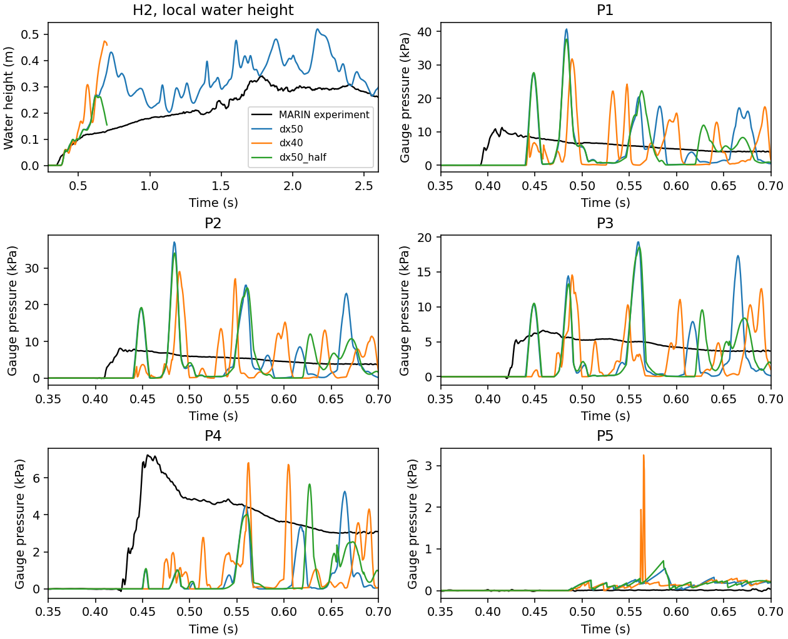

# MARIN 箱体首次冲击的水位、压力与冲量

三档粒距的[固定圆面首冲验证](fixed_disk/README.md)同时保存每个测点的点值、整圆面平均、支撑数和纵向冲量，另有两个人工声速在同一时间步下的比较。

采用 SPHERIC Test 2 v1.1 随附的原始工作簿。三维计算中，水位、局部压力、流体对箱体的作用力以及非穿透约束的冲量共用释放时钟。当前三组工况的载荷精度不足以给出设计峰压。[官方试验包](https://www.spheric-sph.org/tests/test-02) · [论文图 19、20](https://doi.org/10.1016/j.jcp.2004.12.007)

## H2 实验值更正

原工作簿有 7,395 行试验记录，采样间隔约 1 ms。H2 上升穿过 0.02 m 的线性插值时刻为 **0.367397 s**，首个超过阈值的样本在 0.368033 s。在 0.35–2.6 s 内，水位峰值为 **0.3408 m，1.787042 s**。原论文图 19 的蓝实线是 ComFLOW，红虚线是实验。以前的灰度连续性算法在曲线相交处识别错误；按原图 RGB 分色重新提取得到蓝线约 0.370 m，红线约 0.337 m。原先用作实验峰值的 0.370 m 应当撤回。[分色结果及图像指纹](figure19.json)

PR #1148 的 50 mm、运动黏度 0.01 m²/s 箱宽平均水位峰高 0.3683 m。改用原始工作簿重算，峰高误差为 **+8.08%**，峰时晚 **0.279 s**。本轮三组全用试验规定的水黏度 10⁻⁶ m²/s、人工声速 20 m/s。50 mm 工况跑到 2.60 s，箱宽平均水位峰为 0.3296 m（1.659 s），局部 H2 峰为 0.5200 m（2.174 s），后者比实验高 52.6%。局部水位全窗 RMSE 为 0.106 m。两种探头同时记录，短窗工况只比较首次到达和冲击。

| 工况 | 中心线 H2 到达 | P1 峰压 kPa | P2 峰压 kPa | P3 峰压 kPa | P4 峰压 kPa | 箱体纵向冲量 N·s（SPH + 钳制） |
|---|---:|---:|---:|---:|---:|---:|
| 实测 | 0.3674 s | 11.27 | 8.13 | 6.61 | 7.23 | 工作簿无总力通道 |
| 50 mm | 0.3927 s | 40.72 | 37.11 | 19.28 | 5.26 | 59.16 + 9.73 |
| 40 mm | 0.3922 s | 31.79 | 29.05 | 14.57 | 6.81 | 51.68 + 9.86 |
| 50 mm，半时间步 | 0.3929 s | 37.67 | 34.10 | 18.54 | 5.65 | 58.91 + 8.76 |

首次冲击统一取 **0.35–0.70 s**。每个探头从自身压力减去 0–0.20 s 的均值，按实际采样时钟线性插值至窗口端点后积分有符号表压。P1、P2 的实验压力冲量分别为 1,853、1,531 Pa·s，50 mm 算得 1,730、1,480 Pa·s，40 mm 算得 1,431、1,244 Pa·s。50 mm 下两者的冲量与实验接近，但细化后偏差扩大。顶面 P5–P8 此窗实验峰均低于 0.055 kPa，40 mm 计算的 P5 却达到 3.25 kPa。0.5 kPa 只用于识别压力到达事件，工作簿无总力通道可验收总冲量。全部八路的压力、压力冲量和峰值处支持粒子数见[定量结果](comparison.json)。



## 测量口径和计算范围

- 迎水面 P1–P4 在距箱体一侧 0.176 m 的线上，顶面 P5–P8 距另一侧 0.176 m。沿各面从起点量 0.021、0.061、0.101、0.141 m，对应图 7 标注的首段和三段间距。图中末端余量和总长的标注有 1 mm 舍入差。H2 位于 x=2.228 m 的水槽中线。
- H2 局部算子用二维水平核积分各粒子瞬时体积 m/ρ，得到单位面积液量；另一算子用 0.08 m 流向窗口与完整箱宽内的标称粒子体积。两者都受飞溅和空间平均影响。P1–P8 采用所在面的流体一侧做体积加权及静水外推，干点表压为零。核半径为 2.6 倍粒子间距，大于相邻压力测点的 40 mm 间距；当前局部峰值不能反映传感器尺度上的收敛。
- 正 x 为下游，正 y 向上。每一步独立累计箱体所受 SPH 反力乘实际步长、及钳制引起的流体动量变化的反量。后者占两档网格纵向总冲量的 14.1% 和 16.0%。这里不含水槽壁反力。八路压力的单位是 Pa，局部压力冲量为 Pa·s，整箱冲量为 N·s。
- 原协议为 6 秒，建议间距约 18.3 mm。本轮采用较粗间距，并把压力核验限制在首次冲击。后续先解析局部压力峰及顶面提前受载的原因，再进行更细网格和完整时程验证。刚性箱体试验没有板位移；柔性结构的界面做功另用[SPHERIC Test 19](../spheric19/interface_work.json)检验。

## 复现

在仓库根目录运行。比较程序校验原始工作簿 SHA-256；读取工作簿需 xlrd。三档原始求解时序以无损 gzip 保存，CSV 校验值和运行配置见 [runs.json](runs.json)。

```bash
python -m pip install -e '.[test]' xlrd
curl -fL https://9449af45-2363-44f6-8b03-03b6b7c2aee5.usrfiles.com/archives/9449af_6ce73873d6d04315853e481c337dbfca.zip -o /tmp/spheric2.zip
unzip -o /tmp/spheric2.zip test_case_2_exp_data.xls -d /tmp/spheric2
python benchmarks/kleefsman_obstacle_3d/run.py --dx .05 --viscosity 1e-6 --t-end 2.6 --output-every 1 --threads 2 --tag dx50 --out-dir out/marin
python benchmarks/kleefsman_obstacle_3d/run.py --dx .04 --viscosity 1e-6 --t-end .7 --output-every 1 --threads 1 --tag dx40 --out-dir out/marin
python benchmarks/kleefsman_obstacle_3d/run.py --dx .05 --dt .00043875 --viscosity 1e-6 --t-end .7 --output-every 1 --threads 1 --tag dx50_half --out-dir out/marin
python benchmarks/marin_box_loads/compare.py --xls /tmp/spheric2/test_case_2_exp_data.xls --series out/marin/dx50_time_series.csv out/marin/dx40_time_series.csv out/marin/dx50_half_time_series.csv --out out/marin
```
