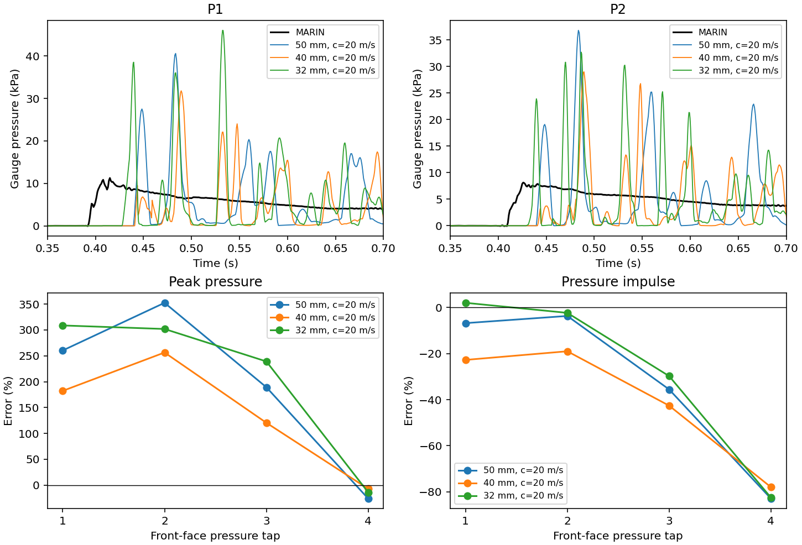

# MARIN 箱面固定面积压力与冲量

三维算例中，水的运动黏度取 10⁻⁶ m²/s。每个输出时刻同时在八个试验测点的圆心、以及同一平面内固定直径 20 mm 的圆盘上重建表压。20 mm 是本研究选定的敏感性口径。公开的测点位置图与工作簿未给出可核实的实验膜片直径。圆面面积为 314.16 mm²；40 mm 的相邻测点间距保持不变。[SPHERIC Test 2](https://www.spheric-sph.org/tests/test-02) · [MARIN 试验说明](https://www.math.rug.nl/~veldman/comflow/dambreak.html)

固定窗为 0.35–0.70 s。每条压力时序扣除自身在前 0.20 s 的基线，积分采用原采样时钟，单位为 Pa·s。箱体纵向总冲量按同一窗口的 SPH 壁面反力和防穿透约束两部分累计，单位为 N·s。实测一栏是实验传感器的原始时程。

| 工况 | 粒距 mm | 声速 m/s | 步长 ms | P1 圆心峰压 kPa | P1 面平均峰压 kPa | P1 压力冲量 Pa·s | 运行最大压缩率¹ | 箱体纵向冲量 N·s |
|---|---:|---:|---:|---:|---:|---:|---:|---:|
| 实测 | — | — | — | — | 11.27 | 1853 | — | 无总力通道 |
| disk50 | 50 | 20 | 0.8775 | 40.72 | 40.61 | 1728 | 12.6% | 68.89 |
| disk40 | 40 | 20 | 0.7020 | 31.79 | 31.80 | 1432 | 16.3% | 61.53 |
| disk32 | 32 | 20 | 0.5616 | 46.39 | 46.05 | 1892 | 17.9% | 70.73 |
| dtmatch_c20 | 50 | 20 | 0.4388 | 37.67 | 37.58 | 1638 | 12.7% | 67.67 |
| dtmatch_c40 | 50 | 40 | 0.4388 | 30.08 | 30.09 | 1754 | 6.8% | 65.44 |

¹ 压缩率取启动至 0.70 s 的累计最大值。原有中心点空间插值采用 h=1.3Δx，支撑半径为 2h。面积积分选用圆心权重 1/4、六个等角环点各 1/8，环半径为圆半径的 √(2/3)。在每个积分点先作流体侧体积加权和静水高度修正，干积分点以零表压参与整圆平均。CSV 同时保存圆面各积分点中最小的支持粒子数。

50、40、32 mm 三档 P1 面平均峰压相对误差依次为 **+260.4%、+182.2%、+308.7%**，压力冲量误差为 **-6.8%、-22.7%、+2.1%**。三个粒距均大于圆直径。相同圆面消除了名义测量面积随网格改变的影响；各积分点的压力重建仍依赖 83–130 mm 的核支撑半径。上述数据只能检验该重建量的网格敏感性。匹配时间步的两组只改变人工声速，便于判断峰压和冲量对可压缩性的依赖。

## 网格与声速对照

在粒距 50 → 40 → 32 mm、相同名义 Courant 数下，比较迎流面四个测点相邻网格的变化方向与幅度。

| 测点 | 峰压 kPa | 峰压变化 | 压力冲量 Pa·s | 冲量变化 |
|---|---|---|---|---|
| P1 | 40.61 → 31.80 → 46.05 | 方向反转 | 1728 → 1432 → 1892 | 方向反转 |
| P2 | 36.81 → 28.99 → 32.69 | 方向反转 | 1475 → 1241 → 1496 | 方向反转 |
| P3 | 19.13 → 14.58 → 22.43 | 方向反转 | 839 → 748 → 915 | 方向反转 |
| P4 | 5.33 → 6.70 → 6.21 | 方向反转 | 191 → 246 → 195 | 方向反转 |

匹配步长的 50 mm 对照中，声速从 20 提至 40 m/s，正压缩率由 12.69% 降至 6.76%。同窗内，纵向壁面 SPH 冲量由 58.91 减至 49.42 N·s，防穿透约束冲量由 8.76 增至 16.01 N·s，占两者之和的比例由 12.9% 升到 24.5%。峰压仍显著高于实验，冲量组成也随声速改变。局部压力冲量接近实测不能验证船体总载荷。

各档元数据保留实际运行时的源码散列。50 mm 的三组计算完成后，加严了断点配置匹配检查，并将积分点最小支持数的归约改写为等价的表达式；粒子推进和压力积分公式相同。

网格改变时，初始水柱按整格填充的几何体积 NΔx³ 分别为 0.6600、0.6240、0.6562 m³，试验几何给定值为 0.6754 m³。该量按粒子数量和粒距计算，与压缩流体的瞬时体积定义不同。箱体粒子层的等效宽度分别为 400、400、416 mm，名义宽度为 403 mm，硬约束和测点仍在名义表面上。这两项离散几何误差也随网格变化，当前加密序列不能单独识别压力离散的阶数。

在同一首冲窗内，以压力冲量除以峰压定义等效脉宽。P1 实测为 164.5 ms，三档粒距分别为 42.6、45.0、41.1 ms。最细档冲量接近实验，但脉宽只有实测的约四分之一。



[八路压力与支撑数](grids/metrics.json) · [匹配时间步的声速对照](acoustic/metrics.json) · [声速对比图](acoustic/pressure_footprint.png)

## 复算

在项目根目录安装 TensorSPH、xlrd、Matplotlib，将官方工作簿放到 `/tmp/spheric2/test_case_2_exp_data.xls`。下列第一条命令分别将粒距改为 .05、.04、.032 并使用 tag disk50、disk40、disk32。声速对照在 .05 m 下固定 `--dt .00043875` 并分别使用 `--sound-speed 20` 和 `--sound-speed 40`。为新结果使用独立输出目录，以免覆盖归档。

```sh
python benchmarks/kleefsman_obstacle_3d/run.py --dx .05 --viscosity 1e-6 --pressure-disk-diameter .020 --t-end .70 --output-every 1 --threads 1 --tag disk50 --out-dir out/marin-20mm
python benchmarks/marin_box_loads/footprint.py --xls /tmp/spheric2/test_case_2_exp_data.xls --series benchmarks/marin_box_loads/fixed_disk/disk{50,40,32}_time_series.csv.gz --out out/marin-grids
```
