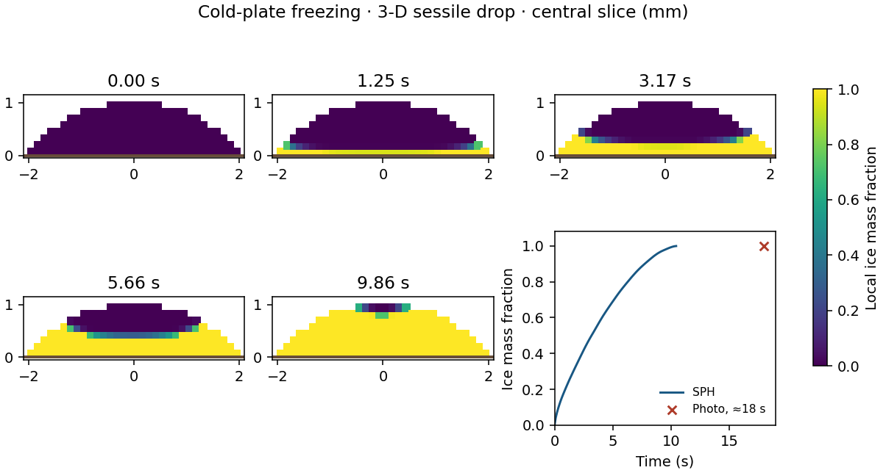

# Freezing of a sessile water drop on cold glass

The simulation starts at prescribed nucleation in a deposited drop. A fixed 3-D cloud carries specific enthalpy. Local temperature and solid fraction follow the fresh-water phase curve with a 0.05 K transition interval. A symmetric SPH conduction operator transfers heat between particle pairs. A second cloud represents heat storage and lateral conduction in the glass. This benchmark compares the time from onset to completion with an independent photographic experiment.

## Experiment and inputs

Enríquez, Marín, Winkels and Snoeijer report a water drop on a cold glass slide, a base radius of approximately 2 mm, a plate temperature of about −20 °C and approximately 18 s for the ice front to reach the top. The initial height used here is 1 mm, estimated from the height-to-base-radius ratio in Fig. 1(a). The experiment also shows expansion and a sharp final tip. The fixed cap in this calculation can predict an ice fraction for each particle, but cannot predict this tip. [Paper and photographs, Fig. 1](https://doi.org/10.1063/1.4747185)

The reference run assumes water at 0 °C at onset, a 1 mm thick, 6 mm wide glass slide initially at −20 °C, perfect interfacial contact and a thermostatted underside. The exposed glass, lateral boundaries and drop surface are insulated. For the glass we assume constant conductivity of 1.2 W/(m K), density of 2230 kg/m³ and specific heat of 830 J/(kg K). These are representative borosilicate properties tabulated at higher temperatures. The slide material, thickness, contact resistance, underside temperature history and initial water temperature are not specified in the paper. No coefficient was fitted to the 18 s observation. [SCHOTT material data](https://www.schott.com/en-us/products/borofloat-p1000314/technical-details)

Sun Pengnan led an SPH project on supercooled drop impact, splashing and icing, and presented drop icing among his multiphase applications. The public project and talk establish the research topic. The thermal discretization here is an independent implementation. The clock begins after deposition and nucleation. Impact, nucleation delay, fluid motion and expansion lie outside this benchmark. [Project record](https://soet.sysu.edu.cn/zh-hans/node/133) · [Presentation report](https://dcwan.sjtu.edu.cn/news/showDetail.aspx?tid=1236)

## Measured results

The completion time is the first numerical step at which the ice fraction of every water particle reaches one within a tolerance of 1e-9. The last photograph and the last particle are different observational definitions of complete freezing. The ideal-contact control holds the water contact surface itself at −20 °C. In the finite-slide calculation the water–glass interface can warm.

| Base radius / spacing | Spacing (mm) | Isothermal contact (s) | Conducting slide (s) | Slide error vs. ≈18 s |
|---:|---:|---:|---:|---:|
| 8 | 0.2500 | 3.425 | 11.188 | −37.8% |
| 12 | 0.1667 | 3.349 | 10.749 | −40.3% |
| 16 | 0.1250 | 3.270 | 10.441 | −42.0% |

At the finest spacing the run has 3,500 water and 18,432 glass particles. The drop reaches 99% ice by mass at 9.861 s. At the coarsest spacing, halving the time step changes completion from 11.188 to 11.184 s. The largest sampled discrepancy between total enthalpy change and heat extracted, divided by the initial water mass times its latent heat, is 2.1e-14 or less across the six runs. Mesh refinement and heat balance do not resolve the experimental timing discrepancy. Experimental timing validation remains open.



## Independent planar verification

The same 3-D SPH code also cools a flat 2 mm water layer with an isothermal face at −20 °C. At 2 s the Neumann similarity solution gives 0.711388 mm. Both discretizations report equivalent solid thickness from total ice mass per unit surface area. TensorFEM independently assembles mass-lumped LINE2 elements and uses a sharp latent plateau. The corresponding cell spacings match. This comparison tests planar heat flow and freezing separately from the drop geometry and the glass assumptions.

| Cells through the layer | SPH front (mm) | TensorFEM front (mm) | SPH error | FEM error |
|---:|---:|---:|---:|---:|
| 8 | 0.69773 | 0.70898 | −1.92% | −0.34% |
| 12 | 0.69911 | 0.70618 | −1.73% | −0.73% |
| 16 | 0.70333 | 0.70985 | −1.13% | −0.22% |

## Reproduce on CPU

From the TensorSPH repository root, install TensorFEM only when requesting the independent comparison.

```bash
python -m pip install -e '.[test]'
python -m pip install --no-deps 'git+https://github.com/cxs503/TensorFEM.git@89025065023c21c66e833ba056850debac7c8c2f'
python benchmarks/sessile_freezing/run.py --cells 8 12 16 --fem-reference --output artifacts/sessile_freezing
python -m pytest -q tests/test_sessile_freezing.py
```

The runner writes the [resolution and energy records](results.json), [finest-run time history](history.csv), figure and a PyTorch file with particle positions, final enthalpy and ice fractions. Omit `--fem-reference` for a stand-alone TensorSPH run. Use `--no-plot` to skip the figure.
