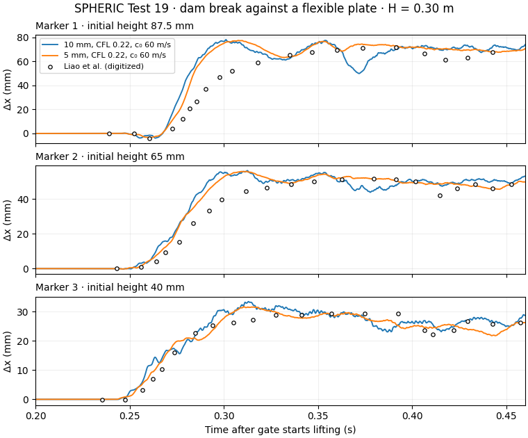

# SPHERIC Test 19 · dam break against a flexible plate

A measured rigid gate rises at x = 0.20 m. The water column runs downstream
and loads a separate flexible cantilever at x = 0.60 m. The tank is 0.80 m
long and the water depth in this comparison is 0.30 m. Marker 1 is the
highest marker. This fixture compares the displacement histories at initial
heights **87.5, 65 and 40 mm** in the order used by Figure 1.

## Reproduce the comparison

From the TensorSPH checkout with Python 3.11+:

```sh
python -m pip install "scipy>=1.11" -e ".[test]"
python -m pip install --no-deps "git+https://github.com/cxs503/TensorFEM.git@d281d065d08d88573965226cce3c978243541054"
python benchmarks/spheric19/run.py --dx .01 --output out/test19-10mm
python benchmarks/spheric19/run.py --dx .005 --output out/test19-5mm
python benchmarks/spheric19/run.py --dx .01 --courant .11 --output out/test19-half-step
python benchmarks/spheric19/run.py --dx .005 --tank-contact --output out/test19-contact
python benchmarks/spheric19/plot.py out/test19-10mm out/test19-5mm out/test19-contact --output out/test19.png
python -m pytest -q tests/test_spheric19.py
```

Each run writes per-step marker displacements in metres, physical time in
seconds, and a JSON record with raw and peak-normalized marker RMSE, Mach
number, maximum particle excursion through the tank floor/sides, and the
horizontal force balance over all walls and fluid particles. Scores use linear
interpolation in physical time at the experimental sample times, with no phase
alignment or amplitude fitting.

## Model and interface

The fluid uses the TensorSPH single-phase WCSPH density-summation solver and
its hydrostatic mass initialization. It models an open water surface, free-slip
walls and a single row of moving plate stations on the centreline. The gate
lift is piecewise linear with a final hold. The plate stiffness and inertia
use the physical 4 mm thickness, Young's modulus 3.5 MPa, density 1161.54
kg/m³, and unit span. Its finite-rotation beam reduction uses uniaxial bending
stiffness EI, without a plane-strain Poisson correction.

At each acoustic step the fluid reads the plate positions and velocities,
evaluates the actual wall reaction for every station and sends both force
components to TensorFEM. The structure subcycles this load and returns its
updated shape. The exchange is explicit and staggered. Wall-pressure
extrapolation uses gravity and omits prescribed or structural wall acceleration.
Gas entrapment, wall-normal thickness resolution and strong coupling iterations
are outside this implementation. The pressure-only baseline uses no tank-position clamping. The optional
contact comparison enforces unilateral, frictionless, inelastic contact on the
fixed tank planes after each trial step, records the additional tank impulse
and raw penetration, and leaves the top open. This impulse stays separate
from the forces applied to the elastic plate.

## Experimental data provenance

Reference: [SPHERIC Test 19](https://www.spheric-sph.org/tests/test-19), prepared
by P. Sun. The original measurements are due to Liao, Hu & Sueyoshi (2015),
*Free surface flow impacting on an elastic structure: Experiment versus
numerical simulation*. Sun, Le Touzé & Zhang (2019) studied the multiphase
case, DOI [10.1016/j.enganabound.2019.03.033](https://doi.org/10.1016/j.enganabound.2019.03.033).

- `gate_fig2.dat` uses the centres of 40 green measurement symbols in
  [Figure 2](https://static.wixstatic.com/media/c24cbb_2cf2d7b6c3934113981582aca79e7f45~mv2.png)
  plus the physical start (0,0). SHA-256 of the source PNG is
  `dce218589c7f8a13801e841f63a92ece5ff1f7c7fa07531cb158dcb3a3ffadd9`.
  In image pixels the axes were calibrated with x=62.2 at 0 s and a 648 px
  span for 0.14 s, y=351.1 at 0 m and a 331 px span for 0.7 m.
  An alternate two-column SI record can be supplied via `--gate`.
- `markers_h030_fig3.csv` uses 62 sampled black experimental circles from
  the right-hand panels of [Figure 3](https://static.wixstatic.com/media/c24cbb_34ace7615efb48cf815cbe8e712cfac8~mv2.png).
  Source PNG SHA-256 is `eda0e560c7035173cfc111aed27478ead2654e4022c749f1e413187a69ebabc1`.
  Coordinates were calibrated against the ticks of each panel, converted from
  dimensionless time and displacement using H=0.30 m and g=9.81 m/s². One
  image pixel corresponds to approximately 0.93 ms and 0.51 mm. The numbers
  are figure digitizations, not the original ASCII records or the coloured
  SPH simulation curves.

## Measured CPU results

All three runs use 8 finite elements, sound speed 60 m/s and end at 0.46 s.
Each error is the RMSE in millimetres; parentheses give the error divided by
the largest measured displacement magnitude among that marker's samples.
The CFL column is the maximum Courant number used to select the fluid step.

| Particle spacing | CFL | Marker 1 | Marker 2 | Marker 3 | Peak fluid Mach |
|---|---:|---:|---:|---:|---:|
| 10 mm | 0.22 | 17.10 (23.75%) | 7.59 (14.71%) | 2.76 (9.43%) | 0.075 |
| 5 mm | 0.22 | 13.93 (19.34%) | 5.78 (11.21%) | 2.36 (8.07%) | 0.136 |
| 10 mm | 0.11 | 17.66 (24.52%) | 7.57 (14.67%) | 3.56 (12.15%) | 0.125 |



At 5 mm spacing the top, middle and lower markers reach half of their measured
peak magnitudes **9.05, 6.81 and 3.41 ms early**. Refining the spatial grid
reduces all three RMSEs in this pair of runs. Halving the Courant limit at
10 mm does not uniformly reduce error. Two spacings do not establish a
convergence order. The SPHERIC page cites a 1 mm particle spacing; that level
has not been run here. The fixed tank boundary also allows excursions. These
histories are a development baseline; the coupled model is not qualified for
load prediction.

The largest envelope excursion in the pressure-only 5 mm run is **62.47 mm
in x at y = 0.820 m**, above the 0.60 m rim. This maximum is not a measure
of solid-wall penetration. There is also a genuine floor crossing before
the main bending response: at t = 0.26858 s a particle first exceeded 0.25
particle spacings below the floor near x = 0.620 m. The output records both
the first such envelope excursion and the location of the largest one.
