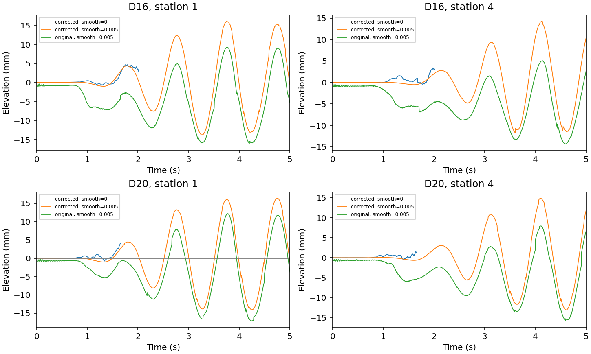

# 波浪水槽初始压力与重力平衡

同一活塞规则波工况取水深 0.25 m、波高 40 mm、周期 1 s、声速 30 m/s。初始水体在静止的固定底板、端壁和造波板内铺设。下表的力与加速度都直接取自生产求解器的 WCSPH 粒子对与重力项；加速度残差取所有流体粒子的向量均方根，再除以 g。压力误差以整段水深的静水压头 ρ₀gH 归一化。壁面支承为全部壁面对水体的向上作用力除以粒子总水重。

| 水深格数 | 原始支承/水重 | 仅壁面密度迭代 | 初态密度修正 | 原始加速度残差 | 修正后残差 |
|---|---:|---:|---:|---:|---:|
| 16 | 78.02% | 95.95% | 100.42% | 0.7448g | 0.0201g |
| 20 | 78.24% | 96.05% | 100.47% | 0.7731g | 0.0199g |

原始计算的底部带残差为 1.35g、1.67g，大于自由面带的 0.82g、0.81g。仅补壁面密度能恢复大部分总支承，水体内仍有显著局部误差。记录还提供各分带水平残差、最大值位置、压力误差、合力守恒及关闭密度扩散的对照。[原始分带数据](static_balance.json)

## 方法与适用范围

可选参数 `--reference-density-increment` 对每个粒子单独保存解析静水 Tait 密度与初始原始求和密度之差。积分中把这个差值加到当前位置的密度和，再用原有的扩散、Tait 状态方程、Adami 壁面压力和对称压力力项推进。粒子质量不变，修正量随对应粒子携带。该处理补偿初始粒子邻域截断，仍允许压缩扰动。它没有直接抵消加速度。严重翻卷、液滴分离及自由面粒子转入内部时的适用性未经检验。

## 同一输入下的闭槽和造波

沿用最大马赫数 0.5、正压缩率 1% 以及四探头波高误差不超过 10% 的既定判据。静水和造波的首次超限均保留原时刻并提前结束。表中弱平滑的系数是 0.005，比上轮 0.1 小 20 倍；“仅弱平滑”保留原始密度算子。报告同时列出最低密度比以显示只看正压缩率会漏掉的稀疏区。3–5 s 内以造波频率拟合各探头波高；末站相位误差以首站和线性色散波数为基准。未覆盖固定时窗的记录不计算波高通过率。

| 水深格数 | 工况 | 实际时长 s | 最大正压缩率 | 最低 ρ/ρ₀ | 四站波高 mm | 末站相位误差 | 判定 |
|---|---|---:|---:|---:|---|---:|---|
| 16 | 固定板 0.4 s | 0.4000 | 0.284% | 1.000 | — | — | 静水窗完成 |
| 16 | 固定板 5 s | 2.0722 | 1.004% | 0.925 | — | — | 超限停止 |
| 16 | 造波 | 2.0136 | 1.002% | 0.928 | — | — | 未通过 |
| 16 | 仅弱平滑造波 | 5.0000 | 0.595% | 0.772 | 24.4、23.1、22.2、16.8 | -9.1° | 未通过 |
| 16 | 密度修正及弱平滑造波 | 5.0000 | 0.413% | 0.998 | 29.0、27.6、25.3、23.5 | -5.7° | 未通过 |
| 20 | 固定板 0.4 s | 0.4000 | 0.298% | 1.000 | — | — | 静水窗完成 |
| 20 | 固定板 5 s | 1.6201 | 1.008% | 0.878 | — | — | 超限停止 |
| 20 | 造波 | 1.6574 | 1.034% | 0.880 | — | — | 未通过 |
| 20 | 仅弱平滑造波 | 5.0000 | 0.558% | 0.772 | 28.3、24.9、23.8、19.9 | -6.9° | 未通过 |
| 20 | 密度修正及弱平滑造波 | 5.0000 | 0.361% | 0.991 | 30.1、29.1、27.7、25.2 | -4.0° | 未通过 |

仅作初态密度修正时，16 格造波首次超限出现在 2.014 s、20 格在 1.657 s。固定板长程对照分别在 2.072 s、1.620 s 超限。两档均通过前 0.4 s 静水检查，长程静水平衡仍然失效。原未修正的对应造波初次超限时刻为 0.114 s、0.100 s。[上轮相同海况](../verification_20261121/README.md)

16 格在相同 0.005 平滑系数下引入密度修正，末站波高从 16.78 mm 变为 23.52 mm。3–5 s 实测活塞基频行程为 34.40 mm，按线性活塞传递关系对应 40.00 mm 波高。修正后的首站波高为目标的 72.6%，从首站到末站再减少 19.0%，四站分离法估计的反射系数为 0.050。

20 格在相同 0.005 平滑系数下引入密度修正，末站波高从 19.94 mm 变为 25.21 mm。3–5 s 实测活塞基频行程为 34.40 mm，按线性活塞传递关系对应 40.00 mm 波高。修正后的首站波高为目标的 75.3%，从首站到末站再减少 16.3%，四站分离法估计的反射系数为 0.043。

首站波高不足与沿程衰减同时存在。两档首站距造波板约 1.00 m，末站约 1.49 m，均在消波区之前。反射分离依赖线性波数；这些时程尚不能把造波板附近的流固传递损失与到达首站前的传播损失分别量化。



[各工况的四个探头、分周期波高、反射拟合与首次超限位置](assessment.json)

## 复算

从仓库根目录运行。以下造波命令分别取 16 和 20 格，去掉速度平滑可得到强迫的单因素对照；去掉密度修正可得到仅弱平滑对照。固定板的短窗取 `--settle 1 --simulate-time .4`，长窗取 `--settle 6 --simulate-time 5`，均关闭速度平滑。程序会为触发物理判据的工况返回非零退出码并保留完整的可用时序。运行时给 `--max-courant` 传入数值可同时控制名义步长和自适应上限，未指定时保持原有 0.25 启动、0.30 自适应上限。

```sh
PYTHONPATH=src python benchmarks/wave_flume/hydrostatic_balance.py --out out/static_balance.json
PYTHONPATH=src python benchmarks/wave_flume/run.py --depth-cells 16 --reference-density-increment --xsph .005 --simulate-time 5 --output-every 25 --threads 1 --snapshots 0 --stop-on-regime-exit --out out/weak16.json
PYTHONPATH=src python benchmarks/wave_flume/hydrostatic_start/measure.py --records benchmarks/wave_flume/hydrostatic_start/*.json.gz --out out/wave
```
