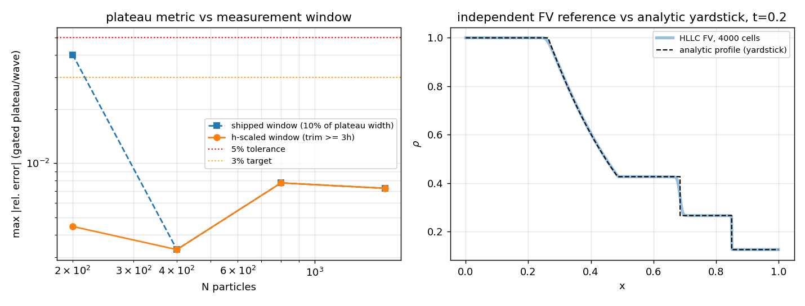

# 可压 Sod 案例度量审计（CASE-SPH-SOD-SHOCK-COMPRESSIBLE）

> 由 `python scripts/audit_sod_metrics.py` 生成，**全部数字程序化注入，零手抄**
> 生成时间（UTC）：2026-11-12T12:18:46Z
> 被审计对象：`docs/validation/compressible_sod/REPORT.md`（m16184）

## A1 度量窗污染：平台误差里有多少是"测量"造出来的

平台/波位置的测量窗以精确波位置为锚、两端各裁掉平台宽度的
`WAVE_WINDOW_FRACTION = 10%`。这是**与分辨率无关**的裁法，而 SPH 把间断面抹平在
~3–4 h 内（核支撑 2h）；当 10% 平台宽度 < 3h 时，滑窗均值必然吞掉抹平的间断。

| N | 10% 平台裁宽 | 3h | 裁宽≥3h（受影响门控量数） | max abs rel err（原裁法） | max abs rel err（≥3h） | L1(ρ) | L1 收敛阶 |
|---|---|---|---|---|---|---|---|
| 200 | 0.01649 | 0.03750 | ✘ 污染（6 量） | 4.03% | 0.44% | 2.15% | 0.64 |
| 400 | 0.01649 | 0.01875 | ✘ 污染（0 量） | 0.33% | 0.33% | 1.39% | 0.29 |
| 800 | 0.01649 | 0.00938 | ✔（0 量） | 0.78% | 0.78% | 1.14% | 0.11 |
| 1600 | 0.01649 | 0.00469 | ✔（0 量） | 0.72% | 0.72% | 1.05% | — |

- 分辨率阶梯上有 **2/4** 个点的原裁法低于 3h（N 越小越严重）。
- 最严重的一点 N=200：原裁法 4.03%
  → h 标度裁法 0.44%（相差 **9.1×**）。
  即该点报告的"误差"主要是测量窗把抹平间断算进了平台均值，而非格式误差。
- **生产算例 N=800 不受影响**（10% 裁宽 0.01649 ≥ 3h 0.00938），
  故 REPORT 的判据结论（<3%）不变；受影响的是"分辨率阶梯"的粗端与由此推出的收敛印象。
- L1(ρ) 全场误差不经滑窗（直接插值比较），故 L1 不是测量伪影：N=200→1600
  从 2.15% 降到 1.05%，**总收敛阶仅 0.34**（远低于一阶）。
  结论：本格式的 L1 误差由间断抹平主导；平台量残差虽小（≤0.8%）但**非单调**（N=200 最小），
  说明它趋近的是初始膜片抹平造成的模型残差、而非 0——不可被引作"精度 0.7%"。
  报告的"max |rel err|"与"L1"是两种东西，不可互相替代。

## A2 标尺独立复核：精确 Riemann 剖面本身对不对

REPORT 里所有 L1/L2/平台误差都对着 `exact_riemann_profile()` 量。该函数此前从未被
独立复核过（测试是把标尺和标尺自己比）。本审计用**一阶 HLLC 有限体积**独立求解同一
Euler 方程（不同离散、不同代码路径，不调用精确解）：

| 量 | FV 4000 胞 vs 精确剖面 相对 L1 |
|---|---|
| ρ | 0.28% |
| u | 0.33% |
| p | 0.18% |

（FV 步数 4380，CFL 0.4，t=0.2000；残差主要来自一阶格式对接触间断的抹平，
属 FV 侧误差。）**结论：标尺可用**——解析剖面与独立数值解一致到 <1%，因此 REPORT 的
误差数字不是标尺错误的产物。

## A3 结论

1. 判据结论（N=800，max|rel err| <3%）**成立且不受本次修复影响**。
2. 度量窗已改为 h 标度（`WINDOW_TRIM_H = 3.0`），粗网格点不再把抹平间断计入平台均值；
   `evaluate_metrics` 新增 `window_trim` 字段供读者自查。
3. 标尺（精确剖面）经独立 FV 复核通过。
