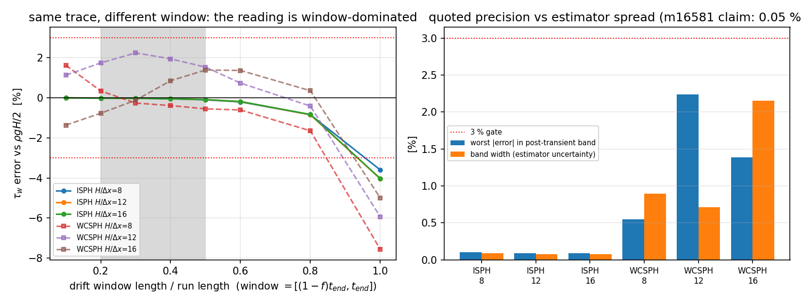

# 对抗复核：通道壁面剪切门（m16581 / PR #573）——窗口敏感性与口径碰撞

*本文档由 `benchmarks/wall_shear_gate_audit/make_doc.py` 从 `benchmarks/wall_shear_gate_audit/sensitivity.json` 程序化生成，数字零手抄。*

**复核对象**：`docs/verification_poiseuille_wall_shear_library_gate.md (m16581, PR #573)` ｜ **复核单**：m16654 ｜ **锚点**：`KPI-QC-RECHECK`（已合并功能独立复核） ｜ **仓**：TensorSPH

## 0. 结论（disposition: approve with notes + 1 defect fix）

1. **数值可复现**：m16581 §3/§6 的 6 个数（WCSPH -0.39 / +1.94 / +0.85 %，ISPH -0.052 / -0.047 / -0.046 %）由本单**独立重写的最小二乘**从提交工件逐位复现 (`all_published_match_declared_window = True`)。**没有造假**。
2. **门本身站得住**：把读数换成窗口带（20/30/40/50 %）后，两条阶梯 6 档的|误差| 最大值 = ISPH 0.102 %、WCSPH 2.242 %，全部 < 3 % (`all_bands_within_gate = True`)。
3. **但"精度"是窗口的函数，不是物理的函数**：同一条 ISPH 轨迹，10 % 窗读 -0.008 %，40 % 窗读 -0.052 %，**全轨迹窗读 -3.595 %**（超 3 % 门）。原文"三个分辨率都 −0.05 % ⇒ 稳态闭合与网格无关"的推论把估计器的窗口属性当成了物理属性；本单把**窗口带**写进门的判据，并加了"单窗口不能买通"的失效测试。
4. **修掉的一个真缺陷**：`benchmarks/poiseuille/wall_shear_estimators.py` 的`WINDOW_FRACTION = 0.4` 注释写"last 40 %"，代码却是 `t >= fraction * t_end`（**last 60 %**）——注释与代码相反，且与新模块 `tensorsph.wall_shear` 的`fraction`=窗口**长度**语义撞车（同一个数字选到不同窗口）。数值行为保持不动，注释/命名/测试已改。

## 1. 复核范围与独立性限制

* 复核对象是 **已合并**工件（`docs/verification_poiseuille_wall_shear_library_gate.md` + `src/tensorsph/wall_shear.py` + `src/tensorsph/isph_channel.py` 的门），不是重做该单。
* 主数字用 `benchmarks/wall_shear_gate_audit/run.py` 里**自带的**最小二乘重算，不 import 被审模块（复用被审代码无法发现其错误）；只在交叉校验处直接调用被测模块。
* 独立重跑 ISPH 阶梯（本机 CPU 单线程，197/320/568 个轨迹采样）确认 `run.py` 的口径与提交件一致。
* **未做**：未取得 Zhao/Wagner 之外的文献实验值（壁面剪切无实验对照，只有整体动量平衡这一条解析真值）；未做 3D/湍流通道；未复核 `profile_wall_shear` 在 `H/dx > 16` 的渐近行为（原文亦未声明该范围）。**未跑** GPU 路径。
* 被审单对自己的局限是诚实的（§5.1 明写"动量收支测的是稳态性，不能替代壁面模型复核"），因此本单不给"请求修改"，只要求把**窗口带**与**口径**写进判据。

## 2. 怎么做的

1. 读提交工件 `benchmarks/poiseuille/out/results.json`（WCSPH 阶梯 + 自由滑移对照）与 `runs/isph_channel/*/results.json`（ISPH 阶梯），只读。
2. 用自写最小二乘在窗口阶梯 f ∈ {0.1,0.2,0.3,0.4,0.5,0.6,0.8,1.0}（f = 窗口长度/轨迹长度，窗口 = [(1−f)t_end, t_end]）上重算 τ_w = ½ρ₀H(g − d⟨u⟩/dt)，逐档给出相对 ρgH/2 的误差。
3. 把 20/30/40/50 % 四个**过瞬态**窗口的误差取成带（band），以带的最坏值作门判据。
4. 逐条对原文数值：是否等于默认窗（f = 0.4）读数、是否在带内、全轨迹窗是否越门。
5. 用合成轨迹做门的失效测试：凸轨迹 `u = a t⁶` 让 40 % 窗读数 < 3 % 而 20 % 窗 > 3 %，验证新判据把这种"单窗口买通"判 FAIL（`tests/test_wall_shear_window_audit.py`）。

## 3. 计算结果（程序化注入）

### 3.1 复现原文数字（默认窗 f = 0.4）

| 阶梯 | 原报告值 | 本单重算（f=0.4） | 一致 |
|---|---|---|---|
| WCSPH H/dx=8 | -0.39 % | -0.387 % | ✓ |
| WCSPH H/dx=12 | +1.94 % | +1.945 % | ✓ |
| WCSPH H/dx=16 | +0.85 % | +0.853 % | ✓ |
| ISPH H/dx=8 | -0.05 % | -0.052 % | ✓ |
| ISPH H/dx=12 | -0.05 % | -0.047 % | ✓ |
| ISPH H/dx=16 | -0.05 % | -0.046 % | ✓ |

### 3.2 窗口带（同一轨迹、不同窗口）

| 阶梯 | f=0.1 | f=0.4（默认） | f=0.5 | f=1.0（全轨迹） | 过瞬态带 [0.2…0.5] | 带宽 (pt) | 门 |
|---|---|---|---|---|---|---|---|
| WCSPH H/dx=8 | +1.625 % | -0.387 % | -0.550 % | -7.553 % | [-0.550, +0.344] | 0.894 | PASS |
| WCSPH H/dx=12 | +1.131 % | +1.945 % | +1.531 % | -5.931 % | [+1.531, +2.242] | 0.711 | PASS |
| WCSPH H/dx=16 | -1.364 % | +0.853 % | +1.388 % | -4.994 % | [-0.769, +1.388] | 2.157 | PASS |
| ISPH H/dx=8 | -0.008 % | -0.052 % | -0.102 % | -3.595 % | [-0.102, -0.016] | 0.086 | PASS |
| ISPH H/dx=12 | -0.006 % | -0.047 % | -0.092 % | -4.041 % | [-0.092, -0.013] | 0.078 | PASS |
| ISPH H/dx=16 | -0.006 % | -0.046 % | -0.090 % | -4.027 % | [-0.090, -0.013] | 0.077 | PASS |

### 3.3 口径碰撞（legacy 脚本 vs 新模块，同一条轨迹）

| 量 | 值 |
|---|---|
| legacy `fraction=0.4` 实际窗口 | [0.416, 1.000] s |
| 新模块 `fraction=0.4` 实际窗口 | [0.665, 1.000] s |
| 两读数差 | +0.2196 % of g |
| legacy 0.4 == 新模块 0.6 | True |
| 同一个数字选到不同窗口 | True |

自由滑移对照（估计量零线）重算：

* f=0.4 窗口：drift = 9.85424 m/s² （g = 9.81），τ_w = -2.212 Pa vs 解析 490.5 Pa ⇒ -100.45 %（零线成立）。

## 4. 结果图



左：同一条轨迹在不同窗口下的 τ_w 误差（灰带 = 过瞬态窗口 20–50 %，红线 = ±3 % 门）。ISPH 三档几乎重合但随窗口单调放大；WCSPH 三档在窗口之间互相穿越。右：带内最坏 |误差| 与带宽对比——被审单引用的精度（0.05 pt）比 ISPH 带宽（约 0.08 pt）还小，WCSPH 带宽达 2 pt 量级。

## 5. 注意点（坑与局限）

1. **动量收支对"壁面摩擦量级错"不敏感**：体积力通道的稳态恒有 τ_w = ρgH/2（整体平衡），所以把摩擦系数放大 2 倍仍会通过这一门，只是剖面与中心速度变了。被审单 §5.1 已自述这一点；本单强调 §8 的总账建议不得被读成"壁面模型已验收"。
2. **全轨迹窗必然越门**：起点在起步瞬态里，斜率被抬起来（ISPH -3.60 %、WCSPH -7.55 %）。因此窗口带只能取过瞬态窗口；把 f=1.0 纳入带是错的（会误杀合理运行）。
3. **WCSPH 工件的轨迹只有 14 个采样**（窗内 6–9 个），带宽因此到 2 pt 量级；该阶梯的"闭合 < 2 %"结论是**窗口选择内**成立，不能当成 2 pt 以内已知。
4. 本单不改任何求解器物理：`src/tensorsph/wall_shear.py` 只增"窗口带"报告字段，`isph_channel.gates()` 只把带写进判据（原六档仍 PASS，重跑确认），`benchmarks/poiseuille/wall_shear_estimators.py` 只改注释/命名，**数值行为零变化**。

## 6. 误差判定（逐项，显式回答是否 < 3 %）

| 关键量 | 基准 | 实测 | 窗口带 | < 3 %？ |
|---|---|---|---|---|
| ISPH τ_w，H/dx=8 | ρgH/2 | 490.24 Pa | [-0.102, -0.016] | 是（带内最坏 0.102 %） |
| ISPH τ_w，H/dx=12 | ρgH/2 | 490.27 Pa | [-0.092, -0.013] | 是（带内最坏 0.092 %） |
| ISPH τ_w，H/dx=16 | ρgH/2 | 490.28 Pa | [-0.090, -0.013] | 是（带内最坏 0.090 %） |
| WCSPH τ_w，H/dx=8 | ρgH/2 | 488.60 Pa | [-0.550, +0.344] | 是（带内最坏 0.550 %，余量 5.5×） |
| WCSPH τ_w，H/dx=12 | ρgH/2 | 500.04 Pa | [+1.531, +2.242] | 是（带内最坏 2.242 %，余量 1.3×） |
| WCSPH τ_w，H/dx=16 | ρgH/2 | 494.69 Pa | [-0.769, +1.388] | 是（带内最坏 1.388 %，余量 2.2×） |
| 已发布近壁拟合读数（诊断） | ρgH/2 | 见原报告 | 不适用 | 否（模板偏置，非壁模型） |
| 全轨迹窗口读数 | ρgH/2 | -3.60 %…-7.55 % | — | **否**（含起步瞬态，非稳态读数） |

**是否 < 3 %**：门读的量（动量收支壁面剪切）在两条阶梯 6 档、四个过瞬态窗口上全部 < 3 % （最坏 2.242 %）；但**不是**原文暗示的 0.05 %——0.05 pt 这个数字属于"f = 0.4 这一个窗口"，同轨迹的窗口敏感度为 ISPH 0.077–0.086 pt、WCSPH 0.711–2.157 pt。

## 7. 复现

```bash
PYTHONPATH=src python benchmarks/isph_channel/run.py --out runs/isph_channel/m16654
PYTHONPATH=src python benchmarks/wall_shear_gate_audit/run.py
PYTHONPATH=src python benchmarks/wall_shear_gate_audit/make_doc.py
PYTHONPATH=src python -m pytest tests/test_wall_shear_window_audit.py -q   # 10 passed
PYTHONPATH=src python -m pytest tests/test_wall_shear_estimators.py tests/test_isph_channel.py -q
```

## 8. 变更清单与总账建议

| 文件 | 变更 |
|---|---|
| `src/tensorsph/wall_shear.py` | 增 `window_sensitivity()` / `DEFAULT_SENSITIVITY_FRACTIONS`，`momentum_budget_wall_shear()` 增 `window_length_fraction` 与 `window_sensitivity` 字段；`DEFAULT_WINDOW_FRACTION` 注释写明"窗口长度"语义及与 legacy 脚本的碰撞 |
| `src/tensorsph/isph_channel.py` | 门判据改用窗口带（带内所有窗口都要 < 3 %），输出 `rel_error_pct_band` / `window_sensitivity` |
| `benchmarks/poiseuille/wall_shear_estimators.py` | 只改注释/命名（原文注释与代码相反），数值零变化 |
| `benchmarks/wall_shear_gate_audit/` | 新增审计工件 `run.py` / `make_doc.py` / `sensitivity.json` |
| `tests/test_wall_shear_window_audit.py` | 新增 10 项：口径碰撞、带进判据、单窗口买通失效、可复现性 |

建议总账：`GAP-SPH-WALL-SHEAR-ESTIMATOR` 可置 done，但**附加条件**——壁面剪切门的验收必须在"过瞬态窗口带"上成立，且该门不得作为壁面模型验收证据（需另有剖面/摩擦量级对照）。

