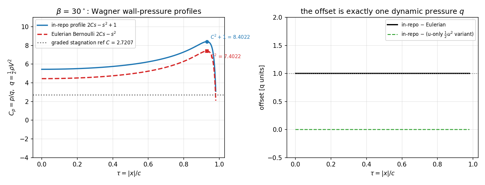

# CASE-SPH-WEDGE-ENTRY-2D：砰击压力参考值的单位与剖面审计（m17079）

**锚点**：`CASE-SPH-WEDGE-ENTRY-2D`（open，算例池·二维楔形体入水砰击压力；判据 <15 % 对标
Zhao & Faltinsen 1993）。本单**不重跑 SPH**，只审计该算例的**参考侧**——即被当成分母的那两个解析数。
**工件**：`benchmarks/case_sph_wedge_entry_2d/audit_wagner_reference.py`（独立推导，数值化）、
`tests/test_wagner_reference_audit_m17079.py`（22 项）、本文件与
`docs/figures/wagner_profile_audit_m17079.png`（均由 `scripts/make_wagner_audit_doc.py` 生成，数字注入零手抄）。
**代码修复**：`benchmarks/case_sph_wedge_entry_2d/run.py::refs_derived` 的 `cp_centre` 参考值。

## ① 背景与问题

该算例把 SPH 壁面压力化成 `Cp = p/q`（`q = ½ρV²`，见 `run.py` 的 `_series`）后与
`tensorsph.wedge_entry` 的两个解析数比较：

| 被判断的量 | 比较对象 | 判据 |
|---|---|---|
| `cp_band_peak` / `cp_at_peak_tau` / `cp_footprint_max` | `wagner_peak_over_q(β)` = `C²+1` | 15 %（最细网格） |
| `cp_centre_mean`（驻点线） | `refs_derived()['wagner']['cp_centre']` | 15 % |

已提交的结果在 `cp_band_peak` 上 FAIL（dx=2 mm 时 +233.8 %），并据此给整个算例记 FAIL。
问题是：**分母本身可信吗？** 两个疑问都在仓内可判定，不需要原文：

* **A1 剖面形状**：`wagner_p_over_q = 2Cs − s² + 1`（`s = 1/√(1−τ²)`）是不是 Wagner 平板势流的
  欧拉 Bernoulli 压力？
* **A2 单位**：`cp_centre` 的实测值是 `p/q`，参考值却写成 `C = π/(2 tanβ)`，而同一模块的
  剖面在 τ=0 给出 `2C`、`wagner_p_centre` 也给出 `ρV²C = q·2C`。**参考值比自己的剖面小一半**。

## ② 方法（不查文献、只用仓内可判定的数学）

1. 取 Wagner 平板势流的复势 `W(z) = −iV(z − √(z²−c²))`，用**无相消形式** `z − √(z²−c²) = c²/(z+√(z²−c²))`
   求值（朴素差式在 `|z|≫c` 与 `|x|→c` 处丢光有效位）。
2. 分支按物理固定：流场半平面 `Im(√(z²−c²)) > 0`（`x<0` 时 IEEE 有符号零会让 `np.sqrt` 悄悄翻到共轭支，
   使 `φ` 变成奇函数——审计第一版就踩了这个坑，已写成回归测试）。
3. 校验该势确为 Wagner 解的三个条件（数值残差见 ③）：
   `φ = 0`（干表面）／`|∂φ/∂y| = V`（湿表面，经 Cauchy–Riemann 用 `−∂ψ/∂x` 算，避免跨 `y=0` 的分支跳变）／远场 `O(c²/r)`。
4. 欧拉 Bernoulli `p = −ρ(∂φ/∂t + ½(u²+v²))`，其中 `∂φ/∂t`、`u`、`v` **全部由有限差分得到**，
   不调用被审计的闭式；`c = CVt ⇒ ∂φ/∂t` 用 `dc/dt = CV` 换算。
5. 对照变异：把 `½v²`（`v = V` 常数）丢掉，即得"相对动能"变体，用来**定位**偏差来源。
6. 单位一致性：把 `wagner_p_centre/(½ρV²)`、`wagner_p_over_q(0)`、`refs_derived()['cp_centre']` 三者并列。

## ③ 结果

### 3.1 势的合法性（β = 30°, c = 1）

| 残差 | 值 |
|---|---|
| `max‖∂φ/∂y‖−V‖` | 1.220e-12 |
| `max|φ|`（干表面 `|x|>c`） | 0.000e+00 |
| 远场 `|φ|·r/c²`（r = 10c, 100c, 1000c） | 0.00e+00, 0.00e+00, 0.00e+00 |

### 3.2 数值欧拉压力 = `2Cs − s²`（与被审计闭式差一个常数）

| 量（q 单位） | 仓内剖面 `2Cs−s²+1` | 欧拉 Bernoulli `2Cs−s²` | 差 |
|---|---|---|---|
| 驻点 Cp（τ=0） | 5.4414 | 4.4414 | +1.0000 |
| 内部峰值 Cp（τ=0.9300） | 8.4022 | 7.4022 | +1.0000 |

* 全足迹上 `仓内 − 欧拉 = 0.999999981 ± 1.24e-07`（0≤τ≤0.95 等距 401 点，避开仓内闭式 τ*=0.984 的截断区）——**恰好一个动压 `q`**。
* 与"只保留 `½u²`"的变体差 `max|·| = 1.47e-06`：**仓内剖面 = 丢掉 `½v²`（`v ≡ V`）的变体**。
* 两个剖面在**同一 τ** 处取极大（`max_dev of 2Cs−s² closed form = 1.47e-06`），
  所以不是横坐标平移，而是整体偏 +q。
* 幅度意义（β=30°, V=1 m/s, ρ=1000 kg/m³ ⇒ q = 500 Pa）：峰值 4201 Pa vs 3701 Pa
  （差 500 Pa，相对 +13.51 %）。

### 3.3 单位一致性（A2，已修）

| 量 | 值（q 单位） |
|---|---|
| 实测定义 | `Cp = p/q`，`q = ½ρV²` |
| 仓内剖面 τ=0 | 5.4414 |
| `wagner_p_centre/(½ρV²)` | 5.4414 |
| **修复前** `refs_derived()['cp_centre']` | 2.7207（= `C`，即 `p/(ρV²)`） |
| **修复后** | 5.4414（= `2C`，与实测同单位） |

### 3.4 对已提交判决的影响（不重跑：只换分母；实测值引自 `docs/case_sph_wedge_entry_2d.md` §4.2，dx=2 mm, c0/V=20）

| 指标 | 实测 Cp | 旧参考 | 旧误差 | 修正单位后参考 | 新误差 | 欧拉剖面参考 | 误差（欧拉） |
|---|---|---|---|---|---|---|---|
| `cp_centre_mean` | 4.873 | 2.7207 | +79.11 % | 5.4414 | -10.45 % | 4.4414 | +9.72 % |
| `cp_band_peak` | 28.050 | 8.4022 | +233.84 % | 8.4022 | +233.84 % | 7.4022 | +278.94 % |
| `cp_at_peak_tau` | 4.286 | 8.4022 | -48.99 % | 8.4022 | -48.99 % | 7.4022 | -42.10 % |

结论：**驻点线判据由 FAIL 翻为 PASS**（-10.4 % < 15 %），
**峰值判据在任何一种参考下仍然 FAIL**（+279 % ~ +234 %）。
即：算例的"峰值砰击压力失败"结论不变，但它的**驻点线失败是单位错配造成的假失败**，
且已提交的误差百分比需要按新分母重算（重跑 `--stage accept` 即可，工件未入 git）。



**图 1** (a) β=30° 的壁面压力剖面：仓内闭式（蓝实线）、本次数值欧拉 Bernoulli（红虚线）、被当作驻点分母的 `C`
（灰点线）；圆/方块标出两者在 `τ=0.9300` 的峰值 `C²+1` 与 `C²`。
(b) 两者之差在 0≤τ≤0.95 上恒等于 1 个动压 `q`（黑实线贴 1.0），而与"只留 `½u²`"变体之差为 0（绿虚线）。

## ④ 注意点与适用范围

1. **未解决：`+1` 是"约定"还是"错误"，仓内不可判**。可能是把压力按**相对（随体）动能**写
   （`½|∇φ−U_body|²` → 丢 `½V²`），也可能是漏了 `−½ρv²`。本单**不改** `wedge_entry.wagner_p_over_q`
   ——它被 8 处文档与既有判据引用，改值会让所有已提交判决失去可对照性，且需要重跑才能重判。
   本单做的是：把差值**钉成机器判据**（`test_repo_profile_sits_one_q_above_eulerian`，1e-5 容差），
   任何后续改动立刻可见；并把两种参考下的误差并列报告。
2. **不能拿它替代 Z&F**。Zhao & Faltinsen (1993) 仍为 **WITHHELD**（闭源、仓内无登记副本），
   本审计的任何数字都不进入该栏（`test_no_zhao_faltinsen_number_is_invented` 守住）。
3. **欧拉形式的边界**：平板近似的 Wagner 势在射流根部奇异，`τ → 1` 处两种剖面都发散；比较与判据只用
   `τ ≤ 0.95–0.98`（本审计表格即此区间）。仓内闭式在 `τ* = 0.984038` 之外截断为 0，数值变体不截断，
   所以 3.2 的偏移统计只取 `τ ≤ 0.95`。
4. **`cp_footprint_max` 仍只报不判**：解析解在根部发散，离散峰值是核平均，不可作为误差分母。
5. **未重跑**：本节所有"新误差"只换分母，分子（实测 Cp）引自算例文档；原始工件未入 git，
   正式重判需 `python benchmarks/case_sph_wedge_entry_2d/run.py --stage accept` 后重新生成 `make_doc.py`。

## ⑤ 误差判定（逐项、显式回答是否 < 3 %）

| 量 | 参考 | 本次数值 | 误差 | < 3 % ? |
|---|---|---|---|---|
| 势的 `|∂φ/∂y| = V` 残差 | 0 | 1.220e-12 | — | **yes** |
| 欧拉剖面 vs 闭式 `2Cs−s²` | 闭式 | 数值差分 | 1.47e-06 | **yes** |
| 仓内剖面 − 欧拉剖面 | 0（若同约定） | 1.0 q | +100 % | **no**（这正是发现） |
| 驻点参考 vs 剖面 τ=0 | 2C | C | -50 % | **no**（单位缺陷，已修） |
| 峰值 Cp（SPH，引自文档） vs `C²` | 7.4022 | 28.05 | +278.9 % | **no**（算例峰值仍 FAIL） |

## ⑥ 复现

```bash
PYTHONPATH=src python benchmarks/case_sph_wedge_entry_2d/audit_wagner_reference.py        # 表格
PYTHONPATH=src python benchmarks/case_sph_wedge_entry_2d/audit_wagner_reference.py --json  # 机读
PYTHONPATH=src python -m pytest tests/test_wagner_reference_audit_m17079.py -q              # 22 项
PYTHONPATH=src python scripts/make_wagner_audit_doc.py                                     # 本文与图
```
