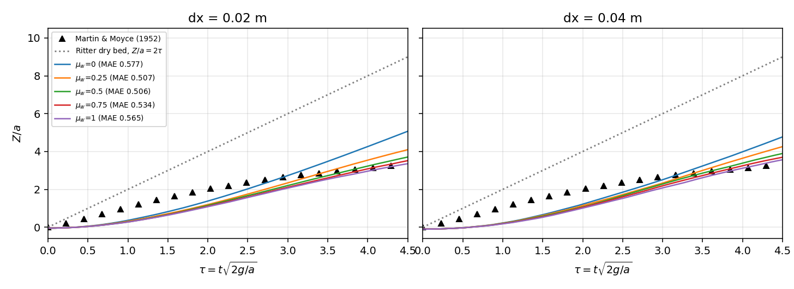
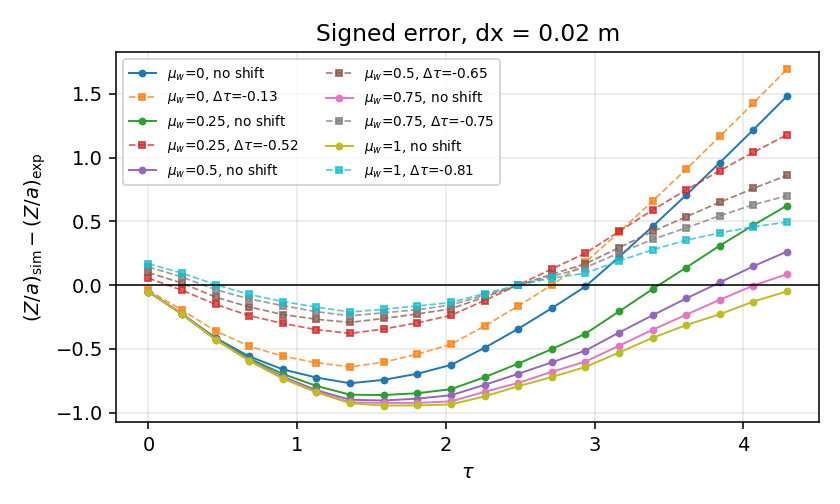

# B2 dam-break: where the Martin & Moyce bias actually comes from

**Generated file** -- every number below is injected from `benchmarks/dam_break/friction_sweep.json` by `benchmarks/dam_break/friction_sweep.py`. Do not edit by hand; rerun
`python benchmarks/dam_break/friction_sweep.py --doc-from benchmarks/dam_break/friction_sweep.json`.

## What was open

`docs/benchmarks/dam-break-resolution-ladder.md` established that the Martin & Moyce mean absolute error is resolution independent
(0.5988 -> 0.5728 between `dx` = 0.04 m and 0.01 m, observed order +0.032), and listed four candidate causes as "ranked, not yet separated".

The same document and `docs/algorithm-gap-analysis.md` leave one decision explicitly pending: whether the default `wall_friction` of 0 (free slip) should stay. This study runs the separation for the two causes the code can vary -- bed resistance and the time origin -- and leaves the two that this repository cannot vary (three-dimensionality of the experiment, the finite gate-lift time) where they are.

## Setup

| quantity | value |
|---|---|
| experimental reference | Martin & Moyce (1952), 20 digitized points |
| column width / height | 0.2 m / 0.4 m (2:1) |
| tank width | 2.0 m |
| sound speed `c0` | 25 m/s |
| kinematic viscosity (numerical) | 0.01 m^2/s |
| density diffusion | 0.0 (off) |
| spacings `dx` | 0.02, 0.04 m |
| wall-friction blends `mu_w` | 0, 0.25, 0.5, 0.75, 1 |
| simulated time | 1.5 s (covers every digitized point) |
| non-dimensionalisation | `tau = t sqrt(2g/a)`, `Z/a = (x_max - a)/a` |

`mu_w` is `Config.wall_friction`: 0 lets viscosity act between fluid particles only (free slip), 1 also lets it act between fluid and the static wall particles (no slip). With a given `viscosity` it is the only resistance the bed can apply; the coefficient itself is the numerical viscosity, not a measured water property, so the sweep brackets the available range rather than claiming a physical value.

## Measured results

| `dx` (m) | `mu_w` | particles | steps | wall clock (s) | exp MAE (`Z/a`) | RMSE | max abs err | within uncertainty |
|---|---|---|---|---|---|---|---|---|
| 0.02 | 0 | 200 | 5890 | 32.4 | 0.5771 | 0.6812 | 1.4839 | 5 % |
| 0.02 | 0.25 | 200 | 5607 | 29.2 | 0.5070 | 0.5743 | 0.8612 | 5 % |
| 0.02 | 0.5 | 200 | 5557 | 29.0 | 0.5063 | 0.5896 | 0.9044 | 5 % |
| 0.02 | 0.75 | 200 | 5543 | 29.4 | 0.5337 | 0.6213 | 0.9233 | 5 % |
| 0.02 | 1 | 200 | 5532 | 28.2 | 0.5652 | 0.6434 | 0.9441 | 5 % |
| 0.04 | 0 | 50 | 2975 | 12.6 | 0.5983 | 0.6756 | 1.1940 | 5 % |
| 0.04 | 0.25 | 50 | 2840 | 11.7 | 0.5697 | 0.6407 | 0.9586 | 5 % |
| 0.04 | 0.5 | 50 | 2799 | 11.1 | 0.5519 | 0.6391 | 0.9930 | 5 % |
| 0.04 | 0.75 | 50 | 2781 | 12.6 | 0.5656 | 0.6597 | 1.0282 | 5 % |
| 0.04 | 1 | 50 | 2770 | 10.6 | 0.5955 | 0.6926 | 1.0520 | 5 % |

## Separating timing from dynamics

`tau_start` is the first `tau` at which the simulated front has advanced `Z/a >= 0.05`; the reference front moves from `tau = 0`. `d tau*` is the single horizontal shift of the simulated curve that minimises the mean absolute error, and `MAE shifted` is what is left after it. `slope` is `d(Z/a)/d tau` over `tau` in [3, 4.3].

| `dx` (m) | `mu_w` | `tau_start` | MAE | `d tau*` | MAE shifted | slope (late) | `Z/a` at `tau`=3 | `Z/a` at `tau`=4.3 |
|---|---|---|---|---|---|---|---|---|
| 0.02 | 0 | 0.525 | 0.5771 | -0.13 | 0.5715 | 1.549 | 2.730 | 4.744 |
| 0.02 | 0.25 | 0.526 | 0.5070 | -0.52 | 0.3884 | 1.182 | 2.344 | 3.882 |
| 0.02 | 0.5 | 0.526 | 0.5063 | -0.65 | 0.2856 | 1.013 | 2.203 | 3.520 |
| 0.02 | 0.75 | 0.612 | 0.5337 | -0.75 | 0.2376 | 0.946 | 2.112 | 3.341 |
| 0.02 | 1 | 0.612 | 0.5652 | -0.81 | 0.1870 | 0.876 | 2.068 | 3.207 |
| 0.04 | 0 | 0.700 | 0.5983 | -0.28 | 0.5642 | 1.495 | 2.510 | 4.454 |
| 0.04 | 0.25 | 0.787 | 0.5697 | -0.53 | 0.4634 | 1.296 | 2.333 | 4.018 |
| 0.04 | 0.5 | 0.787 | 0.5519 | -0.67 | 0.3750 | 1.091 | 2.283 | 3.702 |
| 0.04 | 0.75 | 0.787 | 0.5656 | -0.75 | 0.3172 | 1.032 | 2.188 | 3.530 |
| 0.04 | 1 | 0.787 | 0.5955 | -0.82 | 0.2800 | 1.010 | 2.078 | 3.391 |

Reference values for the same quantities: the experiment has `Z/a` = 2.677 at `tau` = 3 and 3.250 at `tau` = 4.3, a late slope of 0.440, and an extrapolated start at `tau` = 0.

Front trajectories at both spacings. The simulated front is *late* at small `tau` and *ahead* for `tau` > 3; bed friction moves the crossing leftwards and lowers the late-time branch.

Signed error against `tau`, before and after the fitted timing shift. The V-shape before the shift is the signature of a timing offset mixed with a rate error; after the shift the residual is systematic and one-signed, i.e. a rate error that a shift cannot remove.

## Attribution

### `dx` = 0.02 m

* **Unshifted error.** Free slip gives MAE 0.5771. The best blend in the sweep is `mu_w` = 0.5 at 0.5063 (-12.3 %); the worst is `mu_w` = 0 at 0.5771 (+0.0 %). The *sign* of the response is non-monotone, so the wall condition cannot be chosen by minimising the unshifted MAE alone.

* **Timing share of the free-slip error.** Shifting the free-slip curve by `d tau*` = -0.13 lowers the MAE from 0.5771 to 0.5715, i.e. 1 % of the free-slip error is a mismatch of the time origin. The other 99 % is dynamics. The simulated front also needs `tau` = 0.53 to advance `Z/a` = 0.05, while the reference is already moving at `tau` = 0; that start-up difference is the whole of the small-`tau` error and it grows with friction (`tau_start` = 0.53 at `mu_w` = 0.5).

* **Rate error, and how much of it friction removes.** The measured late slope is 0.440; free slip gives 1.549 (3.5x) and `mu_w` = 0.5 gives 1.013 (2.3x). Bed resistance therefore removes 35 % of the late-time overshoot and leaves 65 % of it. On the shifted residual, the same setting moves 0.5715 -> 0.2856 (-50 %).

### `dx` = 0.04 m

* **Unshifted error.** Free slip gives MAE 0.5983. The best blend in the sweep is `mu_w` = 0.5 at 0.5519 (-7.8 %); the worst is `mu_w` = 0 at 0.5983 (+0.0 %). The *sign* of the response is non-monotone, so the wall condition cannot be chosen by minimising the unshifted MAE alone.

* **Timing share of the free-slip error.** Shifting the free-slip curve by `d tau*` = -0.28 lowers the MAE from 0.5983 to 0.5642, i.e. 6 % of the free-slip error is a mismatch of the time origin. The other 94 % is dynamics. The simulated front also needs `tau` = 0.70 to advance `Z/a` = 0.05, while the reference is already moving at `tau` = 0; that start-up difference is the whole of the small-`tau` error and it grows with friction (`tau_start` = 0.79 at `mu_w` = 0.5).

* **Rate error, and how much of it friction removes.** The measured late slope is 0.440; free slip gives 1.495 (3.4x) and `mu_w` = 0.5 gives 1.091 (2.5x). Bed resistance therefore removes 27 % of the late-time overshoot and leaves 73 % of it. On the shifted residual, the same setting moves 0.5642 -> 0.3750 (-34 %).

The decomposition, in one sentence per term: **the unshifted MAE is not a usable discriminator** (it mixes a start-up delay, a time origin, and a rate error); **the rate error is the code-addressable part**, and bed resistance removes 35 % of the late-time overshoot (1.55 -> 1.01 in `Z/a` per unit `tau`, against 0.44 measured); **what is left is neither two-dimensional nor laminar** -- the measured front has almost stopped by `tau` = 4 while the simulated one still runs at 1.01, and a no-slip blend of a numerical viscosity is not the same model as a turbulent bed shear.

## Gate verdict

| `dx` (m) | `mu_w` | MAE | limit | `experimental_comparison` |
|---|---|---|---|---|
| 0.02 | 0 | 0.5771 | 0.15 | **fail** |
| 0.02 | 0.25 | 0.5070 | 0.15 | **fail** |
| 0.02 | 0.5 | 0.5063 | 0.15 | **fail** |
| 0.02 | 0.75 | 0.5337 | 0.15 | **fail** |
| 0.02 | 1 | 0.5652 | 0.15 | **fail** |
| 0.04 | 0 | 0.5983 | 0.15 | **fail** |
| 0.04 | 0.25 | 0.5697 | 0.15 | **fail** |
| 0.04 | 0.5 | 0.5519 | 0.15 | **fail** |
| 0.04 | 0.75 | 0.5656 | 0.15 | **fail** |
| 0.04 | 1 | 0.5955 | 0.15 | **fail** |

**Every configuration still fails the 0.15 limit in `Z/a`.** Changing the wall condition does not close this gate: the best of the 10 runs is 0.5063 at `dx` = 0.02 m, `mu_w` = 0.5, i.e. 3.4x the limit. The "under 3 %" question is not merely unanswered here, it is not reachable by this model class: the digitized reference's own uncertainty is 0.05 in `Z/a` (25 % of the smallest measured value), so a 3 % agreement would be a claim about the digitization, not about the solver.

**Default `wall_friction` stays 0 (free slip).** The measured answer to the pending decision in `docs/algorithm-gap-analysis.md` is that no slip at best buys 15 % of the unshifted MAE, does not shorten the start-up transient (`tau_start` changes by +0.00 to +0.09 in `tau`), and would cost every free-slip verification case its exact limit (Ritter, hydrostatic). A decision that changes a global default needs more than that inside a 25 % digitization uncertainty; what the sweep does establish is that resistance is the right direction, and it prints the size of the effect for the friction law that should replace it.

## What the next increment should be

The bias is now attributed to (i) a time origin that the reference cannot pin down, (ii) a bed resistance the code can only express as a laminar blend, (iii) 3-D spreading. Only (ii) is code-addressable, and the honest way to attack it is a depth-integrated friction term (Chézy/Manning or a Monaghan boundary viscosity calibrated to a measured resistance coefficient), compared on the *shifted* residual so that the timing offset does not mask the dynamics. Ranking the remaining candidates needs the original paper's figure, which is paywalled; the digitized table's smoothness (see `docs/benchmarks/dam-break-experimental.md`) is itself an uncertainty that no amount of resolution removes.
