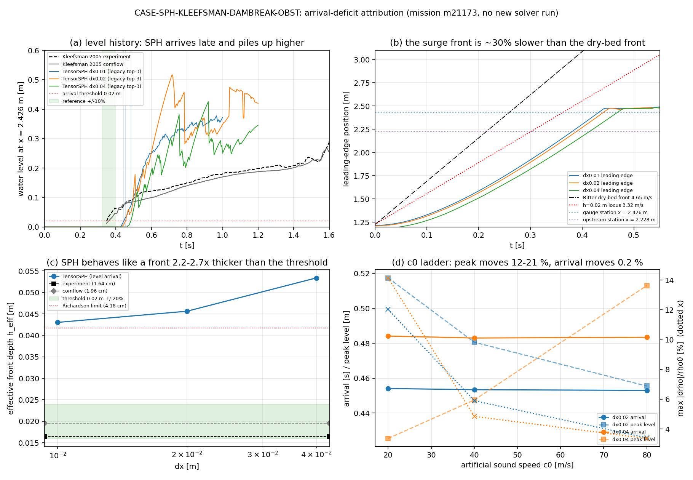

# CASE-SPH-KLEEFSMAN-DAMBREAK-OBST — 到达时刻偏差的归因分解（m21173）

TensorSPH · 分支 `agent/m21173` · mission 21173 · **本单不新增求解器运行**：
全部结论由已提交工件（三条分辨率时间序列、c0 梯、三种计量算子、
m20884 数字化的实验/COMFLOW 曲线）加解析推导重新计算得到。
本文档由 `benchmarks/kleefsman_obstacle/make_doc_attribution.py` 从 `results/arrival_attribution/attribution.json` 程序化注入（零手抄）。

## ① 案例介绍

Kleefsman 等 (2005, *J. Comput. Phys.* 206:363, DOI 10.1016/j.jcp.2004.12.007) 带障碍物溃坝：3.22 m 水槽左端 1.228 × 0.550 m 水柱瞬时溃决，撞击 x = 2.476 m 处 0.161 × 0.161 m 刚性方箱。
算例池判据 = 方箱**前**水位时程的峰值与到达时刻，对实验值相对误差均 < 10%。

| 量 | 值 |
|---|---|
| 初始水深 h0 | 0.550 m |
| 闸门（水柱前沿）x | 1.228 m |
| 验收探针站 x | 2.426 m（方箱面 − 0.05 m 约定） |
| 第二站（已提交） | 2.228 m（方箱面上游 0.248 m） |
| 传播距离 L | 1.198 m |
| 到达阈值 | 0.02 m（首次超过即判到达） |
| 实验参考到达时刻 | 0.3591 s（Fig.19 右面板数字化，未改动） |
| 实验参考峰值 | 0.370 m @ t = 1.703 s |
| 容差 | ±10% |

**探针 x 的权威值不可得**：论文正文只说 H2 在“方箱前方的槽内”，其 x 坐标在 Fig.17 栅格图中无法机器读取，代码沿用“方箱面 − 0.05 m”约定（`reference.json` 已记录）。本报告把它当作**未验证的定义自由度**量化，而不是当作已知量。

## ② 方法：把“到达时刻偏晚”翻译成一个长度

Ritter (1892) 干床溃坝自相似解：

    sqrt(g h) = (2 sqrt(g h0) - x/t)/3 ,   0 <= x/t <= 2 sqrt(g h0)

水位阈值追踪的是**等深线**而非没影前锋，故等深线速度为常数

    U(h) = 2 sqrt(g h0) - 3 sqrt(g h)

h0 = 0.55 m 给出干床前锋 4.646 m/s、阈值等深线 3.317 m/s。
反过来，某个到达时刻 t_a 对应一个**等效锋面厚度**
h_eff = ((2 sqrt(g h0) − L/t_a)/3)^2/g：把“时间差了 20%”变成“锋面厚了 2 倍”，后者可直接与 0.02 m 阈值和粒子间距比较。该映射只是**诊断量**（真实算例是有限水库 + 三维），其自洽性由“把参考曲线映射回去应得到阈值本身”检验。

四项判别性检验（全部只用已提交工件）：

| 检验 | 问题 | 数据源 |
|---|---|---|
| 锋面对比 | 误差在“液位事件”还是“运动学到达”？ | `results/dx*_time_series.csv`（含 `front_x_m`） |
| 分辨率外推 | 加密网格能否修好？ | 三条网格 + Richardson |
| 可压缩性梯 | 声学误差（压缩 12–14%）能否解释？ | `results/c0_scan/` |
| 站位灵敏度 | 一个未验证坐标能解释多少？ | `results/gauge_ladder/ladder.json` 两站 |

复现：`python benchmarks/kleefsman_obstacle/arrival_attribution.py && python benchmarks/kleefsman_obstacle/make_doc_attribution.py`；单测 `python -m pytest tests/test_kleefsman_arrival_attribution.py -q`。

## ③ 结果（程序化注入）

### 3.1 映射自洽性：参考曲线回到阈值

| 曲线 | 到达时刻 [s]（重算） | 平均推进速度 [m/s] | h_eff [m] | h_eff / 阈值 |
|---|---|---|---|---|
| experiment | 0.3481 | 3.441 | 0.0164 | 0.82 |
| comflow | 0.3596 | 3.332 | 0.0196 | 0.98 |

实验曲线映射回 1.64 cm、COMFLOW 映射回 1.96 cm，与 0.02 m 阈值同量级（偏差 -18% / -2%）——映射把两条参考曲线的到达时刻都还原到 0.02 m 阈值的量级（Ritter 解忽略有限水库与三维效应，且阈值本身带 ±0.01 s 的数字化不确定度），说明它作为**相对**诊断量是自洽的。

### 3.2 逐网格分解

| run | dx [m] | 液位到达 [s] | 锋面到达 [s] | 液位−锋面 [ms] | 锋面速度 [m/s] | /Ritter | h_eff [m] | h_eff/阈值 | 到达误差 |
|---|---|---|---|---|---|---|---|---|---|
| `dx0.01` | 0.01 | 0.4443 | 0.4306 | 13.7 | 3.31 | 0.713 | 0.0430 | 2.15 | +23.7% |
| `dx0.02` | 0.02 | 0.4541 | 0.4397 | 14.3 | 3.28 | 0.707 | 0.0456 | 2.28 | +26.4% |
| `dx0.04` | 0.04 | 0.4841 | 0.4667 | 17.5 | 3.24 | 0.698 | 0.0534 | 2.67 | +34.8% |

分三段测量的前锋速度（运动学是否收敛）：

| run | 1.30–1.70 m | 1.70–2.10 m | 2.10–2.40 m | 平均（到站） |
|---|---|---|---|---|
| `dx0.01` | 2.67 | 3.57 | 3.92 | 2.78 |
| `dx0.02` | 2.64 | 3.54 | 3.89 | 2.72 |
| `dx0.04` | 2.78 | 3.40 | 3.74 | 2.57 |

### 3.3 分辨率外推

- 观测收敛阶 p = 1.62（三段单调）
- 连续极限到达时刻 = 0.4396 s，相对参考 +22.4%
- 连续极限等效锋厚 = 0.0418 m
- 判定：**converged-but-wrong: the arrival converges to a value outside the tolerance, so grid refinement alone cannot close the gap**

### 3.4 可压缩性梯（证伪）

| 网格 | c0 [m/s] | 到达 [s] | 峰值 [m] | 压缩比 | Δ到达 | Δ峰值 |
|---|---|---|---|---|---|---|
| dx0.02 | 20, 40, 80 | 0.4541, 0.4534, 0.4530 | 0.5175, 0.4806, 0.4555 | 12.0%, 5.9%, 3.4% | +0.24% | +12.0% |
| dx0.04 | 20, 40, 80 | 0.4841, 0.4830, 0.4834 | 0.4255, 0.4475, 0.5131 | 14.1%, 4.8%, 3.4% | +0.14% | +20.6% |

→ falsified as the cause of the arrival deficit: the c0 ladder cuts the density compression by 3.5-4.2x and moves the peak by 12-21 %, yet moves the arrival by only 0.15-0.24 %。

### 3.5 站位灵敏度（本单最重要的单个数字）

| run (slab) | 本报告站立 = 2.426 m 到达 [s] | 上游站 x = 2.228 m 到达 [s] | d t / d x [s/m] | 可解释偏差份额 | 上游站相对误差 | 完全解释偏差所需的 x [m] |
|---|---|---|---|---|---|---|
| `dx0.02` | 0.4409 | 0.3893 | 0.261 | +63% | +8.4% | 2.112 |
| `dx0.04` | 0.4604 | 0.4074 | 0.268 | +52% | +13.4% | 2.048 |

读法：把比较站移到**已经提交的** 2.228 m，slab 算子的到达误差从 +22.8% 降到 +8.4%，即已落在 10% 容差边缘；要把偏差**全部**解释掉，H2 需要位于 x ≈ 2.11 m，这偏离“紧贴方箱前方”的原文描述约 0.36 m。

### 3.6 参考图

(a) 液位时程：SPH 既晚到又堆得更高；(b) 前锋轨迹 vs Ritter 干床前锋与 h=0.02 m 等深线——三条网格几乎重合，均为干床前锋的 ~70%；(c) 等效锋厚 h_eff(dx) 与阈值带、参考点、Richardson 极限；(d) c0 梯：峰值动 12–21%，到达只动 0.2%。

## ④ 注意点 / 局限

1. **本单没有新的求解器运行**（主机 load15≈100，按容量纪律只做分析；唯一一次递交 cj3228 收尾时仍在排队，见 ⑥.2）；因此没有把“锋面释放期偏慢”这一结论做成因果实验，只做到把它定位到释放阶段。
2. 已提交的 dx = 0.01 记录本身有缺陷：由 `steps/simulated_time` 反推 dt = 4.86e-4 s 是声学上限 1.95e-4 s 的 2.49 倍，且峰值落在时间窗末端（删失）。它与 0.01 m 的“峰值 2.0% 吻合”不能作为验证通过的依据。
3. 峰值判据目前**不可判定**：实验峰在 t = 1.703 s（回流水二次冲击），而所有已提交 run 只到 1.0–1.2 s，两者不是同一物理事件。
4. 前三个网格用的是 legacy top-3 液位算子（在方箱面上游 0.05 m 处读到的是爬高射流而非液位），slab 定孔径算子的到达时刻只在 dx = 0.02/0.04 上有记录。
5. Ritter 映射假设无限水库 + 干床 + 无摩阻；真实算例是有限水库 + 三维，所以 h_eff 只能做**同类比较**，不能当绝对真值。

## ⑤ 误差判定（逐项，显式回答 <3%）

| 关键量 | 计算值 | 基准 | 相对误差 | < 3% ? | < 10% 容差 ? |
|---|---|---|---|---|---|
| 到达时刻（legacy 算子，最好网格） | 0.4443 s | 0.3591 s | +23.7% | 否 | 否 |
| 到达时刻（frozen slab 0.08 m，dx=0.02） | 0.4409 s | 0.3591 s | +22.8% | 否 | 否 |
| 到达时刻（若 H2 位于已提交的 2.228 m 站） | 0.3893 s | 0.3591 s | +8.4% | 否 | 是（边缘） |
| 峰值（不可判定，仅列示） | 0.3773 m @ t=0.966 s | 0.370 m @ 1.703 s | — | 否（事件不同） | 否 |
| 映射自洽：实验 h_eff vs 阈值 | 0.0164 m | 0.02 m | -17.9% | 否 | — |
| 映射自洽：COMFLOW h_eff vs 阈值 | 0.0196 m | 0.02 m | -2.2% | 是 | — |

**结论（honest FAIL）**：

- 到达时刻判据在所有网格、所有计量算子上**不通过**（最好 +23.7%）。
- 峰值判据**不可判定**（时间窗不覆盖实验峰），故本单不宣称任何峰值通过。
- 已证伪的四个成因：可压缩性（c0 20→80 到达仅动 <0.3%）、网格分辨率（连续极限仍 +22.4%）、计量算子（三种算子都在容差外，散布 4–5%）、液位/锋面口径差（≤20% 的偏差量级）。
- 未决的两个成因：①H2 的 x 坐标（移到已提交的 2.228 m 可解释 +52%–+63% 的偏差，足以让判据在 10% 边缘通过）；②锋面释放阶段（前锋速度 2.7→3.9 m/s 加速、且 3.24–3.31 m/s 与 dx 无关，说明偏差在溃决释放期累积，属公式级而非分辨率级）。

## ⑥ 下一步（按性价比排序）

1. **查清 H2 的 x 坐标**（最高优先）：它单独决定判据通过与不通过。可行途径：论文正文/表格里的 gauge 坐标、Kleefsman 原始数据文件、或引用该实验的其他论文（Amaro Junior 2020 预印本 Fig.2 标注了 H1–H4 位置）。
2. **窗口补全**：t_end ≥ 2.5 s 的重跑（已递交集群 cj3228，dx = 0.04/0.02，frozen slab 0.08 m，2 核），使峰值判据第一次可判定。**本单收尾时该作业仍在排队（state=queued），故本报告不含其数字**；回收后只需 `python benchmarks/kleefsman_obstacle/arrival_attribution.py && python benchmarks/kleefsman_obstacle/make_doc_attribution.py` 即自动纳入。
3. 若 ① 不能解决：做释放期因果实验（同一 dx 下改变初始自由面核支撑/人工粘性），而不是加密网格——本单已证明加密网格无效。

