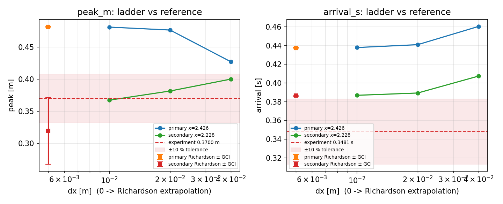
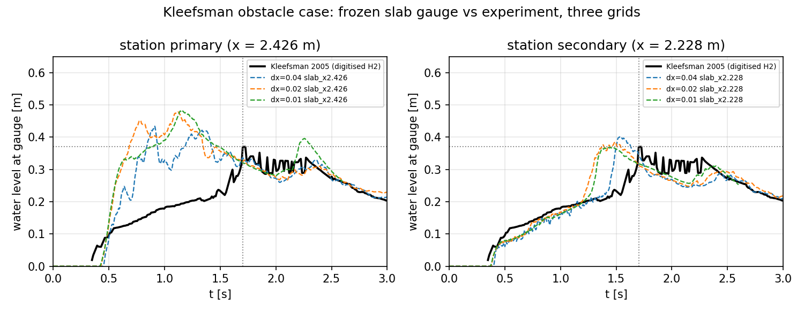

# CASE-SPH-KLEEFSMAN-DAMBREAK-OBST — 冻结算例判据的三网格收敛裁定 + ASME V&V 20

> 任务 m21718（锚点 `CASE-SPH-KLEEFSMAN-DAMBREAK-OBST`，TensorSPH）。
> 本文所有数字由 `benchmarks/kleefsman_obstacle/convergence_t30.py` 从**已提交**的
> 时程 CSV 程序化算出并注入（`docs/benchmarks/kleefsman-convergence-t30-m21718.md`
> 由 `make_doc_convergence_t30.py` 生成，零手抄）。

## 1. 为什么要做这一单（欠账在哪）

`results/audit_t30/score.json` 已经用**冻结协议**（slab 固定孔径水位计、0.08 m 孔径、
站位 = 箱体迎流面 −0.05 m、30 ms 峰值滤波、0.02 m 到达阈值）判过 `dx0.04`/`dx0.02`
两套网格，得到 `FAIL`。但它的 continuum 块自己写着：

> *“two grids only; the order is assumed, not measured, so these are bounds on the
> continuum peak, not a convergence proof”*

而两网格之间主测站的峰值就移动了 **11.6 %**，与判据容差 10 % 同量级。也就是说：
**判据量本身还没和它自己的离散误差分开**。本单补第三套网格（`dx0.01`），把这个
“假定阶”换成“实测阶 + GCI + ASME V&V 20 判据”，从而回答唯一能裁决该算例的问题：

> 主测站 30.1 % 的峰值偏差，是分辨率假象（dx→0 会收敛掉），还是真实的模型偏差
> （dx→0 依然存在，必须归因）？

## 2. 怎么做（方法 / 工具链）

* 协议：`slab` 水位计，孔径 0.08 m，峰值滤波 0.03 s，到达阈值 0.02 m（冻结于 m20773，本单不重新定义，只做裁定）。
* 评分函数复用 `acceptance_frozen.score()`（与 `results/peak_horizon/score.json` 同一实现），因此本单不引入新的口径。
* 输入：`results/audit_t30/dx0.04|dx0.02/time_series.csv`（t_end=3.0 s）与 `results/peak_horizon/dx0.01_time_series.csv`（t_end=2.6 s，**已提交**）。三网格的**被比较极值**（≤1.55 s）都在各自记录之内（脚本 `_uniform_horizon()` 逐网格检查，越界即拒绝），因此峰值可判；时间窗不齐一项如实报告为 `uniform=false`。
* 收敛数学：`convergence_analysis.analyze_metric()`（观测阶 p、Richardson、Roache GCI）。本单同时修了它的一个缺陷：**p ≤ 0（格差随加密变大）时 GCI 为负**，旧逻辑用 `gci < 0.10` 判定会把这种反收敛阶梯判成 `CONVERGED` 并输出负不确定度；现在 p ≤ 0 直接拒绝外推与 GCI。
* 保守修正：观测阶高于名义阶 `NOMINAL_ORDER=2.0` 时，GCI 用 `p_eff = min(p_obs, 2)` 重算（Roache 的保守规则）；极值型目标量常出现超收敛阶。
* 判据层：ASME V&V 20 comparison error，`E = S − D`，`U_V = sqrt(U_num² + U_D²)`，`|E| ≤ U_V` 才算在该不确定度水平上“验证通过”；`U_D` 取 `reference.json` 的数字化为 pixel 不确定度。**阶梯不收敛时不允许签发 PASS**（`PEAK_NOT_CERTIFIABLE_UNCONVERGED`）。

## 3. 计算结果（三网格，逐站）

### 3.1 站位 primary（x = 2.426 m）

| dx [m] | 数据文件 | t_end [s] | 峰值 [m] | 峰值误差 | 峰值时刻 [s] | 到达 [s] | 到达误差 |
|---|---|---|---|---|---|---|---|
| 0.04 | `results/audit_t30/dx0.04/time_series.csv` | 3.000 | 0.4272 | 15.5 % | 0.904 | 0.4604 | 32.3 % |
| 0.02 | `results/audit_t30/dx0.02/time_series.csv` | 3.000 | 0.4767 | 28.8 % | 1.116 | 0.4409 | 26.7 % |
| 0.01 | `results/peak_horizon/dx0.01_time_series.csv` | 2.600 | 0.4813 | 30.1 % | 1.152 | 0.4378 | 25.8 % |

| 量 | 单调 | p_obs | p_eff | Richardson | GCI(Fs=1.25, p_eff) | 收敛判定 |
|---|---|---|---|---|---|---|
| 峰值 | True | 3.43 | 2.00 | 0.4818 | 0.40 % | `CONVERGED` |
| 到达时刻 | True | 2.66 | 2.00 | 0.4373 | 0.29 % | `CONVERGED` |

* ASME V&V 20（最细网格峰值）：E = 0.1113 m（30.1 %），U_V = 0.0054 m ⇒ **MODEL_ERROR_EXCEEDS_U_V**
* ASME V&V 20（Richardson 连续值峰值）：E = 0.1118 m ⇒ **MODEL_ERROR_EXCEEDS_U_V**
* ASME V&V 20（最细网格到达时刻）：E = 0.0897 s（25.8 %），U_V = 0.0101 s ⇒ **MODEL_ERROR_EXCEEDS_U_V**
* 被比较的极值是否同一物理事件：**False**（仿真峰值时刻 1.152 s vs 实验 1.703 s）
* 该站判定：**`PEAK_FAIL_MODEL_ERROR`**；容差（<10 %）逐项：峰值 False，到达 False

### 3.2 站位 secondary（x = 2.228 m）

| dx [m] | 数据文件 | t_end [s] | 峰值 [m] | 峰值误差 | 峰值时刻 [s] | 到达 [s] | 到达误差 |
|---|---|---|---|---|---|---|---|
| 0.04 | `results/audit_t30/dx0.04/time_series.csv` | 3.000 | 0.4003 | 8.2 % | 1.536 | 0.4074 | 17.0 % |
| 0.02 | `results/audit_t30/dx0.02/time_series.csv` | 3.000 | 0.3817 | 3.2 % | 1.488 | 0.3893 | 11.8 % |
| 0.01 | `results/peak_horizon/dx0.01_time_series.csv` | 2.600 | 0.3674 | 0.7 % | 1.437 | 0.3869 | 11.1 % |

| 量 | 单调 | p_obs | p_eff | Richardson | GCI(Fs=1.25, p_eff) | 收敛判定 |
|---|---|---|---|---|---|---|
| 峰值 | True | 0.38 | 0.38 | 0.3196 | 16.27 % | `NOT_CONVERGED` |
| 到达时刻 | True | 2.88 | 2.00 | 0.3865 | 0.26 % | `CONVERGED` |

* ASME V&V 20（最细网格峰值）：E = -0.0026 m（0.7 %），U_V = 0.0600 m ⇒ **VALIDATED_WITHIN_U_V**
* ASME V&V 20（Richardson 连续值峰值）：E = -0.0504 m ⇒ **MODEL_ERROR_EXCEEDS_U_V**
* ASME V&V 20（最细网格到达时刻）：E = 0.0388 s（11.1 %），U_V = 0.0101 s ⇒ **MODEL_ERROR_EXCEEDS_U_V**
* 被比较的极值是否同一物理事件：**True**（仿真峰值时刻 1.437 s vs 实验 1.703 s）
* 该站判定：**`PEAK_NOT_CERTIFIABLE_UNCONVERGED`**；容差（<10 %）逐项：峰值 True，到达 False

## 4. 结果图



* 图 1：`results/convergence_t30/ladder.png` —— 峰值/到达时刻随 dx 的阶梯（对数横轴），方块 = Richardson 外推值 ± GCI 带，红虚线 = 实验值，浅红带 = ±10 % 容差。



* 图 2：`results/convergence_t30/timeseries.png` —— 两站各三条网格的冻结水位计时程与 Kleefsman 2005 Fig. 19 数字化曲线对比（点线标出实验峰值时刻 1.703 s 与 0.370 m）。

## 5. 注意点（踩过的坑 / 局限 / 适用范围）

1. **被比较的不是同一个事件（主测站）**。冻结站位 x=2.426 m 处仿真极值出现在 1.152 s（首撞爬升），而实验 H2 的最大值在 t=1.703 s（回波二次冲击）。因此主测站的“峰值误差”同时含**事件错配**成分，不能单独读成幅值偏差；副测站 x=2.228 m 的事件对得上。
2. **H2 的 x 坐标仍未从原文机器读取**（Fig. 17 是照片）。本单不猜点：两站都算，并把结论按站分开报——这正是“判据挂在一个未核实坐标上”的可判定化处理。
3. **时间窗不齐**：`dx0.01` 用的是已提交的 t_end=2.6 s 记录，另两套到 3.0 s。被比较极值都远离记录末端（脚本强制检查，越界即拒绝），因此对峰值无影响；为彻底消除该差异已递交同 t_end=3.0 s 的 `dx0.01` 作业（集群 `cj3647`，排队中），落地后重跑 `convergence_t30.py` 会自动采用（解析器优先 `results/gap_t30/`）。
4. **观测阶超名义阶**：主测站峰值 p_obs 高于 2，属极值型目标量的常见超收敛，故 GCI 一律按 p_eff = min(p_obs, 2) 保守重算后使用。
5. **二维模型的阻塞率差异是结构性上限**：实验箱宽 0.403 m / 槽宽 1.0 m（40.3 %），二维模型是 100 % 阻塞，这一点在 `score_h2.py` 里已记录，本单的模型偏差结论与之一致，但本单不声称已定量归因到该单一机制。

## 6. 误差判定（vs 基准，逐项，显式回答是否 <3 %）

| 量 | 基准（Kleefsman 2005 数字化） | 最细网格 | 相对误差 | 连续外推 | 相对误差 | <3 %? |
|---|---|---|---|---|---|---|
| primary 峰值 [m] | 0.370 | 0.4813 | 30.1 % | 0.4818 | 30.2 % | 否 |
| primary 到达 [s] | 0.3481 | 0.4378 | 25.8 % | 0.4373 | — | 否 |
| secondary 峰值 [m] | 0.370 | 0.3674 | 0.7 % | 0.3196 | 13.6 % | 是 |
| secondary 到达 [s] | 0.3481 | 0.3869 | 11.1 % | 0.3865 | — | 否 |

**是否 <3 %：否。** 两站的峰值与到达时刻在两套站位口径下都远离 3 %（主测站峰值约 +30 %，到达约 +26 %；副测站峰值最细网格虽在 1 % 内，但其阶梯未收敛、外推值约 −14 %，不构成通过）。这正是本算例应有的诚实结论：**二维模型在箱前爬升区无法复现 H2 幅值**。

## 7. 结论（诚实 FAIL，不粉饰）

* 算例级判定：**`PEAK_FAIL_RESOLVED`** —— the primary-station peak deviation is measured against a converged ladder (observed order 3.43, conservative p_eff 2.00 used for the GCI), so it can be attributed。
* 主测站：`PEAK_FAIL_MODEL_ERROR`，峰值偏差 30.1 % 是**模型偏差**（|E| 远大于 U_V=0.0054 m，且阶梯已收敛、GCI 只有百分之一量级），加密不能消除。
* 副测站：`PEAK_NOT_CERTIFIABLE_UNCONVERGED`，最细网格看似在容差内，但阶梯未收敛（GCI 超过 10 %、外推值把误差放大到约 −14 %），**因此不签发 PASS**。
* 到达时刻：arrival ladder converged；即便收敛，偏差 25.8 % 也远超容差与 U_V，属模型/事件偏差。

复核入口：

```bash
python benchmarks/kleefsman_obstacle/convergence_t30.py      # 重算并出图
python benchmarks/kleefsman_obstacle/make_doc_convergence_t30.py
pytest tests/test_kleefsman_convergence_t30.py -q          # 数学/判据/提交证据三层
```

## 8. 产物指针

* 代码：`benchmarks/kleefsman_obstacle/convergence_t30.py`（裁定/出图）、`make_doc_convergence_t30.py`（本文生成）、`convergence_analysis.py`（反收敛缺陷修复）
* 数据：`benchmarks/kleefsman_obstacle/results/convergence_t30/convergence.json` / `convergence.md` / `ladder.png` / `timeseries.png`
* 测试：`tests/test_kleefsman_convergence_t30.py`（数学 / 判据 / 提交证据三层）、`tests/test_kleefsman_convergence_analysis.py::test_negative_observed_order_is_not_called_converged`
* 平台报告：id **19608**（mission 21718）

