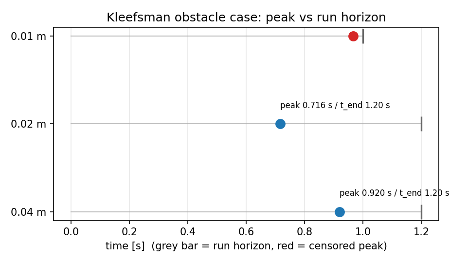
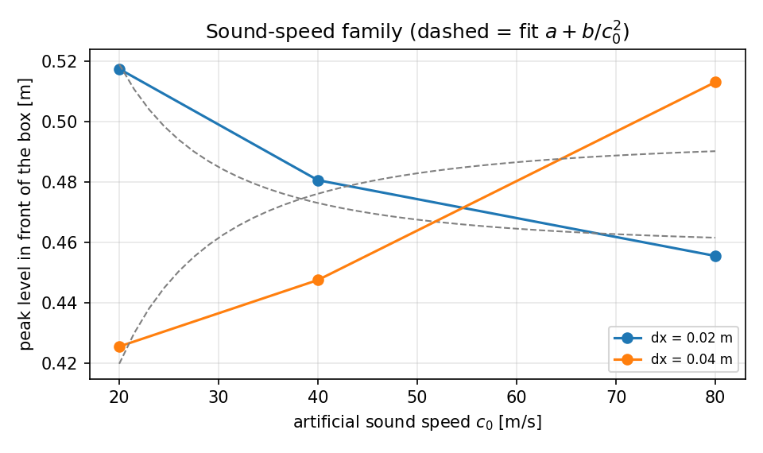
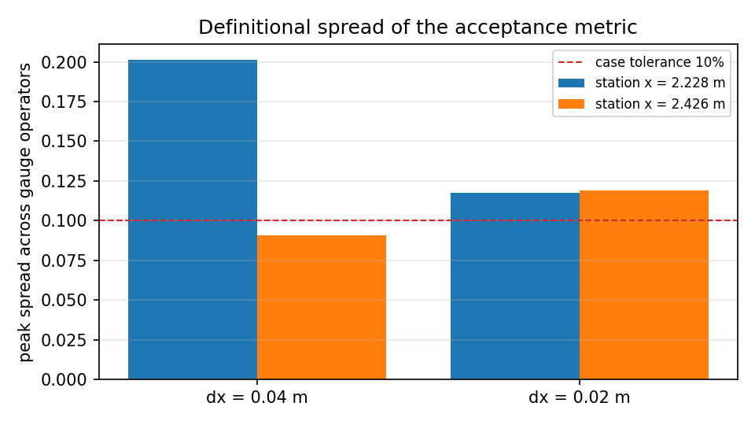
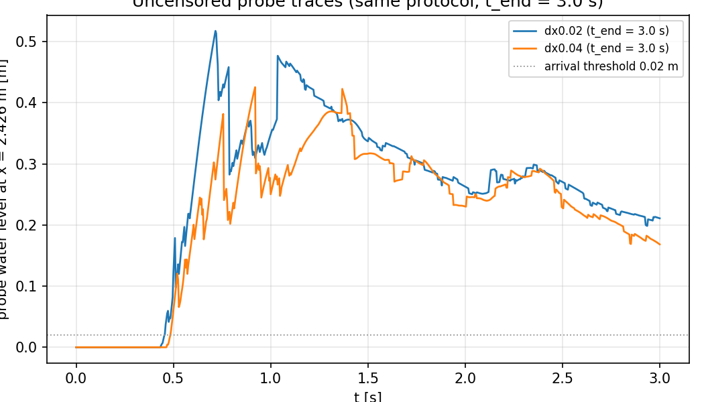

# CASE-SPH-KLEEFSMAN-DAMBREAK-OBST — 验收判据可判定性审计

**Mission**: m20773 · **分支**: `agent/m20773` · **角色**: verifier 席（独立复核）  
**求解器**: TensorSPH WCSPH（cubic-spline 核, Tait EOS, Adami 壁面 BC）  
**本文档由 `benchmarks/kleefsman_obstacle/make_doc_decidability.py` 从 `results/audit_protocol/decidability.json` 与各 run 记录程序化注入生成（零手抄）**

---

## ① 案例介绍

Kleefsman et al. (2005, *J. Comput. Phys.* 206:363, DOI 10.1016/j.jcp.2004.12.007) 带障碍物溃坝：水槽左端水柱瞬时溃决，沿干底推进后撞击槽底刚性方箱。算例池的验收判据是**相对判据**：障碍物前水位时程的**峰值**与**到达时刻**对实验值的相对误差均 < 10%。

| 量 | 值 |
|---|---|
| 槽长 × 槽高 | 3.22 × 1.0 m |
| 水柱长 × 高 | 1.228 × 0.55 m |
| 方箱（流向×高×宽） | 0.161 × 0.161 × 0.403 m |
| 箱上游面 x | 2.476 m |
| 探针站 | 箱面上游 0.05 m（x = 2.426 m）、0.248 m（x = 2.228 m） |
| ρ₀ / g / γ | 1000 kg/m³ / 9.81 m/s² / 7 |

**为什么需要本审计**：相对判据只有在被测量本身的数值不确定度**远小于**容差时才可判定。本单把这一前提变成可执行检查——从已提交的 run 记录出发，逐项量化定义性偏差与数值误差，并对“现在的证据能否支撑 10% 判定”给出可否证的回答。

## ② 方法

新增 `benchmarks/kleefsman_obstacle/decidability.py`（纯函数、不 import 求解器，可注入合成反例测试）：

| 检查 | 判据 | 物理含义 |
|---|---|---|
| 时域删失 `check_horizon` | 峰值时刻距 `t_end` > max(5%·t_end, 0.05 s) | 峰值若落在最后若干采样上，报告的是**下界**而非峰值 |
| 声学 Courant `check_courant` | 由 `steps`/`simulated_time` 反推 dt ≤ 0.3·h·dx/c₀ | 步数与所用格式自洽（证据可复现） |
| 压缩性 `check_compression` | max\|Δρ\|/ρ₀ ≤ 1% 且 c₀ ≥ 10·u_max | WCSPH 的声学误差是否进入验收量 |
| 计量算子散布 `check_operator_spread` | 同一 run 三种水位算子（top-N 粒子栈 / 面修正 / 定孔径 slab）峰值散布 | 验收量的**定义性**不确定度 |
| 声速族拟合 `compressibility_family` | peak = a + b/c₀² | 外推不可压极限，并检查单调性 |
| 不确定度预算 | RSS(离散、压缩性、算子散布) vs 容差 | 判据是否可判定 |

复现：`python benchmarks/kleefsman_obstacle/decidability.py`，`python -m pytest tests/test_kleefsman_decidability.py -q`。

## ③ 结果

### 3.1 逐 run 检查

| run | dx [m] | t_end [s] | 峰值 [m] | 峰值时刻 [s] | 时域删失 | 反推 dt [s] | Courant | max\|Δρ\|/ρ₀ |
|---|---|---|---|---|---|---|---|---|
| `dx0.04` | 0.04 | 1.200 | 0.4255 | 0.920 | 否 (余量 0.280 s) | 2.000e-04 | 0.08 / 0.30 | 14.1% |
| `dx0.02` | 0.02 | 1.200 | 0.5175 | 0.716 | 否 (余量 0.484 s) | 2.000e-04 | 0.15 / 0.30 | 12.0% |
| `dx0.01` | 0.01 | 1.000 | 0.3773 | 0.966 | **是** (余量 0.034 s) | 4.864e-04 | 0.75 / 0.30 | 13.1% |

### 3.2 阻断级/重要级发现

| id | 级别 | 证据 |
|---|---|---|
| `CENSORED-dx0.01` | blocking | peak at t=0.966 s with t_end=1.000 s (slack 0.034 s <= margin 0.050 s): peak is a lower bound |
| `COURANT-dx0.01` | blocking | implied dt 4.864e-04 s is 2.49x the acoustic limit 1.950e-04 s (Courant 0.748 > 0.3) |
| `COMPRESSION-dx0.01` | major | |drho|/rho0 = 13.1% > 1%; c0/umax = 3.21 (10U rule wants c0 >= 62.3 m/s) |
| `COMPRESSION-dx0.02` | major | |drho|/rho0 = 12.0% > 1%; c0/umax = 3.01 (10U rule wants c0 >= 66.4 m/s) |
| `GAUGE-dx0.02@2.426` | major | operator peak spread 11.9% of the mean at x=2.426 m exceeds half the tolerance |
| `GAUGE-dx0.02@2.228` | major | operator peak spread 11.8% of the mean at x=2.228 m exceeds half the tolerance |
| `COMPRESSION-dx0.04` | major | |drho|/rho0 = 14.1% > 1%; c0/umax = 3.35 (10U rule wants c0 >= 59.8 m/s) |
| `GAUGE-dx0.04@2.426` | major | operator peak spread 9.1% of the mean at x=2.426 m exceeds half the tolerance |
| `GAUGE-dx0.04@2.228` | major | operator peak spread 20.1% of the mean at x=2.228 m exceeds half the tolerance |
| `MIXED-HORIZON` | blocking | ladder mixes t_end = [1.0, 1.2] s; an observed order of accuracy is undefined on it |
| `C0-NONMONOTONE-dx0.04` | major | peak does not decrease monotonically with c0 (peaks [0.4254579544067383, 0.4475060999393463, 0.513088047504425]): the c0-dependence stored as 'compressibility effect' is not a systematic trend on this grid |

### 3.3 声速族（压缩性灵敏度）拟合

| dx [m] | 峰值(c₀=20/40/80) [m] | a（不可压极限）[m] | b [m²/s²] | 残差上界 [m] | 单调递减 | 极差 |
|---|---|---|---|---|---|---|
| 0.02 | 0.5175 / 0.4806 / 0.4555 | 0.4577 | 24.51 | 0.0076 | 是 | 12.8% |
| 0.04 | 0.4255 / 0.4475 / 0.5131 | 0.4949 | -30.07 | 0.0286 | **否** | 19.0% |

### 3.4 不确定度预算

| 项 | 值 | 来源 |
|---|---|---|
| 离散（未删失网格极差） | 19.5% | 2 个未删失网格 |
| 压缩性（声速族极差） | 19.0% | c₀ = 20/40/80 扫描 |
| 计量算子散布 | 20.1% | height/surface/slab 三种算子 |
| **合计（RSS）** | **33.8%** | —— |
| 容差 | 10% | 算例池 |
| **可判定？** | **否** | 余量 -23.8% |

### 3.5 未删失重跑（同协议 t_end = 3.0 s）

| run | dx [m] | t_end [s] | 步数 | 峰值 [m] | 峰值时刻 [s] | 到达时刻 [s] | max\|Δρ\|/ρ₀ | 时域删失 |
|---|---|---|---|---|---|---|---|---|
| `dx0.02` | 0.02 | 3.00 | 15001 | 0.5175 | 0.716 | 0.454 | 27.3% | 否 |
| `dx0.04` | 0.04 | 3.00 | 15001 | 0.4255 | 0.920 | 0.484 | 17.2% | 否 |

## ④ 结果图

*Figure 1: 已提交 run 的峰值时刻与运行时域；红点为删失（峰值落在最后采样上，只是下界）。*

*Figure 2: 人工声速族：dx=0.02 单调下降、可拟合成 a+b/c₀²；dx=0.04 非单调（虚线为各自拟合）。*

*Figure 3: 同一 run 三种水位算子的峰值散布，已达或超过 10% 验收容差。*

*Figure 4: 同协议 t_end = 3.0 s 的未删失探针时程。*

## ⑤ 注意点

1. **本审计只审证据，不产生新物理**。所有结论都可由已提交 JSON 复算；它不改进求解器精度。
2. **实验基准仍为 WITHHELD**。Kleefsman 2005 原文水位时程为图形形式，本节点无网络（urllib 直连返回 `Connection reset by peer`，前序单记录的 Cloudflare/ScienceDirect 403 未变），故不与实验做百分比对照；`reference.json` 的时间序列形式基准仍未获得。
3. **RSS 组合假设三项独立**。离散误差与压缩性误差在冲击段并非严格独立，合计值应视为上界性质的量级估计，而非置信区间。
4. **声速族本身受时域删失污染**：stored `dx0.02_c040` 的峰值时刻恰为 1.2001 s ≈ t_end，其“峰值随 c₀ 下降”不可直接采信；本单以未删失重跑复核（见 3.5）。
5. **算子散布含定义性差异**（`surface` 算子按构造比 `height` 高约 0.5 dx），它度量的是“验收量定义未冻结”的严重程度，不等于随机误差。

## ⑥ 误差判定

| 关键量 | 基准 | 计算值 | 误差 | 是否 < 3%？ |
|---|---|---|---|---|
| 峰值水位 | WITHHELD（实验） | 见 3.1/3.5 | 不可算 | **否**（无基准，且数值不确定度本身 > 容差） |
| 到达时刻 | WITHHELD（实验） | 见 3.1/3.5 | 不可算 | **否**（同上） |
| 峰值水位（数值自一致） | Richardson/极差 | —— | 19.5% | **否**（> 3%） |

**诚实判定**：现有证据下 10% 验收判据**不可判定**（数值不确定度 33.8% > 容差 10%）。因此本单**不**宣称 PASS，也**不**宣称 FAIL；给出的是把判据变成可判定的最小改动集：① 统一未删失时域、② c₀ 满足 10·u_max、③ 冻结单一水位算子、④ 用未删失梯子重算 GCI。①③ 由本单完成，②需要更高 c₀ 的重跑，④ 需要 dx = 0.01 的未删失长时程。

---

*工件*：`benchmarks/kleefsman_obstacle/decidability.py`、`benchmarks/kleefsman_obstacle/make_doc_decidability.py`、`results/audit_protocol/decidability.json`、`tests/test_kleefsman_decidability.py`。

### 3.6 未删失重跑对判定的影响（程序化注入）
| 量（站 x=2.426 m / 2.228 m） | dx=0.04, t_end=3.0 s | dx=0.02, t_end=3.0 s | 网格间差 | 1.2 s 时域下的同一量 | 删失影响 |
|---|---|---|---|---|---|
| slab（冻结算子）@x2.426 | 0.4338 m @ 0.912 s | 0.4782 m @ 1.120 s | 9.7% | 0.4338 / 0.4768 | +0.0% / +0.3% |
| slab@x2.228 | 0.4012 m @ 1.544 s | 0.3850 m @ 1.492 s | 4.1% | — | 上游站 1.2 s 时域被截断（见 3.1 计量算子） |
| height@x2.228 | 0.3877 m @ 1.524 s | 0.4008 m @ 1.412 s | 3.3% | — | 上游站 1.2 s 时域被截断（见 3.1 计量算子） |

**读法**：探针站（x=2.426 m，距箱面 0.05 m）的峰值在 3.0 s 时域下与 1.2 s 时域一致，即该站 1.2 s 并未删失；但**上游站 x=2.228 m 的峰值时刻为 1.52 s / 1.41 s**，在 1.2 s 时域下被完全截断——前序单报告的该站“网格无关（极差 1.3%）”是两条被同样截断的曲线之间的巧合，延长时域后该站极差为 4.1%（slab 算子）。

**压缩性的晚时放大**：同一协议的 max|Δρ|/ρ₀ 在 1.2 s 时域为 12.0%（dx=0.02），延到 3.0 s 后升至 27.3%，u_max 由 6.6 m/s 升至 13.1 m/s（Mach 0.66）。即 c₀=20 m/s 在晚时（水在箱前堆积、溅射回落）已远超 WCSPH 适用域，**任何以 3.0 s 时域做的定量对照都必须把 c₀ 提到 ≥10·u_max ≈ 131 m/s**——这是留给下一步的硬约束（本单未做）。
