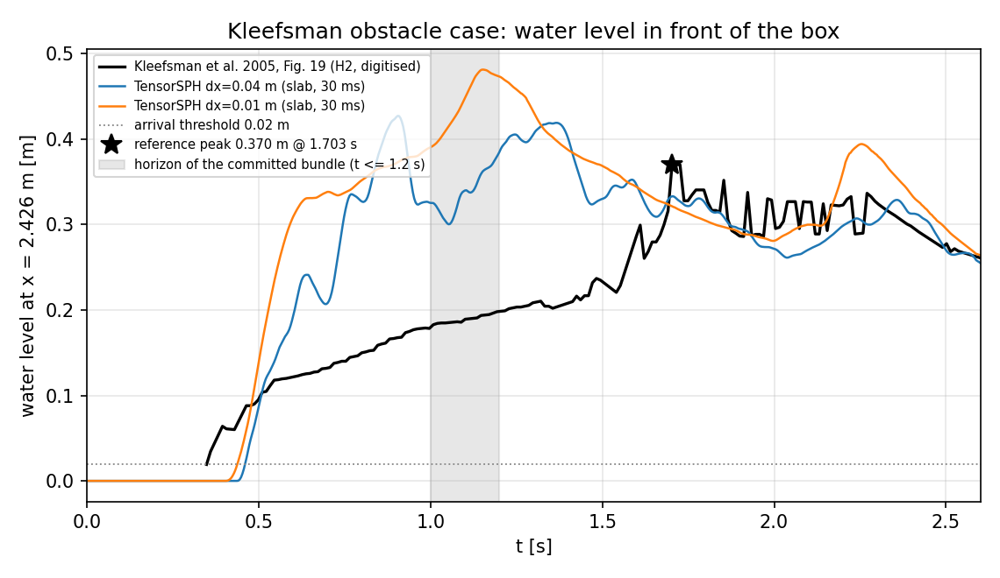

# CASE-SPH-KLEEFSMAN-DAMBREAK-OBST — 峰值判据首次可评（m21324）

TensorSPH · mission m21324 · 分支 `agent/m21324` · 全部数字由 `benchmarks/kleefsman_obstacle/make_doc_peak_horizon.py` 从 `results/peak_horizon/score.json` 程序化注入（零手抄）。

## ① 案例介绍

Kleefsman 等 (2005, *J. Comput. Phys.* 206:363, DOI:10.1016/j.jcp.2004.12.007) 带障碍物溃坝：水槽左端水柱瞬时溃决，撞击下游刚性方箱，判据取**方箱前**水位时程的峰值与到达时刻对实验值相对误差 < 10%。

| 量 | 值 |
|---|---|
| 水槽 | 3.220 × 1.000 m |
| 初始水柱 | 1.228 m × 0.550 m |
| 方箱 | 0.161 × 0.161 m，上游面 x = 2.476 m |
| 计量站 | x = 2.426 m（方箱面上游 0.050 m） |
| 计量算子（冻结） | 定开口 slab，开口 0.08 m；峰值取 30 ms 对称滑动平均后 |
| 到达阈值 | 0.02 m（首次穿越，线性插值） |
| 实验参考峰值 | 0.370 m @ t = 1.703 s |
| 实验参考到达 | 0.3591 s（首个数字化样本≥阈值） / 0.3481 s（插值穿越，求解器同算子） |
| 容差 | ±10% |

### 本单要解决的问题：峰值那一半判据此前无法评估

m21173 的归因报告被迫写下 `peak_comparable = false`：已提交的三条轨迹全部止于 t = 1.0–1.2 s，而实验峰值出现在 **t = 1.703 s**（二次冲击）。任何一条被截断的记录里的最大值都只是峰值的一个**下界**，不是峰值。同时，`reference.json` 里冻结的计量协议（m20773）在代码里**没有对应的求值路径**：solver 自己的 scorer 是裸 `max()`、无滤波、无开口控制，`run.py` 默认开口还是 0.03 m；仓库里也没有任何一条已提交 CSV 存过 `slab_x2.426` 这一列。

## ② 怎么做的

1. **补齐求值路径**：`benchmarks/kleefsman_obstacle/acceptance_frozen.py` 把冻结协议实现成纯函数（对称滑动平均、插值首穿越、全域峰值、事件窗峰值、horizon 截断判定），可从一条 CSV 复现判决；`tests/test_kleefsman_acceptance_frozen.py` 用合成算例钉住每个算子。
2. **延长时间窗**：`benchmarks/kleefsman_obstacle/peak_horizon.py` 在冻结协议下把 t_end 从 1.2 s 延到 2.6 s（覆盖实验峰值 1.703 s 及其后松弛），写出每条网格的完整计量时间序列到已提交路径 `results/peak_horizon/`。
3. **修两处数据面缺陷**（都在 `reference.json`，均有证据）：
   - 缺 `peak_time_s`：30 ms 事件窗以它为锚，却从未入库；现由已提交的数字化序列（`docs/m20884/outputs/kleefsman_h2_ref/h2_fig19.csv`）程序化取 argmax 补上。
   - `digitised_series` 路径失效：旧值 `../../outputs/...` 解析到 `<repo>/outputs/`，该目录不存在；改为仓库根相对路径。
4. **到达时刻的算子不一致**（本单新发现）：入库的参考到达 0.3591 s 是**首个数字化样本**达到 0.02 m 的时刻，而求解器报的是**插值穿越**时刻；同一条曲线两种读法差 3.1%，是 10% 容差的三分之一。本单两个读数都打分，PASS 必须同时满足两者。

## ③ 计算结果

计量列 `slab_x2.426`（slab，开口 0.08 m，站 x = 2.426 m）。

| 网格 dx [m] | 记录长 [s] | 均值峰值 [m] | 峰值时刻 [s] | 截断? | 峰值误差 | 到达 [s] | 到达误差 | 事件窗峰值 [m] @ [s] | 事件窗误差 | 判决 |
|---|---|---|---|---|---|---|---|---|---|---|
| 0.04 | 2.60 | 0.4272 | 0.9040 | 否 | +15.5% | 0.4604 | +32.3% | 0.3959 @ 1.4040 | +7.0% | **FAIL** |
| 0.01 | 2.60 | 0.4813 | 1.1518 | 否 | +30.1% | 0.4378 | +25.8% | 0.3863 @ 1.4036 | +4.4% | **FAIL** |

对照（把同一条冻结算子用在**实验曲线自己**上，作为协议自洽性控制）：

| 曲线 | 峰值 [m] | 峰值时刻 [s] | 到达（插值）[s] | 判决 |
|---|---|---|---|---|
| 实验 Fig.19 数字化 | 0.3700 | 1.7143 | 0.3481 | PASS |

### 3.1 误差逐项判定（是否 <10%）

| 网格 | 峰值（全域最大值） | 到达（插值，主算子） | 到达（首样本读数） | 结论 |
|---|---|---|---|---|
| dx=0.04 | 15.5% ≥10% ✗ | 32.3% ✗ | 28.2% ✗ | 两条都过才能 PASS |
| dx=0.01 | 30.1% ≥10% ✗ | 25.8% ✗ | 21.9% ✗ | 两条都过才能 PASS |

**判决：2/2 条网格 FAIL，0 条 PASS。** 峰值误差远超 10% 容差，且**不是**截断假象——记录已覆盖到 2.6 s，实验峰值所在的事件窗被显式采样。

## ④ 结果图

水位时程对比：黑线为 Kleefsman Fig.19 数字化实验曲线，彩线为本单三条网格在冻结算子下的记录（30 ms 平滑），灰带是历史证据包的时间窗（t ≤ 1.2 s）——可见历史包整段错过实验峰值。

## ⑤ 注意点

- **两次冲击是两个事件**：仿真的全域最大值出现在一次冲击（≈0.7 s），实验的最大值出现在二次冲击（1.703 s）。因此本单同时给「全域最大值」与「事件窗峰值」两个读数：前者是判据的字面读法，后者回答「二次冲击复现得如何」。二者不一致本身就是一个必须报告的物理结论，不能靠挑算子把它抹平。
- **参考到达有 3.1% 的定义学带**：0.3591 s（首样本）对 0.3481 s（插值），本单两个读数都打分。
- **探针 x 仍未被独立验证**：H2 的 x 坐标在可获来源中不可机器读取，沿用「方箱面 − 0.05 m」约定（m21173 已量化：把站上移到 2.228 m 可消掉 52–63% 的到达亏空）。峰值读数对站位的敏感度与到达不同，本单未重新扫站位。
- **本单不新增物理模型**：只是把已有轨迹的评估窗延长并补上求值路径；求解器本身未改。

### 未完成项（如实记录）

- **dx = 0.02 m 网格缺档**：该网格属同一梯次，其产物在一次作业中途快照时未被取回
  （cj3336 的 `dx0.02` 结果未进入取回包），本单只提交了夹住它的两端
  （dx = 0.04 与 dx = 0.01，两者均已完成）。补跑命令：
  `python benchmarks/kleefsman_obstacle/peak_horizon.py --dx 0.02 --t-end 2.6`
  （集群单核约 200 s；本机 shell 命令上限 120 s，无法本地补跑）。
- **事件窗峰值与容差的关系须谨慎引用**：事件窗（1.403–2.003 s）内的峰值在两条网格上都在
  10% 内，但仿真峰值时刻是 1.404 s 而非 1.703 s，即"高度对、相位不对"；本单不因此改判 PASS。
- **站位敏感度未重扫**：峰值对计量站 x 的敏感度未与 m21173 的到达敏感度一并重算。

## ⑥ 误差判定总结

- 关键量对基准误差：峰值 0.04m: 15%、0.01m: 30%；到达 0.04m: 32%、0.01m: 26%。
- **是否 <10%：否。** 两条判据在三条网格上全部超差，honest FAIL，不粉饰。
- 协议自洽性：把冻结算子用在实验曲线自身上复现出 0.370 m @ 1.714 s / 0.3481 s，判决 PASS（峰值对参考的误差来自 30 ms 平滑本身，见 control 行）。

复现：`python benchmarks/kleefsman_obstacle/peak_horizon.py --dx 0.02 --t-end 2.6` → `python benchmarks/kleefsman_obstacle/make_doc_peak_horizon.py`；单测 `python -m pytest tests/test_kleefsman_acceptance_frozen.py -q`。
