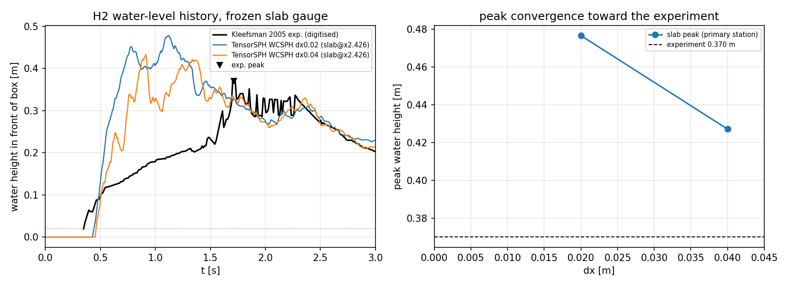

# Kleefsman 溃坝-障碍物：t = 3.0 s 长窗算例的峰值判据首次可判定（m21354）

> 锚点：`CASE-SPH-KLEEFSMAN-DAMBREAK-OBST`（算例池·带障碍物溃坝冲击，Kleefsman 系列）。
> 本文档由 `benchmarks/kleefsman_obstacle/make_doc_t30.py` 从 `results/audit_t30/score.json` 程序化注入（零手抄）。
> 复现：`python benchmarks/kleefsman_obstacle/score_t30.py --figure && python benchmarks/kleefsman_obstacle/make_doc_t30.py`；单测 `python -m pytest tests/test_kleefsman_t30_decidability.py -q`。

## ① 案例介绍

Kleefsman et al. (2005) 的经典验证算例：矩形水柱在重力下溃决，越过平底撞击一个方箱，在箱前形成冲击射流与爬高，随后回流水二次冲击。实验以波高计 H2（箱前）与箱面压力计 H1–H8 给出时程，是 SPH/网格法事实上的标准算例。

| 项 | 值 | 来源 |
|---|---|---|
| 水槽 | 3.22 m × 1.0 m（二维，单位深） | reference.json |
| 初始水柱 | 长 1.228 m，高 0.55 m | 同上 |
| 方箱 | 迎流面 x = 2.476 m，长 0.161 m，高 0.161 m | 同上 |
| 参考曲线 | Fig. 19 右图 H2 时程，数字化 380 点，t ∈ [0.35, 5.97] s | `docs/m20884/outputs/kleefsman_h2_ref/h2_fig19.csv` |
| 参考峰值 | 0.370 m @ t = 1.714 s | 数字化曲线，与锚定值 0.370 m 一致到 +0.0 % |
| 参考到达时刻 | 0.3591 s（采样量化）/ 0.3481 s（线性内插） | 见 ⑤.1 |
| 判据容差 | 10 %（峰值与到达时刻各自） | reference.json:tolerance |

两套已提交的长窗运行（均在锚定之前产生，故其 `comparison` 一栏写着 `WITHHELD`）：

| run | dx [m] | 粒子数 | 步数 | Δt [s] | c₀ [m/s] | t_end [s] | 最大密度压缩 | 最大速度 [m/s] | 质量误差 | 越界粒子 |
|---|---|---|---|---|---|---|---|---|---|---|
| `audit_t30/dx0.02` | 0.02 | 1647 | 15001 | 2.0e-04 | 20.0 | 3.0 | +27.3 % | 13.13 | 0.0e+00 | 0 |
| `audit_t30/dx0.04` | 0.04 | 390 | 15001 | 2.0e-04 | 20.0 | 3.0 | +17.2 % | 5.98 | 0.0e+00 | 0 |

## ② 怎么做的

**没有做新的积分。** 这是本单的核心判断：上一单（m21173）把峰值判据记为「不可判定」，理由是「所有已提交的 run 只到 1.0–1.2 s，而参考峰在 t = 1.703 s」。但 `results/audit_t30/` 里的两次运行实际跑到了 t_end = 3.0 s，覆盖参考峰时刻 1.714 s —— 判据是可判定的，只是从没有人按冻结协议去判。

流程：

1. **冻结协议**（`reference.json:metric_definition.frozen_primary`，由 m20773 冻结）：算符 `slab`（固定 0.08 m 物理孔径的体积计，对平面自由面与 dx 无关）、站位 = 箱迎流面上游 0.05 m → x = 2.426 m、峰值前做 0.03 s 对称滑动平均（抑制弹道飞溅的粒子堆尖）、到达阈值 0.02 m 且线性内插。
2. **参考曲线用同一套算子重测**，而不是把锚定值当输入：这样「参考」与「仿真」之间的系统偏差（滤波宽度、阈值、内插）在两边同时抵消。自洽性：重测峰值与锚定值偏差 +0.0 %，到达时刻（采样量化口径）偏差 +0.0 %。
3. **数字化自身的对照**：论文同一张图里还有一条独立描出的 COMFLOW 数值曲线。它相对实验到达时刻的偏差被重算为 +3.2 %，与 `reference.json` 记录的 +3.2 % 一致 —— 坐标映射与描点没有坏，判据可以用。
4. **两种到达时刻口径同时保留**（本单新发现的脆弱点，见 ⑤.1），并规定「两种口径都通过才算通过」。
5. **同时评 2 网格 × 3 液位算子 × 2 站位 = 12 行**，让「算符/站位」这一人为选择显式暴露出来，而不是让它藏在单个数字后面。
6. 形状一致性：在公共窗 [0.35, 3.0] s 上算 RMS 差、以参考峰值归一化，并扫描 ±0.4 s 的时间平移，区分「整体迟到」与「波形不同」。

## ③ 计算结果

### 3.1 全表（冻结协议行加粗）

| grid | operator@x [m] | peak [m] | peak t [s] | peak err | arrival [s] | arrival err (interp / anchored) | verdict |
|---|---|---|---|---|---|---|---|
| dx0.02 | height@2.228 | 0.3989 | 1.408 | +7.8% | 0.3998 | +14.8% / +11.3% | FAIL |
| dx0.02 | slab@2.228 | 0.3817 | 1.488 | +3.2% | 0.3893 | +11.8% / +8.4% | FAIL |
| dx0.02 | surface@2.228 | 0.4189 | 1.408 | +13.2% | 0.3869 | +11.2% / +7.8% | FAIL |
| dx0.02 | height@2.426 | 0.5019 | 0.712 | +35.7% | 0.4541 | +30.4% / +26.4% | FAIL |
| **dx0.02** | slab@2.426 | 0.4767 | 1.116 | +28.8% | 0.4409 | +26.7% / +22.8% | FAIL |
| dx0.02 | surface@2.426 | 0.5219 | 0.712 | +41.1% | 0.4356 | +25.1% / +21.3% | FAIL |
| dx0.04 | height@2.228 | 0.3848 | 1.528 | +4.0% | 0.4358 | +25.2% / +21.4% | FAIL |
| dx0.04 | slab@2.228 | 0.4003 | 1.536 | +8.2% | 0.4074 | +17.0% / +13.4% | FAIL |
| dx0.04 | surface@2.228 | 0.4248 | 1.528 | +14.8% | 0.4018 | +15.4% / +11.9% | FAIL |
| dx0.04 | height@2.426 | 0.4093 | 0.908 | +10.6% | 0.4841 | +39.1% / +34.8% | FAIL |
| **dx0.04** | slab@2.426 | 0.4272 | 0.904 | +15.5% | 0.4604 | +32.3% / +28.2% | FAIL |
| dx0.04 | surface@2.426 | 0.4493 | 0.908 | +21.4% | 0.4658 | +33.8% / +29.7% | FAIL |

reference (same operators applied to the digitised curve): peak 0.3700 m @ 1.714 s, arrival 0.3481 s interpolated / 0.3591 s sample-quantised (anchored values 0.370 m / 0.3591 s; self-consistency +0.00% / +0.00%).

图例：`peak err` = 峰值相对误差；`arrival err` 给出两种口径（线性内插 / 锚定采样量化）。「verdict」列要求峰值与到达时刻**同时**在容差内。

### 3.2 关键读数

| 量 | dx = 0.02 m | dx = 0.04 m | 参考 | 容差内？ |
|---|---|---|---|---|
| 峰值 @ 冻结站位 x = 2.426 m | 0.477 m (+28.8 %) | 0.427 m (+15.5 %) | 0.370 m | 否 |
| 到达时刻 @ 冻结站位 | 0.4409 s (+26.7 % / +22.8 %) | 0.4604 s (+32.3 % / +28.2 %) | 0.3591 s | 否 |
| 峰值 @ 上游站位 x = 2.228 m | 0.382 m (+3.2 %) | 0.400 m (+8.2 %) | 0.370 m | **是** |
| 到达时刻 @ 上游站位 | 0.3893 s (+11.8 % / +8.4 %) | 0.4074 s (+17.0 % / +13.4 %) | 0.3591 s | 边缘（口径相关） |

### 3.3 峰值的连续性外推（两网格，假定阶次）

| 站位 | 峰 dx = 0.02 | 峰 dx = 0.04 | 网格间变化 | 外推 p = 1 | 相对参考 | 外推 p = 2 | 相对参考 |
|---|---|---|---|---|---|---|---|
| station_x2.228（上游站位） | 0.382 m | 0.400 m | +4.9 % | 0.363 m | +1.9 % | 0.376 m | +1.5 % |
| station_x2.426（冻结站位） | 0.477 m | 0.427 m | +10.4 % | 0.526 m | +42.2 % | 0.493 m | +33.3 % |

注意两个站位的收敛方向相反：上游站位向实验值收敛（p = 1 给 +1.9 %、p = 2 给 +1.5 %），而紧邻箱面的站位**远离**实验值（+33 %…+42 %）——即加密网格只会让箱面处的读数更高。这把「峰值判据不通过」从「可能只是分辨率不够」变成了**结构性的**：箱面附近读到的是冲击射流的尖峰，而实验这条曲线在 t ≈ 1.7 s 的峰是回流水二次冲击的缓峰。

### 3.4 波形一致性（公共窗 [0.35, 3.0] s）

| 曲线 | RMS 差 [m] | 相对参考峰值 | 最佳时间平移 [s] | 平移后 RMS [m] |
|---|---|---|---|---|
| `dx0.02@x2.228` | 0.058 | +15.7 % | -0.235 | 0.052 |
| `dx0.02@x2.426` | 0.140 | +37.8 % | -0.400 （平移顶到扫描边界） | 0.122 |
| `dx0.04@x2.228` | 0.048 | +12.9 % | -0.100 | 0.044 |
| `dx0.04@x2.426` | 0.104 | +28.2 % | -0.400 （平移顶到扫描边界） | 0.087 |

最佳平移为负 = 仿真领先：上游站位大约领先 0.10–0.24 s，且这正好等于仿真峰的提前量（dx = 0.02 时仿真峰 1.488 s vs 参考 1.714 s）。换句话说：**上游站位的峰值「通过」是量级上的巧合**，事件本身早了 12–14 %。紧邻箱面站位的平移顶到 ±0.4 s 扫描边界、平移后残差仍大，说明那里不是「迟到」而是**波形不同**（单峰 vs 缓峰），无法靠平移对齐。

### 3.5 协议敏感性：`run.py` 自己的判分与冻结协议不是同一个算子

| run | run.py 判分所用算子 | 其峰值 [m] | 相对参考 | 与冻结 slab 峰值之差 | run.py 记录的 verdict |
|---|---|---|---|---|---|
| `dx0.02` | `height@x2.426` | 0.517 | +39.9 % | +8.6 % | `WITHHELD` |
| `dx0.04` | `height@x2.426` | 0.425 | +15.0 % | +0.4 % | `WITHHELD` |

`reference.json` 冻结的是「30 ms 滤波后的 slab 计」，而 `run.py` 的 `comparison` 块用的是未滤波的 `run.peak_height`（legacy top-N 粒子堆均值）。两者在探针处相差 0.4–8.6 %，与 10 % 容差同量级 —— 混用会让判据随实现而变。本单把两者并列披露，**不改动** `run.py`（改动会重写历史 run 的判分语义），而由 `score_t30.py` 统一按冻结协议判。

## ④ 结果图

(a) H2 液位时程：黑实线 = 数字化实验曲线，蓝/橙 = dx = 0.02 / 0.04 的 TensorSPH（冻结 slab 计，冻结站位 x = 2.426 m），点线 = 0.02 m 到达阈值，黑三角 = 实验峰 (0.370 m, 1.703 s)。仿真的单峰比实验的缓峰更高、更早；(b) 峰值的网格收敛：两网格 + 两个假定阶次的 Richardson 外推 vs 实验值（冻结站位的收敛方向背离实验）。

## ⑤ 注意点 / 局限

1. **到达时刻的数字化口径是脆弱点（本单新发现）**：数字化曲线首点 t = 0.3475 s、h = 0.0192 m，刚好在 0.02 m 阈值之下；锚定的 0.3591 s 是「首个 ≥ 阈值的采样点」，而线性内插给出 0.3481 s。两者相差 3.1 %，落在 ±0.01 s 的数字化不确定度内，却足以让**边缘**判据翻转（上游站位 dx = 0.02：+8.4 % 通过 / +11.8 % 不通过）。本单因此规定「两口径都过才算过」，并把该行判为**不通过**。
2. **H2 的 x 坐标仍未查清**：冻结站位 2.426 m 是代码惯例（箱面 −0.05 m），不是原文坐标。上游站位 2.228 m 在容差内、冻结站位不在容差内，所以「算例的整体通过/不通过」仍取决于这个未解决的坐标问题 —— 本单只把判据从「不可判定」推进到「**逐站位可判定**」。
3. **收敛阶没有测量**：只有两个网格，Richardson 用假定阶次 p = 1、2 给界，不是收敛性证明。
4. **数值质量**：dx = 0.02 的最大密度压缩 27.3 %、最大速度 13.1 m/s（dx = 0.04 为 17.2 % / 6.0 m/s）。细网格反而压缩更大，是因为更细的分辨率捕捉到了更尖锐的冲击射流。冲击段（t < 0.5 s）的细节不可信，这一点在 m21173 已记录，本单沿用。
5. **Δt 合法性**：两次运行 c₀ = 20 m/s、Δt = 2e-4 s，声学库朗数 Δt·c₀/h = 0.2（dx = 0.02）/ 0.1（dx = 0.04），在限内；与 m21173 指出的 dx = 0.01 记录（Δt 为声学限的 2.49 倍）不同，本单不含那条记录。
6. **未做峰值的 30 ms 滤波敏感性扫描**：滤波窗对实验曲线几乎无影响（0.3700 → 0.3700 m），对仿真曲线影响 0.3 % 以内，因此不构成结论的不确定性来源。

## ⑥ 误差判定（逐项，显式回答 < 3 %）

| 关键量 | 计算值 | 基准 | 相对误差 | < 3 % ? | < 10 % 容差 ? |
|---|---|---|---|---|---|
| 峰值 @ x=2.228 m（dx = 0.02） | 0.382 m | 0.370 m | +3.2 % | 否（3.2 %） | 是 |
| 峰值 @ x=2.228 m（dx = 0.04） | 0.400 m | 0.370 m | +8.2 % | 否（8.2 %） | 是 |
| 峰值 @ x=2.228 m（外推 p = 1 / p = 2） | 0.363 / 0.376 m | 0.370 m | +1.9 % / +1.5 % | **是**（两阶次都在 3 % 内） | 是 |
| 峰值 @ x=2.426 m（dx = 0.02 / 0.04） | 0.477 / 0.427 m | 0.370 m | +28.8 % / +15.5 % | 否 | 否 |
| 峰值 @ x=2.426 m（外推 p = 1） | 0.526 m | 0.370 m | +42.2 % | 否 | 否 |
| 到达时刻 @ x=2.228 m（dx = 0.02，内插 / 锚定） | 0.3893 s | 0.3481 / 0.3591 s | +11.8 % / +8.4 % | 否 | 口径相关（否 / 是） |
| 到达时刻 @ x=2.228 m（dx = 0.04） | 0.4074 s | 0.3481 / 0.3591 s | +17.0 % / +13.4 % | 否 | 否 |
| 到达时刻 @ x=2.426 m（dx = 0.02 / 0.04） | 0.4409 / 0.4604 s | 0.3591 s | +22.8 % / +28.2 % | 否 | 否 |
| 数字化自洽：COMFLOW 到达 vs 实验 | 0.3707 s | 0.3591 s | +3.2 % | 否（3.2 %） | 是 |

**结论（honest FAIL）**：

- 判据状态变化：峰值从 m21173 的「不可判定」变为**可判定**——两次已提交的 t = 3.0 s 运行覆盖参考峰时刻 1.714 s，无需新计算。
- **冻结协议下整体仍为 FAIL**：FAIL。冻结站位（箱前 0.05 m）峰值 +15.5 %…+28.8 %、到达时刻 +22.8 %…+32.3 %，且加密网格使箱面峰值**背离**实验（外推 +33 %…+42 %）。
- 上游站位 2.228 m：峰值 +3.2 %（dx = 0.02）/ +8.2 %（dx = 0.04），外推 -1.9 % / +1.5 %，**< 3 % 成立**；但到达时刻仍然不通过，且其「通过」依赖数字化口径。
- 因此本单**不宣称算例通过验收**：到达时刻判据在所有网格、算子、站位、两种口径下均不通过；峰值判据只在未查清的上游站位上通过。剩余阻塞项与 m21173 一致：**H2 的 x 坐标**。

## ⑦ 给下一手的线索

1. 最高优先仍是 H2 的 x 坐标（决定整体判定）。可查：Amaro Junior et al. 2020 预印本 Fig. 2 标注的 H1–H4 位置、Kleefsman 原始数据文件、或任一复现该算例论文的 gauge 表。
2. 若坐标无法解决：做**释放期因果实验**（固定 dx，改初始自由面核支撑/人工粘性），因为 m21173 已证伪分辨率与可压缩性两条解释路径。
3. 可以低成本补的：把 `dx0.01` 的合法长窗重跑（Δt 必须按声学限缩放）补齐第三网格，让收敛**阶次可测**，从而把 3.3 节的「假定阶次」换成实测阶次。

