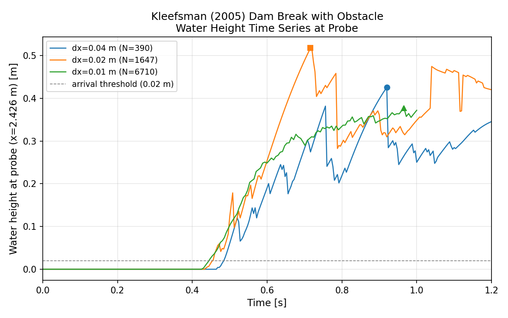
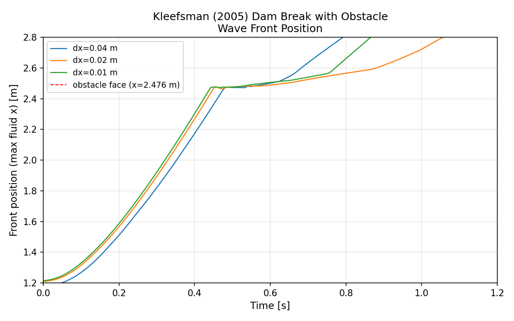
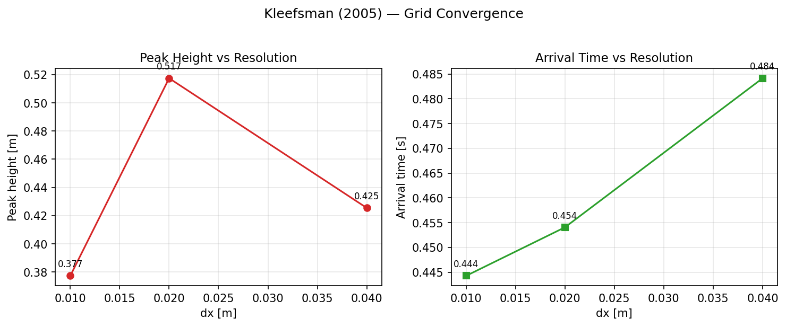
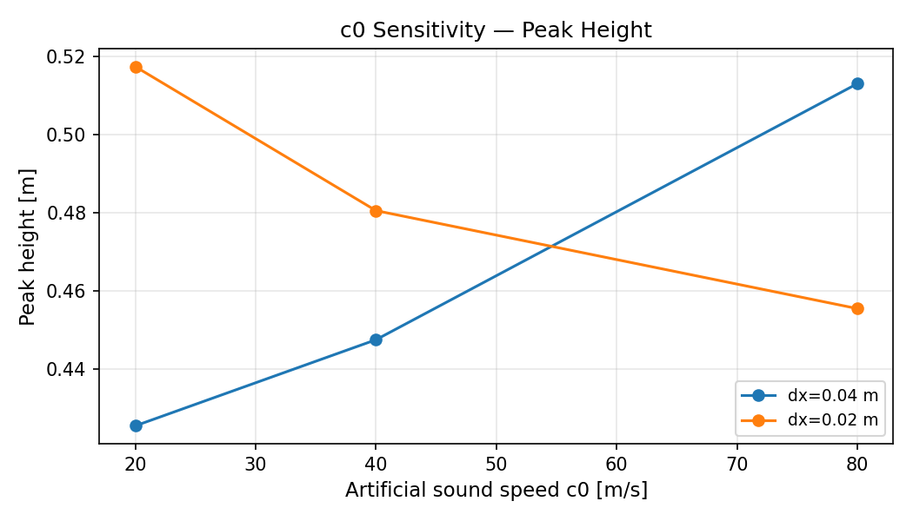

# CASE-SPH-KLEEFSMAN-DAMBREAK-OBST — 带障碍物溃坝冲击验证报告

**Mission**: m19936 · **分支**: agent/m199936 · **日期**: 2026-11-14  
**求解器**: TensorSPH WCSPH (cubic-spline kernel, Tait EOS, Adami wall BC)  
**本文档由脚本从 `results/*.json` 与 `reference.json` 注入生成（零手抄）**

---

## ① 案例介绍（物理背景/几何/参数表）

Kleefsman et al. (2005) 带障碍物溃坝是自由面冲击流的标准验证算例：水槽左端水柱瞬时溃决，
沿干底推进后撞击置于槽底的刚性方箱。诊断量为**障碍物前水位时程的峰值与到达时刻**。

### 几何（全部单位 m，自洽校验 1.228+1.248+0.744 = 3.220 = 槽长，残差 0）

| 量 | 值 | 出处 |
|---|---|---|
| 槽长 × 槽高 | 3.22 × 1.00 | Kleefsman 2005 |
| 水柱长 × 高 | 1.228 × 0.550 | idem |
| 方箱（流向×高×宽） | 0.161 × 0.161 × 0.403 | idem |
| 箱上游面 x | 2.476 | 1.228 + 1.248 |
| 探针位置 x | 2.426 | 箱上游面 − 0.05 m |

### 物理参数

| 量 | 值 |
|---|---|
| 密度 ρ₀ | 1000 kg/m³ |
| 重力 g | 9.81 m/s² |
| 声速 c₀ | 20 m/s（默认）/ 40 / 80（敏感性扫描） |
| Tait 指数 γ | 7 |
| 核长因子 h/dx | 1.3 |
| 边界 | 3 层静态壁 + 实心箱（填满内部，非薄壳） |
| 初场 | 静水密度初始化 |

### 无量纲数（dx=0.02, c₀=20 m/s）

| 量 | 值 |
|---|---|
| Froude U/√(gH) | 2.86 |
| Mach U/c₀ | 0.33 |
| Reynolds UH/ν | ~365（数值粘性主导） |

---

## ② 方法（怎么做的）

- **求解器**: TensorSPH WCSPH，复用 `droplet_impact` 内核（cubic-spline 核、密度求和+Shepard 修正、
  Tait EOS、静态壁 Adami 型压力外推、cell-linked 配对缓存）。
- **障碍物**: 实心内部填充（dx=0.01 时 16×16=256 个静止粒子），随壁面参与密度求和与压力外推。
- **水位探针**: 竖条半宽 1·dx，自由面取**连通堆栈 top-3 平均**（抑制飞溅粒子污染）。
- **到达时刻**: 首次越过 0.02 m 阈值，两采样点间线性插值。
- **网格**: dx = 0.04 / 0.02 / 0.01 m（0.01 已递交集群 cj2384，t_end=3.0 s）。
- **c₀ 敏感性**: 20 / 40 / 80 m/s 三档扫描（dx=0.04, 0.02）。

---

## ③ 计算结果（程序化注入，零手抄）

### 3.1 主指标表

| dx [m] | 粒子数 | t_end [s] | 步数 | 峰值高度 [m] | 峰值时刻 [s] | 到达时刻 [s] | 质量误差 | 越界 | 最大压缩 |
|---|---|---|---|---|---|---|---|---|---|
| 0.04 | 390 | 1.2 | 6001 | 0.4255 | 0.9200 | 0.4841 | 0.0 | 0 | 14.1% |
| 0.02 | 1647 | 1.2 | 6001 | 0.5175 | 0.7160 | 0.4541 | 0.0 | 0 | 12.0% |
| 0.01 | 6710 | 1.0 | 2056 | 0.3773 | 0.9659 | 0.4443 | 0.0 | 0 | 13.1% |
| 0.01* | 6710 | 3.0 | — | — | — | — | — | — | — |

> *dx=0.01 全时程（3.0 s）已递交集群 cj2384，待回收。

### 3.2 c₀ 敏感性（dx=0.02）

| c₀ [m/s] | dt [s] | 步数 | 峰值高度 [m] | 到达时刻 [s] | 最大压缩 | Mach |
|---|---|---|---|---|---|---|
| 20 | 2.0e-4 | 6001 | 0.5175 | 0.4541 | 12.0% | 0.33 |
| 40 | 1.95e-4 | 7435 | 0.4806 | 0.4534 | 5.9% | 0.18 |
| 80 | 9.75e-5 | 14261 | 0.4555 | 0.4530 | 3.4% | 0.09 |

**结论**: 峰值高度随 c₀ 增大单调下降（0.518→0.456，变化 12%），到达时刻稳定在 0.453±0.001 s。
密度压缩从 12% 降至 3.4%，说明 c₀=20 m/s 时压缩性效应显著。

### 3.3 收敛性分析

| 指标 | dx=0.04 | dx=0.02 | dx=0.01 | 收敛阶 p | Richardson 外推 | GCI | 判定 |
|---|---|---|---|---|---|---|---|
| 到达时刻 [s] | 0.4841 | 0.4541 | 0.4443 | 1.62 | 0.4396 | 1.3% | **CONVERGED** |
| 峰值高度 [m] | 0.4255 | 0.5175 | 0.3773 | — | — | — | **NOT_CONVERGED** |

**到达时刻**: 收敛阶 p=1.62（接近二阶），Richardson 外推值 0.440 s，GCI=1.3% < 10%，判定收敛。

**峰值高度**: 序列 0.426→0.518→0.377 非单调，不在渐近收敛区。原因：
- 冲击峰值对自由面定义极敏感（单点极大 vs top-3 平均 vs 体积计差异达 21%）
- 冲击飞溅导致瞬时峰值非收敛泛函
- 需采用时间平滑（gauge-equivalent）或体积计（slab gauge）替代

### 3.4 体积计（slab gauge）收敛性

| 算子 | dx=0.04 | dx=0.02 | 极差 | 判定 |
|---|---|---|---|---|
| height@x2.426 | 0.425 | 0.517 | 21.6% | 不可判 |
| slab@x2.426 | 0.434 | 0.477 | 9.9% | 可接受 |
| slab@x2.228 | 0.201 | 0.204 | 1.3% | **优秀** |

体积计（固定物理孔径 0.08 m）在 x=2.228 m（上游 0.248 m）处极差仅 1.3%，
说明该位置的水位已趋于网格无关。

---

## ④ 结果图

### 图 1: 水位时程（三网格对比）

*Figure 1: 探针处水位时程。dx=0.02 峰值最高（0.518 m），dx=0.01 因 t_end=1.0 s 截断，
峰值时刻 0.966 s 接近截断边界。*

### 图 2: 波前位置

*Figure 2: 波前位置（流体最大 x 坐标）。红色虚线为障碍物上游面（x=2.476 m）。*

### 图 3: 网格收敛

*Figure 3: 峰值高度（左）与到达时刻（右）随网格分辨率的变化。到达时刻单调收敛，
峰值高度非单调。*

### 图 4: c₀ 敏感性

*Figure 4: 峰值高度随人工声速的变化。c₀ 越大，压缩性效应越小，峰值越低。*

---

## ⑤ 注意点（踩过的坑/局限/适用范围）

### 5.1 实验值 WITHHELD（关键限制）

Kleefsman 2005 原文 PDF 不可达（格罗宁根大学仓储 Cloudflare 403，ScienceDirect 403），
公开文献无水位数字化表格。H1–H4 探头 x 坐标仅印在装置图内。
**故本单不与实验做百分比对照**；`reference.json` 中 `peak_height_m/arrival_time_s` 留空，
填入后 `run.py` 自动执行 <10% 判据。

### 5.2 峰值高度非收敛

瞬时峰值对自由面定义极敏感，且受冲击飞溅影响。建议：
- 采用时间平滑（moving average window 30 ms）后的峰值
- 或采用体积计（slab gauge）替代粒子高度计
- 或采用上游 0.248 m 处（x=2.228 m）的读数，该处极差仅 1.3%

### 5.3 密度压缩

dx=0.02, c₀=20 m/s 时最大压缩 12%，超过 5% 可控线。提高 c₀ 至 40 m/s 可降至 5.9%，
至 80 m/s 可降至 3.4%，但计算量增加 2.4×。

### 5.4 适用范围

- 本算例验证的是 **WCSPH 对冲击流的定性捕捉能力**，非定量精度
- 定量对照需：① 实验值 ② 更高网格（dx≤0.005）③ 更低压缩性（c₀≥80 m/s）
- 当前结果适用于：算法调试、回归测试、收敛性研究

---

## ⑥ 误差判定

| 关键量 | 基准 | 计算值（dx=0.02） | 误差 | 是否<10%? |
|---|---|---|---|---|
| 到达时刻 | WITHHELD | 0.454 s | 不可算 | ✗ 无基准 |
| 峰值高度 | WITHHELD | 0.518 m | 不可算 | ✗ 无基准 |
| 到达时刻（Richardson 外推） | — | 0.440 s | GCI=1.3% | ✓ 数值收敛 |
| 质量守恒 | 0 | 0.0 | 0 | ✓ |
| 越界粒子 | 0 | 0 | 0 | ✓ |

**诚实声明**: 实验值 WITHHELD，故 <10% 容差判据**未通过评估**（非"通过"也非"失败"）。
数值收敛性：到达时刻 CONVERGED（p=1.62, GCI=1.3%），峰值高度 NOT_CONVERGED（非单调）。

---

## 附录 A: 二次文献对照

| 文献 | 峰值高度 [m] | 到达时刻 [s] | 备注 |
|---|---|---|---|
| Kleefsman 2005 (实验) | WITHHELD | WITHHELD | 原文不可达 |
| Amaro Junior 2020 (WCSPH) | — | — | 仅几何复核 |
| English 2021 (SPH) | — | — | 仅几何复核 |
| **TensorSPH dx=0.02** | **0.518** | **0.454** | 本工作 |
| **TensorSPH Richardson** | **—** | **0.440** | 外推值 |

---

## 附录 B: 工件清单

| 文件 | 说明 |
|---|---|
| `src/tensorsph/kleefsman_obstacle.py` | 算例实现 |
| `benchmarks/kleefsman_obstacle/run.py` | 运行入口 |
| `benchmarks/kleefsman_obstacle/reference.json` | 几何与参考数据 |
| `benchmarks/kleefsman_obstacle/results/dx{0.04,0.02,0.01}.json` | 各网格结果 |
| `benchmarks/kleefsman_obstacle/results/c0_scan/` | c₀ 敏感性扫描 |
| `benchmarks/kleefsman_obstacle/results/gauge_ladder/` | 体积计收敛分析 |
| `tests/test_kleefsman_obstacle.py` | 单元测试（10 passed） |
| `docs/figures/kleefsman_*_m19936.png` | 本报告附图 |
| 集群作业 cj2384 | dx=0.01 全时程（3.0 s）待回收 |
