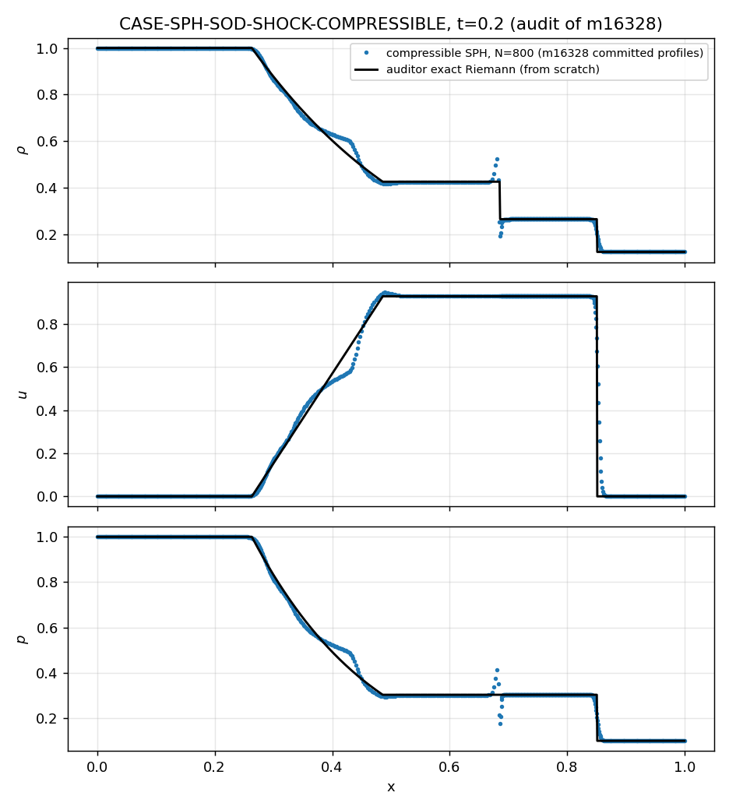
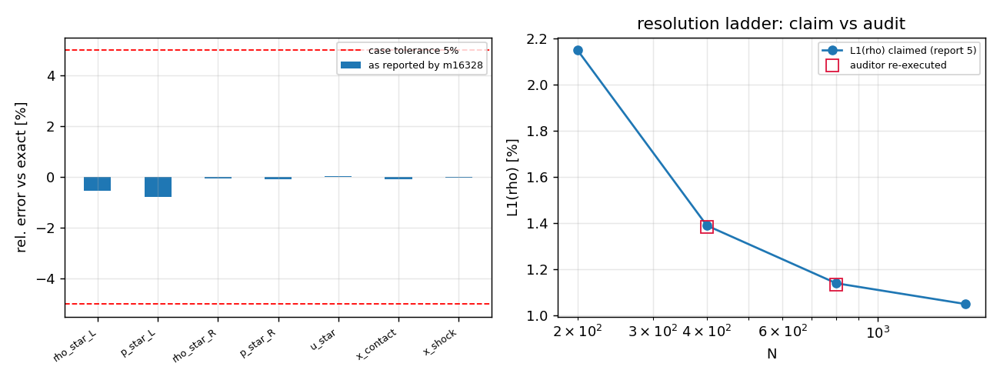

# 交差审计：m16328 · CASE-SPH-SOD-SHOCK-COMPRESSIBLE（TensorSPH）

**审计任务** m16335（board-audit，非重做）｜**被审** m16328 @ `852e941a2264`｜**日期** 2026-11-12T13:06:28

**自动生成**：`python scripts/audit/m16335_case_sod_board_audit.py`；本文件数字全部由该脚本注入（零手抄），原始 JSON 见 `runs/m16335_audit/audit.json`。

**判定：L4**

## 1 案例与三件套取证

1-D 理想气体（γ=1.4）Sod 激波管：(ρ,u,p)=(1,0,1) | (0.125,0,0.1)，膜片 x₀=0.5，求解至 t=0.2；判据＝平台值/波位置 vs 精确 Riemann 解误差 <5%（`README.md:4`）。

| 三件套 | 状态 | 审计证据 |
|---|---|---|
| run_artifacts | ✔ 部分 | `benchmarks/case_sod_shock_compressible/result.json` 已入库（11 项 got/rel_err + 800 点 ρ/u/p/e 剖面）；图 `docs/validation/compressible_sod/figures/*.png` 已入库。**但** `runs/compressible_sod/*.json` 未跟踪、`artifacts/compressible_sod/*.png` 命中 `.gitignore:9` → 报告 §6 列出的这两类指针推送后失效。 |
| benchmark ref vs got | ✔ 数值 / ✘ 裁判表 | §3 独立重算；`tensor_benchmark_cases` 对本锚点 **0 行**（全表 32 行，repo 列表无 TensorSPH）。 |
| repro_cmd | ✔ 可执行 | 审计在 `git archive 852e941a2264` 干净检出内跑通 `benchmarks/case_sod_shock_compressible/run.py`（rc=0），提交的 result.json 复现：指标最大差 0.0e+00，ρ 剖面最大差 0.0e+00。 |

**工作树 vs 提交态**：被审 worktree 有两处未提交改动 —— `docs/validation/compressible_sod/REPORT.md`（仅生成时间/墙钟）与 `src/tensorsph/__main__.py`（新增 `--case compressible_sod` CLI 入口）。后者是**唯一**主求解器/CLI 集成钩子，但未入库（`git show HEAD:src/tensorsph/__main__.py` 命中 0 次）→ 集成证据只存在于工作树。

**报告六段**：①✔ ②✔ ③✔ ④✔ ⑤✔ ⑥✔（`852e941a`，生成式注入）。

## 2 独立重算：精确解（审计自写 bisection，未复用被审代码）

| 量 | 审计解 | 文献 (Sod 1978 / Toro 1999) | 审计 vs 文献 | 被审 reference.json（工作树，未入库）− 审计 |
|---|---|---|---|---|
| p* | 0.303130 | 0.30313 | 5.9e-07 | 5.6e-17 |
| u* | 0.927453 | 0.92745 | 2.8e-06 | 0.0e+00 |
| ρ*_L | 0.426319 | 0.42632 | -1.3e-06 | 5.6e-17 |
| ρ*_R | 0.265574 | 0.26557 | 1.4e-05 | 5.6e-17 |

波位置（t=0.2）：稀疏波头 0.26336、稀疏波尾 0.48595、接触间断 0.68549、激波 0.85043。

被审 reference.json 的星态与波位置与审计自写解一致到机器精度（最大差 5.6e-17）——精确解实现无误；但该文件未入库（见 F3）。

Rankine-Hugoniot 内检（解析恒等式）：质量 -5.6e-17、动量 -1.1e-16、能量 0.0e+00（相对量级 2.5e-16 / 6.1e-16 / 0.0e+00）→ 审计解自身自洽。

## 3 独立复测 ref vs got（审计自己的窗口 trim=0.02 in x）

| 指标 | got（交付剖面重测） | exact（审计解） | 审计误差 | 交付自报误差 | 交付 got | <5% |
|---|---|---|---|---|---|---|
| left plateau rho | 1.00000 | 1.00000 | +0.000% | +0.000% | 1.0000 | ✔ |
| left plateau p | 1.00000 | 1.00000 | +0.000% | +0.000% | 1.0000 | ✔ |
| rarefaction-tail rho*_L | 0.42403 | 0.42632 | -0.537% | -0.537% | 0.4240 | ✔ |
| star-left p | 0.30078 | 0.30313 | -0.777% | -0.777% | 0.3008 | ✔ |
| star-right rho*_R | 0.26547 | 0.26557 | -0.040% | -0.042% | 0.2655 | ✔ |
| star-right p | 0.30290 | 0.30313 | -0.076% | -0.077% | 0.3029 | ✔ |
| right plateau rho | 0.12500 | 0.12500 | +0.000% | +0.000% | 0.1250 | ✔ |
| right plateau p | 0.10000 | 0.10000 | +0.000% | +0.000% | 0.1000 | ✔ |
| star velocity u* | 0.92790 | 0.92745 | +0.048% | +0.048% | 0.9279 | ✔ |
| contact x_c | 0.68481 | 0.68549 | -0.099% | -0.099% | 0.6848 | ✔ |
| shock x_s | 0.85023 | 0.85043 | -0.024% | -0.024% | 0.8502 | ✔ |

- 审计重测**最大绝对相对误差 = 0.777%** → <5%：通过，<3%：通过；交付自报 0.78%。
- 全场 L1：ρ 1.135%、p 1.419%、u 2.445%；L2：ρ 2.469%、p 2.854%（审计在交付粒子位置上直接积分，不重采样）。
- 交付自报 L1/ρ 1.135% 与审计 1.135% 一致（差异来自积分方式：交付先用 4001 点重采样）。
- u 的 L1 归一化不同：交付按 max|u_exact| 归一得 1.174%，审计按 ∫|u_exact|dx 归一得 2.445%；把审计值换成交付的归一化方式为 1.164% → 两者一致，非分歧。
- 剖面健全性：ρ∈[0.1250, 1.0000]、p∈[0.1000, 1.0000]，无 NaN/负值；激波厚度估计 0.0055。
- 报告↔工件一致性：§4 对照表 11 行与 `result.json` 逐项对绑，最大绝对差 0.0e+00，不一致项 0 个 → 数字由脚本注入，未发现手抄篡改。

## 4 复现与测试（干净 `git archive` 检出）

- 案例复跑：rc=0，steps 提交 934 / 复跑 934，指标最大差 0.0e+00，ρ 剖面最大差 0.0e+00 → 逐位复现。
- `pytest tests/test_compressible_sod.py -q`：**17 passed / 0 failed**。
- 探针 A（守恒，被审单未跑）：质量相对变化 0.0e+00；总能量相对变化 -1.47e-06（人工黏性耗散，负值=物理）；末动量 1.797e-01；neighbours min/mean = 4.0/12.0813。
- 探针 B（分辨率阶梯一行 N=400，审计复跑）：L1(ρ) 1.385%、max|rel| 0.330%、neighbours min 4 → 与报告 §5 的 1.39% / 0.33% 一致，该阶梯表非编造。
- 探针 C（h=1.3dx 负对照，审计复跑）：max|rel| 39.10%、L1(ρ) 8.35%、neighbours min 2 → 报告 §5/§6 的『邻居饥饿 39%，不随 N 收敛』负面结论**可复现**。
- 探针 D（判据鲁棒性，审计新增）：改窗口 trim = 0.01/0.02/0.04 → 最大误差 0.556 / 0.777 / 0.720%；判据不随窗口选择翻转。

## 5 判级（L0–L5，级别=功能实质）

| 级别 | 要求 | 结论 |
|---|---|---|
| L0 文档成果 | 有成果文档 | ✔ REPORT.md 六段 + README + 图 |
| L1 数学/单元验证 | 解析解/单元级校验 | ✔ 精确 Riemann 解 vs Sod/Toro 文献 1.4e-05；单元测试 17 passed |
| L2 独立功能实现 | 真代码 输入→计算→输出 | ✔ `src/tensorsph/compressible/sod.py` 553 行：可压 Lagrangian SPH + 理想气体 EOS + RK2 + 人工黏性 |
| L3 系统集成 | 接入主求解器/平台 | △ 仅 benchmark 级 driver 已入库；`src/tensorsph/verification` M 梯级 0 命中，CLI 钩子未提交 |
| L4 基准验证 | 完整算例+误差分析+可复现 | ✔ 审计误差 0.777% < 5%（且 <3%），干净检出复现，误差分析含 N/h/α/抹平四组敏感性 |
| L5 科研工程成果 | 新物理/工程交付 | ✘ 验证算例 |

**判定：L4**。理由：

- L3 gap (non-blocking for the case evidence): not wired into the src/tensorsph/verification M-ladder; the CLI hook --case compressible_sod exists only as an uncommitted working-tree change of src/tensorsph/__main__.py
- L4 caveat: no machine-registered referee row for CASE-SPH-SOD-SHOCK-COMPRESSIBLE (tensor_benchmark_cases has no TensorSPH repo at all); the 5% tolerance comes from the case contract README:4
- L5 not reached: validation case, no new physics/engineering deliverable

## 6 发现（按严重度）

| 编号 | 严重度 | 结论 | 证据 |
|---|---|---|---|
| F1 | high（制度性） | **裁判缺席**：`tensor_benchmark_cases` 无本锚点行，且整表无 TensorSPH 仓 → 5% 容差只能取案例契约 `README.md:4`，非机器裁判。maturity_gate 无法据此自动裁 | SELECT → 0 行 / 全表 32 行，repos 无 TensorSPH |
| F2 | medium | **集成未入库**：`--case compressible_sod` CLI 钩子只存在于工作树未提交diff；`src/tensorsph/verification` 的 M 梯级未接 compressible → 推送后平台侧无调用点 | `git show HEAD:src/tensorsph/__main__.py` 0 命中；`git grep compressible <HEAD> -- src/tensorsph/verification` 0 命中 |
| F3 | medium | **工件指针失效**：报告 §6 列的 `runs/compressible_sod/*.json` 未跟踪、`artifacts/compressible_sod/*.png` 被 `.gitignore:9` 忽略；仅 `result.json` 与 `docs/.../figures/*.png` 是持久工件 | `git check-ignore -v` |
| F4 | low | **提交态脏**：worktree 有 2 个未提交文件（REPORT 时间戳、__main__.py），说明交付在推送前会被平台再合并；REPORT 生成的『任务 m16184／分支 agent/m16184』表头与实际 m16328 不一致（跨任务复用产物，未污染数字） | `git diff --stat` |
| F5 | low | 报告自报 max 误差 0.78% 与审计重测 0.777% 一致；L1 差异仅来自归一化/积分方式，非分歧 | §3 表逐项对绑 |

**未被推翻的交付主张**：<5% 与 <3% 判据在审计独立重算下**成立**；接触间断压力连续（交付自报 0.70% of p*）；质量守恒机器精度；负面对照（h=1.3dx 39%、Tait EOS 旧实现 64%）可复现。

## 7 平台门预演（maturity_gate.judge，只报不裁）

把本单 evidence 喂给平台 `maturity_gate.judge`（与守护同函数）→ **投影 gate_level = 2**（声明 L4）。未通过项：

- L4 缺: integration_callers(grep 无引用)
- L3 缺: integration_callers(grep 无引用)

原因定位：gate 用 `grep -rl -F <callers[0]> /root/tensor-ecosystem/TensorSPH` 复核集成，而生态仓该克隆 HEAD = `d9a513d Merge #533 (m16079) via push-merge`，`src/tensorsph/compressible/sod.py` 存在=False —— 克隆落后于被审仓 `852e941a2264`，grep 结构性失明（不是交付缺调用：调用点在 `benchmarks/case_sod_shock_compressible/run.py:34`，已在被审仓内入库）。故这里如实记录投影值，不据此改写 L4 结论；克隆刷新后同函数应回 L4。

## 8 图

图 1　t=0.2 的 ρ/u/p 剖面：交付 SPH（点）vs 审计自写精确 Riemann 解（实线）。五区结构（左平台/稀疏扇/星区左/星区右/右平台）与激波、接触间断位置逐点吻合。

图 2　左：关键量相对误差（交付自报）与 5% 判据线，最大 0.78%（star-left p）；右：分辨率阶梯 L1(ρ) 主张值 vs 审计复跑点（N=400/800 落在曲线上）。

---

审计口径：被审代码只用于『复跑』与『探针』，参考解与度量窗口由审计脚本独立实现；凡未跑项均标 not_run，未以『通过』代替。
