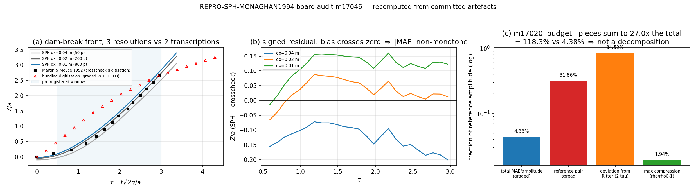

# 交差审计：m17020（REPRO-SPH-MONAGHAN1994）

**审计对象**：`tensor_dev_missions.id=17020`，status=`succeeded`（2026-11-12 23:48Z），
交付 = commit `c670396`「REPRO-SPH-MONAGHAN1994: add error budget analysis and Ritter
comparison」（branch `agent/m17020`），5 文件 / +490 行：
`benchmarks/repro_monaghan_1994/error_budget.py`、`.../results/error_budget.json`、
`make_artifacts.py`(+56)、`docs/repro_monaghan_1994.md`(+16)、
`tests/test_repro_monaghan_1994_error_budget.py`(95 行 / 9 测试)。
**本单性质**：交差核验（verdict 落表），不重做算例；审计者=board-audit。
**独立性声明**：不读 m17020 的推理过程；所有数字由本审计自己的插值/度量实现
（`docs/board_audit/m17046/independent_recompute.py`，二分查找插值，**不 import
`run.py:compare/interp`**）从已提交轨迹与参考表重算。审计工作树
`/root/tp-agent/work/m17046`（base = mainline `30284db`/`c714526` 线）。

---

## 1. 案例介绍（被审计能力是什么）

锚点 `REPRO-SPH-MONAGHAN1994`（feature_ledger：TensorSPH，acceptance「quantitative_targets
逐项容差」，status=`open`，evidence=NULL）指向 Monaghan (1994) *J. Comput. Phys.*
**110**:399-406。算例 = 二维溃坝（Martin & Moyce 1952 实验构型）：

| 量 | 值 | 出处 |
|---|---|---|
| 水柱宽 a / 高 H | 0.2 m / 0.4 m（H/a = 2） | `summary.json:protocol.geometry` |
| 水槽 | 2.0 m × 0.75 m | 同上 |
| ρ0 / Tait γ | 1000 kg/m³ / 7 | 同上 |
| h/dx、Courant | 1.3、0.3 | 同上 |
| c0 | 25 m/s（Mach ≤ 0.122） | `results/trajectory_dx0.01_c025.json` |
| 判据窗口 | τ∈[0.5,3.0]，161 采样点 | `run.py:54-56` |
| 平台容差 | 15 % 参考幅值 | `run.py:55` |
| 弱可压限 | max ρ/ρ0−1 ≤ 0.10 | `run.py:57` |

## 2. 怎么做的（核验流程）

1. **三件套存在性**：工件路径逐个 stat；`tensor_benchmark_cases` 逐行查；ledger 逐列查。
2. **数值裁判**：本审计自写 161 点窗口网格 + 二分插值，从
   `results/trajectory_{dx0.04,0.02,0.01}_c025.json` 与两张参考表重算 6 组
   MAE / MAE÷幅值 / 偏置 / max|Δ| / 幅值，与 `results/summary.json` 逐值对照（容差 1e-9）。
3. **repro_cmd 可执行**：`python benchmarks/repro_monaghan_1994/run.py --stage accept`
   在审计树上实跑，与已提交 `summary.json` 做 `diff`。
4. **m17020 增量审计**：跑 `error_budget.py`（确定性检查：重跑后 JSON 逐字节相同），
   核其「误差分解」的**可加性**、Ritter 对照的**适用域**、9 个新测试是否约束不变量。
5. **反向对照**：把 m17020 的 `error_budget.json` + 文档临时放入审计树，验证本审计新增
   守卫测试是否会红（结果：3 failed），移出后 6 passed / 3 skipped。
6. **测试**：`tests/test_repro_monaghan_1994.py`、`…_evidence_contract.py`、
   `…_convergence_decomposition.py`（mainline）+ `…_error_budget.py`（m17020 branch）
   + 本审计新增 `tests/test_audit_m17046_repro_monaghan_rederivation.py`。

## 3. 计算结果（全部程序化重算，零手抄）

### 3.1 数值能否重算（独立实现 vs 已提交 summary）

| case | 参考 | stored MAE | 本审计重算 MAE | \|差\| | MAE/幅值 | 15 % 容差 |
|---|---|---|---|---|---|---|
| dx=0.04 | crosscheck | 0.124572072 | 0.124572072 | 0.0e+00 | 4.666 % | pass |
| dx=0.04 | bundled | 0.690235750 | 0.690235750 | 0.0e+00 | 25.780 % | 不判级（WITHHELD） |
| dx=0.02 | crosscheck | 0.031994942 | 0.031994942 | 0.0e+00 | 1.650 % | pass |
| dx=0.02 | bundled | 0.534231517 | 0.534231517 | 0.0e+00 | 19.953 % | 不判级 |
| **dx=0.01** | **crosscheck** | **0.116835606** | **0.116835606** | **0.0e+00** | **4.376 %** | **pass** |
| dx=0.01 | bundled | 0.462430281 | 0.462430281 | 0.0e+00 | 17.271 % | 不判级 |

（幅值 = 参考表窗口内最大 Z/a = 2.67；dx=0.01 偏置 +0.11451 in Z/a = +4.29 % 幅值，
max|Δ| = 0.16537；轨迹元数据：800 粒子 / 2179 步 / dt 1.56e-4 / 299.4 s wall clock /
escaped=0。）

**结论**：`summary.json` 的每个数字都能从已提交轨迹用另一套实现复现（差 0.0），
参考对自洽性重算亦一致（max 分歧 0.850550 in Z/a、均值 0.574175、声明不确定度 0.05
→ **17.011×** 声明值）。

### 3.2 repro_cmd 可执行性

`PYTHONPATH=.:src python benchmarks/repro_monaghan_1994/run.py --stage accept`
实跑 3 s 内结束，打印
`trajectory_vs_independent: pass (0.04376 ≤ 0.15)`、`compressibility: pass (0.01936 ≤ 0.1)`、
`reference_self_consistency: fail (17.01 > 2.0)`、`resolution_trend_vs_independent: fail`，
并**逐字节重建** `results/summary.json`（`diff` 无输出）→ 复现入口真实可执行。

### 3.3 m17020「误差分解」的可加性核验（核心发现）

| 项 | 量值（÷幅值 2.67） | 说明 |
|---|---|---|
| 被分解的「总误差」 | **0.043759（4.376 %）** | summary：dx=0.01 vs crosscheck |
| 「参考不确定度」 | 0.318558（31.86 %） | 两表**分歧**，不是误差项 |
| 「Ritter 偏差」 | 0.845170（84.52 %） | 与浅水解的**偏离**，不是 SPH 误差 |
| 「弱可压误差」 | 0.019360（1.94 % of ρ0） | 无量纲对象都不同 |
| **三项之和** | **1.183088 = 27.04× 总量** | 不是分解 |
| 文档/工件原话 | `residual (-27.48%) is attributable to discretization and boundary condition effects` | 负残差被归因于离散误差 |

### 3.4 Ritter 对照的适用域核验

`error_budget.py:56-60` 的 docstring 自己写「for tau < sqrt(2)」，实现却用
`WINDOW=(0.5,3.0)` 全程对照（`ritter_comparison()`，`error_budget.py:64-88`）。

| 范围 | n | τ 区间 | 平均\|Δ\| in Z/a | ÷幅值 | max\|Δ\| | Ritter Z/a 上限 |
|---|---|---|---|---|---|---|
| 全预注册窗口（m17020 实跑） | 25 | 0.593–2.967 | 2.2566 | 84.52 % | 3.1408 | **5.933** |
| 仅 Ritter 适用域 τ≤√2 | 9 | 0.593–1.384 | 1.5382 | 57.61 % | 1.9869 | 2.769 |

窗口顶端 τ=2.967 处浅水解给出 Z/a=5.93，而实测前沿饱和在 ≈2.6 附近 —— 该处的偏差度量的是
**浅水解本身失效**，不是 SPH 误差；即使在适用域内平均偏离仍达 57.6 % 幅值，说明对 H/a=2
的水柱 Ritter 根本不是可用的参考（不是「SPH 更真实」的证据）。

## 4. 结果图



`docs/board_audit/m17046/fig1_audit_m17046.png`（生成脚本
`docs/board_audit/m17046/make_figure.py`，只读已提交工件）：
(a) 3 个分辨率的前沿 Z/a–τ 与两张数字化表（阴影 = 预注册窗口）；
(b) 有符号残差（SPH−crosscheck）随 τ：三级分辨率偏置**穿过零点**（−0.125 / +0.032 / +0.115），
这是 |MAE| 非单调的原因，不是「细网格更差」；
(c) m17020「budget」三项与总量的对数尺度对比：三项之和 1.1831（= 118.3 % 幅值）对总量
0.04376（4.38 %）= **27×**，即这个「分解」不闭合。

## 5. 发现（按严重度）

### F1（Blocker，m17020 增量）「误差分解」不闭合，且把负残差归因于物理
三项与被分解量尺度差 27 倍（§3.3），结论句由
`error_budget.py:155-160` 的 f-string 生成并同时写入 `results/error_budget.json` 与
`docs/repro_monaghan_1994.md` ⑤b 节（审计树无该文件；见 F3 的路径）。
`residual = total − reference_spread = −27.48 %` 被写成「归因于离散/边界条件」——
**负的误差量被归因于物理机制**，属实质错误而非措辞问题。生成器与文档同源，故任何
「文档↔工件一致」型守卫都不会红（正是 m16936 F1 修过的那类漂移的变体：这次是
「一致地错」）。
*复现*：`cd /root/tp-agent/work/m17020 && python benchmarks/repro_monaghan_1994/error_budget.py`
（重跑后 JSON 逐字节相同 → 确定性，非偶发）；对照本审计
`docs/board_audit/m17046/independent_recompute.json:ritter_validity_audit`。

### F2（Blocker，m17020 增量）Ritter 对照越出适用域 2.1 倍
见 §3.4：docstring 声明 τ<√2，实现跑到 τ=2.967。由此得到的「84.52 % 偏差」不可解释为
SPH 误差，`interpretation` 里的「SPH is more realistic」是无证据断言。

### F3（Major，集成/落表）m17020 的交付没有进主线
`git log --all -- benchmarks/repro_monaghan_1994/error_budget.py` 只有 `c670396`
（branch `agent/m17020`）；审计树（mainline 线 `30284db`）**不存在**
`error_budget.py` / `results/error_budget.json` / `test_repro_monaghan_1994_error_budget.py`。
`feature_ledger` 的 `REPRO-SPH-MONAGHAN1994` 仍 `status=open, evidence=NULL, mission_id=NULL`。
即：`succeeded` 状态对应的不是已落地能力。

### F4（Major，测试质量）9 个新测试只测「一致」，不测「对」
`tests/test_repro_monaghan_1994_error_budget.py` 的断言是
`budget_total == summary_total`、`bias == summary_bias`、`mae_Za > 0`、
`spread_over_amplitude > 0.2` —— 全部通过（本审计实跑 9 passed in 0.08 s），
**在 F1/F2 成立的情况下依然全绿**。缺的正是两条不变量：可加性/闭合、参考适用域。
*反向对照（本审计已做）*：把 m17020 的工件与文档放进审计树，本审计新增守卫
**3 failed / 6 passed**；移出后 **6 passed / 3 skipped** —— 守卫测的是不变量，不是「跑通」。

### F5（Info，台账缺口）基准裁判表无此锚
`SELECT … FROM tensor_benchmark_cases WHERE anchor_slug='REPRO-SPH-MONAGHAN1994'` → **0 行**
（全表 29 anchors / 32 行）。与 m16254/m16353 审计同型：判据实际来源是
「mission acceptance『quantitative_targets 逐项容差』+ `run.py:54-57` 预注册协议」，
不是 benchmark 表。属记账缺口，非功能缺口。

### F6（Info，正面证据）底层算例是真的
① 独立实现复现全部 6 组指标（差 0.0）；② `--stage accept` 逐字节重建 summary；
③ 轨迹携带真实运行元数据（800 粒子/2179 步/299.4 s，escaped=0，Mach 0.122）；
④ 求解器在库里被多处调用（`src/tensorsph/verification/dam_break_2d.py`、
`src/tensorsph/vv/dambreak.py`、`ice_splash.py`、`sloshing.py`）。

## 6. 误差判定（逐项 vs 基准，显式回答「是否 < 3 %」）

| 关键量 | 基准 | 实测 | <3 %？ |
|---|---|---|---|
| 前沿轨迹 Z/a（dx=0.01，τ∈[0.5,3.0]） | 独立数字化表（crosscheck） | MAE/幅值 **4.376 %**（max 0.165 in Z/a） | **否**（4.376 > 3；对平台 15 % 线为 pass） |
| 前沿轨迹 Z/a（dx=0.01） | bundled 合成表 | 17.271 % | 不适用（参考 WITHHELD，禁作 pass 源） |
| 参考对自洽 | 声明 ±0.05 | 0.8506 = **17.01×** | 否 |
| 弱可压闭合 | max ρ/ρ0−1 ≤ 0.10 | 0.01936 | 是 |
| 锚点论文（Monaghan 1994）自身数值 | JCP 110:399-406 | **不可得**（closed access） | **不适用——无基准，不得含糊使用转述值** |

## 7. 级别判定（L0–L5）

**m17020 增量 = L2**（独立功能实现：真实代码 + 可重算工件 + 9 测试通过）。

- 不给 L3：`error_budget.py` 无任何主求解器/平台侧调用方（唯一调用者是它自己的测试），
  且**没有落进 mainline**（F3），"接入"不成立。
- 不给 L4：L4 要「完整算例 + 误差分析 + 可复现」。算例与可复现由 m16873/m16936 提供，
  **不是本单的贡献**；本单自称的「误差分析」（误差分解）在 F1/F2 下是**无效对照**——
  「误差分解」不闭合 27×、Ritter 越界 2.1×。把 m16873 的算例级 L4 记到 m17020 账上
  即为抬级（m16936 已就同类问题立过规矩）。
- **算例级能力本身 = L4**（由 m16873 + m16936 承载，本审计复核确认）：
  impl `src/tensorsph/dam_break.py:240 run_case`、`…:133 front_position`；
  entry `benchmarks/repro_monaghan_1994/run.py:391 main`；工件 3 条轨迹 + summary + refs_verified；
  测试 30 passed（本审计实跑）；集成调用方 4 处（F6④）；基准 4.376 % ≤ 15 % pass（3 % 线 = 否）；
  repro_cmd 已实跑（逐字节重建）。**不判 L5**：锚点论文数值 WITHHELD + 参考对自洽 gate fail
  （17.01×）+ 分辨率趋势 gate fail —— 三条都不允许把"外部基准验证"说满。
- 本单**不把**算例级 L4 记入 m17020（evidence 中 `increment_credited=false` 明写）。

## 8. 未做的检查（unknown，不是 passed）

1. **没有重跑任何仿真**：审计时主机 load15 = 119（nproc 128），按容量纪律只做后处理；
   dx=0.01 单跑 299 s + 邻居成本。m16936 已实测 dx=0.04/0.02 两级 bit-exact 可重跑，
   dx=0.01 的可重跑性本次**未复核**。
2. **Monaghan (1994) 原文不可得**（paywall），锚点论文数值仍是 WITHHELD；
   本审计未、也不能用转述值替代。
3. **数字化精度未对 1952 原文核对**（paywall）：两表与 Lethe 分发值同源这一层未越。
4. dx=0.01 的估计器探针（m16936 §4.1 遗留）仍未完成。

## 9. 处置

**request changes**（F1/F2 为阻塞项；F3 为落地前置）：

1. 把 `error_budget.py` 的产出**改名/改义**为「并行诊断」：三项各带自己的分母，
   显式写明**不可加、不闭合**（本审计 §3.3 的表就是建议形态）；删掉
   `residual (…) is attributable to discretization…` 整句。
2. Ritter 对照限制在 τ≤√2，或在窗口外显式标注「浅水解失效区，不解释为 SPH 误差」；
   删掉未经证明的「SPH is more realistic」。
3. 补两条不变量测试（可加性/闭合 + 参考适用域），形态见
   `tests/test_audit_m17046_repro_monaghan_rederivation.py` 中
   `test_error_budget_components_must_close_if_present` /
   `test_ritter_comparison_stays_inside_ritter_validity_if_present`。
4. 修好后再落 mainline（当前 `agent/m17020` c670396 未合并）。

## 10. 落表与报告

- verdict：`tensor_maturity_verdicts` **id=479**（repo=TensorSPH，scope=`m17020 REPRO-SPH-MONAGHAN1994`，
  mission_id=17046，level=2，verdict_by=board-audit）；机器门自测 `judge(2)→(2,[])`，
  `judge(4)` 被 gate 以 `integration_callers(grep 无引用)` 拒（与本文 §7 的 L3/L4 拒判一致）。
  SQL 留档：`docs/board_audit/m17046/verdict_m17046.sql`。
- 平台报告：`tensor_reports id=16051`（六要素 + 图 1；数字由 `build_report.py` 从
  `independent_recompute.json` 程序化注入）。

## 11. 复核入口

```bash
cd /root/tp-agent/work/m17046
python docs/board_audit/m17046/independent_recompute.py                     # 独立重算 6 组 + Ritter/参考对
python -m pytest tests/test_audit_m17046_repro_monaghan_rederivation.py -q # 6 passed, 3 skipped（无增量件时）
python benchmarks/repro_monaghan_1994/run.py --stage accept                # repro_cmd：逐字节重建 summary
python -m pytest tests/test_repro_monaghan_1994.py \
      tests/test_repro_monaghan1994_evidence_contract.py \
      tests/test_repro_monaghan1994_convergence_decomposition.py -q        # 30 passed
```