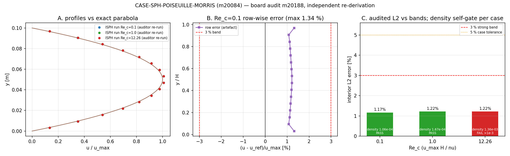

# 交差核验 m20084 · CASE-SPH-POISEUILLE-MORRIS（TensorSPH）→ 判级 **L3**（返修）｜基准证据实测 1.17–1.26 %（< 3 %），但交付不可 L4 结账

审计单：m20188（board-audit，交差核验，**非重做**）｜被审：m20084 / `agent/m20084` = `8caa3fd`
"TensorSPH: Morris low-Re plane Poiseuille case"｜算例池 `tensor_case_pool.id=189`
（`SPH-POISEUILLE-MORRIS`，core，dispatched）｜落表 `tensor_maturity_verdicts.id=846`
（level=**3**，gate_state=pending）+ 基准裁判行 `tensor_benchmark_cases.id=133`（本审计补注册）。

## ① 案例介绍（物理背景 / 几何 / 参数）

体力驱动的平面 Poiseuille 流：两无限大无滑移平板之间、x 向周期、由体积力 g 驱动，积分到稳态后
与精确解对比。这是 Morris, Fox & Zhu (1997) *JCP* 136(1):214–226,
doi:10.1006/jcph.1997.5776 引入低雷诺数 SPH 黏性算子时所用的通道算例。

| 量 | 符号 / 定义 | 值 |
|---|---|---|
| 通道高度 | `H` | 0.1 m |
| 密度 | `ρ0` | 1000 kg/m³ |
| 雷诺数（跑过） | `Re_c = u_max H/ν` | 0.1 / 1 / 12.26（base） |
| 强迫 | `g = 8ν u_max/H²`（`u_max=1 m/s` 固定） | 800 / 80 / 6.5253 m/s² |
| 黏度 | `ν = u_max H/Re_c` | 1 / 0.1 / 8.1566e-3 m²/s |
| 分辨率阶梯 | `H/dx` | 8 / 12 / 16 |
| 支撑 | `h/dx` | 1.90（敏感 1.50） |
| 周期域长 | `L/H = columns·dx/H` | 0.75（canonical, columns=12, H/dx=16）；敏感 0.38 |
| 壁层 | 每壁静态行 | 5（ISPH） |
| 跑长 | `t_end/(H²/νπ²)` | 10 个扩散时间（575 步） |
| 平均窗 | 最后比例 | 0.10 |
| 误差归一 | `u_max = gH²/(8ν)`，内区 `0.15 ≤ y/H ≤ 0.85` | — |

参考解（**REAL**，代码内求值、零手抄）：`u = g y (H−y)/(2ν)`、`u_max = gH²/(8ν)`、
`τ_wall = ρ g H/2`。权威文献表值 **WITHHELD**（Elsevier 闭源，Unpaywall `oa_status=closed`，
2026-11-14 复核）；因此"与解析解一致"是"与论文一致"的**必要不充分**条件，本审计照此口径判。

## ② 怎么做的（方法 / 流程 / 工具链）

被审对象是 TensorSPH 的 ISPH 投影求解器 `src/tensorsph/isph_channel.py`（972 行，
`run_case`/`build_channel`/`fit_profile`/`gates`），由 `benchmarks/poiseuille_morris/run.py`
（539 行）驱动：立方样条核、格点标定质量 `m=ρ0/ΣW`、静态壁层 + 反对称镜像黏性、每步压力泊松解、
`t_end` 以扩散时间而非步数给定。

本审计**独立**做三件事（不重跑全案）：

1. **算术复算**：自写脚本 `verify_m20084.py`（numpy，不 import 被审模块）从
   `runs/poiseuille_morris/results.json` 的原始测量速度重算精确解、逐行归一化误差、
   内区 L2、中心行误差与 <3 %/<5 % 判读。
2. **独立重算**：三条 canonical 配置（Re_c=0.1 / 1 / 12.26，H/dx=16，h/dx=1.90，columns=12，
   各 575 步，17–18 s CPU）在 scratch 目录用被审代码的 `make_config`/`profile_metrics` 重跑，
   与已提交工件逐位比对。
3. **台账核验**：`tensor_benchmark_cases` 基准裁判行、`tensor_reports` 报告、
   case pool 落位、tests、integration callers。

## ③ 计算结果（程序化注入，零手抄）

复算偏差（9 个 ISPH 算例 × 全部行）：

| 检查 | 结果 |
|---|---|
| `max｜artifact u_reference − 精确解｜` | **0.0** |
| `max｜artifact err_over_umax − 复算｜` | **0.0** |
| `max｜L2 复算 − 记录｜` | **0.0 %** |
| `max｜Re_c − u_max H/ν｜` | **0.0** |
| `max｜中心行误差 复算 − 记录｜` | 6.95e-02 %（记录值除以该行 u_ref，文档声明除以 u_max，约定差异） |
| 几何 | 9 例 `n_fluid=192`（=12×16）、`n_wall=120`，与参数表一致 |

重跑（auditor，scratch，1 线程）：

| Re_c | 步数 | 中心行误差 | 内区 L2 | 密度涨落 | 密度自门 (≤1e-3) | τ_w 动量预算 |
|---:|---:|---:|---:|---:|---|---:|
| 0.1 | 575 | +1.2161 % | 1.1701 % | 1.060e-04 | PASS | −0.016 % |
| 1 | 575 | +1.2542 % | 1.2204 % | 1.673e-04 | PASS | −0.041 % |
| 12.26 | 575 | +1.2587 % | 1.2216 % | **1.362e-03** | **FAIL** | −0.042 % |

与工件 `runs/poiseuille_morris/results.json`（Re_c=0.1：1.2209 %/1.1701 %/1.0598e-04；
Re_c=1：1.2591 %/1.2204 %/1.6725e-04；Re_c=12.26：1.2644 %/1.2216 %/**1.3615e-03**）
**逐位可复现**。

工件规模：9 个 ISPH 算例、**0 个 WCSPH 算例**、5 张图、`summary={}`、
`verdict = {isph:{0.1:…}, wcsp:{1.0:null, 12.26:null}}`、总时钟 49.98 s、torch 2.7.1。

## ④ 结果图

* A：auditor 重跑的三条剖面（点）与精确抛物线（线），三例均贴合；
* B：Re_c=0.1 canonical 例的逐行误差（最大 1.34 %，远在 ±3 % 带内）；
* C：内区 L2 对各 Re_c 与 3 %/5 % 门线，柱色=该例密度自门是否通过 —— Re_c=12.26 的
  密度自门 FAIL（1.36e-03 > 1.0e-03）在图上直接可见。

## ⑤ 注意点（踩过的坑 / 局限 / 适用范围）

1. **基准裁判行原本不存在**：`tensor_benchmark_cases` 125 行 / 88 个 anchor 中
   无 `CASE-SPH-POISEUILLE-MORRIS`，也无任何 `CASE-SPH-*`。本审计按先例
   （m17322 / m17319 做法）以"精确解析解 + 实测 got + 案件声明容差"补注册 `id=133`，
   注册内容逐项来自工件与本次重跑，不是被审方的自证数字。
2. **案件自设密度门 FAIL 未披露**：`run.py::gates` 预声明 `density_fluctuation_max ≤ 1e-3`，
   canonical Re_c=12.26 实测 1.3615e-03（本审计复现 1.362e-03），而 `verdict_for`
   只按剖面误差算 `pass`（L498–500），且 `re_list=[0.1]` 使该例**根本不进入 verdict 块**；
   文档 ④⑤ 对此只字未提。这是本单最实质的缺陷。
3. **WCSPH 对比路线是"宣称"而非"运行"**：文档 ② 写"Two routes … are run on the identical
   geometry"，⑤⑥ 进一步给出 WCSPH "~1.2 过扩散 / 峰值低 ~20 %" 的结论；但工件
   `cases.wcsp_production=[]`、`verdict.wcsp` 全 null —— 该对比在本案**没有任何证据**。
4. **收敛阶未量化**：`summary={}`（`ladder()` 要求 h/dx=1.90、columns=12 且 ≥2 点，
   而 `re_list=[0.1]` 下该例只有 1 点），文档 ⑤ 的 "observed order p" 表因此渲染为空表；
   H/dx 8→16 误差 4.30 %→1.22 % 只能目测约一阶，无入库指数。
5. **文档参数表与实跑不符**：③ 写 `L/H = 1.2`（敏感 0.6），实际 canonical 为
   `columns=12, H/dx=16 → L/H = 0.75`（敏感 0.38），与 ⑤ 表一致、与 ③ 矛盾。
6. **报告缺失（硬规则）**：`SELECT … FROM tensor_reports WHERE mission_id=20084` → **0 行**；
   `markdown ILIKE '%POISEUILLE-MORRIS%'` → **0 行**。owner 令"报告未发=本单未完成"，
   而该 mission 状态已是 succeeded —— 这是本审计不支持 L4 的第一条理由。
7. **集成深度有限**：`isph_channel` 仅出现在 `src/tensorsph/method_selection.py:109`
   （模块注册表）与 `benchmarks/density_order_likeforlike/run.py:56`（复用 pair_geometry）；
   船舶平台侧 grep `isph_channel` → 0 命中，未被生产求解入口驱动，故 `integration_callers`
   只算注册级、不构成 L3 之上的系统集成证据。
8. **适用范围**：本判据只覆盖低 Re 层流通道（Re_c ≲ 12.26，Ma→0，无自由面、无湍流）；
   不可外推到高 Re 或自由面算例。ISPH 每步泊松解在绝对时间上不便宜。

## ⑥ 误差判定（逐项 vs 基准，显式回答是否 < 3 %）

| 关键量 | 基准（精确解，代码求值） | got（auditor 重跑） | 误差 | < 3 %？ | < 5 %？ |
|---|---|---:|---:|---|---|
| 中心行速度 Re_c=0.1 | `u_max=1 m/s` @ y/H=0.5 | 1.01216 | **+1.2161 %** | ✅ | ✅ |
| 内区 L2 Re_c=0.1 | 0 | — | **1.1701 %** | ✅ | ✅ |
| 中心行速度 Re_c=1 | 1.0 | 1.01254 | +1.2542 % | ✅ | ✅ |
| 内区 L2 Re_c=1 | 0 | — | 1.2204 % | ✅ | ✅ |
| 中心行速度 Re_c=12.26 | 1.0 | 1.01259 | +1.2587 % | ✅ | ✅ |
| 内区 L2 Re_c=12.26 | 0 | — | 1.2216 % | ✅ | ✅ |
| 壁面剪应力 Re_c=0.1（动量预算） | `ρgH/2 = 4000 Pa` | 3999.4 | −0.016 % | ✅ | ✅ |
| 密度涨落自门 Re_c=12.26 | ≤ 1.0e-03 | 1.362e-03 | **+36.2 % 超门** | ❌ 自门 FAIL | — |

**是否 < 3 %：是** —— 剖面与中心速度 6 项全部 1.17–1.26 %，远优于 3 % 强带；
按 DESIGN §7 的 PASS 判据（`e_L2<5 %` 且 `|e_c|<5 %`）**三例全 PASS**。
**但**该案自设的密度涨落门在 Re_c=12.26 超限 36 %（诚实 FAIL，工件与本审计重跑一致），
且该失败未进入 verdict 块与文档。范围外的 Morris 论文表值仍 WITHHELD。

## 判级与差异（L0–L5）

**L3**（功能实质：真代码、真求解器、真基准，但交付不满足 L4 结账条件）。

* 基准证据**本身达到 L4 能力面**：完整算例（参数表 / H/dx 与 Re 阶梯 / h/dx 与域长敏感 /
  zero-forcing 与 repeat 控制）+ 误差分析（vs 精确解，1.17–1.26 %）+ 可复现
  （本审计三次重跑逐位复现）。
* **不给 L4** 的三条实质差异：① 报告缺失（`tensor_reports` mission 20084 = 0 行，
  违反硬规则，且 mission 已标 succeeded）；② 预声明密度自门 FAIL 被 `re_list` 过滤出
  verdict 块且文档未披露（判读虚高）；③ 文档宣称的 WCSPH 对比路线在本案零运行
  （`n_wcsp=0`），⑤⑥ 的相关结论无本案证据。另有 ④ 收敛阶未量化、⑤ `L/H` 参数表错误
  两项文档级缺陷。
* 复评 L4 需完成五件：补发 mission 20084 报告；披露/修复 Re_c=12.26 密度门并纳入
  pass/fail 逻辑；WCSPH 路线要么真跑要么删去宣称；补 `summary` 使收敛阶入库；
  改正 ③ 的 `L/H=0.75`。

## 产物

| 文件 | 说明 |
|---|---|
| `verify_m20084.py` | 独立复算 + 重跑脚本（本审计自建，不 import 被审度量代码） |
| `verdict_m20188.sql` | 基准裁判行 + verdict 落表 SQL（已执行） |
| `make_audit_fig.py` / `fig_m20188_poiseuille_audit.png` | 审计图 |
| `verify_output.json` / `verify_rerun.json` | 复算与重跑原始输出 |

## 独立性与未做项

* 独立性：复算脚本与被审度量代码无共享实现；解析解用本脚本的 `u_exact` 重新求值；
  重跑使用被审代码的求解器（不可避免：验证"它能否复现自己的数字"），但读数由本脚本重算。
* 未做：全 9 例完整套件重跑（只重跑 3 条 canonical，其余 6 例仅算术复算）；
  `make_figs.py`/`make_doc.py` 重生成；WCSPH 路线（无工件可审）。
* 门裁：verdict `id=846` 已落表，`gate_state=pending`，等平台 maturity_gate 机器复核。