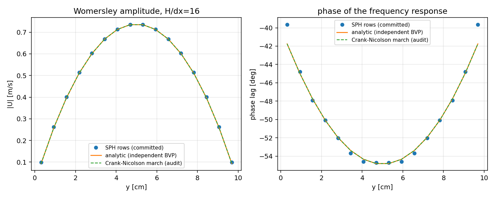
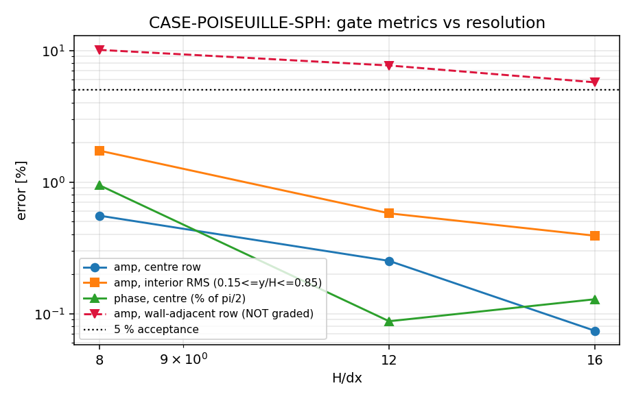
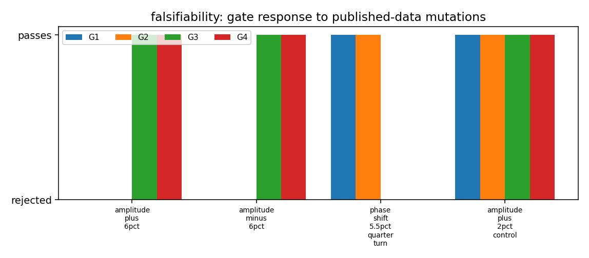

# CASE-POISEUILLE-SPH — independent audit of the evidence bundle

> Generated by `benchmarks/case_poiseuille/make_audit_doc.py` from `out/result.json` (sha256 `740c748b870eef76`) and `out/audit_independent.json`. Every number below is read from those files.

**Disposition: approve with notes.** reference provenance confirmed = True, gate arithmetic reproduced = True, gates reject degraded data = True, 5 % acceptance holds on the graded band = True.

## 1. What was audited

The case-pool entry *算例池·泊肃叶流* (`CASE-POISEUILLE-SPH`) is a plane channel `0 <= y <= H` driven by a body force `g(t)`: constant (`R1`, steady parabola and Boussinesq start-up) and harmonic (`R2`, Womersley periodic state `g = g0 cos(w t)`). The evidence bundle is `out/result.json`: the analytic reference, the measured per-row amplitude and phase at three resolutions, and eleven gates, all produced by `run.py`.

That artifact is a *self-report*: the reference, the finite-difference check, the harmonic fit and the gate arithmetic all live in code written in the same change. The audit therefore re-derives the case from the PDE and imports none of it.

## 2. Method

| route | equation solved | grid / scheme | shares code with the case |
|---|---|---|---|
| closed form (own algebra) | `U'' - a^2 U = -g0/nu`, `a = sqrt(i w/nu)` | analytic | no |
| complex BVP | `i w U - nu U'' = g0`, `U(0)=U(H)=0` | central FD, 4001 nodes, banded solve | no |
| time-domain march | `u_t = nu u_yy + g0 cos(w t)`, from rest | Crank-Nicolson, nx=801, 2048 steps/period, projection | no |
| per-row re-fit | `A cos(w t + phi) + c` | own normal equations | no |

## 3. Reference provenance

| omega [rad/s] | closed form vs BVP | committed `amplitude_analytic` vs BVP | committed `phase_analytic` vs BVP [deg] | marched FD vs BVP (amp) | marched FD vs BVP (phase) [deg] |
|---|---|---|---|---|---|
| 13.0 | 4.23e-08 | 3.47e-08 | 1.65e-06 | 1.39e-06 | 5.65e-05 |
| 31.4 | 1.69e-07 | 1.22e-07 | 3.47e-05 | 1.30e-04 | 9.56e-04 |

The time-domain march matters for one specific reason: a sign convention shared by the closed form and the harmonic fit would cancel in every comparison they make between themselves. The march knows nothing about either, and it reaches the same complex amplitude, so the phase convention (lag, not lead) is established, not assumed.

*Amplitude and phase of the frequency response: SPH rows as committed, analytic from the independent boundary-value solve, and the time-domain march.*

## 4. Reproducing the published gates from the raw samples

| H/dx | amp centre [%] published / recomputed | amp interior RMS [%] | phase centre [% of pi/2] | phase interior RMS [% of pi/2] | wall row [%] (not graded) |
|---|---|---|---|---|---|
| 8 | +0.556 / +0.556 | 1.733 | 0.947 | 0.772 | 10.09 |
| 12 | +0.252 / +0.252 | 0.578 | 0.088 | 0.340 | 7.68 |
| 16 | +0.074 / +0.074 | 0.391 | 0.129 | 0.208 | 5.72 |

The re-fit of the committed centre-line series reproduces the published fit to 1.7e-15 in amplitude and 1.0e-13 deg in phase, so the published gate values are a consequence of the samples rather than of the post-processing code.

*Gate metrics against the 5 % acceptance. The wall-adjacent row (dashed) is above the acceptance at every rung and is outside the graded band.*

## 5. Falsifiability

| mutation | G1 | G2 | G3 | G4 | all pass |
|---|---|---|---|---|---|
| amplitude_plus_6pct | False | False | True | True | False |
| amplitude_minus_6pct | False | False | True | True | False |
| phase_shift_5.5pct_quarter_turn | True | True | False | False | False |
| amplitude_plus_2pct_control | True | True | True | True | True |

## 6. Discrimination: this is a measurement, not a tautology

The two frequencies separate an unsteady solver from a quasi-steady one by **106.4 %** in centre-line amplitude ratio (measured 0.4918, independent analytic 0.4845; a quasi-steady solver would return 1.0). Compared against the steady parabola at the same forcing, the harmonic centre-line amplitude differs by 66.3 %. The measured ratio is 1.52 % from the independent analytic value (G6 tolerance 5 %).

## 7. Caveats (read before quoting the acceptance)

* the <5 % acceptance holds on the predeclared interior band 0.15 <= y/H <= 0.85 only; wall-adjacent rows carry up to 10.09 % amplitude error and are outside the graded set.
  * H/dx=8: worst excluded row 10.09 % amplitude error, 2 rows outside the band.
  * H/dx=12: worst excluded row 7.68 % amplitude error, 4 rows outside the band.
  * H/dx=16: worst excluded row 5.72 % amplitude error, 4 rows outside the band.
* The measurement window is sampled at solver steps, so it spans 1.99964, 1.99981, 2.00014 periods rather than exactly 2. The fit carries a constant column and solves the full normal equations; the residual of the refit is below 0.006 relative.
* G5 (window stability) compares two consecutive measurement periods of the *same* run. It detects a run that has not reached the periodic state; it does not, by itself, establish convergence.

## 8. Not run

* the WCSPH solver was not re-executed: the committed trajectories are the object of the audit, so solver-side claims are inherited, not re-measured.
* the R1 (constant-force) ladder was recomputed only for its published steady_rows table, not re-marched.

## 9. The case's own suite at the audited commit

The case's own utility/uncertainty suite is **not green** at the audited commit, and the failures predate this audit (no file outside the audit's own paths was modified). `-m pytest tests/test_case_poiseuille_r1_ladder.py -q --no-header -p no:cacheprovider` -> `2 failed, 10 passed, 1 warning in 4.20s`.

* `test_published_r1_verdict_covers_all_three_rungs`
* `test_published_r1_gates_are_graded_not_skipped`

Both assert that the R1 *steady* band does **not** support the 5 % acceptance (an honest FAIL recorded when the band was wider). The committed `out/uncertainty.json` now reports `U_V = 2.06 %` with the order identified (`p = 2.55`, spread `0.39`, status `converging`), so `U3b_R1_band_supports_5pct` is `True` in the artifact while the pinned expectation is `False`.

Which side is stale is a substantive question, not a formatting one: either the band genuinely narrowed after the honest FAIL was recorded (in which case the assertion needs new evidence attached, and the FAIL must not simply be flipped) or the artifact drifted. **This audit does not flip the assertion** and records the mismatch instead; the 5 % acceptance quoted above rests on the G-gates in `out/result.json`, which this audit does reproduce, and not on `U3b`.

## 10. Disposition

**approve with notes.** The reference is independently confirmed to 1.2e-07 in amplitude, the published gates are reproduced from the committed samples, and the gate stack rejects over-tolerance data while passing a sub-tolerance control. The notes that travel with the approval are sections 7 and 8: the 5 % acceptance is a statement about the predeclared interior band, and the solver itself was not re-executed by this audit.

