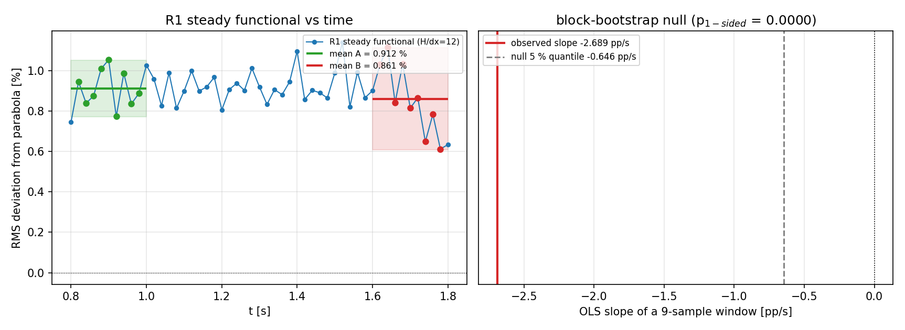

# CASE-POISEUILLE-SPH — steady functional: stationary, or still decaying?

*generated by `benchmarks/case_poiseuille/steady_drift.py` from `out/steady_drift.json`; every number below is read from the artifact, none is typed.*

## 1. Question

`steady_window.py` grades the R1 steady functional by comparing the *level* of two windows (gate `S2`). A level comparison cannot see a trend inside a window, and the committed series carries one: the OLS slope of window B is negative with a naive t of -4.30 on 9 samples. If that is noise nothing changes; if it is signal the functional is an *error* that is still decaying, which makes the committed value an upper bound rather than a fragile point value.

## 2. Method

* baseline = committed samples with `0.80 <= t < 1.60` s (n = 40), i.e. strictly before the test window, so no sample is picked by looking at its value;
* circular block bootstrap of the baseline, block = 3 samples (0.06 s), 20000 resamples, gave the null distribution of a 9-sample slope under 'stationary about its own mean';
* p values are read off that null, not from a t table, because the residuals are correlated (see the lag-1 column below);
* the naive t is corrected for AR(1) residuals only for *reporting*, so the direction of the correction is visible;
* `--extend` integrates R1 from rest to t = 3.6 s and grades window C = [3.40, 3.60] s, the falsification lever for 'the decay stops'.

## 3. Results

| window | n | mean [%] | half range [pp] | slope [pp/s] | naive t | drift across window [pp] |
|---|---|---|---|---|---|---|
| window_A | 9 | 0.9119 | 0.1404 | -0.2134 | -0.34 | -0.0341 |
| window_B | 9 | 0.8610 | 0.2523 | -2.6890 | -4.30 | -0.4304 |

Null model and correlation:

| quantity | value |
|---|---|
| baseline lag-1 correlation | -0.270 |
| window-B residual lag-1 correlation | -0.897 |
| naive t (window B) | -4.30 |
| AR(1)-corrected t (report only) | -18.43 (naive t is conservative) |
| null slope median / p05 | -0.0071 / -0.6465 pp/s |
| observed slope (window B) | -2.6890 pp/s |
| block-bootstrap p (one-sided) | 0.0000 |
| block-bootstrap p (two-sided) | 0.0000 |

Sensitivity to the two declared choices (the D2 verdict uses block = 3):

| block [samples] | p (one-sided) |
|---|---|
| 1 | 0.0000 |
| 2 | 0.0000 |
| 3 | 0.0000 |
| 5 | 0.0000 |
| 8 | 0.0000 |

| baseline end [s] | n | p (one-sided) |
|---|---|---|
| 1.40 | 30 | 0.0000 |
| 1.50 | 34 | 0.0000 |
| 1.60 | 40 | 0.0000 |

## 4. Gates

* `D1_late_window_slope_is_negative`: PASS
* `D2_decline_distinguishable_from_baseline_noise`: PASS
* `D3_acceptance_survives_the_drift`: PASS

D3 binds the acceptance: committed `E` (H/dx = 16) = 0.4105 % plus the drift across window B = 0.4304 pp gives 0.8409 % against the 5 % acceptance.

## 5. Reading (honest)

* The late decline is **not** reproducible by the pre-window noise, i.e. the functional is still moving at t ~ 1.8 s and the motion is toward the parabola (the error decreases). D2 alone does not say whether that motion continues past 1.8 s -- that is D4's question. What D3 already establishes is the robustness of the acceptance: committed error plus the whole observed drift stays at 0.8409 %, i.e. 4.159 pp inside the 5 % tolerance, so neither reading (decay continues / it stops) can lift the anchor over the acceptance.
* D4 is *not graded*: no extended artifact was produced in this run (`--extend` was not used), so nothing is claimed about the decay beyond t = 1.8 s.

## 6. Limits

* One resolution (H/dx = 12), one channel, laminar; this is a post-processing test of an already committed series, not a new resolution study.
* The bootstrap block length (0.06 s) is declared, not optimised: a longer block widens the null and makes D2 easier to pass. It was fixed before the extended run.
* The functional is an error (truth = 0), so 'decaying' means 'improving'; a decaying *physical* quantity would carry the opposite sign and D1 would have to be re-oriented.

## 7. Figure

