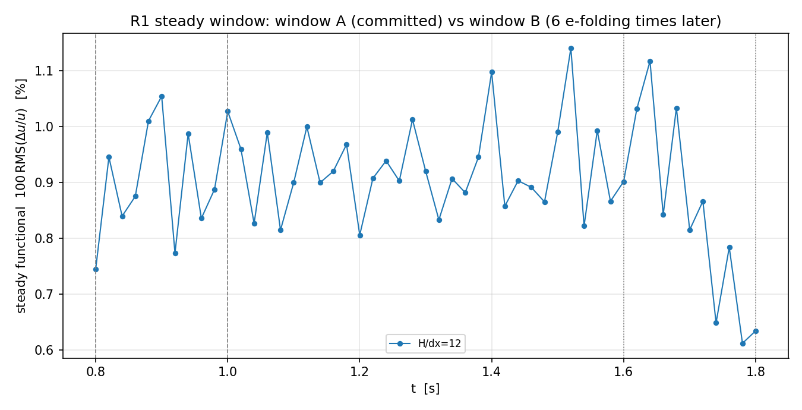

# CASE-POISEUILLE-SPH — is the steady window stationary?

*generated by `benchmarks/case_poiseuille/steady_window.py` from `out/steady_window.json`; numbers are read from the artifact, not typed.*

## 1. Why

is the committed 0.80..1.00 s R1 window stationary, i.e. is its sample scatter a repeatability rather than residual fill?

The R1 steady functional is an error (RMS relative deviation from the parabola), and its `U_input` is the half range of the in-run samples. If the channel were still filling during the window, that half range would be a bound on a transient, not a repeatability, and gate U3b would be entitled to fail. The residual fill decays with the slowest Boussinesq mode, so moving the second window six e-folding times later separates the two hypotheses.

## 2. How

* windows: A = [0.8, 1.0] s (the committed one), B = [1.6, 1.8] s; samples every 0.02 s, integration to t = 1.8 s from rest under constant forcing
* the functional is `100 * RMS((u - u_parabola)/u_parabola)` on `0.15 <= y/H <= 0.85`, computed by the same formula as `run.evaluate_constant`
* per window: mean, half range; across windows: half range of the two means (the repeatability an R2-style estimator would use)
* trend test: OLS slope of the functional against time inside each window

## 3. Results

| H/dx | mean A [%] | mean B [%] | half range A [pp] | half range B [pp] | between-window [pp] | between / mean [%] | U_V [%] |
|---|---|---|---|---|---|---|---|
| 12 | 0.9119 | 0.8610 | 0.1404 | 0.2523 | 0.0254 | 2.87 | 2.049 |

Trend tests (a drift would show as a large |t|):

| H/dx | window | slope [pp/s] | t | dof |
|---|---|---|---|---|
| 12 | A | -0.2134 | -0.34 | 7 |
| 12 | B | -2.6890 | -4.30 | 7 |

Fill bound: decay rate 9.870 1/s (e-folding 0.1013 s), separation 0.80 s -> predicted surviving ratio 3.723e-04.

## 4. Gates

* `S1_extended_run_reproduces_committed_window@H/dx=12`: PASS
* `S2_window_is_stationary@H/dx=12`: PASS
* `S3_surviving_fill_cannot_explain_the_difference@H/dx=12`: PASS
* `S4_between_window_band_supports_5pct@H/dx=12`: PASS

## 5. Error statement

* H/dx=12: S1 deviation from the committed window 0.517 % (threshold 1.0 %); U_input(between) = 0.025 pp, U_V = 2.049 % vs 5 % acceptance -> supports

## 6. Limits

* two rungs (H/dx = 12, 16) with one separation (0.8 s = 7.9 e-folding times of the slowest start-up mode): the test falsifies *fill* as an explanation of the scatter, it cannot resolve a drift slower than the window's own 0.2 s
* the 30 % window-to-window scatter reduction expected from averaging 11 samples instead of one is NOT claimed here: the graded functional is already the window mean, so the between-window half range is the repeatability of that mean and is smaller than the single-sample half range by construction -- the single-sample value stays the conservative choice used by uncertainty.py
* no acoustic (compressibility) scale separation is attempted: the instantaneous scatter is WCSPH particle noise, not resolved physics

## 7. Figure

