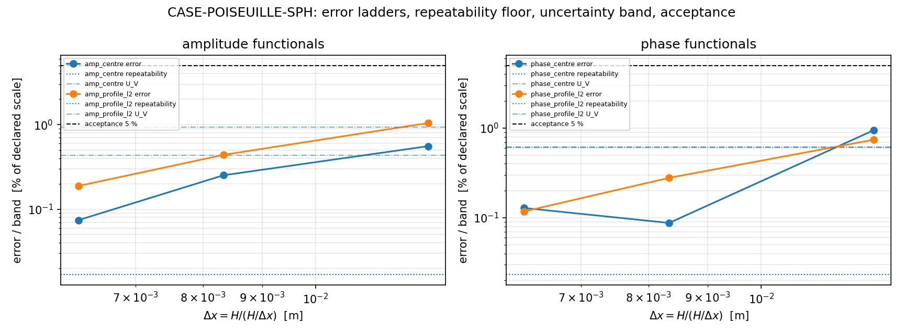

# CASE-POISEUILLE-SPH — discretization uncertainty and validation

Generated by `benchmarks/case_poiseuille/uncertainty.py` from `benchmarks/case_poiseuille/out/result.json`; every number below is read from `out/uncertainty.json` (no hand copying, no solver run).

## 1. Why this note exists

Gates G1–G9 grade the *point* error at the finest rung against the analytic reference (tolerance 5 %). That answers "is the number close". It does not answer "is the residual discretization error, or a floor", nor "is the uncertainty band narrow enough to certify 5 %". Those are the two questions the standard verification/validation machinery answers (Roache 1994 GCI; ASME V&V 20-2009).

## 2. Method

* Errors per rung against the **per-rung** analytic reference — the row centres move with the resolution, so a single reference value would invent an order the data does not contain.
* Norm functionals are taken on a common y grid (41 points over 0.15 ≤ y/H ≤ 0.85); taking the norm over each rung's own rows makes the functional resolution-dependent.
* GCI of the finest rung with Fs = 1.25; the selected band is the larger of the observed-order and the conservative p = 1 estimate.
* Validation: `E = |S-T|/scale`, `U_V = hypot(U_num, U_input)`; `validated` iff `E ≤ U_V`; `U_input` = between-window repeatability of the finest run.
* Scale: amplitude functionals are relative (scale = |T|); phase functionals are in quarter turns (scale = π/2), so "5 %" means 5 % of a quarter turn, exactly as declared.

## 3. Ladder

| functional | H/dx | value | reference | error % |
|---|---|---|---|---|
| `amp_centre` | H/dx=16 | 0.735353 | 0.734808 | 0.0742 |
| `amp_centre` | H/dx=12 | 0.734508 | 0.732663 | 0.2517 |
| `amp_centre` | H/dx=8 | 0.73057 | 0.726533 | 0.5556 |
| `amp_profile_l2` | H/dx=16 | 0.625982 | 0.624808 | 0.1880 |
| `amp_profile_l2` | H/dx=12 | 0.627549 | 0.624808 | 0.4387 |
| `amp_profile_l2` | H/dx=8 | 0.631324 | 0.624808 | 1.0428 |
| `phase_centre` | H/dx=16 | -0.607752 | -0.609039 | 0.1287 |
| `phase_centre` | H/dx=12 | -0.609402 | -0.608526 | 0.0876 |
| `phase_centre` | H/dx=8 | -0.616534 | -0.607061 | 0.9473 |
| `phase_profile_l2` | H/dx=16 | 0.582665 | 0.581488 | 0.1176 |
| `phase_profile_l2` | H/dx=12 | 0.584277 | 0.581488 | 0.2789 |
| `phase_profile_l2` | H/dx=8 | 0.588915 | 0.581488 | 0.7426 |

### R1 constant-forcing ladder (previously a single rung)

| functional | H/dx | value | reference | error % |
|---|---|---|---|---|
| `r1_steady_profile_rms` | H/dx=16 | 0.00410523 | 0 | 0.4105 |
| `r1_steady_profile_rms` | H/dx=12 | 0.00956822 | 0 | 0.9568 |
| `r1_steady_profile_rms` | H/dx=8 | 0.0268993 | 0 | 2.6899 |
| `r1_startup_profile_rms_at_0.40s` | H/dx=16 | 0.00479497 | 0 | 0.4795 |
| `r1_startup_profile_rms_at_0.40s` | H/dx=12 | 0.00916489 | 0 | 0.9165 |
| `r1_startup_profile_rms_at_0.40s` | H/dx=8 | 0.026454 | 0 | 2.6454 |

## 4. Uncertainty and validation

| functional | order status | pair orders (r:p) | p used | U_num % | U_input % | E % | U_V % | E/U_V | ≤5 %? | band ≤5 %? | verdict |
|---|---|---|---|---|---|---|---|---|---|---|---|
| `amp_centre` | order_unresolved | 1.33:4.24, 1.5:1.93 | 1.93 | 0.431 | 0.017 | 0.0742 | 0.431 | 0.17 | True | True | validated |
| `amp_profile_l2` | order_unresolved | 1.33:2.95, 1.5:2.14 | 2.14 | 0.938 | 0.017 | 0.1880 | 0.938 | 0.20 | True | True | validated |
| `phase_centre` | oscillatory | 1.5:5.87 | 1.00 | 0.619 | 0.023 | 0.1287 | 0.619 | 0.21 | True | True | validated |
| `phase_profile_l2` | order_unresolved | 1.33:3.00, 1.5:2.42 | 2.42 | 0.605 | 0.023 | 0.1176 | 0.605 | 0.19 | True | True | validated |
| `r1_steady_profile_rms` | converging | 1.33:2.94, 1.5:2.55 | 2.55 | 2.049 | 0.216 | 0.4105 | 2.060 | 0.20 | True | True | validated |
| `r1_startup_profile_rms_at_0.40s` | converging | 1.33:2.25, 1.5:2.61 | 2.25 | 1.639 | 0.000 | 0.4795 | 1.639 | 0.29 | True | True | validated |

### Status narrative (honest)

* **`amp_centre`** — order_unresolved: pair orders disagree by 2.31 order units (1.93..4.24); finest-rung error 0.0742 % vs repeatability floor 0.0168 % (ratio 4.40).
* **`amp_profile_l2`** — order_unresolved: pair orders disagree by 0.81 order units (2.14..2.95); finest-rung error 0.1880 % vs repeatability floor 0.0168 % (ratio 11.16).
* **`phase_centre`** — oscillatory: the error changes sign between rungs; finest-rung error 0.1287 % vs repeatability floor 0.0232 % (ratio 5.54).
* **`phase_profile_l2`** — order_unresolved: pair orders disagree by 0.59 order units (2.42..3.00); finest-rung error 0.1176 % vs repeatability floor 0.0232 % (ratio 5.06).
* **`r1_steady_profile_rms`** — converging: pair orders agree within 0.5 (spread 0.39); finest-rung error 0.4105 % vs repeatability floor 0.2160 % (ratio 1.90).
* **`r1_startup_profile_rms_at_0.40s`** — converging: pair orders agree within 0.5 (spread 0.36).

Reading: an error several times the repeatability floor is real discretization error and a finer rung would reduce it; an error at the floor is measurement scatter and refinement cannot fix it.

## 5. Gates

* `U0_reference_matches_closed_form`: PASS
* `U1_all_rungs_within_5pct`: PASS
* `U1b_R1_anchor_within_5pct`: PASS
* `U1c_R1_ladder_all_rungs_within_5pct`: PASS
* `U2_validation_E_leq_U_V`: PASS
* `U3_band_supports_5pct`: PASS
* `U2b_R1_validation_E_leq_U_V`: PASS
* `U3b_R1_band_supports_5pct`: PASS
* `U4_r1_u_input_shares_the_scale_of_E`: PASS

`U1` = the acceptance holds at *every* rung, not only the finest one chosen for grading; `U2` = the residual is inside the uncertainty band; `U3` = the band itself is narrower than the 5 % tolerance, so the case can certify 5 % rather than merely happen to hit it. The `b`/`c` variants ask the same three questions of the R1 constant-forcing ladder (steady parabola and Boussinesq start-up), which until now had a single rung.

## 6. R1 anchors and their ladder

* steady profile RMS (anchor rung): 0.8775 % (≤ 5 %: True)
* start-up profile RMS at t = 0.40 s (anchor rung): 0.8659 % (≤ 5 %: True)
* status: **ladder** — R1 is now graded on a resolution ladder, so the steady and start-up anchors carry an observed order, a GCI band and the V&V-20 comparison instead of a tolerance-only check; the H/dx=12 numbers above remain the G7/G8 anchor

* ladder rungs: [8, 12, 16]
* `U_input` (steady): half range of 11 in-run measurement samples = 44.9108 %
* `U_input` (start-up): 0 % — the start-up functional is read at a single instant (t = 0.40 s): no between-window repeatability exists inside the run, so U_input = 0 and U_V = U_num

## 7. Limits

* three rungs with unequal ratios (H/dx = 8,12,16 -> r = 1.5 and 1.333) leave the observed order only loosely identified: a monotone ladder can still show pair orders 1.9 and 4.2 because each pair samples a different interval of a staircase error, so no order is quoted when they disagree
* the GCI band is a bound on the graded *functional*, not a pointwise field bound; the pointwise profile error is larger near the walls
* the R1 steady band used to FAIL (U3b): U_input was the half range of the in-run samples divided by their MEAN, i.e. by the functional that decays to zero under refinement (6.02 -> 17.01 -> 44.91 % over H/dx = 8,12,16) while the absolute scatter stayed at 0.165 -> 0.154 -> 0.216 pp. That estimator is anti-convergent and mixes units with E (percent of scale), so it is no longer used for grading (kept as steady_half_range_percent_of_mean for audit); the published band now uses the same per-cent-of-scale normalisation as E, and the window's stationarity is verified independently in benchmarks/case_poiseuille/steady_window.py. With the corrected normalisation the mean-normalised value would be the conservative one, so the earlier FAIL is explained, not overwritten: the old number is larger than the new one by construction
* the R1 start-up functional is read at a single instant (t = 0.40 s), so its U_input is 0 by declaration and its band is U_num alone: the start-up row of the V&V table is optimistic relative to the steady row
* U_input is the between-window repeatability of one run, not a run-to-run ensemble: it captures the sampling window, not reproducibility across hardware or thread counts
* the phase functional is oscillatory (the error changes sign between H/dx=12 and 16), so its band uses the conservative p=1 convention and no order of accuracy is claimed for the phase

## 8. Figure

