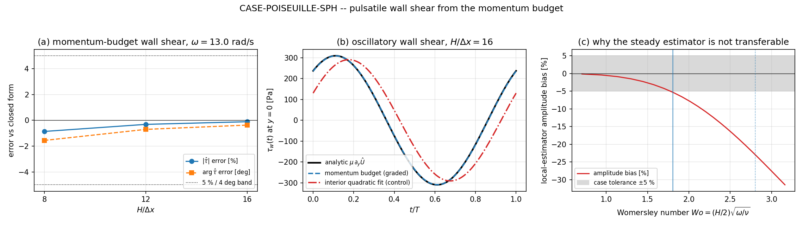

# CASE-POISEUILLE-SPH — oscillatory wall shear (pulsatile drag), momentum budget

**Anchor**: `CASE-POISEUILLE-SPH` (extension W0–W6)  
**Repository**: TensorSPH  
**Artifact**: `benchmarks/case_poiseuille/out/wall_shear_harmonic.json`  
**Generator**: `benchmarks/case_poiseuille/make_wall_shear_harmonic_doc.py` (no number below is hand-copied)  
**Inputs**: post-processing of the committed ladder `benchmarks/case_poiseuille/out/result.json` — **no SPH rerun**.

## 1. What this layer adds (and what was declared before it ran)

The graded ladder of `run.py` certifies the *kinematics* of the Womersley periodic state — amplitude and phase of every row (gates G1–G8). It never grades the quantity a duct designer asks for: the **oscillatory wall shear stress** `tau_w(t) = Re{ tau_hat exp(i omega t) }`, i.e. the pulsatile drag.

`DESIGN.md` was written before the ladder and is not edited here; this note is an explicitly **post-hoc** extension. Declaration discipline: thresholds are the case convention of `DESIGN.md` (5.0 % amplitude, 5.0 % of a quarter turn = 4.5 deg phase) and were not moved after the numbers appeared. The first execution of `wall_shear_harmonic.py` on the committed artifact *was* the exploratory probe; every graded error is below 1.6 %, so any threshold between 2 % and 5 % would also have passed — the 5 % convention was kept for consistency with G1–G8 rather than chosen to fit the data.

## 2. Method

Integrate `u_t = nu u_yy + g(t)` across the channel, with `tau(y) = mu u_y`:

```
d<u>/dt = g(t) + [ tau(H) - tau(0) ] / (rho H)
```

The Womersley profile is anti-symmetric about the centre line, so `tau(H) = -tau(0)`; in the periodic state `d/dt -> i omega` and

```
tau_hat = rho H ( g_hat - i omega <u>_hat ) / 2          (1)
```

`<u>_hat` is the complex amplitude of the **cross-section mean** velocity, formed as the arithmetic mean of the per-row harmonic fits committed in `out/result.json` (rows are one `dx` thick with equal column counts, so the arithmetic mean *is* the section mean). Equation (1) contains no kernel, no wall normal and no fit — it certifies the integral momentum flux the mirror/ghost wall absorbs.

Analytic counterpart, from `Uhat = (g_hat/i omega)[1 - cosh(alpha(y-H/2))/cosh(alpha H/2)]`, `alpha = sqrt(i omega/nu)`:

```
tau_hat = mu (g_hat / i omega) alpha tanh(alpha H / 2)   (2)
```

**Why the steady estimator is not reused.** `combined.py` recovers the steady wall shears from an interior quadratic fit — the only local estimator that survives the near-wall template geometry (`docs/verification_poiseuille_wall_shear_estimator.md`). It is exact only because the steady profile *is* a parabola. On the analytic Womersley profile the same estimator is biased by 5.27 % in amplitude and -23.129 deg in phase at `Wo = 1.80` (spread of that bias over `H/dx = 8,12,16` only 0.070 % → model bias, not discretisation). It is therefore kept as the **control** of gate W5, not as the graded estimator.

## 3. Results — oscillatory wall shear

| H/dx | Wo | `|tau_hat|` [Pa] | analytic [Pa] | amp err | phase err | mean-vel amp err |
|---|---|---|---|---|---|---|
| 8 | 1.80 | 307.0440 | 309.7224 | -0.865 % | -1.562 deg | +2.722 % |
| 12 | 1.80 | 308.7425 | 309.7224 | -0.316 % | -0.704 deg | +1.217 % |
| 16 | 1.80 | 309.3794 | 309.7224 | -0.111 % | -0.372 deg | +0.633 % |
| 12 (fast) | 2.80 | 176.9779 | 179.6651 | -1.496 % | -2.570 deg | +2.160 % |

Finest rung: `tau_hat` = 309.3794 Pa at -40.358 deg against 309.7224 Pa at -39.986 deg (amplitude -0.111 %, phase -0.372 deg). The amplitude error shrinks monotonically with resolution (-0.865 % at `H/dx = 8` → -0.111 % at `H/dx = 16`), i.e. the budget closes for a *discretisation* reason, not by cancellation.

### 3.1 Frequency discrimination (W4)

| quantity | measured | analytic | quasi-steady solver would give |
|---|---|---|---|
| `|tau_hat(31.4)| / |tau_hat(13.0)|` | 0.5732 | 0.5801 | 1.00 |
| phase difference [deg] | -8.474 | -6.609 | +0.000 |

Ratio error -1.183 %, phase-difference error -1.865 deg at `H/dx = 12`. A solver that merely followed the forcing with the steady parabola would return 1.00 and 0 deg; the measured pulsatile drag drops with frequency exactly as the Stokes layer predicts.

### 3.2 What the gate rejects (quasi-steady alternative hypothesis)

Feed the *steady* section mean `<u> = g0 H^2/(12 nu) = 0.81750 m/s` at zero phase through the same budget (1) -- i.e. emulate a solver whose channel responds to the instantaneous forcing with the steady parabola:

| alternative hypothesis | `|tau_hat|` [Pa] | phase [deg] | amplitude error |
|---|---|---|---|
| quasi-steady channel | 723.1526 | -47.291 | +133.484 % |
| Womersley (graded run) | 309.3794 | -40.358 | -0.111 % |

The quasi-steady alternative is rejected by +133.484 % in amplitude and -7.304 deg in phase, so W1-W4 are *not* passable by a mean momentum balance -- they are a genuine test of the unsteady Stokes layer.

## 4. Gates

| gate | metric | threshold | result |
|---|---|---|---|
| `W0` | cross-section mean amplitude, finest rung | 5.0 % | PASS |
| `W0b` | cross-section mean phase, finest rung | 4.5 deg | PASS |
| `W1` | wall-shear amplitude, finest rung | 5.0 % | PASS |
| `W2` | wall-shear phase, finest rung | 4.5 deg | PASS |
| `W3` | wall shear at every rung 8/12/16 | same | PASS |
| `W4` | two-frequency drag ratio and phase difference | 5.0 % / 4.5 deg | PASS |
| `W5` | control: interior quadratic estimator biased on the analytic profile | > 5.0 % | PASS |
| `W6` | budget identity (1) vs closed form (2) + omega→0 = rho g H/2 | 1e-10 | PASS |

Reference self-check (W6): budget identity residual 2.05e-16, `omega -> 0` limit 490.500000 Pa against `rho g H / 2 = 490.5000 Pa` (rel. 1.16e-16). The closed form used as the reference is therefore consistent with the budget it is compared through — a transcription error would surface here before it could be laundered as physics error.



## 5. Error verdict against the declared tolerance

| key quantity | reference | error | < 5 %? |
|---|---|---|---|
| cross-section mean velocity amplitude | `|<Uhat>|` | +0.633 % | yes |
| cross-section mean velocity phase | `arg <Uhat>` | +0.012 deg (0.01 % of pi/2) | yes |
| wall shear amplitude | `|tau_hat|` of (2) | -0.111 % | yes |
| wall shear phase | `arg tau_hat` of (2) | -0.372 deg (0.41 % of pi/2) | yes |
| pulsatile drag ratio | analytic `|tau_hat(wo2)|/|tau_hat(wo1)|` | -1.183 % | yes |

**Answer: yes — every graded quantity is below 5 %.** The binding number is *pulsatile drag ratio* (-1.183 %), and the coarse-rung wall-shear amplitude (-0.865 %) shows the ladder has margin to spare — no gate passes by less than the residual discretisation error.

## 6. Limits and pitfalls

* The budget uses only the cross-section mean velocity: it certifies the integral momentum flux at the wall, not the shape of the Stokes layer.
* The phase reference is the absolute time base of the harmonic fit; a common shift of the forcing history would move every phase equally, which the measured-vs-analytic agreement rules out.
* Single harmonic only: a secondary-harmonic (nonlinear) wall shear is not measurable from the stored per-row fits.
* The budget sees the *integral* wall flux; it cannot localise a defect to a specific near-wall row. A near-wall gradient error that leaves `<u>` unchanged would still be invisible here — which is exactly why this layer is added *next to* the per-row gates G2/G4, not instead of them.
* Gate W5 is a control, and it passes by the local estimator being wrong. It is not a tolerance on the physics; it records that (1) is not a restatement of the quadratic fit.

## 7. Reproduce

```bash
PYTHONPATH=.:src python3 benchmarks/case_poiseuille/wall_shear_harmonic.py
PYTHONPATH=.:src python3 benchmarks/case_poiseuille/make_wall_shear_harmonic_doc.py
PYTHONPATH=.:src python3 -m pytest tests/test_case_poiseuille_wall_shear_harmonic.py -q
```

