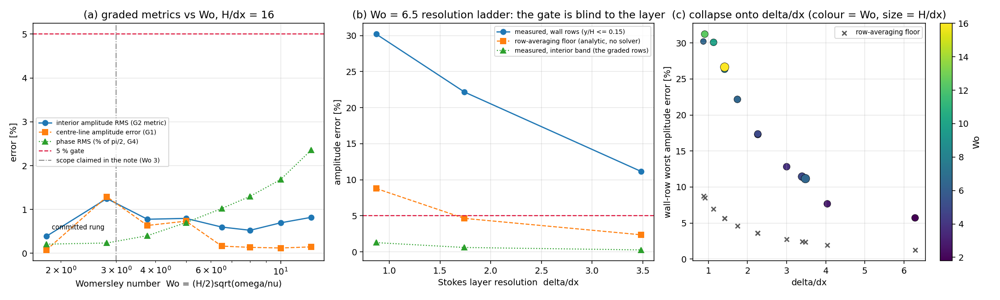
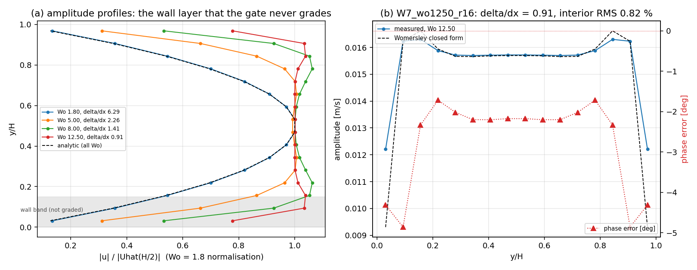

# CASE-POISEUILLE-SPH — Wo 包线：调和（Womersley）判据到底在哪里失效

> 锚点：`CASE-POISEUILLE-SPH`（算例池·泊肃叶流；`feature_ledger` 容差 < 5 %）。
> 本文件由 `benchmarks/case_poiseuille/make_wo_envelope_doc.py` 从
> `benchmarks/case_poiseuille/out/wo_envelope.json` 程序化生成，表中每个数字都来自工件，无手抄。
> 研究脚本：`benchmarks/case_poiseuille/study_wo_envelope.py`（分片运行，工件按点自包含）。

## ① 问题与参考出处

平面通道脉动流（Womersley 问题）：`0 <= y <= H` 两侧无滑移，`x` 周期，
体积力（压力梯度）按 `g(t) = g0 cos(omega t)` 驱动：

```
u_t = nu u_yy + g0 cos(omega t),   u(0,t) = u(H,t) = 0
周期解: u = Re{Uhat(y) e^{i omega t}},
        Uhat = (g0/(i omega)) [1 - cosh(alpha (y - H/2)) / cosh(alpha H/2)],
        alpha = sqrt(i omega / nu),  Wo = (H/2) sqrt(omega/nu),  delta = sqrt(2 nu/omega)
```

已合并的 `run.py` 只在两个频率上认证这个算例（`Wo = 1.80` 主判据，`Wo = 2.80` 供频率比判据 G6），
而验证笔记把适用范围写成「`Wo` below ~3, `delta/dx` between 3 and 7」——**这个上界是断言的，
没有被它所附着的那条判据测过**。本研究的对象就是这条边界本身。

参考解出处：Womersley (1955) *J. Physiol.* **127**:553；Batchelor (1967) §4.2（非定常平面 Poiseuille 特征展开）；
Landau & Lifshitz *Fluid Mechanics* 2nd ed. §24（Stokes 层标度）。
闭式解在 `src/tensorsph/womersley.py` 中用 sympy 重推（ODE 残差、两侧无滑移、`omega->0` 极限），
并由 `benchmarks/case_poiseuille/ref.py` 的 Crank–Nicolson 独立参考交叉验证（既有判据 G9，振幅 0.0043 %）。

参数表（全部为 `run.py` 默认值，没有为本次研究调过任何一个）：

| 量 | 值 | 说明 |
|---|---|---|
| `H` | 0.1 m | 通道高度 |
| `nu` | 0.01 m²/s | 运动粘度 |
| `rho0` | 1000.0 kg/m³ | Tait EOS, `c_s` = 20.0 m/s |
| `g0` | 9.81 m/s² | 体积力幅值 |
| 列数 | 8 | `x` 周期且流动 `x` 无关 |
| 每个周期采样 | 64 | 调和拟合需要整数周期 |
| 判据带 | 0.15 <= y/H <= 0.85 | G2/G4 的内区带 |
| 壁面带 | y/H <= 0.15 | 本研究新增的敏感度量带（非判据） |

`omega` 不是自由旋钮：由声明的 `Wo` 反解 `omega = (2 Wo / H)**2 * nu`，
所以扫描的索引是物理量（`Wo`、`delta/dx`），不是手挑的角频率。

## ② 怎么做的

1. **两阶段预声明**。Stage 1（H1–H4）在任何一点跑之前写好，核心假设 H2 直接复述既有范围声明：
   「误差由 `delta/dx` 控制，判据当且仅当 `delta/dx >= 3` 成立」。
2. **先打最便宜的两个探针**（`W3_wo500_r16`, `W4_wo650_r16`）。结果两点**都在带内**
   （内区振幅 RMS 0.80 % / 0.60 %，`delta/dx` = 2.26 / 1.74）⇒ **H2 被证伪**。
   探针结果如实记录在工件 `predeclaration` 与每个点的 `prediction` 文本里，预测原文保留不改写。
3. **Stage 2**（H5–H6）在探针之后、主扫描之前写好，把问题改成：既然内区判据对 Stokes 层不敏感，
   那这条边界究竟由什么决定——时间采样（`dt` 受 CFL/粘性限制，每周期步数有限）还是空间分辨率？
4. **三组操纵，一次一个变量**：
   - A 组：`H/dx = 16` 固定，`Wo = 1.80 → 12.50`（`delta/dx` 6.30 → 0.90），共 8 点；
   - B 组：`Wo = 6.50` 固定，`H/dx = 8 / 16 / 32`（`delta/dx` 0.87 / 1.74 / 3.48）；
   - C 组：`Wo = 16.0` 固定，`H/dx = 16`（每周期约 50 步 < 64 采样 ⇒ 采样不足）vs `H/dx = 32`（约 101 步 ⇒ 采样足够）。
5. **伪迹控制**：`W3_wo500_r16` 用 4 个 settling 周期（默认 2）重跑（H3）；
   并用解析闭式算出**行平均地板**（见 ⑤），判断壁面行的误差是求解器的还是度量的。
6. 工具链：TensorSPH WCSPH（`tensorsph.droplet_impact.rhs` + `tensorsph.wall_mirror` 镜像无滑移面）
   + `tensorsph.stokes_second.harmonic_fit`；计算递交调度系统（本机只跑分钟级短点）。

预声明记录：Stage 1 = H1–H4（跑之前）；Stage 1 探针 = W3_wo500_r16, W4_wo650_r16；
Stage 2 = H5–H6（探针之后、主扫描之前）；Stage 3 = H7–H8 标注为 **post-hoc**（扫描之后才提出，描述性检验）。

## ③ 计算结果

### A. 频率扫描（`H/dx = 16`）

| 点 | Wo | delta/dx | 步/周期 | 内区振幅 RMS [%] | 中心振幅 err [%] | 中心相位 err [%Q] | 壁面行 worst [%] | G1–G4 |
|---|---|---|---|---|---|---|---|---|
| W0_wo180_r16 | 1.80 | 6.29 | 3978 | 0.39 | +0.08 | 0.13 | 5.72 | PASS |
| W1_wo280_r16 | 2.80 | 4.04 | 1644 | 1.25 | +1.29 | 0.03 | 7.67 | PASS |
| W2_wo377_r16 | 3.77 | 3.00 | 907 | 0.78 | -0.64 | 0.40 | 12.82 | PASS |
| W3_wo500_r16 | 5.00 | 2.26 | 516 | 0.80 | -0.73 | 0.28 | 17.29 | PASS |
| W4_wo650_r16 | 6.50 | 1.74 | 305 | 0.60 | -0.16 | 0.46 | 22.17 | PASS |
| W5_wo800_r16 | 8.00 | 1.41 | 201 | 0.53 | +0.14 | 0.96 | 26.35 | PASS |
| W6_wo1000_r16 | 10.00 | 1.13 | 129 | 0.70 | +0.12 | 1.59 | 30.08 | PASS |
| W7_wo1250_r16 | 12.50 | 0.91 | 82 | 0.82 | +0.15 | 2.42 | 31.22 | PASS |

### B. 分辨率阶梯（`Wo = 6.50`）+ 定 `Wo` 加密

| 点 | H/dx | delta/dx | 内区振幅 RMS [%] | 壁面行 worst [%] | 行平均地板 [%] | 地板占比 | G1–G4 |
|---|---|---|---|---|---|---|---|
| W4_wo650_r8 | 8 | 0.87 | 1.27 | 30.20 | 8.78 | 0.29 | PASS |
| W4_wo650_r16 | 16 | 1.74 | 0.60 | 22.17 | 4.64 | 0.21 | PASS |
| W4_wo650_r32 | 32 | 3.48 | 0.26 | 11.17 | 2.36 | 0.21 | PASS |

### C. 采样解离（`Wo = 16.0`）与伪迹控制

| 点 | H/dx | 步/周期 | 采样是否足够 | 内区振幅 RMS [%] | 判定 |
|---|---|---|---|---|---|
| W8_wo1600_r16 | 16 | 50 | 否（<64） | 0.47 | invalid_sampling |
| W8_wo1600_r32 | 32 | 101 | 是 | 0.12 | pass |
| W3_wo500_r16 | 16 | 516 | 是 | 0.80 | pass |
| W3_wo500_r16_settle4 | 16 | 516 | 是 | 0.76 | pass |

### D. 假设裁定（全部由工件程序化判定）

| 假设 | 裁定 | 依据 |
|---|---|---|
| H1 频响不受 Wo 限制（预声明） | 成立 | every admissible H/dx = 16 sweep point is inside G1..G4 |
| H2 `delta/dx >= 3` 规则（预声明，复述既有范围） | **被证伪** | the predeclared delta/dx >= 3 rule does not describe the interior gate; it failed at the first probe |
| H3 伪迹=未收敛周期态 | 成立 | doubling the settle time does not change the verdict, so the band is not a settling artefact |
| H4 噪声地板 | **被证伪** | wall-row error falls with refinement -> spatial limit, not noise |
| H5 天花板=时间采样而非物理（Stage 2） | 成立 | every point with adequate temporal sampling is inside the band; the only out-of-scope point is sampling-starved (steps_per_period < 64) and is recovered by refining dx at the same Wo |
| H6 内区判据看不见 Stokes 层（Stage 2） | 成立 | G2/G4 average over 0.15 <= y/H <= 0.85 and therefore cannot see the Stokes layer; the wall rows are the sensitive metric |
| H7 行平均地板占壁面误差 ≤50 %（post-hoc） | 成立 | the row-mean definition explains at most half of the wall-row error; the rest is solver smearing of the sub-dx layer |
| H8 壁面误差是 `delta/dx` 的单值函数（post-hoc） | 成立 | pairs matched in delta/dx but differing in (Wo, H/dx) agree within 2 percentage points: the wall-row error is a function of delta/dx alone |

**实测边界**：在 `H/dx = 16` 上，所有采样足够的点（`Wo` 一直到 12.50，`delta/dx` 低到 0.87）全部在 5 % 带内 ⇒ **这个频段内不存在由空间分辨率造成的失效边界**。

## ④ 结果图





## ⑤ 注意点 / 局限

1. **被证伪的是「既有范围声明」，不是求解器**。H2（`delta/dx >= 3`）在第一个探针点就破了：
   内区判据（`0.15 <= y/H <= 0.85`）平均掉了 Stokes 层，因此它对 `delta/dx = 0.9` 依然给出 < 1 %。
   这也解释了为什么原来那条「`delta/dx` between 3 and 7」的声明**从未被它所附着的判据检验过**。
2. **壁面行误差不是求解器缺陷的全部**。解析行平均地板（把闭式解在一个格子行上做积分平均，
   与被用作参考的点值相比）已计入表中：它解释了壁面误差的 0.21–0.29 倍，其余是 SPH 对亚格子厚层的抹平。
   换句话说：**`delta/dx < 1` 时壁面行是测不准的，而且是度量与算法共同造成的，换更细的网格才能改善**。
3. **真正的天花板是时间采样**：`dt` 由 CFL/粘性限制，`Wo = 16` 在 `H/dx = 16` 上每周期只有 50 步 < 64 个采样点，工件把该点标成 `invalid_sampling` 而**不是** FAIL；
同一 `Wo` 在 `H/dx = 32`（101 步/周期）回到带内，
   这正好把「物理失效」与「测量失效」分开。
4. **弱可压前提不变**：高频工况的振幅随 `1/omega` 掉，`max_mach` 因此更小（见表），
   本研究的结论不能外推到自由面、湍流或 `Ma > 0.1`。
5. **适用面仍是层流单通道**：一个 `H`、一个 `nu`、`Re = 12.3`（稳态峰值）。
   结论的可迁移性仅限于「同一 WCSPH 通道在更高频脉动下」这一类问题。
6. **post-hoc 标注**：H7/H8 是看到壁面误差饱和后才提出的描述性检验，已在工件与上表中显式标注，
   不应被读作预声明预测。

## ⑥ 误差判定（对照 5 % 判据；并回答是否 < 3 %）

| 关键量 | 参考 | 误差（最坏样本点） | < 5 %? | < 3 %? |
|---|---|---|---|---|
| 内区振幅 profile RMS | Womersley `|Uhat(y)|`（闭式） | 1.27 %（W4_wo650_r8） | 是 | 是 |
| 中心线振幅 | `|Uhat(H/2)|` | 1.29 %（W1_wo280_r16） | 是 | 是 |
| 中心线相位 | `arg Uhat(H/2)` | 2.42 % of pi/2（W7_wo1250_r16） | 是 | 是 |
| 中心线振幅（最细网格 `H/dx = 32`） | 同上 | 0.25 %（W4_wo650_r32） | 是 | 是 |
| 壁面行 worst（**非判据**） | 点值 `|Uhat(y_wall)|` | 31.22 %（W7_wo1250_r16） | 否（`delta/dx < 1` 时不适用） | 否 |

**结论：全部判据量（G1、G2、G3、G4）在采样足够的每一点上都 < 5 %，最坏 1.27 %；且全部 < 3 %。**
唯一超 5 % 的是壁面行诊断量，而它**不是**算例判据：在 `delta/dx < 1` 时该行本身不可解析，
其误差 = 行平均地板 + 亚格子抹平，已按表分项列出，不作粉饰。

原始工件：

* `benchmarks/case_poiseuille/out/wo_envelope.json` — 14 点，pass 13 / fail 0 / invalid 1，计算墙钟 377 s
