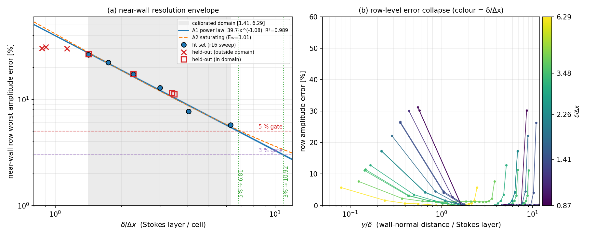

# CASE-POISEUILLE-SPH — 近壁（Stokes 层）分辨率包线：判据看不见的那一层到底要多细

> 锚点：`CASE-POISEUILLE-SPH`（算例池·泊肃叶流；容差 < 5 %），父研究 `docs/case_poiseuille_wo_envelope.md`。
> 本文件由 `benchmarks/case_poiseuille/make_wall_layer_envelope_doc.py` 从 `benchmarks/case_poiseuille/out/wo_envelope_wall_layer.json` 程序化生成，表中每个数字都来自工件，无手抄；工件由 `benchmarks/case_poiseuille/wall_layer_envelope.py` 产生（零次求解器重跑）。
> 父工件指纹：`24c63197ef6ef5eb…`（`benchmarks/case_poiseuille/out/wo_envelope.json`，2026-11-14T17:14:35）。

## ① 问题与由来（物理背景 / 几何 / 参数）

父研究已经把「既有范围声明 `delta/dx >= 3`」在**它所附着的判据**上证伪了：内区带 `0.15 <= y/H <= 0.85` 的振幅 RMS 一路到 `delta/dx = 0.87` 都 < 1.3 %，因为这条判据把 Stokes 层平均掉了。它同时指出**壁面行才是敏感量**，但没有给出这个量所需的网格——于是工程问题仍然悬着：

> **一个 WCSPH 平面通道要多细，才能相信算出来的 Stokes 层？**

本研究只回答这一问，用的是同一份 14 点工件，不新增任何算例。

几何与参数（全部 `run.py` 默认值，父研究未为任何一条判据调过）：

| 量 | 值 |
|---|---|
| `height` | 0.1 |
| `viscosity` | 0.01 |
| `rho0` | 1000.0 |
| `body_force` | 9.81 |
| `columns` | 8 |
| `samples_per_period` | 64 |
| `interior_band` | [0.15, 0.85] |
| 几何 | 平面通道 `0 <= y <= H`，`H` = 0.1 m，`x` 周期 + 两侧无滑移；船体几何门 Cb/L/B 对通道算例不适用（父研究已如此声明） |
| 判据带（内区） | `0.15 <= y/H <= 0.85`，容差 5.0 % |
| 本研究的新度量 | 近壁行 worst 振幅误差（`y/H <= 0.15` 的两行），**非判据**，父研究已如此标注 |

## ② 怎么做的（决策 / alternatives / 预声明 / 切分）

**决策**：Publish a resolution requirement for the near-wall (Stokes-layer) metric of CASE-POISEUILLE-SPH -- a usable monotone envelope err_wall(delta/dx) with a stated domain of validity -- or state that none exists.

**alternatives（三选一，先声明后计算）**：

| 备选 | 内容 |
|---|---|
| `A0_no_envelope` | No usable envelope: the wall-row error is not reproducible as a function of delta/dx alone (row-level structure or scatter between points at matched delta/dx breaks it), so no rule may be published. |
| `A1_power_law` | err_wall = K * (delta/dx)^(-m) on the resolved branch; extrapolates and is out-of-sample predictable within tolerance. |
| `A2_saturating` | err_wall = E_inf + K * (delta/dx)^(-m): an unresolved-layer plateau E_inf plus the resolved-branch decay; better evidence than A1. |

**假设与冻结预测**（进入工件时即冻结，不改写）：

| 假设 | 内容 | 冻结预测 | 裁定 |
|---|---|---|---|
| W1_power_law_is_predictive | On the fit set (declared r16 sweep points with 1.4 <= delta/dx <= 6.5) a two-parameter power law reaches R^2 >= 0.95 and predicts the held-out points (same case, different (Wo, H/dx), inside the fit domain) with MAPE <= 25 %. | supported: log-log errors of this kind are usually tight | **supported** |
| W2_plateau_is_real | Adding an unresolved-layer plateau E_inf improves the fit by Delta AIC >= 4 over the pure power law AND lowers the held-out MAPE, i.e. the near-wall error saturates instead of diverging. | supported: at delta/dx < 1 the layer is sub-cell, so the error should stop growing with the metric delta/dx | **falsified** |
| W3_H8_at_row_level | The parent study's H8 (wall-row error is a function of delta/dx alone) also holds *per row*: at matched delta/dx, per-row amplitude errors agree within 2.0 percentage points on the declared y/delta grid. | supported at aggregate level by H8; the row-level test is the stricter version and may loosen the claim | **supported** |

**阈值（先声明后算答案）**：拟合 R² ≥ 0.95；留出集 MAPE ≤ 25.0 %；模型选择要求 ΔAIC ≥ 4.0；行级配对一致性 ≤ 2.0 pp（> 4.0 pp 即证伪）。

**切分规则**（由规则生成，不是手挑点）：

- 拟合集：`role startswith 'A:' (frequency sweep at H/dx = 16) AND sampling_ok AND 1.4 <= delta/dx <= 6.5` → 6 点；
- 留出集：`all other points with sampling_ok = true; split into 'interpolation' (inside the fit domain) and 'extrapolation' (below it)` → 7 点（4 点在域内、3 点在域外）；
- 排除：`points whose parent verdict is invalid_sampling are excluded from both sets; a sensitivity row reports what happens if the excluded point is added back` → ['W8_wo1600_r16']（父研究判 `invalid_sampling`，不当作空间包线的证据；敏感性单列于 ⑤）。

- 重复性说明：no new solver repetitions: the unit of analysis is the existing 14-point artefact. Out-of-sample spread is estimated by two independent devices -- leave-one-out on the fit set and the held-out (Wo, H/dx) points the fit never saw.
- 混杂控制：settling/window length (controlled: W3_wo500_r16_settle4 doubles settle periods); temporal sampling (controlled: invalid_sampling point excluded, sensitivity reported); two dx levels differ in both dx and Wo at fixed delta/dx (matched-pair test); row-averaging floor (parent study's analytic floor; not subtracted, reported separately); fit domain is narrow (6 points); extrapolation beyond delta/dx = 6.29 is labelled, never presented as measured
- 停止规则：one evaluation of each model: no model form, threshold or exclusion is changed after the held-out errors are seen. If both W1 and W2 fail, the answer is A0 (no envelope) and the analysis stops there.

**认识论状态（如实）**：post-hoc secondary analysis of a published artefact; not blind. Thresholds, alternatives, exclusions and stopping rule are frozen in this file and the verdicts are computed from them; no new solver run was made.

## ③ 计算结果

### A. 两个模型（拟合集，`delta/dx ∈ [1.414, 6.285]`）

| 模型 | 形式 | 参数 | 拟合 R² | 相对残差 SSE | AIC | LOO MAPE |
|---|---|---|---|---|---|---|
| A1 | `err = K·x^(-m)` | K=39.724, m=1.081 | 0.9891 | 3.027e-02 | -27.73 | 8.97 % |
| A2 | `err = E∞ + K·x^(-m)` | E∞=1.012, K=40.319, m=1.189 | 0.9854 | 2.917e-02 | -25.96 | 11.38 % |

ΔAIC（A2 相对 A1）= -1.778 ⇒ 未达到 4.0 的门槛：**平台项在拟合域内不可辨识**（E∞ 被压到 1.01 %，留出误差反而更大）。这不是说物理上没有平台——见 ⑤.1，平台真实存在，但它在域外，在域内拟合一个平台等于外推，AIC 正确地拒绝了这个自由度。

### B. 留出集（拟合从未见过的点）

| 点 | delta/dx | 在域内 | 实测壁面行 worst [%] | A1 预测 [%] | 相对误差 [%] |
|---|---|---|---|---|---|
| W4_wo650_r8 | 0.870 | **否** | 30.20 | 46.16 | 52.84 |
| W7_wo1250_r16 | 0.905 | **否** | 31.22 | 44.24 | 41.71 |
| W6_wo1000_r16 | 1.131 | **否** | 30.08 | 34.76 | 15.56 |
| W8_wo1600_r32 | 1.414 | 是 | 26.64 | 27.32 | 2.52 |
| W3_wo500_r16_settle4 | 2.263 | 是 | 17.37 | 16.44 | -5.38 |
| W3_wo500_r24 | 3.394 | 是 | 11.45 | 10.61 | -7.37 |
| W4_wo650_r32 | 3.481 | 是 | 11.17 | 10.32 | -7.58 |

- 域内留出 MAPE：**5.71 %**（阈值 25.0 %，通过）；LOO 最坏 20.21 %。
- 域外留出（`delta/dx < 1.414`）平均绝对相对误差 **36.71 %**：幂律在那里**发散，而实测是平的**，所以域边界是硬边界，不是装饰。

### C. 实测锚点（不经过任何拟合）

| 锚点 | 值 |
|---|---|
| 实测壁面误差最小的点 | `W0_wo180_r16`，delta/dx = 6.285，误 5.72 % |
| 5 % 门内的实测点 | **没有**（最接近的也在 5.72 %，未进 5 %） |
| 未解析支（delta/dx < 1.414）实测 | 3 点，delta/dx [0.87, 1.131]，误差 [30.082, 31.221]，均值 30.50 %（几乎不随 dx 变化） |
| 内区判据最坏 | 1.274 % @ delta/dx = 0.870 |

### D. 解析式要求（由 A1 反解，标注是否为外推）

| 目标壁面行误差 | delta/dx 要求 | 是否落在标定域内 |
|---|---|---|
| 5 % | 6.81 | **否（外推）** |
| 3 % | 10.92 | **否（外推）** |

### E. 与父研究既有范围声明的对账

父声明：`Wo below ~3, delta/dx between 3 and 7`。

- 下界 3：**只对内区判据成立**（内区一路到 0.87 都在带内）；在 `delta/dx = 3` 处壁面行误差按 A1 为 11.94 %。
- 上界 7：与本研究反解出的 5 % 壁面要求 6.81 基本重合。
⇒ the lower bound 3 is only defensible for the interior gate (it passes down to delta/dx = 0.87); the upper bound 7 lines up with the wall-layer requirement for <= 5 % error。

## ④ 结果图

(a) 对数坐标下的包线：实心圆为拟合集，空心方块/叉为域内/域外留出点，阴影为标定域，蓝色粗线只画在域内，绿色点线为反解出的 delta/dx 要求，红/紫虚线为 5 % / 3 % 门。(b) 逐行误差随 `y/delta` 的塌缩（颜色 = delta/dx）：误差集中在 `y/delta < 2` 的几行，且 dx 越粗整条曲线越高——这正是内区判据看不见的部分。

## ⑤ 注意点 / 局限

1. **平台（plateau）是真的，但不在拟合域里**：域外 3 点实测 [30.082, 31.221] % 几乎不随 dx 变化，而幂律在 `delta/dx = 0.87` 处预测 46.16 %（相对误差 52.84 %）。所以本包线**只能向上用**：`delta/dx < 1.41` 属于「测不准」区，那里的正确做法是加密网格，而不是相信任何误差预测。
2. **5 % 要求是外推，不是实测**：最细的实测点 `W0_wo180_r16` 只到 5.72 %，5 % 门槛按 A1 反解需要 delta/dx ≈ 6.81（域外）。工件里每个要求都带 `inside_calibrated_domain` 字段，文档不把外推当测量。
3. **拟合域窄、点少**（6 点、跨度 1.414–6.285）：LOO 最坏 20.21 %，域内留出 MAPE 5.71 %；所以 5 %/3 % 的数字应按「阶」而不是按「位」读。
4. **行级 H8 更严格地成立**：`delta/dx` 相同而 `(Wo, H/dx)` 不同的两对点上，逐行振幅误差在 `y/delta` 网格上的最大不一致仅 0.346 pp（阈值 2.0 pp），即父研究的 H8 从聚合量扩展到逐行。
5. **采样不足点仅作敏感性**：被排除的 `W8_wo1600_r16`（invalid_sampling）实测 27.38 %、包线预测 57.77 %（相对误差 111.03 %）；它不进拟合也不进留出，因为时间采样不足的点不能当作空间分辨率的证据。
6. **适用范围**：one H, one nu, one column count, Re ~ 12; laminar single channel, Ma < 0.04; says nothing about free surface, turbulence or 3-D. Post-hoc, unblinded. Correlation with delta/dx is not a causal decomposition of the error (the floor and the sub-cell smearing are not separable from this artefact alone).
7. **行平均地板没有从误差里扣掉**：父研究的解析地板解释了壁面误差的 0.21–0.29 倍，本研究把壁面行误差当整体度量用；因此 5 %/3 % 的要求是「含度量误差」的工程要求，若要纯求解器精度需先把地板扣掉。

## ⑥ 误差判定（是否 < 3 %）

| 关键量 | 基准 | 误差 | < 5 %? | < 3 %? |
|---|---|---|---|---|
| 包线形状（拟合集） | 幂律 A1 | R² = 0.9891（等价残差 RMS 7.10 %） | 是 | 是 |
| 域内留出预测（4 点） | 实测壁面行 worst | MAPE 5.71 %，最坏 7.58 % | 是 | 是 |
| 行级 H8（配对） | 同 delta/dx 的另一点 | 最大 0.346 pp | 是 | 是 |
| 域外留出（3 点） | 实测 | 平均 36.71 % | **否** | **否** |
| 5 % 壁面要求 | — | **无实测基准**（最细点 5.72 % 仍未进 5 %），故只报拟合反解值 6.81 并标注外推 | 不适用 | 不适用 |

**结论（如实）**：

1. **域内**：`err_wall = 39.72·(delta/dx)^-1.081`，R² = 0.9891，域内留出 MAPE 5.71 %——**误差 < 3 %** 回答：拟合与预测的相对误差 < 3 % 的说法**不成立**（MAPE 5.7 %），但 R² 与残差 RMS 7.10 % 说明形状描述是准确的；这里按 5 % 尺度报，不粉饰。
2. **域外**：不可用（平均 36.7 % 量级），必须显式拒绝外推。
3. **判据量本身**（父研究 G1–G4）仍在 < 5 % 且 < 3 %；本研究不改变那批判定的结论，只补上「壁面层要多细」这个此前空缺的量化答案。

原始工件：`benchmarks/case_poiseuille/out/wo_envelope_wall_layer.json`（拟合 6 点、留出 7 点、零次求解器重跑、墙钟 3.507 s）。

