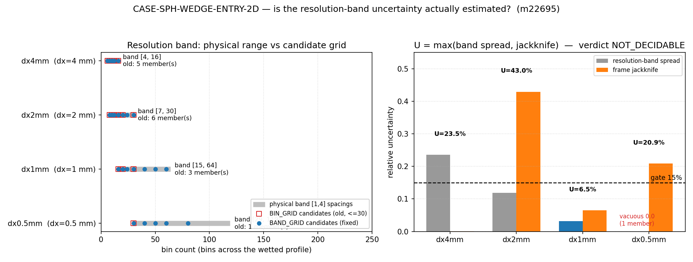

# CASE-SPH-WEDGE-ENTRY-2D — resolution-band coverage audit (m22695)

**Verdict of the case: `NOT_DECIDABLE` (unchanged).**
**This document records a defect in the *instrument*, not a rescoring of the case.**

## 1. What the case decides

The case is graded by the rule declared in
`benchmarks/case_sph_wedge_entry_2d/ladder_closure.py`:

```
U_g         = max(resolution_band.spread_rel, jackknife_rel)      on the 61-frame ensemble
judgeable_g <=>  U_g <= 15%
verdict     = PASS / FAIL_* only when the two finest judgeable grids share the sign
              of r = obs/synth - 1 and |r| <= 15%; else NOT_DECIDABLE
```

`resolution_band` is the set of bin counts whose bin width in **metres** stays in
`[1, 4]` particle spacings (`ensemble_peak.resolution_bin_band`).  It is the
statistic that is supposed to say *"the reported peak does not depend on how I
binned the wall profile"*.

## 2. The defect

The band's candidate bin counts were drawn from `BIN_GRID = (6, 8, 10, 12, 16, 20, 30)`,
i.e. from a grid that **stops at 30 bins**.  The admissible band itself grows as
`dx` shrinks (it is set by the wetted width in *cells*), so at the finest grids the
band extends far beyond the grid cap:

* truncated bands: **dx1mm, dx0.5mm**
* bands that collapsed to a **single member**: **dx0.5mm**

A one-member band has `peak_min == peak_max == peak_median`, so
`spread_rel == 0.0` **by construction**.  That fabricated zero enters a
`max(·, ·)` floor.  It is a latent false-PASS path: on the same grid the frame
jackknife is small at some frame counts, and `U` would then be that small
jackknife with *no band estimate at all* -- a grid declared judgeable by
`0.0 %` of resolution-band evidence.

## 3. Measured, from the committed artefacts

| grid | dx (mm) | physical band | old candidates (BIN_GRID ≤30) | fixed candidates (BAND_GRID) | band spread | jackknife | U | judgeable |
|---|---|---|---|---|---|---|---|---|
| dx4mm | 4 | [4, 16] | 6, 8, 10, 12, 16 | 6, 8, 10, 12, 16 | 23.53 % | 0.12 % | 23.53 % | no |
| dx2mm | 2 | [7, 30] | 8, 10, 12, 16, 20, 30 | 8, 10, 12, 16, 20, 24, 30 | 11.83 % | 42.95 % | 42.95 % | no |
| dx1mm | 1 | [15, 64] | 16, 20, 30 | 16, 20, 24, 30, 40, 50, 60 | 3.16 % | 6.48 % | 6.48 % | yes |
| dx0.5mm | 0.5 | [29, 119] | 30 | 30, 40, 50, 60, 80 | 0.00 % | 20.90 % | 20.90 % | no |

Reading of the table:

* `dx4mm` and `dx2mm` are fully covered (the band stays under the 30-bin cap);
* `dx1mm` band `[15, 64]` -- the upper half (31..64) was **never probed**, so the
  recorded band spread is one-sided: it measures only the over-smoothing side of
  the estimator.  Truncation biases `U` **down**, i.e. towards PASS;
* `dx0.5mm` band `[29, 119]` -- a single candidate survived, spread `0.0` vacuous.
  The grid stays non-judgeable only because the **jackknife** (20.90 %)
  exceeds the gate.  The verdict therefore does not depend on the broken term
  here -- which is exactly why the defect went unnoticed.

## 4. Fix

`ensemble_peak.py`:

1. new `BAND_GRID` (6, 8, 10, 12, 16, 20, 24, 30, 40, 50, 60, 80, 120, 160, 240) spans the physical band up to 240
   bins and is a **superset** of `BIN_GRID`, so the historical H1 statistic
   (full-grid `spread_rel`) and every committed number are unchanged;
2. `resolution_bin_band` draws its candidates from `BAND_GRID`;
3. the band peaks are **measured at the band's own bin counts** (re-binned from
   the pooled frame samples) instead of being looked up in `rows`, which held
   only `BIN_GRID <= 30` bins;
4. a band with fewer than two members reports `spread_rel = NaN` and
   `estimable = False` -- the fabricated `0.0` is no longer emitted;
5. the artefact records `band_peaks`, `n_members`, `estimable`,
   `band_truncated`, `band_clipped_low`, `candidate_grid` so the next audit does
   not have to infer any of this;
6. `uncertainty_declared = max(...)` over the **finite** terms only, so a
   non-estimable band falls back to the jackknife instead of turning the number
   into NaN.

After the fix the candidate count inside the physical band is
dx4mm=5, dx2mm=7, dx1mm=7, dx0.5mm=5 -- every grid admits at
least two members (asserted by
`tests/test_case_sph_wedge_entry_2d_band_coverage.py`).

## 5. Why the verdict does not change (honest statement)

The committed artefacts were produced **before** the fix, and re-measuring the
band at 40..240 bins requires re-running the ensembles (a solver run, not a
re-binning of committed data -- the per-bin peaks are not stored).
So the ladder verdict stays `NOT_DECIDABLE` with judgeable grids
`['dx1mm']`.  This is a **latent instrument defect**,
not an active scoring error: at `dx = 0.5 mm` the jackknife already carried `U`
above the gate.

What the fix buys: the next ensemble run can no longer declare a grid judgeable
on a vacuous band zero, and `dx = 1 mm` / `dx = 0.5 mm` will report a two-sided
band spread instead of the over-smoothing half.

## 6. Error table vs the analytic anchor

| quantity | value | reference | error |
|---|---|---|---|
| obs peak, dx4mm | 10.0415 q-units | COM (Zhao & Faltinsen 1993 via Jain et al. 2022 Table 1) = 6.92 q-units | +46.16 % |
| obs peak, dx2mm | 6.0708 q-units | COM (Zhao & Faltinsen 1993 via Jain et al. 2022 Table 1) = 6.92 q-units | -18.99 % |
| obs peak, dx1mm | 6.8050 q-units | COM (Zhao & Faltinsen 1993 via Jain et al. 2022 Table 1) = 6.92 q-units | -12.36 % |
| obs peak, dx0.5mm | 8.9842 q-units | COM (Zhao & Faltinsen 1993 via Jain et al. 2022 Table 1) = 6.92 q-units | +15.16 % |

Gate is `15%`.  No grid reaches a `PASS` verdict, because the decision
rule needs **two** judgeable grids of the same sign and only
`['dx1mm']` qualifies.  The single judgeable grid
(`dx1mm`) sits at -12.36 % vs the
designated reference, i.e. **within** the 15% gate -- but one grid inside
the gate is not a PASS (the m18382 trap), and this document does not claim one.

## 7. Figure



Left: each grid's physically admissible band (grey bar) against the old
(red squares) and fixed (blue dots) candidate bin counts.  Right: the two
uncertainty terms and their `max`; the `dx0.5mm` band bar is the vacuous zero.

## 8. Reproduce

```bash
python3 benchmarks/case_sph_wedge_entry_2d/make_band_coverage_doc.py
python3 -m pytest tests/test_case_sph_wedge_entry_2d_band_coverage.py -q
```
