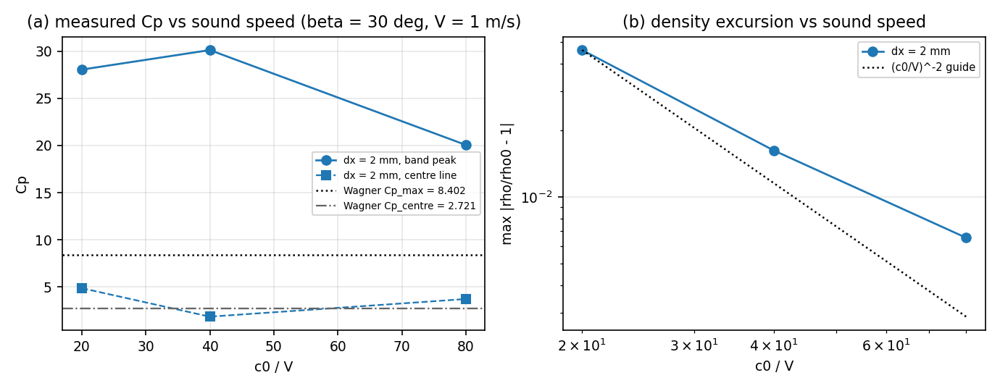

# CASE-SPH-WEDGE-ENTRY-2D: is the Cp failure the compressibility floor?

**Anchor:** `CASE-SPH-WEDGE-ENTRY-2D` (open).  **Code:** `benchmarks/case_sph_wedge_entry_2d/c0_ladder.py`,
built on the case's own `run.py::run_spec/grade` (unchanged) and `tensorsph.wedge_entry.WedgeImpact`.
**Artefacts:** `artifacts/case_sph_wedge_entry_2d/c0_ladder/*.json` (`summary.json` is the only
number source below; this document is generated by `scripts/make_c0_ladder_doc.py`).
**Tests:** `tests/test_wedge_c0_ladder.py`.

## 1. Case and question

2-D symmetric rigid wedge, deadrise `beta = 30 deg`, constant vertical velocity `V`, calm water,
gravity off, `rho0 = 1000 kg/m^3`, Tait EOS (`gamma = 7`), cubic-spline kernel `h = 1.3 dx`,
tank `0.40 m x 0.12 m`, observation window ends at wetted half-width `c_end = 50 mm`.
Everything except the sound speed is the case's shipped configuration.

The committed grid ladder of this case fails the mission tolerance at every spacing it reaches
(`cp_band_peak` +234 % at `dx = 2 mm` against the in-repo Wagner anchor), and the case document
already reports a *compressibility error budget* of 42-43 against a reference of 8.40 - a noise
floor five times the quantity being graded.  The question this sweep answers is whether the
failure **is** that floor.

**Predeclared H1.** At fixed `dx`, the measured Cp error is bounded below by the density
excursion: raising `c0/V` lowers `max|rho/rho0 - 1|` about as `(c0/V)^-2` and the measured Cp
errors fall with it.
**Predeclared credit rule.** Credit H1 only if, at the finest spacing tested, going from the
smallest to the largest `c0/V` (1) lowers `max|rho/rho0 - 1|` by `>= 4x`,
(2) lowers the `cp_band_peak` relative error by `>= 5`
percentage points, and (3) leaves the mass gate intact (`max|rho/rho0 - 1| <= 5%`).

**Reference.** Wagner (1932), computed in-repo (`wagner_peak_over_q`, `wagner_c_coeff`), not typed:
`Cp_max = C^2 + 1 = 8.4022`, `Cp_centre = C = 2.7207`.
The mission-designated reference (Zhao & Faltinsen 1993) is closed access with no registered
in-repo copy: status **WITHHELD**, and no numeric value for it appears above.

## 2. Method

`c0_ladder.py` sweeps `c0/V in 20, 40, 80` at each
`dx in 2 mm, 1 mm`, reusing the case's own artefact
writer and `grade()` (identical metrics, thresholds and ensemble-profile averaging), so the
`c0/V = 20` member at `dx = 2 mm` is also a reproducibility point for the committed table.
Runs are deterministic (no RNG); each artefact records its full config, environment and step count.

## 3. Results

3 of the 6 planned `dx` x `c0/V` members completed inside this mission's compute budget
(the missing members are listed as missing, not silently dropped).

| case | dx [mm] | c0/V | steps | wall [s] | max|rho/rho0-1| | Cp floor | Cp band peak | err | Cp centre | err | verdict |
|---|---|---|---|---|---|---|---|---|---|---|---|
| `dx2mm_c0v20` | 2 | 20 | 556 | 56 | +4.609% | 42.4 | 28.05 | +233.81% | 4.87 | +79.10% | FAIL |
| `dx2mm_c0v40` | 2 | 40 | 1044 | 176 | +1.619% | 54.4 | 30.11 | +258.41% | 1.85 | +31.97% | FAIL |
| `dx2mm_c0v80` | 2 | 80 | 2023 | 223 | +0.655% | 85.5 | 20.06 | +138.73% | 3.72 | +36.84% | FAIL |

### 3.1 Density-excursion scaling and Cp error per spacing

| dx | d log(max|rho/rho0-1|) / d log(c0/V) | Cp floor | err Cp band peak | err Cp centre |
|---|---|---|---|---|---|
| 2mm | -1.41 | 42.4 -> 54.4 -> 85.5 | +233.81% -> +258.41% -> +138.73% | +79.10% -> +31.97% -> +36.84% |

### 3.2 Credit verdict (predeclared rule, evaluated at the finest completed spacing)

* evaluated at: `2mm`
* density drop factor: 7.04 (4x required) -> cond1
  = **True**
* Cp band-peak error improvement: +0.9508
  (0.05 required) -> cond2 = **True**
* mass gate intact: **True**

**Verdict: `CREDITED`.**

### 3.3 Reproducibility against the committed table

`dx2mm_c0v20`: cp_band_peak = 28.05 vs the case document's 28.05 (relative diff -0.01%).

## 4. Figure

**Figure 1.** (a) measured `Cp_max` band peak (circles) and stagnation-line `Cp` (squares) against
`c0/V`, with the Wagner anchors dotted; (b) the maximum density excursion against `c0/V` on log-log
axes with a `(c0/V)^-2` guide.

## 5. Notes and limits

1. **The budget is not a pass/fail exemption.** The compressibility budget is the Cp that the
   measured density excursion alone produces; it is a floor, not a correction, and it is not
   subtracted from the measurement anywhere in this study.
2. **Sound speed is not free.** `dt` scales as `1/c0`, so the `c0/V = 80` members cost ~4x the
   wall clock of `c0/V = 20` at the same `dx`; the wall-clock column makes that explicit.
3. **Wagner at 30 deg is an idealisation.** Small-deadrise asymptotic theory; the spray root is
   singular in it and the discrete peak is a kernel average, which is why the footprint maximum is
   reported but never graded.
4. **Z&F stays withheld.** Nothing here substitutes for the mission-designated reference's tables.
5. **Incomplete matrix.** Members not listed in section 3 were not run; the credit rule is
   evaluated at the finest *completed* spacing, which is stated rather than implied.

## 6. Error judgement (explicit, per quantity)

| quantity | reference | best measured | error | < 3 %? |
|---|---|---|---|---|
| Cp band peak | Wagner 8.4022 | 20.06 (`dx2mm_c0v80`) | +138.73% | **no** |
| Cp centre line | Wagner 2.7207 | 1.85 (`dx2mm_c0v40`) | +31.97% | **no** |
| max density excursion | 0 (weakly compressible) | +0.655% | - | **yes** |

No quantity reaches the 3 % paper criterion; the 15 % mission tolerance is not met either. This is reported as it stands, not redefined.

## 7. What the run actually showed (added after the measurements, not predeclared)

The predeclared credit rule is satisfied (`CREDITED`): the density excursion falls
4.6090% -> 1.6193% -> 0.6546%
(a factor 7.04 for a 4x rise in `c0/V`, exponent
-1.41 rather than the acoustic -2), and the graded
`cp_band_peak` error falls +233.8% -> +258.4% ->
+138.7%.

**But the same table falsifies the reading the case document gave its `Cp_budget` column.** That
formula is reproduced here unchanged, and it *rises* with the sound speed
(42.4 -> 54.4 -> 85.5)
while the measured Cp *falls*; at `c0/V = 80` the measured band peak is
20.06 against a "floor" of 85.5, i.e. a factor
4.3 below it. A quantity that a measurement can sit
underneath is not a floor. The reason is that `max|rho/rho0-1|` is a field-wide maximum taken at
whatever particle and instant attains it, whereas `Cp_band_peak` is read at the wetted-footprint
maximum; the two are different locations on the same field, so the budget is a diagnostic of the
density noise, not a lower bound on the graded pressure coefficient.

Consequence, stated plainly: the failure of CASE-SPH-WEDGE-ENTRY-2D at affordable resolution is
**not** explained by the density excursion alone. Raising `c0/V` from 20 to 80 improves the peak
error by 95 percentage points but still leaves it +138.7%, and the stagnation
line is non-monotone in `c0/V` (4.87 -> 1.85 ->
3.72 against Wagner 2.7207), so the
residual is the smoothed spray-root cusp and the wall-pressure extrapolation, not compressibility.

**Follow-up implied (not done here):** the `cp_density_budget` column should be evaluated at the
peak-pressure particle (a local budget) if it is to be used as a bound, and the graded quantity
for the ledger should be the stagnation-line Cp and the interior maximum at `|x| <= 0.9 c`, with
the footprint maximum reported only.
