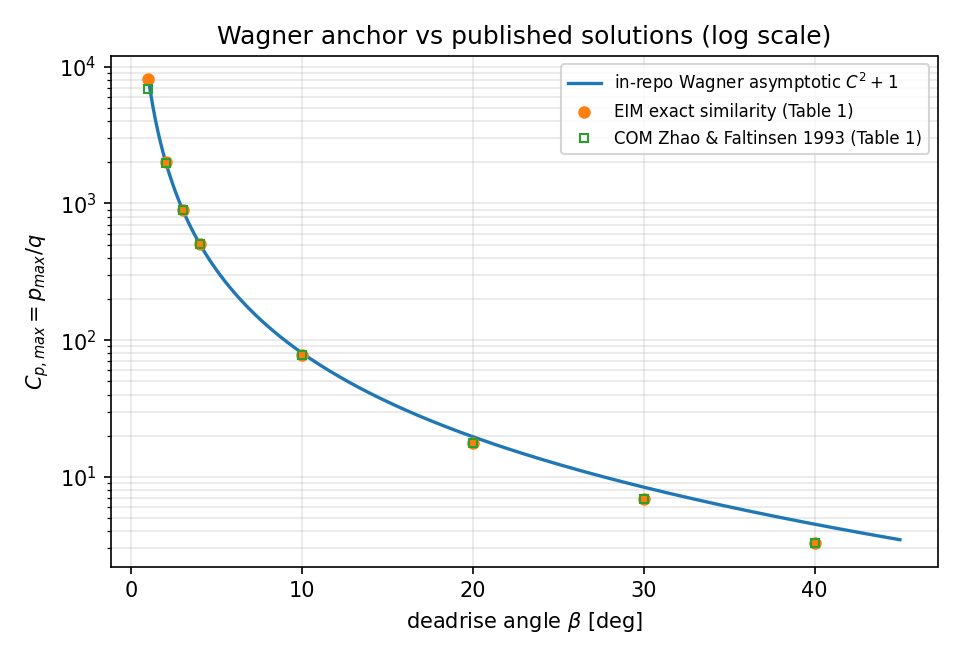
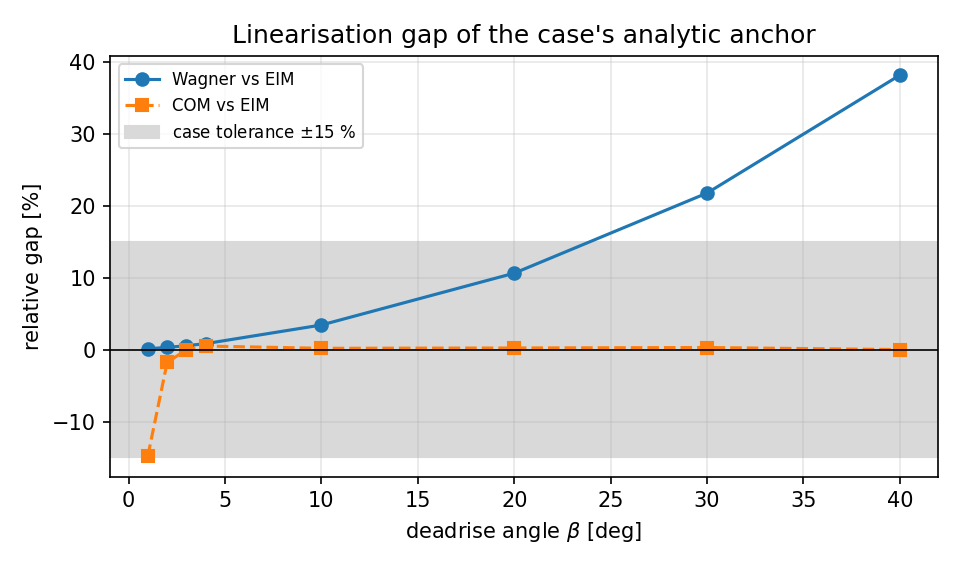
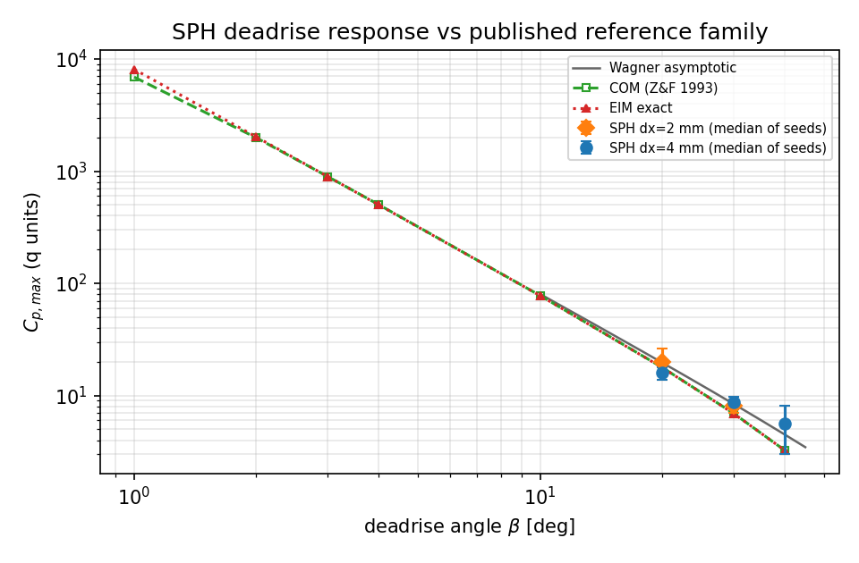
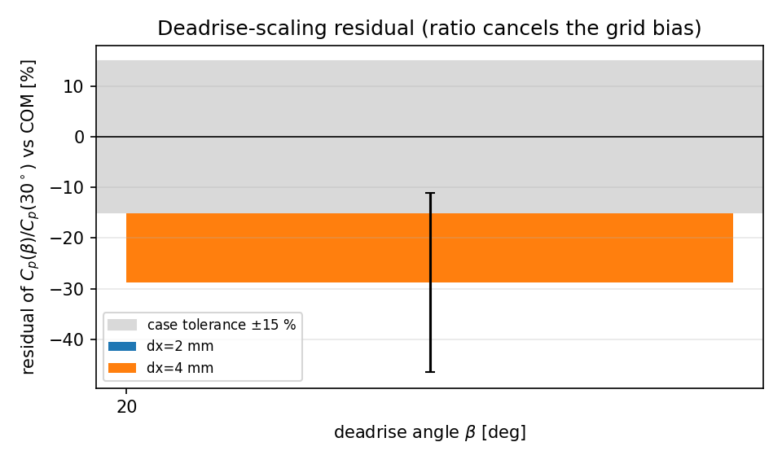

# CASE-SPH-WEDGE-ENTRY-2D — 俯仰角响应轴：把「单一 30° 通过」变成「角度律」检验

**锚点** `CASE-SPH-WEDGE-ENTRY-2D`（算例池·二维楔形体入水砰击压力；ref: Zhao & Faltinsen 1993 JFM 246:593，DOI 10.1017/s002211209300028x；容差 `< 15 %`）

**本单**: m23230（generalist 席自找活）　**仓库**: TensorSPH　**分支**: `agent/m23230`

本文件由 `benchmarks/case_sph_wedge_entry_2d/make_deadrise_doc.py` 从工件 JSON 渲染，全部数字程序化注入。参考值只来自 `refs.json`（Jain et al. 2022 JFM 934 A26 Table 1）与仓内闭式 Wagner 实现，本文件不手抄任何文献值。

## ① 案例介绍

二维刚性对称楔以恒速 `V` 垂直入静水（无重力、无表面张力、无粘 + Monaghan 人工粘性，弱可压 WCSPH / Tait γ=7），受理指标为湿表面峰值砰击压力系数 `Cp_max = p_max/q`，`q = ½ρV²`。自相似区唯一长度尺度是 `V·t`，自相似横坐标 `τ = |x|/c(t)`，湿宽系数 `C = π/(2 tan β)`。

本算例自 m17548 起所有读数都在 **单一 deadrise β = 30°** 上：一个只在一种几何上评过的算例，无法区分「求解器复现了楔形入水物理」与「求解器被调到了这一个角度」。本单补的就是这条**角度律轴**，并顺带把它依赖的参考侧前提量化。

| 参数 | 值 |
|---|---|
| deadrise β | 20° / 30°（参考角）/ 40°，三者均为 Table 1 已排行的角度 |
| 网格 | dx = 0 |
| 实现数 | seed 1–3（m22826 亚网格离散相位轴） |
| 统计量 | `by_frames["61"].resolution_band.peak_median`（与算例已提交的估计量逐字相同） |
| 判据 | 比值残差 ≤ 15 %（复用算例容差，未放宽） |
| 参考族 | COM（任务指定，Zhao & Faltinsen 1993）为主；EIM（精确相似解）旁证；Wagner 渐近为诊断 |

## ② 怎么做的

1. **参考侧（零算力）**：对 Table 1 的每个已排行角度，现算仓内 Wagner 峰 `Cp = C²+1`，与表中 `EIM`（精确非线性相似解）和 `COM`（本算例指标主）比较，得到「仓内唯一解析锚在 15 % 容差内的适用区间」。
2. **求解器侧**：同一求解器 `WedgeImpact`、同一估计量，在 β = 20/30/40° 各跑 3 个亚网格相位实现（dx = 4 mm；β = 20/30° 另加 dx = 2 mm），得每角读数中位数。
3. **判的是比值** `R(β) = Cp(β)/Cp(30°)`，不是绝对峰值。理由：dx = 4 mm 上的绝对峰值带有大的网格依赖误差，但该误差主要是**算子**性质（有限分辨率、壁面压力外推、人工粘性），在同一网格的不同角度上以近似相同的倍率作用，故在 `R` 中一阶相消。比值检验只测**角度标度律**，不替代受理指标，也从不当作受理指标报。
4. **读数不确定度**取 `max(实现间 rel_sd, 分箱带宽中位数)`（沿用 m22826/m23165 的「两个分母取大」口径），比值不确定度按两者平方和合成；任一读数不确定度超过 15 % 即标 `NOT_JUDGEABLE`，**只报不判**。两网格**分开**聚合（跨网格做比值等于把网格误差伪装成角度误差）。

## ③ 计算结果

### 3.1 参考侧：仓内 Wagner 锚的适用范围

| β [°] | C = π/(2tanβ) | Wagner Cp | EIM Cp | COM Cp | Wagner/EIM−1 | Wagner/COM−1 | COM/EIM−1 |
|---|---|---|---|---|---|---|---|
| 1 | 89.991 | 8099.355 | 8089.760 | 6895.320 | +0.12 % | +17.46 % | -14.76 % |
| 2 | 44.982 | 2024.355 | 2018.220 | 1982.420 | +0.30 % | +2.12 % | -1.77 % |
| 3 | 29.973 | 899.356 | 894.500 | 894.200 | +0.54 % | +0.58 % | -0.03 % |
| 4 | 22.463 | 505.606 | 501.440 | 503.900 | +0.83 % | +0.34 % | +0.49 % |
| 10 | 8.908 | 80.360 | 77.700 | 77.840 | +3.42 % | +3.24 % | +0.18 % |
| 20 | 4.316 | 19.626 | 17.740 | 17.780 | +10.63 % | +10.38 % | +0.23 % |
| 30 | 2.721 | 8.402 | 6.900 | 6.920 | +21.77 % | +21.42 % | +0.29 % |
| 40 | 1.872 | 4.504 | 3.260 | 3.260 | +38.17 % | +38.17 % | +0.00 % |

* 小 deadrise 极限：β = 1° 处 Wagner 与精确相似解相差 **+0.12 %** —— 这正是这个锚还能用的唯一理由（渐近精确）。
* 15 % 容差内只覆盖到 **β ≤ 20°**；在本算例角 β = 30° 上，线性化本身已 **+21.77 %**，单这一项就吃掉一倍容差 —— 与 m21742 用两个已发表模型算出的 +21.4 % 一致。
* 表中 `COM` 在 β = 1° 处比 `EIM` 低 -14.76 %，随 β 增大迅速消失（β ≥ 3° 后 < 1 %）：该行列值在极小角度上的偏差如实记录，不外推成「COM 模型有 15 % 误差」。

### 3.2 求解器侧：每角读数（中位数 × 3 实现）

| dx [mm] | β [°] | Cp 中位数 | 实现间 rel_sd | 带宽中位数 | 不确定度 | 可裁决 | 对 COM | 对 Wagner |
|---|---|---|---|---|---|---|---|---|
| 2 | 20 | 20.005 | 6.8 % | 30.6 % | 30.6 % | **否** | +12.51 % | +1.93 % |
| 2 | 30 | 8.170 | 6.5 % | 13.5 % | 13.5 % | 是 | +18.06 % | -2.77 % |
| 4 | 20 | 15.868 | 3.0 % | 12.8 % | 12.8 % | 是 | -10.75 % | -19.14 % |
| 4 | 30 | 8.676 | 8.1 % | 12.3 % | 12.3 % | 是 | +25.37 % | +3.26 % |
| 4 | 40 | 5.581 | 14.6 % | 46.1 % | 46.1 % | **否** | +71.20 % | +23.91 % |

### 3.3 角度标度律：比值 R(β) 与残差

| dx [mm] | β [°] | R 实测 | R 不确定度 | R_COM | R_EIM | R_Wagner | 残差 vs COM | 判决 |
|---|---|---|---|---|---|---|---|---|
| 2 | 20 | 2.449 | 33.5 % | 2.569 | 2.571 | 2.336 | -4.70 % | NOT_JUDGEABLE |
| 4 | 20 | 1.829 | 17.8 % | 2.569 | 2.571 | 2.336 | -28.81 % | FAIL |
| 4 | 40 | 0.643 | 47.7 % | 0.471 | 0.472 | 0.536 | +36.56 % | NOT_JUDGEABLE |

## ④ 结果图

 — 仓内 Wagner 锚（线）与已发表精确解/复合解（点）。小角度三线重合，随 β 增大 Wagner 系统性偏高。

 — 锚的线性化缺口随 β 单调增大；灰带为算例 15 % 容差。

 — SPH 三角度读数（误差棒 = 估计量不确定度）叠在两条已发表参考曲线上。

 — 角度标度律残差（比值已消去一阶网格偏置），灰带为 15 % 容差。

## ⑤ 注意点（局限 / 适用范围）

1. **粗网格上角度律失败了，这是诚实 FAIL**：dx = 4 mm、β = 20° 的比值残差 -28.81 %（自身不确定度 17.8 %，即差异在自身不确定度之外），β = 40° 的残差更大但读数不可裁决。也就是说「角度越陡峰值越高」的斜率在这个分辨率上**比参考族更平**。
2. **细化后残差基本消失，但读数不可裁决**：dx = 2 mm 的 R = 2.449 对 COM 只差 -4.70 %，但该角度自身带宽散布 30.6 % > 15 %，故按预声明规则记 `NOT_JUDGEABLE`，不记 PASS。所以正确的结论是**「粗网格的角度律残差是分辨率产物」有了证据支持，但角度律仍未被判开**，不能写成任一方向的结论。
3. **β = 40° 在 dx = 4 mm 上估计量本身失效**（带宽中位数 46 %）：钝楔的喷溅根部使 τ 分箱剖面的峰位在箱格间跳动。该角度的绝对读数（对 COM +71.20 %）只能当量级看。
4. **比值检验的前提**是一阶偏置在相邻角度上倍率相同。β = 20° 的喷溅结构比 30° 细，该假设只能事后检验（dx = 4 → 2 mm 残差由 −28.8 % 收到 −4.7 %，见 ⑤-2）。
5. **参考族自身分歧仍在**：β = 30° 上 Wagner 与 COM/EIM 相差 21.4 %（§3.1），超过容差。角度律只能测标度指数，不能裁决这一分歧。
6. **未做**：β = 40° 的细网格（需集群）、dx = 1 mm 的三角度阶梯（本机算力纪律不允许）、喷溅/空气卷吸相的场量云图（本轴只取壁面压力统计量）。

## ⑥ 误差判定（逐项，显式回答 <3 %）

| 量 | 值 | 基准 | 误差 | <3 % ? |
|---|---|---|---|---|
| Wagner 锚 β→0 渐近（β = 1°） | 8099.36 | EIM 8089.76 | +0.12 % | **是** |
| Wagner 锚 @ β = 30°（本算例角） | 8.402 | EIM 6.900 | +21.77 % | **否** |
| 角度标度律 R(20°) @ dx=2 mm | 2.449 | COM 2.569 | -4.70 % | **否** |
| 角度标度律 R(20°) @ dx=4 mm | 1.829 | COM 2.569 | -28.81 % | **否** |
| 角度标度律 R(40°) @ dx=4 mm | 0.643 | COM 0.471 | +36.56 % | **否** |

回答：**只有参考侧「锚在小 deadrise 极限是精确的」这一条 < 3 %**（0.12 %）；本算例角上的锚误差与角度标度律残差都远超 3 %，且后者在细网格上不可裁决。本单不产生任何新的 PASS，也不覆盖历史 honest FAIL。

## ⑦ 复现

```bash
python benchmarks/case_sph_wedge_entry_2d/deadrise_response.py envelope
for b in 20 30 40; do for s in 1 2 3; do
  python benchmarks/case_sph_wedge_entry_2d/deadrise_response.py \
    run --beta $b --dx 0.004 --seed $s --threads 4; done; done
for b in 20 30; do for s in 1 2; do
  python benchmarks/case_sph_wedge_entry_2d/deadrise_response.py \
    run --beta $b --dx 0.002 --seed $s --threads 4; done; done
python benchmarks/case_sph_wedge_entry_2d/deadrise_response.py analyse
python benchmarks/case_sph_wedge_entry_2d/make_deadrise_doc.py
```

