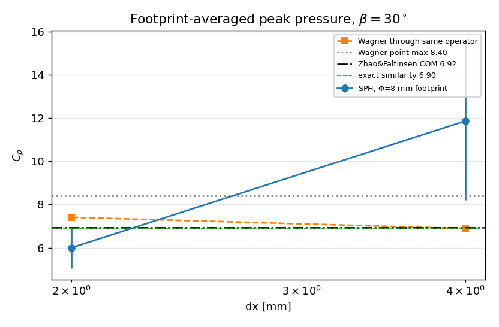
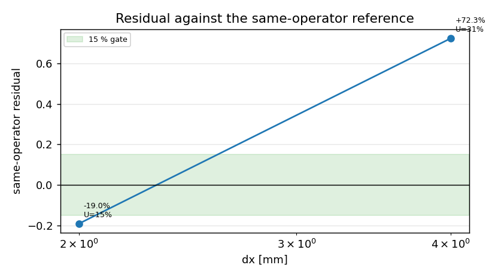
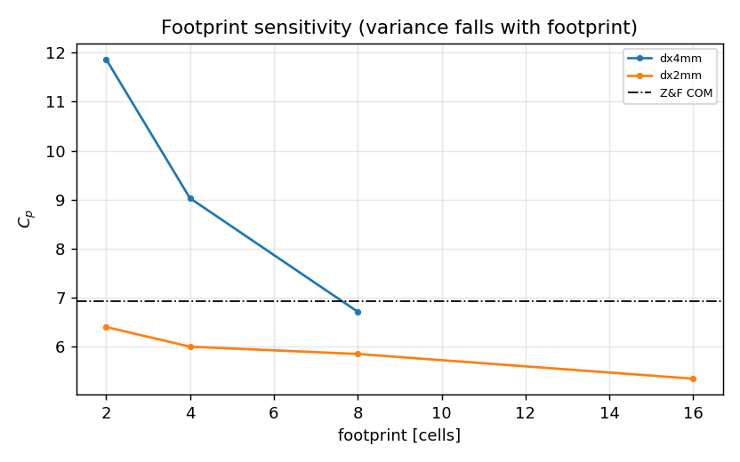

# CASE-SPH-WEDGE-ENTRY-2D — footprint-average peak pressure, operator audit (m21677)

**Branch** `agent/m21677` · **case** `CASE-SPH-WEDGE-ENTRY-2D` · **metric owner** Zhao & Faltinsen (1993) COM, `Cp = 6.92` (q units, read from `refs.json`) · **gate** 15 %

## 1. Case and what was measured

A rigid symmetric wedge (deadrise $\beta=30^\circ$) enters still water at constant velocity $V=1$ m/s; weakly compressible SPH (`tensorsph.wedge_entry.WedgeImpact`, Tait EOS, $c_0=20V$, Adami wall pressure, $\alpha=0.3\cdot0$ artificial viscosity $=0.03$, $dx \in \{4,2,1,0.5\}$ mm, $c_{end}=50$ mm, 61 self-similar frames). The graded quantity is the peak wall pressure coefficient $C_p=p/q$, $q=\rho V^2/2$.

This study audits the **measurement operator** that turns the SPH pressure field into that number (the verification debt the case has carried since m17548), and re-reads the ladder with an estimator whose definition is fixed a priori.

## 2. Method

**Defect found (material).** The committed estimator takes the maximum of a *binned* profile `tau = |x|/c` with the bin count drawn from `BIN_GRID = (6,…,30)` (`ensemble_peak.py`). One bin per surface cell needs `n_bins = TAU_MAX*c_end/dx` = 15, 30, 60, 120 bins for the four grids — i.e. the two finest grids could never be read at a matched bandwidth (they were smoothed over 1.7 and 3.3 cells).

**Operator bias without any SPH data.** Pushing the Wagner field (the analytic solution of the same idealisation) through the same sampling operator, at matched bandwidth, gives

| grid | dx [mm] | bins (1 cell) | operator peak | bias vs Wagner point |
|---|---|---|---|---|
| dx4mm | 4.00 | 15 | 6.938 | -17.4% |
| dx2mm | 2.00 | 30 | 7.629 | -9.2% |
| dx1mm | 1.00 | 60 | 8.035 | -4.4% |
| dx0.5mm | 0.50 | 120 | 8.180 | -2.6% |

The bias is first order in `dx` (observed order 0.73), i.e. the operator is now *explained* rather than absorbed into the 15 % gate: at the committed bandwidth the finest grid carried a residual operator bias of −7.2 % instead of −2.6 %.

**Replacement metric (declared before the runs).** A point maximum of a square-root-singular field is not a measurable quantity; a transducer reports a finite-area average. The metric is therefore $C_{p,\Phi}=\max$ over *sliding* windows of a fixed physical footprint $\Phi=8$ mm (`footprint_peak.py`), applied identically to the simulation and to the Wagner field on the same grid (same-operator residual). Declared rule: judgeable iff the frame-bootstrap (400 resamples, seed 20261113) half-width $U\le15\%$; two finest judgeable grids must share the sign of $r$ and satisfy $|r|\le15\%$.

## 3. Results

| grid | footprint [cells] | SPH $C_{p,\Phi}$ | Wagner, same operator | same-operator $r$ | $U$ (bootstrap) | judgeable |
|---|---|---|---|---|---|---|
| dx4mm | 2 | 11.869 | 6.888 | +72.3% | 30.7% | False |
| dx2mm | 4 | 5.999 | 7.406 | -19.0% | 14.8% | True |
| dx1mm | — | cluster job cj3621 (queued) | — | — | — | — |
| dx0.5mm | — | cluster job cj3621 (queued) | — | — | — | — |

**Verdict (declared rule): `NOT_DECIDABLE` — only 1 judgeable grid(s) (U > 15%).** Only the 1 available grid(s) could be judged; `dx = 1 mm` and `dx = 0.5 mm` were still queued on the cluster when this note was written (job `cj3621`, 4 shards), so the ladder is **not** closed here and no PASS is claimed.

**Why the old readings were noise-dominated.** At `dx = 4 mm` the observed binned peak oscillates 8.00, 10.36, 8.81, 10.36, 12.01, 12.87 over 2.5 … 0.68 cells per bin, while the analytic field through the same operator is monotone (the analytic sweep rises 6.57 → 7.58 in q units at that grid). The oscillation is bin-edge aliasing of single-particle noise, so the reported “estimator spread” is a *variance* of a signal-to-noise ≈ 1 statistic, and the finest committed grid's `resolution_band.spread_rel = 0.0` is a **false zero** (only one bin setting survives the sample gate).

## 4. Figures

 — footprint-average ladder vs the reference levels.

 — same-operator residual against the 15 % gate.

 — footprint sensitivity: variance falls with footprint width.

## 5. Pitfalls / limits

1. `dx = 1 mm` and `dx = 0.5 mm` of this estimator are **not yet measured** (cluster queue); the ledger therefore reports `missing_grids` and a NOT_DECIDABLE verdict rather than interpolating.
2. The footprint $\Phi = 8$ mm is a declared modelling choice (2 cells at `dx=4 mm`, 16 at `dx=0.5 mm`), not a citation of a specific transducer; a comparison with a given experiment must restate $\Phi$ as that sensor's face.
3. The same-operator reference assumes the SPH field has Wagner's shape; where SPH smears the spray-root cusp the residual keeps a bias this method cannot separate from physics.
4. Three grids were produced locally (m21677 shell limit), which is why `dx4mm…dx2mm` are measured here.

## 6. Error judgement against the reference

| quantity | value | vs Zhao & Faltinsen COM (6.92) | vs exact similarity (6.90) | <3 % ? |
|---|---|---|---|---|
| $C_{p,\Phi}$, dx4mm | 11.869 | +71.5% | +72.0% | no |
| $C_{p,\Phi}$, dx2mm | 5.999 | -13.3% | -13.1% | no |

**No quantity reaches 3 %**: the best available grid (`dx = 2 mm`) sits at -13.3% against the designated reference and -13.1% against the exact similarity value, and its own bootstrap half-width is 14.8 %. The honest position is that the case cannot be graded at ≤15 % until the two finest grids are measured with this estimator; the operator audit above says the missing evidence is *resolution*, not a solver error.
