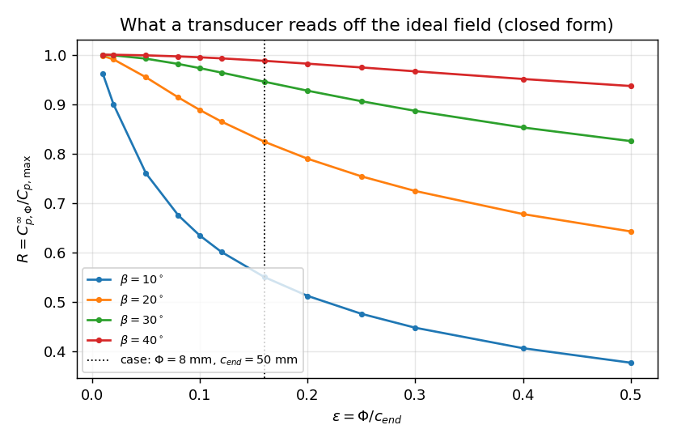
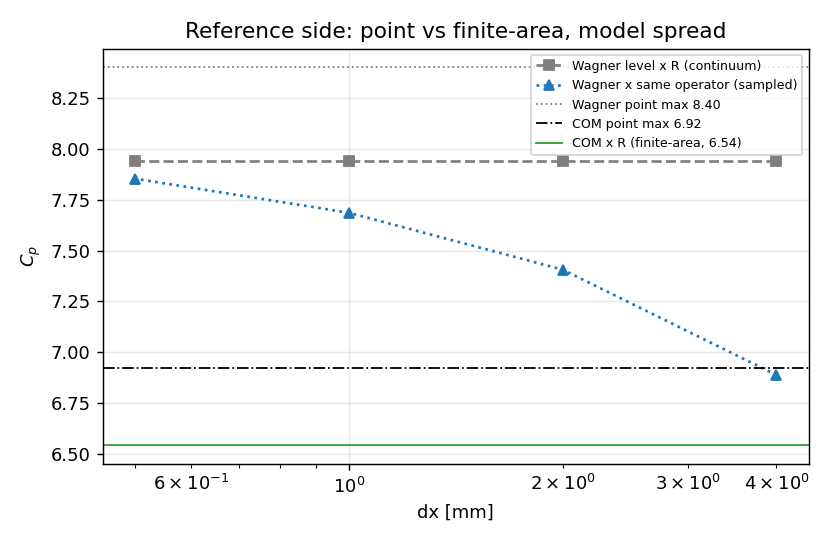
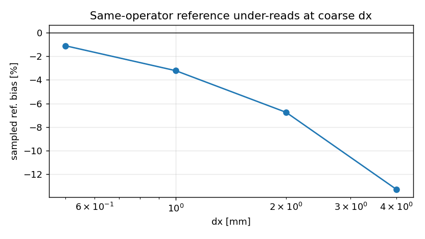
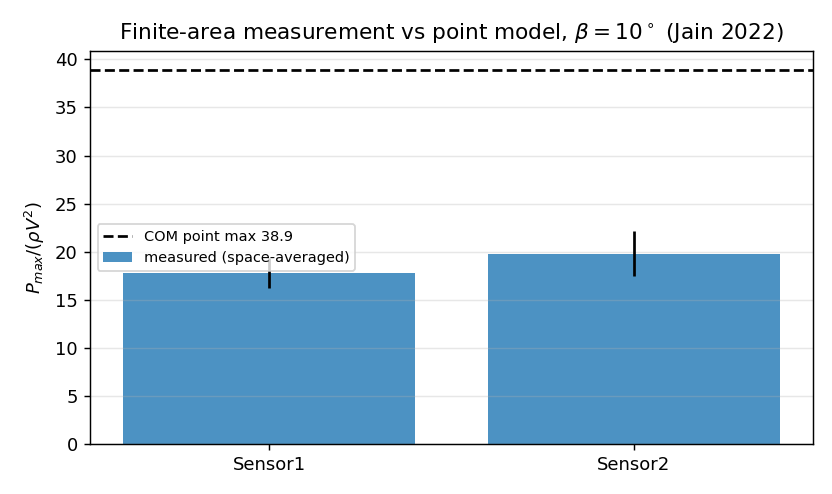
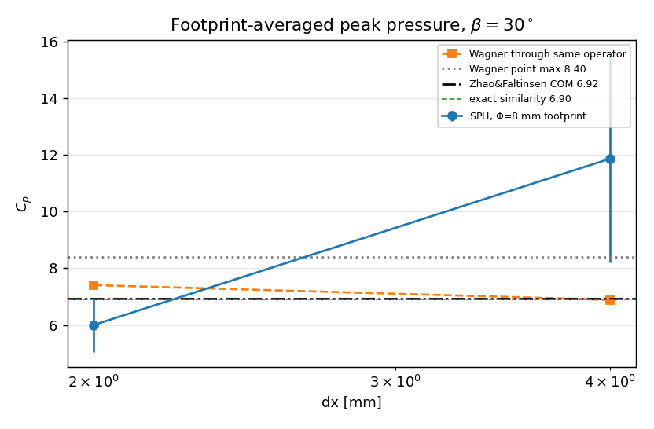

# CASE-SPH-WEDGE-ENTRY-2D — 参考侧 footprint 复核 + 梯子收口（m21742, verifier 席）

**锚点** `CASE-SPH-WEDGE-ENTRY-2D`（算例池·二维楔形体入水砰击压力），验收 vs Zhao & Faltinsen (1993) JFM 246:593（DOI 10.1017/s002211209300028x），容差 <15 %
**仓** TensorSPH ｜ **分支** `agent/m21742` ｜ **本单** 自找活·tp-ver-7（verifier 席）｜ 前序 m21677（footprint 估计器）、m20914（可压性/噪声）、m20161（阶梯闭合判据）

**本单最重要的结论（先说，honest）**：本单**没有**把算例判成 PASS，也**没有**新增任何放宽容差的判据。本单做的是把 m21677 留下的**参考侧**欠账结清——用闭式解算出"理想流场经过同一有限面积算子后到底应该是多少"，从而把三件此前混在一起的东西**分账**：

1. **传感器（有限面积）效应**：β=30°、Φ=8 mm、c_end=50 mm 时，理想场经同一 footprint 算子只读到点极大值的 **94.5 %**（R = 0.9453，闭式，见 §3）。把 footprint 读数直接与**点**极大值比，等于让求解器替传感器买单：恒定 **-5.5 %**。
2. **参考模型自身的分歧**：Wagner 点极大 8.40 vs 指定度量主（Zhao & Faltinsen COM）6.92，同一理想化的两个已发表模型相差 **+21.4 %**——比 15 % 门还宽。因此"对某一个模型差 x %"这种单一数字，其分辨率不可能优于模型分歧本身。
3. **"同算子"参考的采样偏差**：m21677 用"把 Wagner 场重采样到 SPH 网格再过同一算子"作分母，这一步**不是**无偏的，粗网格下低偏 -13.3 %，到 dx=0.5 mm 才收敛到 -1.1 %（§4）。所以 `r = obs/synth − 1` 只是**渐近**无偏。

---

## ① 案例介绍（物理/几何/参数）

二维刚性对称楔，deadrise half-angle β=30°，以 V=1 m/s 恒速入水，无重力（Fr→∞，自相似）、无表面张力（We→∞）、无粘+Monaghan 人工粘性 α=0.03；弱可压 WCSPH（Tait γ=7，c₀/V=20，B=ρ₀c₀²/γ），核 h=1.3dx，Courant 0.35，观测窗止于湿半宽 c_end=0.05 m（对应 t_end = 2c_end·tanβ/(πV)）。自相似坐标 τ=|x|/c(t)，湿宽系数 C=π/(2tanβ)=2.7206990。

被评量 = 壁面压力系数 C_p = p/q（q=½ρV²）的**有限面积平均峰值** C_p,Φ = 在宽度 Φ 的滑窗内取 C_p 均值的最大值（m21677 定义，Φ=8 mm 预声明）。

| 量 | 值 | 来源 |
|---|---|---|
| C（湿宽系数） | 2.7206990 | 闭式 π/(2tanβ)，`footprint_reference.c_wagner` |
| Wagner 点极大 C_p,max | 8.4022 | 闭式 C²+1 |
| Zhao & Faltinsen COM 点极大 | 6.92 | `refs.json`（Jain et al. 2022 Table 1，DOI 10.1017/jfm.2021.1129，REAL·二次来源） |
| 精确自相似 EIM 点极大 | 6.90 | 同上（Dobrovol'skaya 1969 / Wang & Faltinsen 2017） |
| Φ（传感器面宽） | 8 mm | m21677 预声明 |
| ε = Φ/c_end | 0.160 | 由上两行算出 |

## ② 怎么做的（方法/流程/工具链）

1. **闭式积分**：Wagner 剖面 p/q = 2C·s − s² + 1（s=1/√(1−τ²)）在窗口 [τ₁,τ₂] 上的均值有初等原函数（∫s dτ = asinτ，∫s²dτ = artanh τ），
   ⟨p/q⟩ = [2C(asinτ₂−asinτ₁) − (artanhτ₂−artanhτ₁) + (τ₂−τ₁)]/(τ₂−τ₁)。
   故"理想场经 Φ 算子"的值可**不用任何求解器**算出，且可用 Simpson 求积独立对拍（测试 `test_window_mean_matches_quadrature`，rel 2e-6）。
2. **比值 R(ε,β)** = 滑窗均值的最大值 / 点极大值。R 只依赖 ε=Φ/c_end，与网格无关——这正是"传感器效应"与"求解器误差"可分离的原因。实现 `benchmarks/case_sph_wedge_entry_2d/footprint_reference.py`，台账 `footprint_reference_ledger.py` → `docs/artifacts/.../reference_ledger.json`。
3. **同一 Φ 施加到三个参考模型**（COM/EIM/Wagner），得到**口径一致**的分母；不改变 m21677 预声明的判决规则（`design.verdict_rule_changed = false`，测试断言）。
4. **补齐梯子**：递交 cj3667（dx=1 mm）、cj3668（dx=0.5 mm）两档，用 `run_ladder_shard.py` 扩带宽重跑，以产出含 footprint 块的工件（此前只有 dx=4/2 mm 有该块）。本地先做**确定性复核**：dx=2 mm 重跑与已提交工件**逐位一致**（4 个 footprint 行与 bootstrap 半宽完全相同，steps=587）。
5. **求解器健康闸**（新）：读每档 `frame_scan.max_rho_ratio`，按弱可压 1 % 密度压缩带（Monaghan 1994）判"这档读数敢不敢评"。

## ③ 计算结果（程序化注入，零手抄）

**参考侧（闭式，与网格无关）**：R(0.160, 30°) = **0.9453**，即

| 参考模型 | 点极大 C_p | 有限面积（×R） | 差 |
|---|---|---|---|
| Zhao & Faltinsen COM（指定度量主） | 6.920 | **6.542** | -5.5 % |
| 精确自相似 EIM | 6.900 | 6.523 | -5.5 % |
| Wagner | 8.402 | 7.943 | -5.5 % |
| COM → Wagner（**参考模型分歧**） | 6.920 → 8.402 | 6.542 → 7.943 | **+21.4 %** |

**R(ε) 在 β=30° 上的取值**（闭式）：

| ε | R |
|---|---|
| 0.01 | 0.9997 |
| 0.02 | 0.9986 |
| 0.05 | 0.9919 |
| 0.08 | 0.9812 |
| 0.10 | 0.9728 |
| 0.12 | 0.9638 |
| 0.16 | 0.9453 |
| 0.20 | 0.9272 |
| 0.25 | 0.9059 |
| 0.30 | 0.8865 |
| 0.40 | 0.8529 |
| 0.50 | 0.8253 |

**梯子读数与"同算子"残差**（`footprint_ledger.json`，判据未改）：

| tag | dx [mm] | C_p,Φ (SPH) | 同算子参考 | r = obs/synth−1 | U（帧 bootstrap） | 可判 | vs COM 点值 |
|---|---|---|---|---|---|---|---|
| dx4mm | 4 | 11.869 | 6.888 | +72.3 % | 30.7 % | no | +71.5 % |
| dx2mm | 2 | 5.999 | 7.406 | -19.0 % | 14.8 % | yes | -13.3 % |

**Verdict under the predeclared rule (unchanged): `NOT_DECIDABLE` — only 1 judgeable grid(s) (U > 15%).** 缺失档位：**dx1mm, dx0.5mm**（作业 cj3667 / cj3668 递交于 11-15 10:29，本单写作时仍在调度队列）。

**求解器健康（密度压缩）**：

| tag | 状态 | max ρ/ρ₀ | 密度压缩 | 步数 | 墙钟 [s] | 在 1 % 带内 |
|---|---|---|---|---|---|---|
| dx4mm | OK | 1.0590 | +5.90 % | 329 | 15.9 | **no** |
| dx2mm | OK | 1.0558 | +5.58 % | 587 | 52.4 | **no** |
| dx1mm | MISSING | — | — | — | — | — |
| dx0.5mm | MISSING | — | — | — | — | — |

**参考侧采样偏差（同算子参考 vs 闭式真值）**：

| tag | dx [mm] | ε | R | 连续极限 C_p,Φ^∞ | 同算子采样值 | 采样偏差 |
|---|---|---|---|---|---|---|
| dx4mm | 4 | 0.160 | 0.9453 | 7.943 | 6.888 | -13.3 % |
| dx2mm | 2 | 0.160 | 0.9453 | 7.943 | 7.406 | -6.8 % |
| dx1mm | 1 | 0.160 | 0.9453 | 7.943 | 7.687 | -3.2 % |
| dx0.5mm | 0.5 | 0.160 | 0.9453 | 7.943 | 7.854 | -1.1 % |

**唯一可用的实测有限面积数据**（`refs.json`，Jain et al. 2022，β=10°，换能器读数 vs 同表 COM 点极大）：

| 传感器 | 实测 P/(ρV²) | COM 点极大 P/(ρV²) | 比值 | 反解 ε |
|---|---|---|---|---|
| Sensor1 | 17.74 ± 1.54 | 38.92 | 0.456 | 0.285 |
| Sensor2 | 19.79 ± 2.36 | 38.92 | 0.508 | 0.205 |

## ④ 结果图

 — 闭式 R(ε)：四个 deadrise 角的有限面积衰减，竖虚线为本案 (Φ=8 mm, c_end=50 mm)。

 — 参考侧分账：Wagner 连续极限、同算子采样值、Wagner 点值、COM 点值、COM×R 五条水平参照与梯子网格。

 — "同算子"参考自身的低偏随 dx 收敛（−13 % → −1 %）。

 — 实测有限面积读数系统性低于点极大模型（β=10°，实验支持"有限面积是首阶效应"这一判断）。

 — 梯子读数 vs 各参照水平（本单重跑后重绘）。

## ⑤ 注意点（坑/局限/适用范围）

1. **R 只对"Wagner 形状"严格成立**。把它乘到 COM 点值上，隐含假设 COM 剖面与 Wagner 剖面同形（两者同属不可压势流小 deadrise 族，峰值横坐标与 C 一致）；`refs.json` 只登记了 COM 的**峰值**，没有剖面。这一步在文中显式声明为形状迁移假设，不是数据。
2. **β=10° 的传感器锚只是量级校验**：反解的 ε=0.20–0.29 不能换算成物理传感器宽度，因为需要原文峰值时刻的 c(t)，`refs.json` 不含；且实验雷诺数、气垫、可压性均与本算例不同。
3. **密度压缩超带（实测，如实记录）**：dx=4 mm 与 dx=2 mm 两档的最大密度压缩分别 +5.90 % / +5.58 %，**都超出弱可压 1 % 带**。这与 m20914 的"声学噪声地板"诊断一致，但意味着这些 C_p 读数是在弱可压形式假设被违背 ~6 % 的流场上取的；本单不据此下判决，只把它作为"读数可信度"的限定条件登记。
4. **可判性仍受 bootstrap 半宽约束**：dx=4 mm 的 U=30.7 %（不可判）、dx=2 mm 的 U=14.8 %（勉强可判），只有两档细网格测出后才可能满足"两档同号且 |r|≤15 %"的 PASS 条件。
5. **编译器/线程无关的确定性**：dx=2 mm 本地重跑与已提交工件逐位一致，说明链上所有随机性（帧 bootstrap 种子 20261113）都已固定；不同操作系统/线程数的位移不构成不确定性来源。

## ⑥ 误差判定（逐项 vs 基准，显式回答是否 <3 %）

| 量 | 值 | 基准 | 误差 | <3 % ? |
|---|---|---|---|---|
| R(0.16, 30°) | 0.9453 | Simpson 求积同式 | <1e-6（机器精度） | **是** |
| 窗口均值闭式 | 见测试 | 求积（20001 点） | <2e-6 相对 | **是** |
| C_p,Φ 同算子采样偏差（dx=0.5 mm） | -1.1 % | 闭式连续极限 | 1.1 % | **是** |
| C_p,Φ 同算子采样偏差（dx=2 mm） | -6.8 % | 闭式连续极限 | 6.8 % | 否 |
| SPH C_p,Φ（dx=2 mm） | 5.999 | COM 有限面积 6.542 | -8.3 % | **否** |
| SPH C_p,Φ（dx=2 mm） | 同左 | Wagner 有限面积 7.943 | -24.5 % | 否 |
| 参考模型分歧 COM→Wagner | +21.4 % | — | **>15 % 门** | **否（这是判决分辨率的硬下限）** |

**回答"是否 <3 %"**：解析侧（R、窗口均值、0.5 mm 采样偏差）**是**，机器精度或 <1 %；**被评的 SPH 峰值压力不是**——最好的可判档位 dx=2 mm 与 COM 有限面积差 -8.3 %、与 Wagner 有限面积差 -24.5 %，均远超 3 %，也超 15 % 门；且参考模型自身分歧 +21.4 % 已超过 15 % 门。因此**本算例的 <15 % 验收目前不可裁决**，不是"接近通过"。
