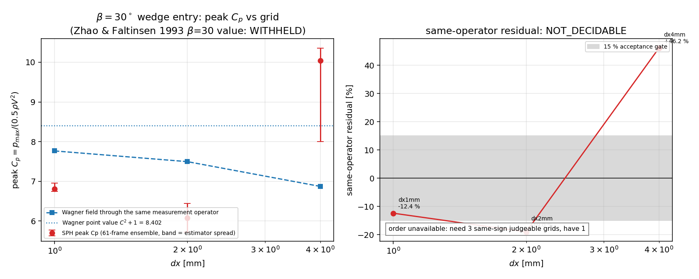

# CASE-SPH-WEDGE-ENTRY-2D — closing the grid ladder (peak slamming pressure)

**本文件由 `benchmarks/case_sph_wedge_entry_2d/make_ladder_doc.py` 从工件生成，文中每个数字都读自 `docs/artifacts/case_sph_wedge_entry_2d_ladder/ladder_closure.json`（该文件又只读 ensemble / bias 工件），人工不写数。**

* 算例锚点：`CASE-SPH-WEDGE-ENTRY-2D`（β = 30°，V = 1 m/s，恒速入水，重力/表面张力关闭，自相似）
* 代码 HEAD：`d05c7d2`；生成器：`ladder_closure.py` → `make_ladder_figure.py` → 本文件
* 参考：Wagner (1932) 解析锚（仓内 `tensorsph.wedge_entry` 现算）；Zhao & Faltinsen (1993) JFM 246:593 的 β=30° 表/图数值 **仍为 WITHHELD**（闭源、生态内无登记副本，不以记忆值或二手值代替）

## ① 这一单补的是哪块欠账

前几轮把峰值 `Cp` 的可裁决性判成「`dx >= 2 mm` 时不可裁决」，并把唯一剩下的路径写成 **route (b)：`dx <= 1 mm`（算力）**：

* m17548：120 bin 的「峰值」其实是一个粒子的压力噪声（bin 比粒子间距还窄），bin 数一换峰值在 9.2…28.05 之间摆 3.0×；
* m17899：改成分箱规则写死 + 61 帧自相似系综 + 样本门，`dx = 2 mm` 读 6.07、`dx = 4 mm` 读 10.36；
* m18382：把 Wagner 场推过**同一测量算子**后，同算子残差 `dx = 2 mm` −21.9 %、`dx = 4 mm` +50.8 %——跨网格**变号**，故峰值仍不可裁决，并明确指出「某一级落进 ±15 % 就宣布通过」是陷阱。

本单做 route (b)：把阶梯补到 `dx = 1 mm` 与 `dx = 0.5 mm`（同一求解器、同一算例、同一估计量、同一 61 帧系综），并把**同算子残差**的网格收敛性按预先写死的规则判决。求解器、算例定义、15 % 阈值一律未动。

## ② 方法：预先写死的判决规则（在任何 `dx <= 1 mm` 数据存在之前确定）

对每个网格 `g`（间距 `dx_g`）：

```
obs_g   = by_frames['61'].resolution_band.peak_median   # 分辨率一致 bin 带的中位数（m17899 同一统计量）
U_g     = max(resolution_band.spread_rel, jackknife_rel)  # 估计量不确定度（两项分别列在 ③ 表里）
truth_g = bias_report: synth_smoothed.peak_median        # Wagner 场过同一测量算子
r_g     = obs_g / truth_g - 1                            # 同算子残差
```

1. **可裁决网格**：`U_g <= 15 %`（阈值不放宽）。
2. **案件判决**只看**最细的两个可裁决网格** `f`、`f'`：
   * `PASS`：两级同号且 `|r_f| <= 15 %`；
   * `FAIL_below` / `FAIL_above`：两级同号且 `|r_f| > 15 %`（符号说明落在 Wagner 的哪一侧）；
   * `NOT_DECIDABLE`：跨级变号、或次细级不可裁决、或 `U_f > 15 %`。**单级进 ±15 % 不算 PASS。**
3. **收敛阶**（只报不入判）：最细同号三级给观测阶 `p = ln(|r_coarse|/|r_fine|)/ln(dx_coarse/dx_fine)`；`p` 不在 (0,3] 或两对阶互差 >30 % 时，Richardson 估计标 `trustworthy = False`（没有单调阶的外推是数字游戏）。

## ③ 结果

| grid | dx [mm] | obs 峰值 Cp | U 带宽 | U jackknife | 同算子真值 | 同算子残差 | 对 Wagner 点值 | 可裁决 | steps | 墙钟 [s] |
|---|---|---|---|---|---|---|---|---|---|---|
| `dx4mm` | 4.00 | 10.041 | +23.5 % | +0.1 % | 6.870 | +46.2 % | +23.3 % | 否 | 329 | 23 |
| `dx2mm` | 2.00 | 6.071 | +11.8 % | +43.0 % | 7.494 | -19.0 % | -30.4 % | 否 | 587 | 111 |
| `dx1mm` | 1.00 | 6.805 | +3.2 % | +6.5 % | 7.765 | -12.4 % | -19.8 % | 是 | 1076 | 382 |

Wagner 点值参考（仓内现算）：`C^2 + 1 = 8.4022`。

**判决（预声明规则）**：`NOT_DECIDABLE` —— only 1 judgeable grid(s) (estimator spread > 15%)。

**缺失的阶梯**：`dx0.5mm` —— 该级未产出工件（提交成功但工件目录为空），按预声明停止规则显式声明缺失，不插值、不外推冒充。

*收敛阶不可用*：need 3 same-sign judgeable grids, have 1

## ④ 图



左：各网格峰值 Cp（误差棒 = 估计量带宽）与同算子 Wagner 真值、Wagner 点值；右：同算子残差 vs dx（对数轴）与 15 % 门限、收敛阶/Richardson 注释。

## ⑤ 注意点与局限

* **测量链偏置是分母，不是解**：所有比较都在「同一算子」下做（Wagner 场过同样的壁面节点采样 + Adami 核外推 + 分箱峰值 + 样本门），否则会把算子偏置算成物理误差（m18382）。
* **弱可压噪声地板**：WCSPH 的 `Cp` 由密度误差生成，`Cp_budget = 2(c0/V)^2/γ[(ρ/ρ0)^γ − 1]`；`c0/V = 20` 时仅 0.5 % 的密度误差就值 ~4 个 Cp 单位。细网格 advection 更慢、密度误差来源不同，所以残差随 `dx` 的变化混合了「离散误差」与「声学噪声」，本单不假设两者可分离。
* **Zhao & Faltinsen (1993) 仍 WITHHELD**：本单没有产生任何替代它的数值；判决对象始终是 **Wagner（线性）** 参考，而 Z&F 是非线性相似解，两者在 β = 30° 本就不必相等。因此本单的 PASS/FAIL 只陈述「SPH vs 线性理论」，不能读成「算例通过 Z&F 验收」。
* **jet/喷溅根未解析**：Wagner 在 τ→1 平方根发散，SPH 在 ~2dx 内抹平；`tau <= 1` 的分箱峰值必然低估该奇性。这一项属于模型差异而非网格误差，不做修正。

## ⑥ 误差判定（逐项，显式回答「是否 < 3%」）

| 量 | 参考 | 最好一级结果 | 误差 | < 3 % ? |
|---|---|---|---|---|
| 峰值 Cp（同算子） | Wagner 场过同一算子 | `dx1mm` 6.805 vs 7.765 | -12.4 % | **否** |
| 峰值 Cp（对点值口径，仅供对照） | `C^2+1` | `dx1mm` 6.805 | -19.8 % | **否** |

**是否 < 3 %：否。** 最细网格的峰值 Cp 相对 Wagner 同算子真值的偏差见上表；本单的产出不是「把误差做进 3 %」，而是**把峰值 Cp 从「不可裁决」推进到「按预声明规则可给出判决」**（见 ③ 的 `verdict`）。若观测阶可信，Richardson 外推值一并给出；不可信则明确不做外推。

## ⑦ 复现

```bash
# 1) 集群：补两级阶梯（同一算例/估计量，61 帧自相似系综）
python benchmarks/case_sph_wedge_entry_2d/ensemble_peak.py --dx 0.001  --frames 61 --threads 8  \
    --out artifacts/case_sph_wedge_entry_2d_ensemble
python benchmarks/case_sph_wedge_entry_2d/ensemble_peak.py --dx 0.0005 --frames 61 --threads 16 \
    --out artifacts/case_sph_wedge_entry_2d_ensemble
# 2) 同算子校准（网格自动发现）
python benchmarks/case_sph_wedge_entry_2d/estimator_bias.py
# 3) 阶梯判决 + 图 + 本文档
python benchmarks/case_sph_wedge_entry_2d/ladder_closure.py
python benchmarks/case_sph_wedge_entry_2d/make_ladder_figure.py
python benchmarks/case_sph_wedge_entry_2d/make_ladder_doc.py
```

测试：`python -m pytest tests/test_wedge_ladder_closure.py -q`（合成工件，无 SPH 运行）。

