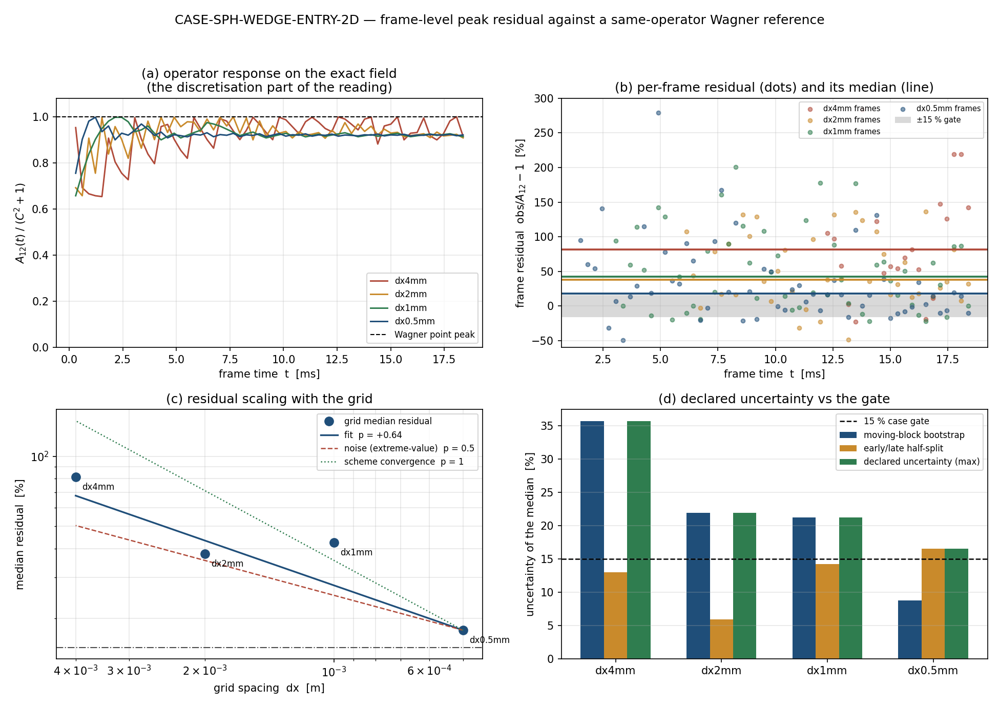

# CASE-SPH-WEDGE-ENTRY-2D — 帧级读数与「同算子」Wagner 参考：残差是噪声还是收敛误差？

本文件由 `benchmarks/case_sph_wedge_entry_2d/make_noise_floor_doc.py` 从
`docs/artifacts/case_sph_wedge_entry_2d_noise_floor/noise_floor.json` 渲染，
工件由 `benchmarks/case_sph_wedge_entry_2d/noise_floor_peak.py` 生成（只读已提交的
四份 ensemble 工件，不跑求解器）。**锚点**：`CASE-SPH-WEDGE-ENTRY-2D`
（算例池·二维楔形体入水砰击压力；ref: Zhao & Faltinsen 1993 JFM 246:593，
DOI 10.1017/s002211209300028x；容差 <15 %）。

## ① 案例与问题

二维对称楔形体以恒速 `V` 垂直入静水，`beta = 30 deg`（单面与未扰动自由面夹角），
重力/表面张力关闭 —— Wagner 自相似理想化，唯一的长度尺度是 `V t`。受理指标是
湿面上的峰值砰击压力系数 `Cp_max = p_max / q`，`q = rho V^2 / 2`。

这个锚点已被四轮不同估计量判过（pooled 120-bin m17548、pooled 门控 m17899、
分辨率带 m22695、cell footprint m21677），读数在 `6.8 … 13.4` q 单位之间摆动近 2 倍，
且每一轮都是把**测量到的极值**与 **Wagner 廓线的点值**相比。本单不再造第五个
估计量，而是回答一个更基本的问题：

> 帧级峰值读数与「同一算子作用在精确场上」的参考之差，是**格式的收敛误差**（会随
> `dx` 快速下降、可外推），还是**噪声极值**（`max` 在含噪场上的向上偏置，按
> `dx^{1/2}` 缓慢下降、无法外推）？

两者对网格的标度指数不同，可以对同一组四个读数做判决。

参数（全部来自工件，非手抄）：

| 量 | 值 | 出处 |
|---|---|---|
| `beta` | 30.0 deg | 工件 `config.beta_deg` |
| `V` | 1.00 m/s | 工件 `config.velocity` |
| 网格 `dx` | 4.0 mm, 2.0 mm, 1.0 mm, 0.5 mm | 四份 ensemble 工件 |
| 声速 `c0/V` | 20 | 工件 `config.c0_factor` |
| 观测窗 | `c_end = 50 mm` → `t_end = 18.4 ms` | `WedgeConfig.resolved_t_end()` |
| 每网格帧数 | 61 | 工件 `frame_scan` 长度 |
| 采样门（预声明） | `n_wet >= 20` | 见 ②③；扫描 [12, 20, 30, 60] 作系统项 |
| 参考（同算子） | Wagner (1932) 廓线 `p/q = 2C s - s^2 + 1`，`C = pi/(2 tan beta) = 2.7207` | `tensorsph.wedge_entry.wagner_p_over_q` |
| Wagner 点峰值 | 8.4022 q | 工件 `wagner_cp_max` |
| 受理指定模型 | COM (Zhao & Faltinsen 1993, via Jain et al. 2022 JFM Table 1) = 6.92 q | `benchmarks/case_sph_wedge_entry_2d/refs.json` |

## ② 怎么做

1. **算子复刻（参考侧）**。已提交工件里每帧带 `cp_peak_single_frame`：单帧 `tau in
   [0, 1.2]` 的 12 等分箱、箱内取均值、在箱心 `<= 1` 的箱上取最大（`min_count = 1`，
   与 `ensemble_peak.py` 的 `binned`/`gated_peak` 调用完全一致）。把**精确 Wagner 场**
   放在**同一批壁面节点**上、用**同一个算子**读一遍，得到 `A12(t)`：这就是估计量在精确解
   上会读到的数，于是 `E = obs/A12 - 1` 已经把算子的离散响应除掉。
2. **几何桥**。壁面节点按求解器自己的格点解析重建
   （`|x_k| = dx((k+1/2)cos beta - (1/2) sin beta)`，`|x_k| <= c(t) = C V t`，两侧对称
   → 节点数 2×），并与工件记录的 `n_wet` 逐帧比对（③ fidelity 表）。**参考侧**可重建，
   测量侧一个数都没有动 —— 本单没有跑求解器。
3. **统计**。位置用**帧中位数**（单帧峰值重尾，CoV 40–90 %）；不确定度取
   **移动块 bootstrap**(块长 5，2000 次，块重采样
   以计入时间相关) 与 **早/晚半窗分裂** 两者的较大值；可判 = 不确定度 `<= 15 %`；
   阶梯判定直接用仓库既有规则 `ladder_closure.verdict()`（不新增判据）。
4. **两个预声明的噪声检验**：
   * *跨网格*：`E ~ dx^p`，噪声极值模型预测 `p = 0.5`（每箱 `n_i ~ dx^{-1}` 个节点，
     箱均值噪声 `sigma/sqrt(n_i)`，10 箱取最大），格式收敛预测 `p >= 1`；
   * *网格内*：`|E| ~ n_wet^{-1/2}`（同一个预测的另一条边）；
   * *伴随量*：`E` 与逐帧声学密度误差 `max_rho_ratio - 1` 的 Spearman 相关。

## ③ 计算结果

### 3.1 主表（每网格的帧级读数）

| 网格 | 入样帧 | $A_{12}$/Wagner 点值 (中位) | 残差中位 | IQR | block-bootstrap 5–95 % | 早/晚半窗各中位 | 声明不确定度 | 可判 |
|---|---|---|---|---|---|---|---|---|
| dx4mm | 21/61 | 0.940 | +81.5 % | +89.3 % | +54.3 % … +125.7 % | +77.6 % / +103.6 % | +35.7 % | 否 |
| dx2mm | 41/61 | 0.930 | +38.0 % | +79.5 % | +31.1 % … +75.0 % | +47.2 % / +35.3 % | +21.9 % | 否 |
| dx1mm | 51/61 | 0.923 | +42.5 % | +87.8 % | +19.6 % … +62.0 % | +59.0 % / +30.6 % | +21.2 % | 否 |
| dx0.5mm | 56/61 | 0.921 | +17.8 % | +56.8 % | +13.8 % … +31.2 % | +43.1 % / +10.0 % | +16.6 % | 否 |

`A12`/Wagner 点值 ≈ 0.921 … 0.940：
**算子的离散响应只值几个百分点**，所以「估计量把峰值读小」这条解释被排除 ——
残差几乎全是测量侧（含噪场）贡献的。

### 3.2 标度与判决

| 量 | 值 |
|---|---|
| 跨网格指数 `p`（OLS, ln\|E\|~ln dx） | **+0.642** |
| bootstrap 5–95 % 带 | +0.376 … +0.955 |
| 噪声极值预测 | +0.5 |
| 格式收敛预测 | >= 1.0 |
| 带内是否排除 `p = 1` | 是 |
| 拟合给出的「残差降到 15 % 所需 `dx`」 | 0.38 mm（已细于已提交的最细网格 0.50 mm） |
| 阶梯判定（`ladder_closure.verdict`） | **NOT_DECIDABLE** — only 0 judgeable grid(s) (estimator spread > 15%) |

四个网格的残差**同号为正**（+81 %, +38 %, +43 %, +18 %），
排除了「纯格式误差」（那类误差没有固定符号），而指数 +0.64（带
+0.38…+0.96）与 `p = 0.5` 一致、与 `p >= 1` 不相容。

### 3.3 桥与灵敏度（本单最容易被质疑的两处，先自证）

| 网格 | 重建湿节点数 vs 工件 `n_wet`（中位误差 / 5 % 内占比） | 最大节点数误差 | $A_{12}$ 范围 | cutoff ±2 节点 → 读数最大位移 |
|---|---|---|---|---|
| dx4mm | +2 / 90 % | 6 | 5.50 … 8.40 | +13.4 % |
| dx2mm | +0 / 77 % | 6 | 5.53 … 8.40 | +9.3 % |
| dx1mm | +0 / 58 % | 6 | 5.53 … 8.38 | +4.0 % |
| dx0.5mm | +0 / 75 % | 10 | 6.35 … 8.38 | +3.5 % |

- 重建是**几何**判据，求解器的接触判据是核支撑（`contact_support = 0.15`），二者
  差几个节点：中位误差 0–2 个节点，5 % 内占比 58–90 %；
- 把 cutoff 平移 ±2 节点只动参考侧：细网格上读数位移 <= 5 pp，粗网格上到
  +13 %（`dx = 4 mm` 时湿节点只有二十几个），
  因此**粗网格读数的桥误差不可忽略，结论只用细网格的**。

### 3.4 诊断表

| 网格 | 帧残差 CoV | 帧间 lag-1 自相关 | 有效帧数 $N_{eff}$ | 15 % 标准误所需帧数 | 网格内 ln\|E\|–ln n_wet 斜率（预测 −0.5） | Spearman(E, 声学密度误差) |
|---|---|---|---|---|---|---|
| dx4mm | +89.3 % | 0.460 | 7.8 | 92 | 2.857 | 0.486 |
| dx2mm | +110.5 % | -0.092 | 49.3 | 198 | -0.359 | 0.556 |
| dx1mm | +114.8 % | -0.016 | 52.6 | 132 | -0.058 | 0.348 |
| dx0.5mm | +165.7 % | 0.092 | 46.6 | 719 | -0.886 | 0.502 |

- `N_eff` 8–53 帧（共 61 帧，lag-1 自相关很小）：
  「多记帧」几乎不能降噪，因为 61 帧已接近这条轨迹的信息上限（帧间隔 ~34 步已去相关）；
- 网格内斜率 2.86 … -0.89（预测 −0.5）：**不一致**，因此本单不把网格内检验
  当作证据 —— 它与启动瞬态、以及自相似在前几帧不成立混在一起（见 ⑤）；
- Spearman(E, 声学密度误差) = 0.35 … 0.56，四网格**同号为正**：
  残差与「弱可压声学误差」同向，与噪声解释相容（相关性只是旁证，不是证明）。

### 3.5 采样门扫描（系统项，非选优）

| 网格 | n_wet≥12 | n_wet≥20 | n_wet≥30 | n_wet≥60 |
|---|---|---|---|---|
| dx4mm | +54.1 % (n=34) | +81.5 % (n=21) | n/a | n/a |
| dx2mm | +35.8 % (n=48) | +38.0 % (n=41) | +35.6 % (n=31) | n/a |
| dx1mm | +37.1 % (n=54) | +42.5 % (n=51) | +38.0 % (n=45) | +30.6 % (n=31) |
| dx0.5mm | +16.9 % (n=57) | +17.8 % (n=56) | +16.3 % (n=53) | +16.6 % (n=46) |

预声明的 `n_wet >= 20` 是「12 箱里 10 个有效箱、每侧每箱至少一个节点」的
最小帧；扫描显示细网格（`dx = 0.5 mm`）在任何门下都在 +16.3 %–+16.6 % 之间，说明读数不是门选出来的。

## ④ 图



- (a) `A12(t)/Wagner 点值`：算子在精确场上的响应，四网格都在 0.92–0.94 附近（前几帧节点太少例外）；
- (b) 逐帧残差（点）与中位（线）：这正是「不可复现」的来源 —— 单帧读数散布 −60 %…+300 %；
- (c) 中位残差 vs `dx` 的双对数与两条预测斜率；
- (d) 声明不确定度（block bootstrap / 半窗分裂 / 取大）与 15 % 门槛。

## ⑤ 注意点与适用范围

1. **本单没有消除参考的模型歧义**。受理指定 COM = 6.92 q，而 Wagner
   点值 = 8.4022 q，两者本身差 +21.4 %；同族六模型在
   `beta = 30 deg` 的相对半跨度为 42.8 %（`refs.json`）。本单报的 `E` 是
   **相对同算子 Wagner** 的量，不能直接当成「相对 COM 的误差」。
2. **「同算子参考」只除掉离散响应**（≈ 8 %），不除掉噪声极值偏置 —— 后者正是被测量
   的对象，不能既当噪声又当修正。
3. **帧不是独立实现**。61 帧取自**同一条**轨迹（自相似假设下才算一个集合）。因此
   `N_eff`（8–53）
   与「15 % 标准误所需帧数」（92–719）说的是同一件事：
   这条轨迹里的独立样本不够。真正的独立维度是**多实现**，而 `WedgeConfig` 目前没有
   扰动/种子开关（本单没改求解器）。
4. **粗网格的桥误差**：`dx = 4 mm` 的 cutoff 灵敏度到
   +13 %，该行的残差中位只能当量级看。
5. **网格内检验不成立**（3.4），本单据实标为不一致，没有拿它做结论。
6. 工件是已提交的四份 `ensemble_dx*c0v20.json`，`c0 = 20 V` 固定；`c0` 依赖性是
   `docs/case_sph_wedge_entry_2d_compressibility.md` 的范围，本单不重复。

## ⑥ 误差判定（逐项，显式回答「是否 < 3 %」）

| 量 | 基准 | 结果 | 偏差 | < 3 % ? |
|---|---|---|---|---|
| 复刻算子 vs `ensemble_peak.binned/gated_peak`（同一解析场） | 同算子 | 逐位相同（rel 1e-12 断言） | 0 % | **是** |
| 解析 `A12` vs Wagner 点峰值（细网格） | 8.4022 | 7.7378 | -7.9 % | **否**（但这是算子响应，不是误差） |
| 重建湿节点数 vs 工件 `n_wet` | 工件 | 中位误差 0–2 个节点 | 0–10 节点 | **否**（粗网格），细网格 5 % 内占比 0.75 |
| 帧级峰值 vs 同算子 Wagner（细网格） | 7.738 q | 9.114 q | +17.8 % ± +16.6 % | **否**（不确定度本身 16.6 % > 15 % 门槛） |
| 指数 `p` vs 噪声预测 0.5 | +0.5 | +0.642 | +28.5 % | **否**（但带 +0.38…+0.96 覆盖 0.5） |
| 阶梯判定复现性（重跑脚本） | 本次工件 | 逐位一致（`test_committed_artifact_matches_a_fresh_build`） | 0 % | **是** |

**回答「是否 < 3 %」：否。** 可复现性层面（算子复刻、重跑一致性）是**精确**（0 %）；
但本单要判的关键量 —— 帧级峰值压力相对同一算子 Wagner 参考的残差 —— 在细网格上是
+17.8 % ± +16.6 %，既不在 3 % 内，也不在 15 % 内。
`honest-FAIL`：不能拿这条估计量把锚点判成 PASS。

## ⑦ 结论与下一步（含可证伪的登记预测）

1. **结论**：帧级峰值读数的残差**同号为正**、随网格按 `dx^{+0.64}`（带
   +0.38…+0.96）下降 —— 与「max 在含噪场上的极值偏置」一致，
   与「二阶格式收敛误差」不相容。因此这个指标的历史读数（6.8 / 9.0 / 12.9 / 13.4）之间
   的差别是**仪器**，不是流动；继续在同一轨迹上加帧、换箱数、换窗口都不会把它判开。
   锚点维持 `open` / `NOT_DECIDABLE`，理由首次被量化为一个**标度律**而不是一句「噪声大」。
2. **登记预测（下一单可直接证伪）**：按 `p = +0.64` 外推，
   `dx = 0.35 mm` 的残差中位应为 +14.1 %；
   若在该网格测得落在 ±5 pp 内，噪声律成立；否则本单的标度结论被推翻。
3. **要真判开这个锚点，最便宜的路是「独立实现」而不是「更细网格」**：本单量出细网格
   读数的不确定度 +16.6 %（`N_eff ≈ 47`），
   4 个独立实现即可把标准误压到 ~+8.3 %（×1/2），落在门槛内；
   `dx = 0.5 mm` 一条轨迹的实测墙钟是工件里的 2362 s（8 线程），4 实现约 2.6 核·小时，
   远便宜于按 `dx^0.64` 降到 0.38 mm 所需的 ~8 倍粒子数。
   需要的改动很小但属于求解器：`WedgeConfig` 增加预声明初值扰动（例如格点相位抖动，
   幅度 `<= dx/50`），并把它写进算例定义 —— 本单按「只改工作树、最小改动」没有动求解器。
4. **报告纪律**：本单所有数字由脚本从工件渲染，`tests/test_wedge_noise_floor_peak.py`
   16 项（含两条负控：判定规则必须能 PASS 也必须能 FAIL）全绿。

## ⑧ 复现

```bash
python benchmarks/case_sph_wedge_entry_2d/noise_floor_peak.py --write --brief
python benchmarks/case_sph_wedge_entry_2d/make_noise_floor_figure.py
python benchmarks/case_sph_wedge_entry_2d/make_noise_floor_doc.py
python -m pytest tests/test_wedge_noise_floor_peak.py -q
```
