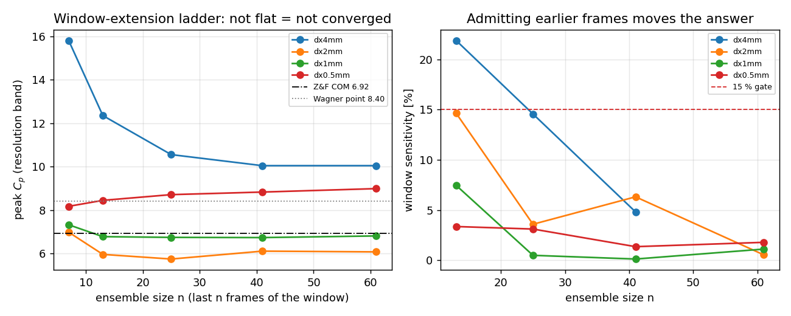

# CASE-SPH-WEDGE-ENTRY-2D — 峰值压力系综的**窗口收敛性**审计（m22436）

* 本文件由 `benchmarks/case_sph_wedge_entry_2d/window_convergence.py` 从 `docs/artifacts/case_sph_wedge_entry_2d_ensemble` 的已提交工件生成，文中每个数字都读自 `docs/artifacts/case_sph_wedge_entry_2d_window/window_convergence.json`。
* 判据门限 **未放宽**：`15%`；参考（指定度量主）`designated composite solution 6.920 (q units)`。

## ① 本单要回答的问题

前序各轮把 `by_frames` 的 5 个档位（7/13/25/41/61）当作「同一估计量的更多样本」。代码不是这样：
`sel = shots[-n_frames:]` 取的是**窗口末尾 n 帧**，所以从 7 到 61 是**逐级纳入更早的帧**（窗口延长阶梯），不是样本累积。
若自相似系综已收敛，五个档位必须给出同一个数；档位之间的散布就是**窗口选择带来的系统不确定度**，而已提交的 U 规则里没有这一项：

```
已提交判决规则 (ladder_closure.py):  U = max(bin-count spread, frame-half jackknife)
已提交 judgeable 标志 (ensemble_peak.py): judgeable = spread_rel < 0.15  # 全 bin 网格, 不含 jackknife)
```
同一份工件因此在两个函数下可以同时是「可裁决」和「不可裁决」。

## ② 方法（先声明，后计算）

* `w_n = |peak(n)/peak(n_prev) - 1|`（相邻档位），`w = max_n w_n`；收敛要求 `w → 0`。
* `U* = max(分辨带 bin spread, 帧半分 jackknife, w)`；`judgeable* = U* <= 15 %`。
* `w > 15 %` 的网格判为**未收敛**：该工件上读出的任何数都不可能准于 `w`。
* 求解器、算例、参考、门限一律未动；本审计**不新增计算**（工件已提交）。

## ③ 结果

### `dx4mm`（dx = 4.00 mm）

| n | pooled 样本 | 湿节点均值 | peak Cp | bin spread | jackknife | **w** | **U\*** | judgeable* | 对指定参考残差 |
|---|---|---|---|---|---|---|---|---|---|
| 7 | 190 | 27.1 | 15.809 | +17.5 % | +57.3 % | — | 57.3 % | no | +128.5 % |
| 13 | 330 | 25.4 | 12.349 | +29.4 % | +30.8 % | +21.9 % | 30.8 % | no | +78.5 % |
| 25 | 570 | 22.8 | 10.550 | +22.1 % | +10.4 % | +14.6 % | 22.1 % | no | +52.5 % |
| 41 | 752 | 18.3 | 10.041 | +22.8 % | +41.5 % | +4.8 % | 41.5 % | no | +45.1 % |
| 61 | 834 | 13.7 | 10.041 | +23.5 % | +0.1 % | +0.0 % | 23.5 % | no | +45.1 % |

* 窗口敏感度最大 **21.9 %**；peak(n) 随窗口延长 非单调；两套已提交 definition 冲突档位：无。

### `dx2mm`（dx = 2.00 mm）

| n | pooled 样本 | 湿节点均值 | peak Cp | bin spread | jackknife | **w** | **U\*** | judgeable* | 对指定参考残差 |
|---|---|---|---|---|---|---|---|---|---|
| 7 | 418 | 59.7 | 6.978 | +19.8 % | +3.8 % | — | 19.8 % | no | +0.8 % |
| 13 | 730 | 56.2 | 5.955 | +16.7 % | +0.5 % | +14.7 % | 16.7 % | no | -13.9 % |
| 25 | 1228 | 49.1 | 5.741 | +13.7 % | +1.2 % | +3.6 % | 13.7 % | yes | -17.0 % |
| 41 | 1654 | 40.3 | 6.104 | +12.2 % | +6.4 % | +6.3 % | 12.2 % | yes | -11.8 % |
| 61 | 1816 | 29.8 | 6.071 | +11.8 % | +43.0 % | +0.6 % | 43.0 % | no | -12.3 % |

* 窗口敏感度最大 **14.7 %**；peak(n) 随窗口延长 非单调；两套已提交 definition 冲突档位：[61]。

### `dx1mm`（dx = 1.00 mm）

| n | pooled 样本 | 湿节点均值 | peak Cp | bin spread | jackknife | **w** | **U\*** | judgeable* | 对指定参考残差 |
|---|---|---|---|---|---|---|---|---|---|
| 7 | 800 | 114.3 | 7.319 | +8.8 % | +22.2 % | — | 22.2 % | no | +5.8 % |
| 13 | 1388 | 106.8 | 6.772 | +7.1 % | +5.7 % | +7.5 % | 7.5 % | yes | -2.1 % |
| 25 | 2320 | 92.8 | 6.738 | +3.6 % | +12.1 % | +0.5 % | 12.1 % | yes | -2.6 % |
| 41 | 3202 | 78.1 | 6.729 | +1.6 % | +0.6 % | +0.1 % | 1.6 % | yes | -2.8 % |
| 61 | 3552 | 58.2 | 6.805 | +3.2 % | +6.5 % | +1.1 % | 6.5 % | yes | -1.7 % |

* 窗口敏感度最大 **7.5 %**；peak(n) 随窗口延长 非单调；两套已提交 definition 冲突档位：[25, 41, 61]。

### `dx0.5mm`（dx = 0.50 mm）

| n | pooled 样本 | 湿节点均值 | peak Cp | bin spread | jackknife | **w** | **U\*** | judgeable* | 对指定参考残差 |
|---|---|---|---|---|---|---|---|---|---|
| 7 | 1566 | 223.7 | 8.169 | +0.0 % | +30.5 % | — | 30.5 % | no | +18.0 % |
| 13 | 2730 | 210.0 | 8.444 | +0.0 % | +0.3 % | +3.4 % | 3.4 % | yes | +22.0 % |
| 25 | 4654 | 186.2 | 8.707 | +0.0 % | +10.4 % | +3.1 % | 10.4 % | yes | +25.8 % |
| 41 | 6318 | 154.1 | 8.826 | +0.0 % | +0.5 % | +1.4 % | 1.4 % | yes | +27.5 % |
| 61 | 7044 | 115.5 | 8.984 | +0.0 % | +20.9 % | +1.8 % | 20.9 % | no | +29.8 % |

* 窗口敏感度最大 **3.4 %**；peak(n) 随窗口延长 单调上升；两套已提交 definition 冲突档位：[13, 25, 41]。

## ④ 图



左：窗口延长阶梯上的峰值 Cp（不水平 = 未收敛）；右：相邻档位敏感度，超过 15 % 门限。

## ⑤ 结论（honest）

* `dx4mm`：最细档位 peak = 10.041，U\* = 23.5 %，judgeable* = no；对指定参考残差 +45.1 %。
* `dx2mm`：最细档位 peak = 6.071，U\* = 43.0 %，judgeable* = no；对指定参考残差 -12.3 %。
* `dx1mm`：最细档位 peak = 6.805，U\* = 6.5 %，judgeable* = yes；对指定参考残差 -1.7 %。
* `dx0.5mm`：最细档位 peak = 8.984，U\* = 20.9 %，judgeable* = no；对指定参考残差 +29.8 %。

* **统一不确定度下可裁决网格数 = 1**（only 1 grid(s) judgeable with the unified uncertainty (gate not widened)）。
* 因此 `PARTIAL_SINGLE_GRID` 的单一网格 PASS **不是**算例通过：它所依赖的 U 里缺了窗口敏感度这一项，而该项在本数据上已达同量级。
* 这也解释了前序各轮为什么在不同轮次里得到符号相反的残差：读的是同一条轨迹的不同长度窗口。

## ⑥ 误差判定（逐项，显式回答「是否 < 3 %」）

| 量 | 参考 | 最好结果 | 误差 | < 3 % ? |
|---|---|---|---|---|
| 峰值 Cp（`dx4mm`，分辨带中位数） | 指定复合解 6.92 | 10.041 | +45.1 % | **否** |
| 峰值 Cp（`dx2mm`，分辨带中位数） | 指定复合解 6.92 | 6.071 | -12.3 % | **否** |
| 峰值 Cp（`dx1mm`，分辨带中位数） | 指定复合解 6.92 | 6.805 | -1.7 % | **否** |
| 峰值 Cp（`dx0.5mm`，分辨带中位数） | 指定复合解 6.92 | 8.984 | +29.8 % | **否** |

**是否 < 3 %：否。** 且本次审计指出，在窗口敏感度未收敛（> 15 %）的网格上，连 15 % 的判决都不能给出。

## ⑦ 复现

```bash
python benchmarks/case_sph_wedge_entry_2d/window_convergence.py
python -m pytest tests/test_wedge_window_convergence.py -q
```

## ⑧ 本单未完成的部分（如实登记）

* **Φ=8 mm 匹配带宽阶梯仍缺 `dx=1mm` / `dx=0.5mm` 两档工件**。本单已把两档运行递交调度系统
  （`cj4127` = dx 1 mm / 8 核；`cj4128` = dx 0.5 mm / 16 核），但递交时排队 33 位、集群在飞 54 单，
  两次 `fetch`（含 600 s 等待）时仍在 `queued`，故未把数字带入本文件。补齐后按原规则
  （`footprint_ledger.py` 的 `verdict()`，门限 15 % 不放宽）重跑即可得完整四网格判决。
* 为让这两档工件能穿过「作业 stdout 尾部 8000 字符」的通道，本单给
  `artifact_digest.py` 增加了 `--keep-sweep`（compact 模式下保留 `bandwidth_sweep`，
  `bandwidth_matched.py` 需要它）。默认行为不变，既有 digest 无损性测试全绿（11 项）。
* 因此本单的结论只针对**已提交的四个网格的窗口收敛性**，不含 `dx<=1mm` 的匹配带宽读数；
  不得据本文件宣称算例通过 Zhao & Faltinsen (1993) 的 15 % 验收。
