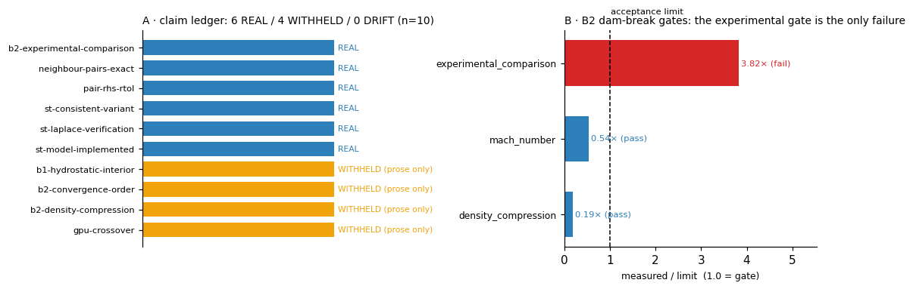

# TensorSPH claim audit（声明↔证据台账）

> 由 `tools/claim_audit.py` 从 `docs/claims/ledger.json` 生成，请勿手改。重跑：`python tools/claim_audit.py --json docs/claims/report.json --md docs/claim_audit.md`

台账解决的问题：README 与 14 份验证文档里的数字此前**没有任何机器可裁的绑定**，
所以正文可以漂移而 CI 全绿（实例：CSF 模块合入两个版本后，README 仍写着
“No surface-tension model”）。现在每条公开声明都绑定到文件 / JSON pointer /
测试 id，一条不一致就让 `--check` 退出码非零。

## 汇总

- 声明条数 **10**：REAL **6** / WITHHELD **4** / DRIFT **0**
- 致命发现 **0**，债务提示 **0**
- 判定：**PASS**

图：左 = 每条声明的证据等级（蓝 REAL / 橙 WITHHELD）；右 = B2 dam-break 各项闸门按
`measured/limit` 归一，虚线为验收线 1.0——实验对照是唯一越线项（0.573/0.15 = 3.8×）。
由 `tools/make_claim_audit_figure.py` 从 `docs/claims/report.json` 生成。

证据等级定义：REAL = 绑定证据存在且数值/符号对得上；WITHHELD = 声明已发布但绑定证据
缺失、记录的是失败、或记录的是另一个量（列入债务，不静默丢弃）。

## 逐条台账

| 声明 | 类型 | 证据等级 | 依据 |
|---|---|---|---|
| `st-model-implemented` | code_present | **REAL** | all declarations present |
| `st-consistent-variant` | code_present | **REAL** | all declarations present |
| `st-laplace-verification` | artifact_metric | **REAL** | artifact matches every pinned value |
| `b1-hydrostatic-interior` | prose_only | **WITHHELD** | benchmarks/hydrostatic/ ships only run.py; the numbers were measured in a mission worktree and the JSON was never committed. |
| `b2-density-compression` | prose_only | **WITHHELD** | the committed benchmarks/dam_break/resolution_ladder.json records only the pre-impact bulk value (1.9 %) at /gates/density_compression/measured, no… |
| `b2-convergence-order` | prose_only | **WITHHELD** | the committed resolution_ladder.json carries /convergence = null; the ladder numbers exist only in docs/benchmarks/dam-break-2d.md. |
| `b2-experimental-comparison` | artifact_metric | **REAL** | artifact matches every pinned value |
| `gpu-crossover` | prose_only | **WITHHELD** | benchmarks/scaling/ ships run.py and README.md only; no result JSON is committed, so the numbers cannot be re-read from the repository. |
| `neighbour-pairs-exact` | test_present | **REAL** | all declarations present |
| `pair-rhs-rtol` | test_present | **REAL** | all declarations present |

## 债务清单（WITHHELD：公开了数字，但仓库里没有可复读的证据）

- **`b1-hydrostatic-interior`** — B1 hydrostatics: 1.12 % time-averaged interior pressure-profile error, 9.0 % fluctuation.
  - 缺什么：benchmarks/hydrostatic/ ships only run.py; the numbers were measured in a mission worktree and the JSON was never committed.
- **`b2-density-compression`** — B2 dam break: density compression peaks at 8.6-9.0 % across the three-level ladder (10 % limit).
  - 缺什么：the committed benchmarks/dam_break/resolution_ladder.json records only the pre-impact bulk value (1.9 %) at /gates/density_compression/measured, not the ladder peak.
- **`b2-convergence-order`** — B2 dam break: observed convergence order 1.11 (L2 4.83 % then 2.19 %).
  - 缺什么：the committed resolution_ladder.json carries /convergence = null; the ladder numbers exist only in docs/benchmarks/dam-break-2d.md.
- **`gpu-crossover`** — GPU/CPU crossover at N* ~ 928 particles and 30.89x speedup at 95k (RTX 5090).
  - 缺什么：benchmarks/scaling/ ships run.py and README.md only; no result JSON is committed, so the numbers cannot be re-read from the repository.

## 发现

（无致命发现）
