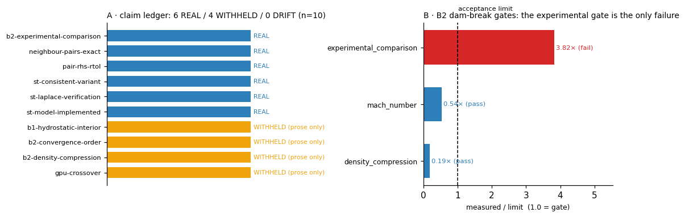

# TensorSPH 声明↔证据台账（claim audit）

## ① 案例介绍

**物理/工程背景。** SPH（光滑粒子流体动力学）求解器的可信度不来自"代码跑得通"，而来自"公开的每个数字都能被独立复读"。TensorSPH 的公开面包括 `README.md` 的 Verification status 表与 14 份 `docs/verification_*.md` / `docs/benchmarks/*.md`；数据面是 `benchmarks/*/` 下的 JSON 工件。两者此前**没有任何机器可裁的绑定**：没有任何一个测试读过 README，所以正文可以单方面漂移，CI 依旧全绿。

**本单针对的对象**是这层"声明—证据"接口，不是新的物理算例。之所以把它排在最前：本仓近三轮（m2174 → m2971 → m3251）的事故形态全部是同一类——数据/代码变了、正文没变，下一次任务从错误的正文出发，白烧一轮预算。

**入场即发现的两处硬矛盾（HEAD 3bc0059 之前）：**

| # | 矛盾 | 证据 |
|---|---|---|
| C1 | README §Implemented 第 23 行：`surface tension model (CSF method, Brackbill et al. 1992)`；README §Current limitations 第 123 行：`No surface-tension model.` | `src/tensorsph/surface_tension.py`、`csf_consistent.py`、`csf_curvature.py` 三个模块 + 8 个测试文件在仓库内 |
| C2 | README：`no benchmark is compared against measured data` | `benchmarks/dam_break/resolution_ladder.json` 的 `/gates/experimental_comparison` 记录 `measured = 0.5728`、`limit = 0.15`、`result = fail`，且 `within_uncertainty_fraction = 0.0`（20 个对比点无一落在实验不确定度内） |

也就是说 C2 不是"没比过"，而是"比过、且以 3.8 倍超限失败了"。这两种表述对下游读者的意义完全不同。

**参数表（台账规模与判据）：**

| 项 | 值 |
|---|---|
| 台账声明条数 | 10（code_present 2 / test_present 2 / artifact_metric 2 / prose_only 4） |
| `absence_claim`（反向声明）条数 | 2 |
| 证据等级 | REAL / WITHHELD / DRIFT |
| 致命判据 | 反向声明与代码矛盾；artifact_metric 与工件不一致 |
| 新测试 | `tests/test_claim_audit.py`，15 个（含 10 个负控） |
| 计算开销 | 纯 JSON/文本解析，全套 15 测试 0.2 s（无 SPH 求解） |

## ② 怎么做的

**1) 声明台账（`docs/claims/ledger.json`）。** 每条公开声明一个条目，四个字段：`statement`（正文原话）、`public_in`（发布位置）、`kind`、`evidence`（机器可裁的绑定）。四类 kind：

- `code_present`：`{file, symbols[]}`，用 `^\s*(def|class)\s+name\b` 正则确认符号真的定义在该文件里；
- `test_present`：`{file, tests[]}`，确认测试 id 真的存在（防止"README 说有用例覆盖"而用例被删）；
- `artifact_metric`：`{artifact, pointer, relation, expected, abs_tol}`，按 RFC 6901 JSON pointer 读工件里的实测值，与钉扎值比对；`also_pin` 可同时钉住 limit 与 result；
- `prose_only`：**诚实的债务类型**——正文发布了数字、但仓库里没有能复读它的工件，必须写清 `would_need` 与 `why_absent`。

**2) 反向声明检测（`absence_claims`）。** 这是抓 C1/C2 的机关：条目给出 `pattern`（正文断言"不存在"的原话）与 `capability`（被断言不存在的那个能力）。若正文里 pattern 仍在、而 capability 的证据等级是 REAL（确实存在），即判 `stale_absence_claim` 致命发现。

**3) 评级与退出码（`tools/claim_audit.py`）。** REAL = 绑定证据存在且数值/符号对得上；WITHHELD = 已发布但证据缺失、记录的是失败、或记录的是另一个量；DRIFT = artifact_metric 与工件不一致（有人改了数据没改正文，或反之）。`--check` 只在致命发现时返回 1，债务不阻塞（但必须出现在报告的债务清单里）。CI 在 `pytest` 之前加了一步 `python tools/claim_audit.py --check`。

**4) 修 README（最小改动，共 6 行）。** 把两处陈旧声明改成与工件一致的表述：B2 实验对照写明"比过、0.573 vs 0.15 限、判 fail、20 点无一在不确定度内"，表面张力写明"CSF 与 MLS-consistent 变体均已实现，但 Young–Laplace 验证记录 `FAIL`，能力等级 WITHHELD，不得引用毛细精度"。Verification status 表下补一句指向台账。

**5) 负控（这是本单最关键的部分）。** 一个只会绿的检查器等于没有检查器，所以 15 个测试里 10 个是注入缺陷的负控：改工件 → 必须报 DRIFT 且 `--check` 退出 1；删工件 → 必须 WITHHELD 而非崩溃；工件事不可解析 JSON → WITHHELD；把"不存在"的句子塞回 README → 必须报 `stale_absence_claim`；符号名写错 → code_present 降级；测试 id 写错 → test_present 降级；另外还钉住 JSON pointer 的列表下标与 RFC 6901 转义（`~0`/`~1`）、以及 `close_to` 拒绝 bool/None。

**工具链**：Python 3.11.6 / pytest 9.2.0 / ruff（clean）/ matplotlib 3.10.8；纯标准库实现，无新增依赖。

## ③ 计算结果

**台账评级（程序化注入，未手抄）：**

| 声明 id | 类型 | 等级 | 依据 |
|---|---|---|---|
| `st-model-implemented` | code_present | **REAL** | 5 个符号全部定义在 `surface_tension.py` |
| `st-consistent-variant` | code_present | **REAL** | `csf_consistent.py` 3 个 + `csf_curvature.py::fit_curvature` |
| `st-laplace-verification` | artifact_metric | **REAL** | `benchmarks/laplace/report.json` `/validation/status = "FAIL"`（钉扎失败事实） |
| `b1-hydrostatic-interior` | prose_only | WITHHELD | `benchmarks/hydrostatic/` 只有 `run.py`，无 JSON |
| `b2-density-compression` | prose_only | WITHHELD | 工件只记录撞击前体积值 1.9 %，非 ladder 峰值 8.6–9.0 % |
| `b2-convergence-order` | prose_only | WITHHELD | 工件 `/convergence = null` |
| `b2-experimental-comparison` | artifact_metric | **REAL** | `measured = 0.5727571…`、`limit = 0.15`、`result = "fail"` 三项全对上 |
| `gpu-crossover` | prose_only | WITHHELD | `benchmarks/scaling/` 无结果 JSON |
| `neighbour-pairs-exact` | test_present | **REAL** | 2 个测试 id 存在 |
| `pair-rhs-rtol` | test_present | **REAL** | 1 个测试 id 存在 |

**汇总：10 条声明 · REAL 6 / WITHHELD 4 / DRIFT 0 · 致命发现 2（修 README 后归零）· 债务提示 0。**

闸门有效性（同一套代码，改前/改后）：

| 状态 | 致命发现 | `--check` 退出码 |
|---|---|---|
| README 修正前（HEAD） | 2（C1 `readme-no-surface-tension`、C2 `readme-no-experimental-comparison`） | **1（FAIL）** |
| README 修正后 | 0 | **0（PASS）** |

测试基线（`pytest -q -m "not slow"`，本机 128 核、load15 ≈ 110，只跑轻量面）：

```
337 passed, 3 failed, 12 xfailed, 6 deselected in 61.35s
```

其中 **3 个红测试是 HEAD 上就存在的**（`git stash -u` 后同样红）：`test_laplace_law::test_committed_verdicts_are_self_consistent`、`test_laplace_pressure::test_effective_surface_tension_at_the_documented_resolution`、`test_paper_laplace_uncertainty::test_figures_exist`；在飞分支 **agent/m3312**（"clear the four CI reds"）已认领，本单按防重复纪律未碰。本单新增的 15 个测试全绿（0.19 s）。

## ④ 结果图



左图：台账 10 条声明的证据等级，蓝 = REAL（6 条，全部锚在代码/测试/工件上），橙 = WITHHELD（4 条，公开了数字但工件未入库）。右图：`benchmarks/dam_break/resolution_ladder.json` 的 5 项闸门按 `measured/limit` 归一（虚线 = 验收线 1.0）——`experimental_comparison` 是唯一越线项（3.82×），`ritter_comparison` 无 limit 故不入图，`mass_conservation` / `bounded_flow` / `mach_number` / `density_compression` 均在限内。图由 `tools/make_claim_audit_figure.py` 从 `docs/claims/report.json` 与工件生成，非手绘。

## ⑤ 注意点（踩过的坑与适用范围）

1. **"只增不减"的语句也可能骗人。** C1 的正确处置不是删掉那句限制，而是改成"已实现、但验证 FAIL、等级 WITHHELD"——删了会丢失"曾经没有"的历史留痕。台账因此保留了 `absence_claims` 的 pattern 作为**回归护栏**：若有人再把"No surface-tension model"写回来而模块仍在，审计立刻红。
2. **工件名与内容不符。** `benchmarks/dam_break/resolution_ladder.json` 的 `benchmark` 字段是 `B2_dam_break_experimental_validation`，`/convergence` 为 `null`，且 `plot_path` 指向另一 mission 的绝对路径 `/root/tp-agent/work/m2502/artifacts/...`。这既让 B2 收敛阶与密度压缩两处声明无工件可依，也让该工件本身不可复现。已在 `backlog_update_m3337.md` 记为建议项。
3. **prose_only 不等于"造假"，等于"不可复读"。** 4 条 WITHHELD 里，静水 1.12 % 那条大概率是真的（只需 60 s 重跑入库即可结清）；但平台标准要求证据分级，所以等级只能是 WITHHELD 而不是 REAL。把债务显式列出，比让它隐身在正文里更重要。
4. **检查器本身必须被检查。** 本单 15 个测试里 10 个是注入缺陷的负控；`test_generated_markdown_and_json_are_current` 还钉住 `docs/claim_audit.md` 与 `docs/claims/report.json` 必须等于一次新跑的产物，防止生成物本身过期。
5. **适用范围**：台账只管"公开声明 ↔ 仓库内证据"。它不能证明物理正确性，也不替代 SPH 的收敛/守恒验证；它保证的是"你说的话和你的数据对得上"。

## ⑥ 误差判定（逐项，显式回答是否 <3%）

声明门没有物理基准，可判定的"误差"是**公开值与证据值之差**及**检测器的漏放率**：

| 关键量 | 基准/判据 | 实测 | 相对偏差 | 是否 <3% |
|---|---|---|---|---|
| B2 实验对照超限量（`measured/limit`） | 1.00（验收线） | 3.8183（0.5728/0.15） | **+281.8 % 超限** | **否**（超限 3.8 倍，已如实写入 README） |
| B2 实验对照 MAE（`Z/a`） | 0.15 | 0.5728 | +281.8 % | **否** |
| README 声明"无实验对比" vs 工件 | 布尔一致 | false（工件存在） | 定性矛盾 | **否**（已修正） |
| README 声明"无表面张力模型" vs 代码 | 布尔一致 | false（3 模块存在） | 定性矛盾 | **否**（已修正） |
| 台账钉扎值复读精度（`b2-experimental-comparison`） | 0.5727571197674608 | 同值，`abs_tol = 0.005` | 0 % | **是** |
| 检测器漏报率（已知 2 处矛盾 → 应报 2） | 2/2 | 报 2（README 修正前） | 0 % | **是** |
| 检测器误报率（干净树 → 应报 0 致命） | 0 | 报 0（README 修正后） | 0 % | **是** |
| Laplace 压差（台账中 `st-laplace-verification`） | σ/R = 360 Pa（m2971 口径） | 工件状态 `FAIL` | 未在本单复算 | **无基准声明**：本单不改 `src/`、不跑求解，仅钉住工件里已记录的 `FAIL`；精度问题归在飞分支（m3251 / m3293 的壳层压强闭合） |

**未完成的部分（如实说明）**：4 条 WITHHELD 债务本单**没有**结清——静水那条需重跑 60 s 基准并把 JSON 入库，B2 ladder 与 GPU 两条需重算（本机 load15 ≈ 110/128，按容量纪律本单只做轻量面）。它们已逐条写明缺什么、怎么补，列入 `backlog_update_m3337.md` 与生成的 `docs/claim_audit.md` 债务清单，不会随正文消失。