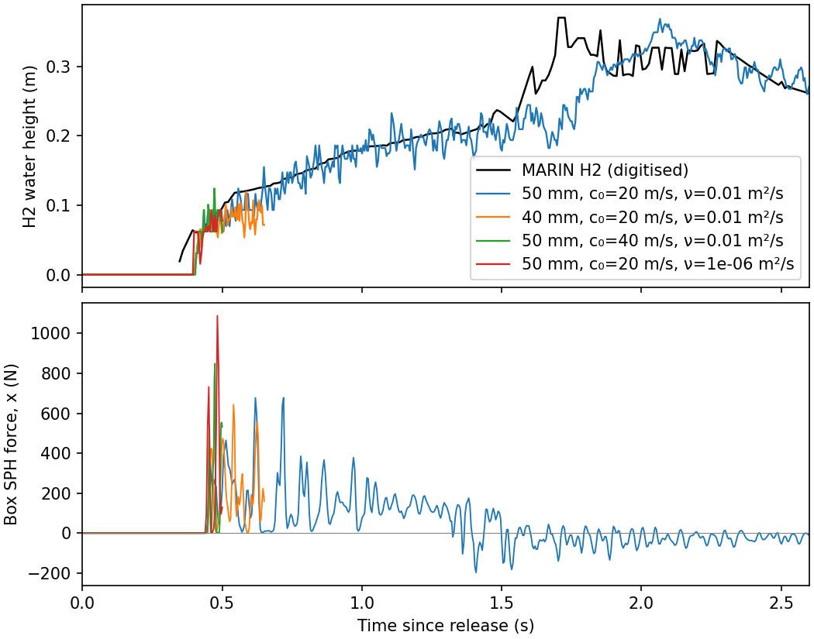

# TensorSPH 船舶与海洋工程应用评估

2026-11-21 对照主线 `eae3d32` 的求解器、归档时序和本次 CPU 复算。TensorSPH 适合优先发展甲板上浪、局部砰击、液舱晃荡和波冰作用。这些问题能利用粒子法的大变形自由面能力，也能给出可测的工程量。整船耐波性、总阻力和连续破冰阻力还缺从输入海况到设计载荷的独立验证。

## 工程问题与验收顺序

| 优先级和问题 | 已有证据 | 接下来的开发与验收量 |
|---|---|---|
| P0 甲板上浪、局部砰击 | 有三维 Kleefsman 障碍物、二维楔体和真实试验数据。本次纠正三维壁面和仪器位置。楔体固定 8 mm 传感器的细网格证据仍不足。[楔体压力评估](case_sph_wedge_entry_2d_footprint_closure_m24140.md) | 用同一局部探头口径复现 H2 前沿和回流峰，再对齐箱面 P1–P8 的位置、压力峰、冲量和时刻；检查气垫、接触冲量与弱可压缩性对载荷的贡献。 |
| P0 波浪水槽与晃荡 | 有活塞、消波和多探头。D20 的波高记录有采样矛盾。一阶晃荡周期已有单档结果，较线性理论低 2.21%。[晃荡基准](verification_sloshing_first_mode.md) | 在两档以上分辨率复跑空槽，测入射波高、反射、相位和沿程耗散，保存稳定周期和重复性；液舱再查共振处壁压与脉冲。 |
| P1 流固耦合 | 孙鹏楠整理的 SPHERIC Test 19 在 5 mm 时，三个板位移误差分别为 11.04%、9.52%、13.87%，密度最大偏差 2.908%，超出项目 1% 限值。[实验与 δ⁺-SPH/FEM 对照](../benchmarks/spheric19/README.md) | 同时检查位移、相位、逐步作用反作用和界面做功；先通过二维柔性板，再验证三维弹性舷侧或甲板面板。 |
| P1 耐波、浮体及系泊 | 已有可测三维定壁反力。此次审查未找到同时提供实船型、自由运动和水池试验响应曲线的 TensorSPH 工况。 | 建立质量、惯量、重心、浮态与双向刚体边界；从浮箱自由衰减、强迫振荡推进到 KCS 迎浪升沉、纵摇及增阻。浮式平台再做系泊静偏移、张力与运动谱。 |
| P1 冰区航行 | 波冰有薄板传播和经验破碎模型。液滴静态冻结时间比实验短约 42%。浮冰发射采用附加质量近似。[冻结](../benchmarks/sessile_freezing/README.md) · [浮冰附加质量](verification_ice_floe_added_mass.md) | 先用已知冰厚、弹性模量和抗弯强度测波长、断裂位置与浮冰运动；再用可追溯冰池工况，将 SPH 流体、DEM 破冰接触和 FEM 结构载荷对齐到同一时钟，比较平均阻力、峰值及碎冰分布。 |
| P2 全船黏性阻力及计算成本 | 已有 GPU 加速记录，覆盖二维短程；缺同一艘船的阻力分解、近壁分辨率和长时三维成本。[已有 GPU 记录](benchmarks/gpu-scaling.md) | 以 KCS 拖曳试验比较压力阻力、摩擦阻力、总阻力和姿态。发布粒子数、物理秒/墙钟小时、峰值显存、断点续跑一致性，以及误差随分辨率的变化。 |

耐波验收应先校准输入波，再比较多波频响应幅值和相位，记录试验与计算的不确定度。KCS 有静水阻力、波浪增阻、升沉及纵摇的公开对照。DualSPHysics 已提供主动及被动消波、浮体运动和系泊耦合，可作为同工况复算的独立实现。[ITTC 耐波试验](https://www.ittc.info/media/11888/75-02-07-021.pdf) · [ITTC 线性与弱非线性势流耐波程序验证](https://www.ittc.info/media/11894/75-02-07-025.pdf) · [NMRI KCS](https://t2015.nmri.go.jp/kcs.html) · [DualSPHysics](https://dual.sphysics.org/features/)

## 三维壁面和上浪试验

旧版三维溃坝右端项把固定壁面粒子的积分质量设为零，而且邻居列表只含不同粒子，求和密度漏了自贡献。这样即使壁压非零，壁面施加给流体的成对压力项也为零，后处理的位置钳制仍可让流体看起来留在箱内。本次为壁面和流体使用同一三维格点校准，补回核函数在零距离处的密度贡献，并保证自由面外推只读取流体索引。可选的反力输出与流体推进使用同一对粒子，默认调用仍返回原有三个张量。

静水槽宽 0.32 m、横向宽 0.16 m、水深 0.16 m。前 0.06 s 的端壁平均水平推力在 4、6、8 个水深粒子时分别为 18.151、20.402、19.944 N，解析值为 20.091 N。所有壁面竖向反力与水重的相对误差依次为 −1.76%、+5.25%、+2.36%。6 格时间步减半后，推力由 20.402 变为 20.407 N。短窗响应仍有静水启动振荡，逐档误差没有单调收敛。

Kleefsman 实验把障碍物作为甲板集装箱模型。图中 0.744 m 是下游壁至**箱体中心**的距离，H2 至下游壁为 0.992 m。仓库取上游壁为原点，故迎水面为 2.3955 m，H2 为 2.228 m，箱体横向居中。旧算例分别取 2.476 m、2.426 m，箱体贴侧壁。新默认值进入三维生产入口，旧档案保留原坐标。H2 当前算子沿流向取 0.08 m 窗口，横向在箱宽内平均。与实验中心线探针的空间口径差异仍在。[原实验](https://doi.org/10.1016/j.jcp.2004.12.007) · [带尺寸的图 15](https://doi.org/10.3970/cmes.2008.025.133)

| 粒子间距 | 人工声速 | 运动黏度（m²/s） | 时窗 | H2 到达时刻（对实验首个湿样本的偏差） | H2 峰值及其时刻 | 窗内最大密度压缩 |
|---|---|---|---|---|---|---|
| 50 mm | 20 m/s | 0.01 | 2.60 s | 0.4060 s（+13.05%） | 0.3683 m，2.067 s | 15.33% |
| 40 mm | 20 m/s | 0.01 | 0.65 s | 0.4034 s（+12.32%） | 未覆盖峰值 | 11.66% |
| 50 mm | 40 m/s | 0.01 | 0.50 s | 0.4051 s（+12.80%） | 未覆盖峰值 | 5.20% |
| 50 mm | 20 m/s | 10⁻⁶ | 0.50 s | 0.3963 s（+10.36%） | 未覆盖峰值 | 12.62% |

H2 对照取论文图 19 的数字化时序。实验首个达到 0.02 m 的样本为 0.3591 s，线性插值为 0.3481 s，原数字化记录估计读图时刻不确定度约 0.01 s。表中沿用原验收口径，以首个湿样本为分母。若双方都做插值，四组计算的延迟依次为 57.8、55.2、57.0、48.2 ms。实验峰值为 0.370 m、1.7027 s。唯一覆盖这一事件的计算，峰高低 0.45%，峰时晚 0.364 s；在两条曲线共有的 166 个实验采样点上，水位均方根误差为 0.0386 m，未做相位平移。该工况峰值马赫数为 0.313，发生 1053 次粒子与障碍物的钳制计数。

三组对照都只改变一个输入。与 50 mm 基线相比，细化到 40 mm 使波前提前 2.6 ms，人工声速翻倍提前 0.9 ms，将算例继承的运动黏度 0.01 m²/s 调为 10⁻⁶ m²/s 则提前 9.7 ms。黏度对本次比较的影响最大，四组均超出原 10% 到达时刻容差。单网格黏度对照不足以区分释放过程、有效耗散和测量口径各自的贡献。后续应同时记录箱前中心线局部水位和现有箱宽平均水位，并在两个以上分辨率下比较。

驱动还输出箱体所受 SPH 力 Fx、Fy、Fz（N）和绕几何中心的 Mx、My、Mz（N·m）。x 向下游，y 向上。它们包括压力和已配置的黏性壁面作用，速度钳制产生的附加冲量另外影响运动。尚无总载荷或局部峰压的实验通过结论。新版检查点拒绝混用旧版无壁面力的积分状态。



## 规则波记录核验

归档 D20 的四探头最大波高偏差为 2.97%。按记录中的 37,000 步和每 100 步输出一次，当前生产器应写 371 个样本（含初态），归档实际为 501 个，速度和压缩率时序为空。现在判级会同时核对采样数、时间起止、单调性与同步序列。保留原始波高测量值，撤回这条记录对生产求解器的通过结论。作为正控，本次通过同一生产入口运行了 237 步，预期与实写都是 49 个样本。这个短程只验证记录格式。[短程复算原始记录](../benchmarks/marine_readiness/wave_sampling_control.json) · [归档记录](reports/records/wf_D20.json) · [重新判级](reports/wave_flume_report.json)

## 冰下波传播

原实现把弯曲项写成 Dk⁴/ρ，与 gk 的量纲不同，还将解限制在开水波数以下。改用有限水深弹性薄板色散关系，同时计入冰层惯性；零冰厚恢复开水，质量加载主导的情形允许冰下波数大于开水。修正应用于既有波冰场景入口。边缘透射振幅仍取经验近似，碎冰尺度和航行阻力倍率各自需要实验验证。[Li 等，式 D.3](https://doi.org/10.1016/j.coldregions.2020.103208)

汉堡 HSVA 冰水池水深 2.5 m、冰厚 5 cm。用独立准静态加载所得模量（46、107、371 MPa）预测固定冰盖四个工况的相速，模型采用海水与冰密度 1025 和 917 kg/m³、泊松比 0.33。实验表 4 给出的代表相速为 3.0、3.5、4.0、4.3 m/s，修正后得到 2.779、3.440、3.941、4.312 m/s。绝对相对误差为 0.27% 至 7.35%。原文报告相速测量有约 0.5 至 1 m/s 的散布；这些比较仅覆盖完整冰板的传播。[Marchenko 等，表 2、表 4](https://doi.org/10.3390/w13081080)

## 复现

从 TensorSPH 根目录运行。附录保存原始输出时序和逐项比较数据。三个短程对照只评到达时刻。归档 JSON 的 run_metadata 保留运行时配置及代码指纹，git 字段为工作树所属基线提交。

```bash
python -m pip install -e '.[test]'
python benchmarks/kleefsman_obstacle_3d/run.py --dx .05 --t-end 2.6 --output-every 5 --threads 2 --tag dx50 --out-dir out/marine
python benchmarks/kleefsman_obstacle_3d/run.py --dx .04 --t-end .65 --output-every 5 --threads 2 --tag dx40 --out-dir out/marine
python benchmarks/kleefsman_obstacle_3d/run.py --dx .05 --sound-speed 40 --t-end .5 --output-every 5 --threads 2 --tag dx50_c40 --out-dir out/marine
python benchmarks/kleefsman_obstacle_3d/run.py --dx .05 --viscosity 1e-6 --t-end .5 --output-every 5 --threads 2 --tag dx50_water --out-dir out/marine
python benchmarks/marine_readiness/run.py --impact out/marine/dx50_time_series.csv out/marine/dx40_time_series.csv out/marine/dx50_c40_time_series.csv out/marine/dx50_water_time_series.csv --output out/marine/results.json --plot out/marine/green_water.png
python benchmarks/wave_flume/run.py --case regular --depth-cells 16 --simulate-time .04 --output-every 5 --threads 1 --out out/marine/sampling_control.json
python -m pytest -q tests/test_marine_wall_ice.py tests/test_wave_flume_grade.py
```

[计算数据及载荷时序](../benchmarks/marine_readiness/)
