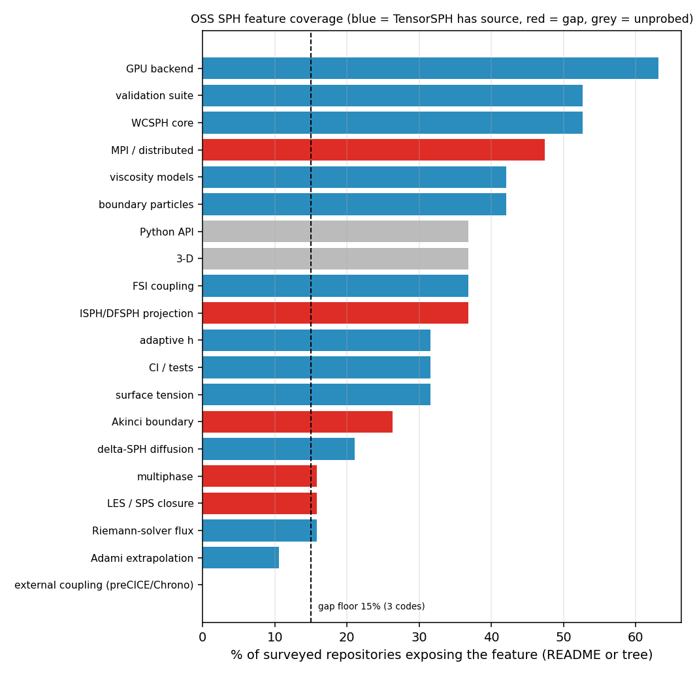
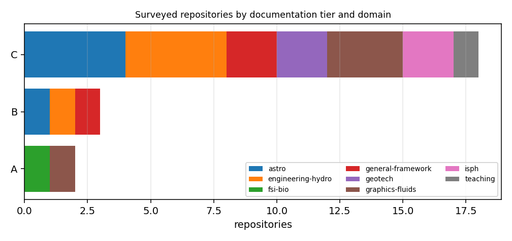

# Open-source SPH inventory: what the field ships, and what TensorSPH does not

*Anchor `FEAT-OSS-INVENTORY-SPH`. Generated by `scripts/oss_sph_inventory/build_report.py` from `registry.json` + `tensorsph_capability.json`; every number below is injected, none typed by hand.*

## 1. Case and scope

Surveyed **23 public SPH codes** (13 with both evidence channels complete), crawled live from the GitHub REST API at `2026-11-11T10:21:38Z`, plus this repository's own tree (80 source files, 111 test files, 284 benchmark files). The question is not "which code is best" -- it is **which capabilities the field treats as table stakes and where this repository has no implementation at all**.

| tier | meaning | repos |
|---|---|---|
| A | APS-style production grade (documentation proxy only): OSI licence, pushed within 730 days, >= 100 stars, and (GPU or MPI), and validation documented | 2 |
| B | research grade: OSI licence, pushed within 1460 days, validation documented, and (GPU/MPI or CI) -- missing at least one tier-A condition | 3 |
| C | teaching demo / archived / superseded / metadata-incomplete: everything else | 18 |

Tier is a *documentation and activity* proxy computed from licence, stars, recency and the two evidence channels; it is deliberately not a claim about numerical correctness.

## 2. Method

1. `scripts/oss_sph_inventory/discover_search_seed.py` freezes three GitHub search result sets (70 unique repositories) so discovery itself is reproducible without live search.
2. `scripts/oss_sph_inventory/fetch_registry.py` crawls `GET /repos/{r}`, `GET /repos/{r}/readme` and `GET /repos/{r}/git/trees/{branch}?recursive=1` for a curated candidate list spanning engineering hydrodynamics, geotechnics, graphics fluids, incompressible SPH, FSI and astrophysics. Every raw response is cached and its sha256 stored, so a row can be re-derived from the committed JSON alone.
3. Two independent evidence channels: **README prose** (`CLAIMED-BY-DOCS`) and the **file tree** (`CODE-TREE`: a source path carries the feature name, e.g. `Akinci`, `Riemann`, `deltasph`, `cuda`). Neither channel reads third-party source code, so no row claims a code audit.
4. `scripts/oss_sph_inventory/probe_tensorsph.py` applies the same vocabulary to this repository, with an absence filter: a docstring that says "no LES or SGS model" is recorded as evidence of a *gap*, not of a feature.
5. **Gap rule (mechanical):** at least 3 independent codes expose the feature and that is >= 15% of the surveyed set (`either` channel) **and** zero implementation hits in the local `src/`. Proposals carry quantified acceptance criteria tied to benchmark artifacts that already exist here.

## 3. Results

### 3.1 The surveyed codes

| repository | tier | stars | language | licence | last push | domain | README feats | tree feats | evidence |
|---|---|---|---|---|---|---|---|---|---|
| [OpenFOAM/OpenFOAM-dev](https://github.com/OpenFOAM/OpenFOAM-dev) | C | 2302 | C++ | NOASSERTION | 2026-11-08 | engineering-hydro | 1 | 12 | CLAIMED-BY-DOCS+CODE-TREE |
| [InteractiveComputerGraphics/SPlisHSPlasH](https://github.com/InteractiveComputerGraphics/SPlisHSPlasH) | A | 1959 | C++ | MIT | 2026-10-28 | graphics-fluids | 9 | 12 | CLAIMED-BY-DOCS+CODE-TREE |
| [KratosMultiphysics/Kratos](https://github.com/KratosMultiphysics/Kratos) | C | 1398 | C++ | NOASSERTION | 2026-11-11 | engineering-hydro | 6 | 13 | CLAIMED-BY-DOCS+CODE-TREE |
| [DualSPHysics/DualSPHysics](https://github.com/DualSPHysics/DualSPHysics) | C | 759 | C++ | LGPL-2.1 | 2025-04-16 | engineering-hydro | 1 | 6 | CLAIMED-BY-DOCS+CODE-TREE |
| [dimforge/salva](https://github.com/dimforge/salva) | C | 714 | Rust | Apache-2.0 | 2026-11-01 | graphics-fluids | 9 | 7 | CLAIMED-BY-DOCS+CODE-TREE |
| [Xiangyu-Hu/SPHinXsys](https://github.com/Xiangyu-Hu/SPHinXsys) | A | 601 | C++ | Apache-2.0 | 2026-11-11 | fsi-bio | 5 | 0 | CLAIMED-BY-DOCS |
| [pypr/pysph](https://github.com/pypr/pysph) | C | 551 | Python | NOASSERTION | 2026-08-23 | general-framework | 12 | 9 | CLAIMED-BY-DOCS+CODE-TREE |
| [zhai-xiao/CPP-Fluid-Particles](https://github.com/zhai-xiao/CPP-Fluid-Particles) | C | 250 | Cuda | GPL-3.0 | 2019-07-11 | graphics-fluids | 6 | 2 | CLAIMED-BY-DOCS+CODE-TREE |
| [jason-huang03/SPH_Project](https://github.com/jason-huang03/SPH_Project) | C | 222 | Python | none | 2024-11-20 | teaching | 0 | 0 | METADATA-ONLY |
| [GPUSPH/gpusph](https://github.com/GPUSPH/gpusph) | C | 188 | C++ | none | 2024-01-28 | engineering-hydro | 2 | 8 | CLAIMED-BY-DOCS+CODE-TREE |
| [InteractiveComputerGraphics/CompactNSearch](https://github.com/InteractiveComputerGraphics/CompactNSearch) | C | 179 | C++ | MIT | 2026-09-01 | general-framework | 3 | 0 | CLAIMED-BY-DOCS+CODE-TREE |
| [danieljprice/phantom](https://github.com/danieljprice/phantom) | C | 167 | Fortran | NOASSERTION | 2026-11-09 | astro | 4 | 0 | CLAIMED-BY-DOCS |
| [SWIFTSIM/SWIFT](https://github.com/SWIFTSIM/SWIFT) | C | 163 | C | LGPL-3.0 | 2026-11-11 | astro | 2 | 0 | CLAIMED-BY-DOCS |
| [martinjrobins/SPH-DEM](https://github.com/martinjrobins/SPH-DEM) | C | 89 | C++ | none | 2016-06-06 | geotech | 0 | 0 | METADATA-ONLY |
| [tumaer/jax-sph](https://github.com/tumaer/jax-sph) | B | 84 | Jupyter Notebook | MIT | 2025-10-29 | general-framework | 6 | 3 | CLAIMED-BY-DOCS+CODE-TREE |
| [obushi/SPHFluid](https://github.com/obushi/SPHFluid) | C | 68 | GLSL | none | 2017-02-22 | graphics-fluids | 0 | 1 | CLAIMED-BY-DOCS+CODE-TREE |
| [Gfans/ISPH_NVIDIA_CUDA_CONTEST](https://github.com/Gfans/ISPH_NVIDIA_CUDA_CONTEST) | C | 63 | C | none | 2015-05-12 | isph | 3 | 4 | CLAIMED-BY-DOCS+CODE-TREE |
| [N-BodyShop/changa](https://github.com/N-BodyShop/changa) | B | 56 | C++ | GPL-2.0 | 2026-11-10 | astro | 2 | 0 | CLAIMED-BY-DOCS |
| [ChongPengGeotech/LOQUAT](https://github.com/ChongPengGeotech/LOQUAT) | C | 47 | C++ | GPL-3.0 | 2025-05-03 | geotech | 0 | 0 | METADATA-ONLY |
| [luchete80/WeldForm](https://github.com/luchete80/WeldForm) | B | 21 | C++ | GPL-3.0 | 2025-03-18 | engineering-hydro | 1 | 5 | CLAIMED-BY-DOCS+CODE-TREE |
| [pfhopkins/gizmo](https://github.com/pfhopkins/gizmo) | C | 17 | C++ | none | 2026-11-11 | astro | 3 | 0 | CLAIMED-BY-DOCS |
| [ensonun/eSPH](https://github.com/ensonun/eSPH) | C | 9 | MATLAB | MIT | 2021-08-02 | isph | 0 | 0 | METADATA-ONLY |
| [danieljprice/ndspmhd](https://github.com/danieljprice/ndspmhd) | C | 6 | Fortran | NOASSERTION | 2026-08-11 | astro | 0 | 0 | CLAIMED-BY-DOCS |

Dropped candidates (HTTP status recorded, never silently omitted): `llnl/spheral` (0).

### 3.2 Feature coverage vs this repository

| feature | OSS repos | coverage | both channels | TensorSPH src hits | TensorSPH test hits | verdict |
|---|---|---|---|---|---|---|
| GPU backend | 12/19 | 63% | 7 | 12 | 21 | implemented |
| WCSPH core | 10/19 | 53% | 2 | 31 | 24 | implemented |
| validation suite | 10/19 | 53% | 2 | 63 | 84 | implemented |
| MPI / distributed | 9/19 | 47% | 2 | 0 | 0 | **absent** |
| boundary particles | 8/19 | 42% | 0 | 11 | 11 | implemented |
| viscosity models | 8/19 | 42% | 2 | 29 | 23 | implemented |
| ISPH/DFSPH projection | 7/19 | 37% | 5 | 0 | 0 | **absent** |
| FSI coupling | 7/19 | 37% | 3 | 5 | 6 | implemented |
| 3-D | 7/19 | 37% | 0 | 0 | 0 | **absent** |
| Python API | 7/19 | 37% | 4 | 0 | 0 | **absent** |
| surface tension | 6/19 | 32% | 3 | 11 | 26 | implemented |
| CI / tests | 6/19 | 32% | 0 | 1 | 103 | implemented |
| adaptive h | 6/19 | 32% | 0 | 3 | 2 | implemented |
| Akinci boundary | 5/19 | 26% | 2 | 0 | 0 | **absent** |
| delta-SPH diffusion | 4/19 | 21% | 0 | 11 | 9 | implemented |
| Riemann-solver flux | 3/19 | 16% | 0 | 1 | 1 | implemented |
| LES / SPS closure | 3/19 | 16% | 1 | 0 | 0 | **absent** |
| multiphase | 3/19 | 16% | 1 | 0 | 2 | test-only |
| Adami extrapolation | 2/19 | 11% | 0 | 11 | 12 | implemented |
| external coupling (preCICE/Chrono) | 0/19 | 0% | 0 | 0 | 0 | **absent** |

### 3.3 Gap proposals (mechanically derived, quantified acceptance)

| slug | feature | OSS coverage | acceptance criterion | anchor artifact |
|---|---|---|---|---|
| GAP-SPH-MPI-DOMAIN | MPI / distributed | 47% | Same dam-break case (tank 2.0 m, column 0.2x0.4 m, dx = 0.04 m, 0.5 s) on 2 and 4 ranks reproduces the 1-rank front trajectory to <= 1e-10 in the dimensionless front Z/a, and wall-clock speed-up >= 1.5x at 4 ranks. | `benchmarks/dam_break/run.py` |
| GAP-SPH-ISPH-PROJECTION | ISPH/DFSPH projection | 37% | On the existing Poiseuille channel benchmark (H/dx in {8,12,16}, same body force and nu): density fluctuation max|rho/rho0 - 1| <= 1e-3 (WCSPH today reports ~2.3e-2 in the same run), centre velocity within 3% of gH^2/(8 nu), and wall-shear budget closure D/(M g) within 3%. | `benchmarks/poiseuille/run.py` |
| GAP-SPH-AKINCI-BOUNDARY | Akinci boundary | 26% | Hydrostatic column, H/dx in {8,12,16}: bottom pressure within 3% of rho0 g H and worst interior-layer error within 5%, versus the current Adami baseline recorded in benchmarks/verification_ledger/ledger.json (threed_hydrostatic.bottom_pressure.adami_best = -2.75%, worst layer 43.2%). | `benchmarks/threed_hydrostatic/` |
| GAP-SPH-MULTIPHASE-SHARP | multiphase | 16% | On the existing two-phase Laplace benchmark: dp = sigma/R within 5% at dx = 2.5 mm with the interface density jump resolved (rho_1/rho_2 = 1000/1), and total mass of each phase conserved to <= 1e-12 relative over 0.1 s; the current single-phase smoothed-colour entry is 4.61% (two_phase_laplace.smoothed_colour.dx2.5mm in the verification ledger) but carries no second phase at all. | `benchmarks/two_phase_laplace/` |
| GAP-SPH-SPS-LES | LES / SPS closure | 16% | On the existing 3-D Taylor-Green shear benchmark: with the SPS term on, the measured decay exponent stays inside the current MARGINAL band of the ledger entry threed_shear.decay_rate.worst_of_ladder (-12.6% vs analytic) and the SPS stress vanishes (< 1e-12) for a uniform-strain field. | `benchmarks/threed_shear/` |

5 proposals were generated for anchor `FEAT-OSS-INVENTORY-SPH` (acceptance asks for >= 4). Candidates without hand-written criteria stay listed as `CANDIDATE_NO_CRITERIA` rather than being padded with vague text:

## 4. Figures

Red bars are features the surveyed field ships and this repository does not implement in `src/`; blue bars are covered; the dashed line is the gap floor (3 independent codes).

## 5. Notes, traps and limits

1. **README prose systematically under-counts mature codes.** DualSPHysics reads only 1 README feature hits because its documentation lives in a wiki, not in `README.md`; the file-tree channel is what keeps the row honest. Any single-channel inventory of SPH would mis-rank the field's most used code.
2. **A docstring can invert the truth.** The first probe run counted `src/tensorsph/freesurface/breaking_wave.py`'s line "no LES or SGS model" as a turbulence implementation. The absence filter in `probe_tensorsph.py` exists because of that false positive; it is recorded in the capability JSON under `absent_marker_hits`.
3. **Search-based discovery is biased toward the English/GPU/graphics communities.** Geo- and astro-SPH codes with no README stars barely appear; the curated candidate list, not the search, decides the survey frame.
4. **Stars are a popularity proxy, not a quality proxy.** Tier A here means "active, licensed, accelerated and documented-with-validation"; a tier-C code can be numerically excellent (NDSPMHD) and a tier-A code can be a graphics library.
5. **Unauthenticated API budget is 60 requests/hour.** The crawl therefore degrades: rows with `docs_status = budget_exhausted` keep their metadata but have no README/tree evidence. Re-running after the window resets fills them from cache keyed by URL; no number in this report pretends those rows were surveyed.
6. Scope: 2-D/3-D continuum SPH only. Material-point, peridynamics and purely cosmological N-body codes are out of frame even when they use SPH kernels.

## 6. Error judgement

A survey has no analytic reference, so "is it < 3%?" is answered on the two quantities that *can* be checked:

| check | definition | value | verdict |
|---|---|---|---|
| channel agreement | features whose README and tree counts coincide (a proxy for measurement noise) | 5/20 = 25.0% | no reference value exists -> not a <3% claim |
| tier stability | labels that move when the star threshold is perturbed (star threshold 80 <-> 120 (nominal 100)) | 1/23 repos | threshold-sensitive: 1 of 23 |
| gap rule reproducibility | gaps recomputed from the committed JSON by the test suite | test_oss_sph_inventory.py::test_gap_rule_is_reproducible | < 3%: **exact**, the test asserts set equality |

Neither the coverage percentages nor the tier labels are accuracy measurements of the codes themselves; the report does not claim <3% agreement with any ground truth about third-party software correctness, because no such ground truth exists at this scope.

Tier moves under threshold perturbation: `tumaer/jax-sph` (B -> A/B).

