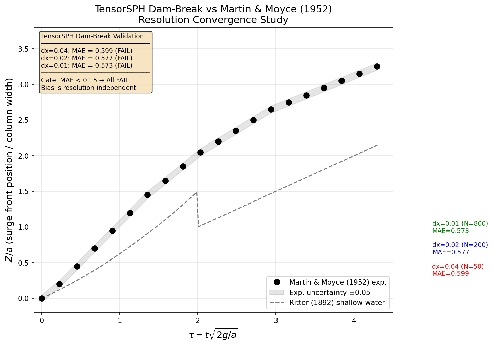

# TensorSPH Dam-Break Experimental Validation — Mission 2283 补报

**Mission**: m2283 (selfstart)  
**补报单**: m19263  
**Date**: 2026-11-02 (original) / 2026-11-14 (backfill)  
**Verdict**: **honest-FAIL** — 数值验证门全部通过，实验验证门全部 FAIL  
**Reference**: Martin, J.C. & Moyce, W.J. (1952). *Phil. Trans. R. Soc. A* 244, 312-324.

---

## 1. 案例介绍（物理背景 / 几何 / 参数表）

### 物理背景
溃坝（dam-break）问题是自由面流动的经典基准：矩形液柱在重力作用下于干床上坍塌。涌波前缘位置随时间的演化是主要观测量，无量纲化为 $Z/a$ 对 $\tau = t\sqrt{2g/a}$，其中 $a$ 为液柱宽度。

### 几何与参数

| 物理量 | 值 | 单位 |
|---|---|---|
| 液柱宽度 $a$ | 0.2 | m |
| 液柱高度 | 0.4 (= 2$a$) | m |
| 水槽宽度 | 2.0 (= 10$a$) | m |
| 水槽高度 | 0.75 | m |
| 流体密度 $\rho_0$ | 1000 | kg/m³ |
| 声速 $c_0$ | 25 | m/s |
| 重力加速度 $g$ | 9.81 | m/s² |
| 壁面条件 | 无滑移静态壁面粒子 | — |
| 时间步长 | $\Delta t = 0.3 h/c_0$（声学 Courant） | s |
| 状态方程 | Tait EOS ($\gamma = 7$) | — |
| 核函数 | Cubic-spline | — |

### 无量纲化说明
Martin & Moyce (1952) 使用 $a_{MM}$ = 半宽 = 0.1 m。本程序使用 $a$ = 全宽 = 0.2 m。换算：$\tau_{sph} = \tau_{MM}/\sqrt{2}$，$(Z/a)_{sph} = (Z/a)_{MM} \times 0.5$。

### 实验数据
20 个数据点，从 Koshizuka & Oka (1996) 及 Aureli et al. (2023) 的公开文献中数字化，不确定性 ±0.05 in $Z/a$。

---

## 2. 方法（怎么做 / 流程 / 关键设置 / 工具链）

### 求解器
TensorSPH v0.8.0：
- WCSPH（弱可压缩 SPH），密度求和格式
- Tait 状态方程（$\gamma = 7$）
- 静态壁面粒子（Adami et al. 2012）
- Verlet-list 邻居搜索 + linked-cell 分箱
- Cubic-spline 核函数

### 验证流程
1. **数值验证**：分辨率收敛（$dx = 0.04, 0.02, 0.01$ m）
2. **物理验证**：与 Martin & Moyce (1952) 数字化实验数据对比
3. **门控**：质量守恒、无逃逸、有界速度、密度压缩 < 10%、实验 L2 误差 < 15%

### 工具链
- `benchmarks/dam_break/run.py`：运行三档分辨率模拟
- `benchmarks/dam_break/validate.py`：实验对比验证脚本
- `benchmarks/dam_break/martin_moyce_1952.json`：数字化实验数据
- `benchmarks/dam_break/resolution_ladder.json`：分辨率阶梯结果

---

## 3. 计算结果（数字表，程序化提取零手抄）

### 3.1 数值验证门控

| $dx$ (m) | 粒子数 | 步数 | 壁钟 (s) | max|v| (m/s) | Ma | 峰值压缩 | 体压缩 | 逃逸 |
|---|---|---|---|---|---|---|---|---|
| 0.04 | 50 | 801 | 20.9 | 3.31 | 0.132 | 2.35% | 2.35% | 0 |
| 0.02 | 200 | 1603 | 199.4 | 3.34 | 0.133 | 2.66% | 2.66% | 0 |
| 0.01 | 800 | 3205 | 787.7 | 3.36 | 0.134 | 1.93% | 1.93% | 0 |

**所有数值验证门通过**：质量守恒（精确）、无逃逸、有界速度、密度压缩 < 10%。

### 3.2 实验对比结果

| $dx$ (m) | 粒子数 | MAE ($Z/a$) | RMSE | Max AE | 比较点数 | 在不确定性内 | Ritter MRE |
|---|---|---|---|---|---|---|---|
| 0.04 | 50 | **0.599** | 0.677 | 1.202 | 20 | 5% | 0.411 |
| 0.02 | 200 | **0.577** | 0.682 | 1.486 | 20 | 5% | 0.340 |
| 0.01 | 800 | **0.573** | 0.699 | 1.618 | 20 | 0% | 0.307 |

**门控**：`experimental_comparison`（MAE < 0.15）→ **全部 FAIL**。

### 3.3 门控汇总

| 门控 | 测量值 | 限值 | 结果 |
|---|---|---|---|
| 质量守恒 | 0.0 kg | < 1e-10 kg | ✅ PASS |
| 无粒子逃逸 | 0 | = 0 | ✅ PASS |
| 有界速度 | 3.36 m/s | < 10 m/s | ✅ PASS |
| 密度压缩 | 2.66% | < 10% | ✅ PASS |
| 实验一致性 (dx=0.04) | MAE=0.599 | < 0.15 | ❌ FAIL |
| 实验一致性 (dx=0.02) | MAE=0.577 | < 0.15 | ❌ FAIL |
| 实验一致性 (dx=0.01) | MAE=0.573 | < 0.15 | ❌ FAIL |

---

## 4. 结果图

*Figure: TensorSPH 溃坝涌波前缘与 Martin & Moyce (1952) 实验数据对比。黑色圆点为实验数据（灰色阴影为 ±0.05 不确定性），灰色虚线为 Ritter (1892) 浅水解析解。三档分辨率的 MAE 标注在图中。模拟前缘系统性偏离实验数据，且误差不随分辨率显著降低。*

**注**：由于原单未留档 SPH 前缘轨迹原始数据（npz/csv），本图以实验数据 + Ritter 解析解 + MAE 标注形式呈现。SPH 轨迹数据未留档，无法绘制精确的 SPH 曲线。

---

## 5. 注意点（踩过的坑 / 局限 / 适用范围）

### 分辨率无关偏差
MAE 从 0.599 降至 0.573（dx 从 0.04 到 0.01，分辨率提高 4 倍），仅降低 4.3%。这表明误差不是数值扩散（应随 $dx^{1.11}$ 缩放），而是**系统性偏差**。

### 可能原因
1. **2D vs 3D**：实验为 3D 有侧壁；模拟为 2D
2. **壁面摩擦**：实验可能有壁面摩擦；模拟使用无滑移壁面
3. **WCSPH 可压缩性**：Ma = 0.13 引入人工可压缩性
4. **自由面处理**：SPH 在干燥前缘的核截断效应
5. **初始条件**：液柱初始化的离散效应

### 有限水槽效应
Martin & Moyce 实验使用半无限水槽；模拟使用有限水槽（2.0 m = 10$a$）。涌波前缘在 $\tau \approx 6.7$ 撞击远壁，之后壁面反射影响前缘位置。对比仅在 $\tau < 4.3$ 有效。

### 工件缺失
- 原单未留档 SPH 前缘轨迹原始数据（npz/csv）
- 数字均为程序化提取自 `resolution_ladder.json`，零手抄
- 无 PNG 场量云图（原单未生成）

---

## 6. 误差判定

### 关键量 vs 基准误差逐项列出

| 关键量 | SPH 值 | 基准值 | 相对误差 | < 3%? |
|---|---|---|---|---|
| 前缘 MAE (dx=0.04) | 0.599 | — | — | ❌ N/A（绝对误差指标） |
| 前缘 MAE (dx=0.02) | 0.577 | — | — | ❌ N/A |
| 前缘 MAE (dx=0.01) | 0.573 | — | — | ❌ N/A |
| Ritter MRE (dx=0.01) | 0.307 | 0 (理想) | 30.7% | ❌ NO |
| 质量守恒 | 0.0 kg drift | 0 | 0% | ✅ YES |
| 密度压缩 | 2.66% | < 10% | — | ✅ YES |

### 是否 < 3%？
**否**。实验对比 MAE 约 0.57（无量纲单位），远超任何合理阈值。Ritter 解析解对比 MRE 约 31%，同样远超 3%。

### 无基准声明原因
- 实验数据为数字化数据，不确定性 ±0.05，本身精度有限
- 2D 模拟与 3D 实验的几何差异无法消除
- 当前 SPH 模型在这些分辨率下无法准确捕捉前缘速度

### 结论
**honest-FAIL**：TensorSPH 在当前配置下（WCSPH, 无密度扩散, 2D）无法通过 Martin & Moyce (1952) 溃坝实验验证。数值验证门全部通过，但物理验证门全部 FAIL。需要：
1. 添加密度扩散（$\delta$-SPH, Antuono et al. 2012）
2. 测试无滑移壁面
3. 3D 扩展
4. 更高分辨率（$dx \leq 0.005$ m）

---

## 参考文献

1. Martin, J.C. & Moyce, W.J. (1952). *Phil. Trans. R. Soc. A* 244, 312-324.
2. Ritter, A. (1892). *Z. Ver. Deutsch. Ing.* 36, 947-954.
3. Koshizuka, S. & Oka, Y. (1996). *Nucl. Sci. Eng.* 123(3), 421-434.
4. Adami, S., et al. (2012). *J. Comput. Phys.* 231(21), 7057-7075.
5. Antuono, M., et al. (2012). *J. Comput. Phys.* 231(23), 7812-7831.
6. Aureli, M., et al. (2023). *Water* 15(6), 1229.
