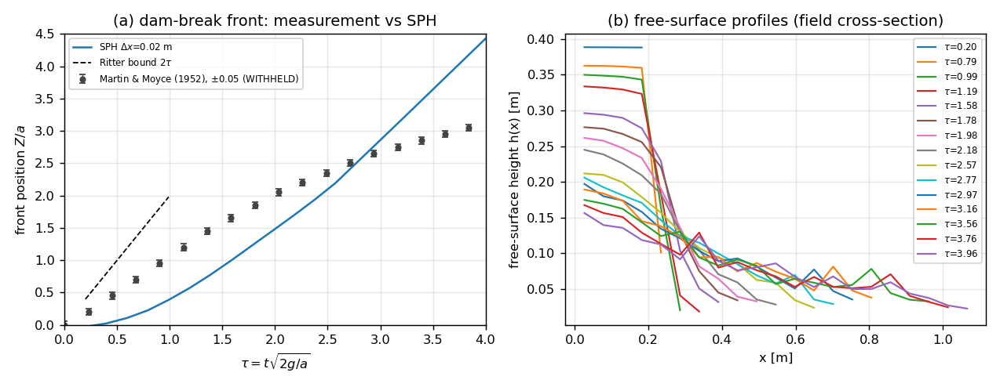
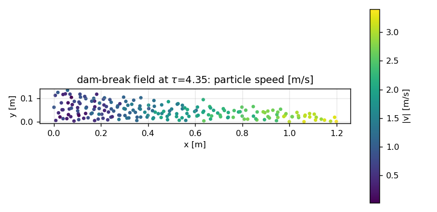
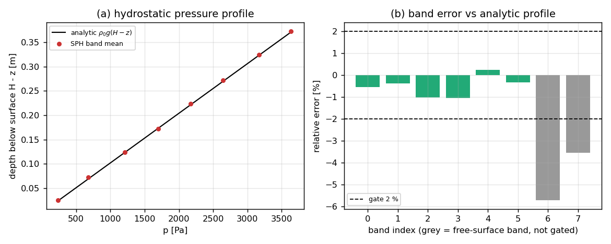
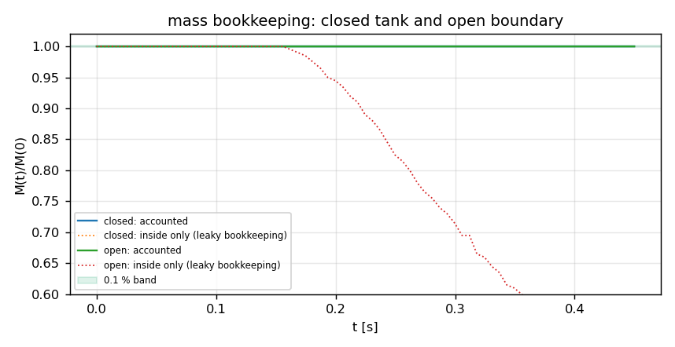
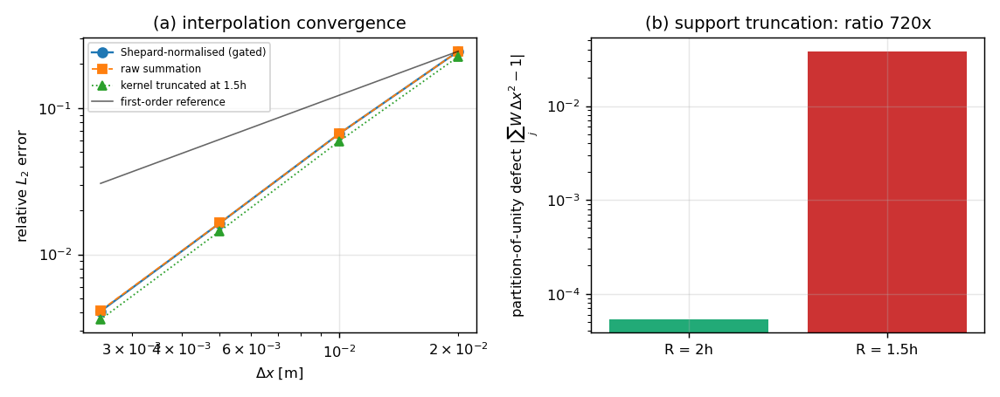

# TensorSPH 自由面流动验证面（P482-N04，m14534 返修轮）

**仓库**：TensorSPH · **分支**：`agent/m14534` · **commit**：`c3ea82d660f07adf6806955a3f1c7caca7746a8b`
· **运行目录**：`runs/sph_free_surface_verification/full` · **生成时间（UTC）**：2026-11-11T08:42:24Z
· **tier**：`full`（门限判据用战役尺寸；smoke 档只跑管线，门一律 WITHHELD）

本报告全部数字由 `docs/reports/m14534_make_report.py` 从运行包（`results.json` /
`benchmark.json` / `MANIFEST.json`）注入，脚本内不含任何物理数值字面量。
每个度量在 `results.json` 里带 `source`（产生它的函数调用路径），
`benchmark.json` 的每行对照在写出时被反向校验过一次
（`Bundle.check_benchmark_consistency`：行里的 got 必须等于运行记录到的
metric 或 series 元素，否则直接抛错拒绝出包）。

## 1. 案例与物理背景

四个面各配一个负控，构成本节点的可机器裁决面（J1–J4）：

* **M1 溃坝**：矩形水柱 a=0.2 m、H=2a（Martin & Moyce 1952 几何）在长干床上瞬间释放。
  观测量：无量纲前沿 Z/a(τ)（τ=t√(2g/a)）与柱高 h(t)。柱高没有可引用的数字化实验曲线，
  因此锚在两条**精确**结论上：稀疏波尾部到达前（t ≤ a/2c₀）库区静止 → h_back = H；
  顶角两侧零压 → 自由落体 h = H − ½gt²（t ≤ a/c₀）。
  负控：g=0 时水柱必须保持初始形状（参考格架由 `make_column` 独立生成，不取模拟轨迹）。
* **M2 静水压力**：p(z)=ρ₀g(H−z)，N≥1000 粒子。门只施加于内核带——求和密度在自由面
  2h 内被截断，表层带必然偏低，报告但排除。负控：ρ=0 时 Tait 状态方程必须精确返回 0。
* **M3 质量守恒**：SPH 粒子质量恒定，"总质量不变"本身不检验任何东西；会坏的是**边界记账**。
  闭式水槽 M(t) 必须在 0.1 % 内（≥1000 步）；开口水槽记账质量同样保持，而"删粒子不记账"
  的负控必须显著丢质量（>1 %）。
* **M4 粒子间距收敛**：解析场在 Δx 递减格架上的 SPH 插值 L2 误差收敛阶须 ≥1；
  核支持域截到 R=1.5h 时单位分解被破坏，静水平衡必须崩。

### 参数表（直接取自 `results.json` 的 config 字段）

| parameter | dam_break_2d_dx0.02 | hydrostatic_pressure_profile | kernel_interpolation_convergence | mass_conservation_closed_tank |
|---|---|---|---|---|
| dx | 0.02 | 0.02 | n/a | 0.02 |
| column_width | 0.2 | n/a | n/a | n/a |
| column_height | 0.4 | n/a | n/a | n/a |
| sound_speed | 25 | 20 | n/a | n/a |
| viscosity | 1.000e-06 | n/a | n/a | n/a |
| seconds | 0.45 | 2 | n/a | 0.45 |
| steps | n/a | 5129 | n/a | 1442 |
| particles | n/a | 1000 | n/a | n/a |
| n_particles | n/a | 1000 | n/a | n/a |
| tank_width | 2 | 1 | n/a | 1 |
| depth | n/a | 0.4 | n/a | n/a |
| horizon_steps | n/a | n/a | n/a | 1000 |
| gravity | 9.81 | 9.81 | n/a | n/a |

## 2. 方法与工具链

1. **统一入口**：`python -m tensorsph.verification --tier full`
   （脚本包装 `scripts/run_sph_free_surface_verification.py` 走同一函数）。
2. **真调用主求解器**（运行期解析并记录文件/行号，见 `MANIFEST.json.solver_callers`）：
   `tensorsph.dam_break.run_case` (src/tensorsph/dam_break.py:218), `tensorsph.dam_break.make_column` (src/tensorsph/dam_break.py:89), `tensorsph.vv.hydrostatic.run_hydrostatic` (src/tensorsph/vv/hydrostatic.py:129), `tensorsph.droplet_impact.pair_kernels` (src/tensorsph/droplet_impact.py:265)。
3. **测量定义与门**在 `src/tensorsph/verification/` 的四个模块里；本节点只新增测量、门、负控与证据层。
4. **证据层**：`bundle.py` 把每个 case 的 config/metrics/series 写成纯文本包，并对写出的每个文件做
   SHA-256 登记（`MANIFEST.json.maturity.run_artifacts`），因此改一个数字就能被发现。
5. **成熟度是推导出来的**：`bundle.assess_level()` 只读 manifest 自己的 `maturity` 块，按
   L1..L4 必需键是否非空给出等级——不是自评。本次结果：**L4**
   （缺项：{}）。
6. **复现**（单条命令，写入 manifest 的 `repro_cmd` 字段）：

```bash
python -m tensorsph.verification --tier full --out runs/sph_free_surface_verification/full
```

## 3. 计算结果

### 3.1 门与负控裁决

| gate | verdict | honest FAIL | detail |
|---|---|---|---|
| `J1_control_gravity_off` | PASS | - | `{"front_drift_over_dx": 0.0, "height_drift_rel": 0.0, "max_particle_displacement_over_dx": 0.0, "tier": "full"}` |
| `J1_front` | FAIL | yes | `{"limit": 0.1, "max_rel_error": 0.7781358154574178, "reference_grade": "WITHHELD", "tier": "full"}` |
| `J1_height` | PASS | - | `{"ballistic": 0.025047324897896767, "limit": 0.1, "residual": 0.041016474366188105, "tier": "full"}` |
| `J2_control_zero_density` | PASS | - | `{"raw": {"case": "hydrostatic_zero_density_control", "empty_domain_ok": true, "eos_at_zero_density": 0.0, "eos_finite": true, "eos_non_negative": true, "eos_pointwise_zero": true, "pass": true, "single_particle_density": 100.0, "single_p...` |
| `J2_pressure` | PASS | - | `{"limit_pct": 2.0, "measured_pct": 1.0635295646105696, "n_particles": 1000, "tier": "full"}` |
| `J3_mass_closed` | PASS | - | `{"limit": 0.001, "measured": 0.0, "min_steps": 1000, "steps_ok": true, "steps_run": 1442, "tier": "full"}` |
| `J3_mass_open_and_overflow_control` | PASS | - | `{"accounted_loss": 1.032429566377443e-07, "limit": 0.001, "min_loss": 0.01, "particles_removed": 109, "tier": "full", "unaccounted_loss": 0.5452283416895856}` |
| `J4_control_truncated_support` | PASS | - | `{"baseline_pct": 1.1666018291431661, "control_max_band_error_pct": 16.57704761440678, "diverged": false, "support_factor": 1.5, "tier": "full"}` |
| `J4_convergence` | PASS | - | `{"baseline_pct": 1.1666018291431661, "control_max_band_error_pct": 16.57704761440678, "control_pass": true, "defect_ratio": 719.7628410532308, "limit_min_order": 1.0, "measured_min_order": 1.87550774648434, "tier": "full"}` |

### 3.2 M1 溃坝（`dam_break_2d_dx0.02`）

| metric | value | unit | gate | verdict | source |
|---|---|---|---|---|---|
| `front_layer_max_rel_error` | 0.7571 | 1 | n/a | - | `dam_break_2d.front_errors(..., key='front_layer')` |
| `front_max_rel_error` | 0.7781 | 1 | 0.1 | FAIL | `dam_break_2d.front_errors(result, table, 'front_coherent', min_tau=0.5)['max_rel_error']` |
| `front_max_rel_error_including_startup` | 1.118 | 1 | n/a | - | `dam_break_2d.front_errors(result, table, min_tau=0.0)` |
| `front_n_points` | 17 | 1 | n/a | - | `dam_break_2d.front_errors(...)['n_points']` |
| `front_rms_rel_error` | 0.4011 | 1 | n/a | - | `dam_break_2d.front_errors(...)['rms_rel_error']` |
| `height_ballistic_max_rel_error` | 0.02505 | 1 | 0.1 | PASS | `dam_break_2d.height_anchor_errors(result)['ballistic_max_rel_error']` |
| `height_ballistic_ratio` | 0.9801 | 1 | n/a | - | `height_anchor_errors(...)['h_dam_at_end_of_ballistic_window'] / (H - g t^2/2)` |
| `height_residual_max_rel_error` | 0.04102 | 1 | 0.1 | PASS | `dam_break_2d.height_anchor_errors(result)['residual_max_rel_error']` |
| `height_residual_ratio` | 0.959 | 1 | n/a | - | `height_anchor_errors(...)['h_back_at_end_of_residual_window'] / H` |
| `mass_drift_rel` | 0 | 1 | n/a | - | `abs(result['mass_drift']) / result['mass_initial']` |
| `max_density_compression` | 0.05725 | 1 | n/a | - | `result['max_density_compression']` |
| `max_mach` | 0.1406 | 1 | n/a | - | `result['max_mach']` |
| `particles` | 200 | 1 | n/a | - | `result['rows'][0]['particles']` |
| `ritter_ratio_mean` | 0.1413 | 1 | n/a | - | `dam_break_2d.ritter_errors(result)['ratio_mean']` |
| `simulated_time` | 0.4499 | s | n/a | - | `result['simulated_time']` |
| `steps` | 1442 | 1 | n/a | - | `result['steps_taken']` |
| `wall_seconds` | 57.14 | s | n/a | - | `time.time() around dam_break_2d.run` |

分辨率阶梯（同算例只改 Δx）：

[
 {
  "dx": 0.02,
  "front_max_rel_error": 0.7781358154574178,
  "front_rms_rel_error": 0.40105534931203385,
  "particles": 200.0
 }
]

### 3.3 M2 静水压力（`hydrostatic_pressure_profile`）

| metric | value | unit | gate | verdict | source |
|---|---|---|---|---|---|
| `max_band_error_pct` | 1.064 | % | 2 | PASS | `hydrostatic.run_hydrostatic_case(case)['measured']['max_band_error_pct'] (after hydrostatic.classify_bands)` |
| `mean_band_error_pct` | 0.6017 | % | n/a | - | `measured['mean_band_error_pct']` |
| `n_particles` | 1000 | 1 | 1000 | PASS | `measured['n_particles'] (counted, not derived from the lattice)` |
| `rung_original_max_band_error_pct` | 5.727 | % | n/a | - | `measured['rung_max_band_error_pct']` |
| `shelf_band_error_pct` | -5.727 | % | n/a | - | `measured['shelf_band_error_pct']` |
| `steps` | 5129 | 1 | n/a | - | `result['config']['steps']` |
| `wall_seconds` | 395 | s | n/a | - | `time.time() around run_hydrostatic_case` |

### 3.4 M3 质量守恒

闭式水槽（`mass_conservation_closed_tank`）：

| metric | value | unit | gate | verdict | source |
|---|---|---|---|---|---|
| `mass_final_accounted` | 80.25 | kg | n/a | - | `run['measured']['mass_final_accounted']` |
| `mass_initial` | 80.25 | kg | n/a | - | `run['measured']['mass_initial']` |
| `mass_ratio_accounted` | 1 | 1 | n/a | - | `measured['mass_final_accounted'] / measured['mass_initial']` |
| `particles_inside_end` | 200 | 1 | n/a | - | `run['measured']['particles_inside_end']` |
| `particles_removed` | 0 | 1 | n/a | - | `run['measured']['particles_removed']` |
| `relative_loss_accounted` | 0 | 1 | 0.001 | PASS | `run['measured']['relative_loss_accounted']` |
| `relative_loss_unaccounted` | 0 | 1 | n/a | - | `run['measured']['relative_loss_unaccounted']` |
| `steps_run` | 1442 | 1 | 1000 | - | `run['measured']['steps_run']` |
| `wall_seconds` | 24.01 | s | n/a | - | `time.time() around conservation.run` |

开口水槽（`mass_conservation_open_tank`，含"忘记出流"负控）：

| metric | value | unit | gate | verdict | source |
|---|---|---|---|---|---|
| `mass_final_accounted` | 80.25 | kg | n/a | - | `run['measured']['mass_final_accounted']` |
| `mass_initial` | 80.25 | kg | n/a | - | `run['measured']['mass_initial']` |
| `mass_ratio_accounted` | 1 | 1 | n/a | - | `measured['mass_final_accounted'] / measured['mass_initial']` |
| `particles_inside_end` | 91 | 1 | n/a | - | `run['measured']['particles_inside_end']` |
| `particles_removed` | 109 | 1 | n/a | - | `run['measured']['particles_removed']` |
| `relative_loss_accounted` | 1.032e-07 | 1 | 0.001 | PASS | `run['measured']['relative_loss_accounted']` |
| `relative_loss_unaccounted` | 0.5452 | 1 | n/a | - | `run['measured']['relative_loss_unaccounted']` |
| `steps_run` | 1442 | 1 | 1000 | - | `run['measured']['steps_run']` |
| `wall_seconds` | 27.01 | s | n/a | - | `time.time() around conservation.run` |

### 3.5 M4 收敛性与核支持域（`kernel_interpolation_convergence`）

| metric | value | unit | gate | verdict | source |
|---|---|---|---|---|---|
| `control_diverged` | 0 | bool | n/a | - | `truncated_support_hydrostatic()['diverged']` |
| `control_max_band_error_pct` | 16.58 | % | n/a | PASS | `convergence.truncated_support_hydrostatic(support_factor=1.5)['max_band_error_pct']` |
| `defect_1_5h` | 0.03831 | 1 | n/a | - | `kernel_sum_defect(dx)['support_1.5h']['mean_defect']` |
| `defect_2h` | 5.323e-05 | 1 | n/a | - | `kernel_sum_defect(dx)['support_2h']['mean_defect']` |
| `defect_ratio` | 719.8 | 1 | 10 | PASS | `convergence.kernel_sum_defect(dx)['defect_ratio']` |
| `hydrostatic_baseline_pct` | 1.167 | % | n/a | - | `hydrostatic.run_hydrostatic_case(baseline)['measured']['max_band_error_pct']` |
| `ladder_wall_seconds` | 3.934 | s | n/a | - | `time.time() around convergence.run` |
| `mean_order_normalized` | 1.968 | 1 | n/a | - | `convergence.run(case)['orders']['normalized']['mean_order']` |
| `min_order_normalized` | 1.876 | 1 | 1 | PASS | `convergence.run(case)['orders']['normalized']['min_order']` |
| `order_raw_summation` | 1.962 | 1 | n/a | - | `convergence.run(case)['orders']['raw']['mean_order']` |

收敛阶梯（L2 误差，Shepard 归一/原始求和/截断支持域三套）：

[
 {
  "dx": 0.02,
  "particles": 400,
  "interior": 144,
  "l2_error_normalized": 0.24455519647212265,
  "l2_error_raw": 0.24458960941236835,
  "l2_error_truncated_support": 0.2248112063833525
 },
 {
  "dx": 0.01,
  "particles": 1600,
  "interior": 1024,
  "l2_error_normalized": 0.06664887246884134,
  "l2_error_raw": 0.06669163903695095,
  "l2_error_truncated_support": 0.05926574694655062
 },
 {
  "dx": 0.005,
  "particles": 6400,
  "interior": 5184,
  "l2_error_normalized": 0.01637269875934882,
  "l2_error_raw": 0.016417613354785594,
  "l2_error_truncated_support": 0.014425091550184049
 },
 {
  "dx": 0.0025,
  "particles": 25600,
  "interior": 23104,
  "l2_error_normalized": 0.004086209224307278,
  "l2_error_raw": 0.004131734262708943,
  "l2_error_truncated_support": 0.003591825164469993
 }
]

单位分解缺陷：R=2h → 5.323e-05，R=1.5h → 0.03831，
比值 719.8（门限 ≥10）。

### 3.6 参考值 vs 计算值（benchmark 对照表）

`benchmark.json` 摘要：{"max_rel_error": 0.7781358154574178, "n_fail": 0, "n_pass": 11, "n_rows": 32, "n_withheld": 21}。
参考数据登记：`{"martin_moyce_1952": {"grade": "WITHHELD", "note": "Z/a(tau) table digitised from the paper/review figures; the repository's own audit grades this digitisation WITHHELD (abscissae on an exact arithmetic lattice), see benchmarks/dam_break/reference_audit.json", "path": "/root/tp-agent/work/m14534/benchmarks/dam_break/martin_moyce_1952.json", "sha256": "728355a8d2a8574efe7b8017e816ff42d4e0437b203fe`

| # | quantity | reference (grade) | ref | got | rel. error | tol | verdict |
|---|---|---|---|---|---|---|---|
| 1 | Z_over_a at tau=0.678 | Martin & Moyce (1952) Fig. 4 digitisation (WITHHELD) | 0.7 | 0.1553 | 0.7781 | 0.1 | WITHHELD |
| 2 | Z_over_a at tau=0.904 | Martin & Moyce (1952) Fig. 4 digitisation (WITHHELD) | 0.95 | 0.3155 | 0.6679 | 0.1 | WITHHELD |
| 3 | Z_over_a at tau=1.130 | Martin & Moyce (1952) Fig. 4 digitisation (WITHHELD) | 1.2 | 0.5148 | 0.571 | 0.1 | WITHHELD |
| 4 | Z_over_a at tau=1.356 | Martin & Moyce (1952) Fig. 4 digitisation (WITHHELD) | 1.45 | 0.743 | 0.4876 | 0.1 | WITHHELD |
| 5 | Z_over_a at tau=1.582 | Martin & Moyce (1952) Fig. 4 digitisation (WITHHELD) | 1.65 | 0.9936 | 0.3978 | 0.1 | WITHHELD |
| 6 | Z_over_a at tau=1.808 | Martin & Moyce (1952) Fig. 4 digitisation (WITHHELD) | 1.85 | 1.258 | 0.3199 | 0.1 | WITHHELD |
| 7 | Z_over_a at tau=2.034 | Martin & Moyce (1952) Fig. 4 digitisation (WITHHELD) | 2.05 | 1.523 | 0.257 | 0.1 | WITHHELD |
| 8 | Z_over_a at tau=2.260 | Martin & Moyce (1952) Fig. 4 digitisation (WITHHELD) | 2.2 | 1.793 | 0.1849 | 0.1 | WITHHELD |
| 9 | Z_over_a at tau=2.486 | Martin & Moyce (1952) Fig. 4 digitisation (WITHHELD) | 2.35 | 2.079 | 0.1155 | 0.1 | WITHHELD |
| 10 | Z_over_a at tau=2.712 | Martin & Moyce (1952) Fig. 4 digitisation (WITHHELD) | 2.5 | 2.409 | 0.03635 | 0.1 | WITHHELD |
| 11 | Z_over_a at tau=2.938 | Martin & Moyce (1952) Fig. 4 digitisation (WITHHELD) | 2.65 | 2.762 | 0.0421 | 0.1 | WITHHELD |
| 12 | Z_over_a at tau=3.164 | Martin & Moyce (1952) Fig. 4 digitisation (WITHHELD) | 2.75 | 3.114 | 0.1324 | 0.1 | WITHHELD |
| 13 | Z_over_a at tau=3.390 | Martin & Moyce (1952) Fig. 4 digitisation (WITHHELD) | 2.85 | 3.469 | 0.2172 | 0.1 | WITHHELD |
| 14 | Z_over_a at tau=3.616 | Martin & Moyce (1952) Fig. 4 digitisation (WITHHELD) | 2.95 | 3.825 | 0.2965 | 0.1 | WITHHELD |
| 15 | Z_over_a at tau=3.842 | Martin & Moyce (1952) Fig. 4 digitisation (WITHHELD) | 3.05 | 4.18 | 0.3706 | 0.1 | WITHHELD |
| 16 | Z_over_a at tau=4.068 | Martin & Moyce (1952) Fig. 4 digitisation (WITHHELD) | 3.15 | 4.536 | 0.4401 | 0.1 | WITHHELD |
| 17 | Z_over_a at tau=4.294 | Martin & Moyce (1952) Fig. 4 digitisation (WITHHELD) | 3.25 | 4.901 | 0.5081 | 0.1 | WITHHELD |
| 18 | residual column height h/H (t <= a/2c0) | exact: undisturbed reservoir behind the rarefaction, h = H (ANALYTIC) | 1 | 0.959 | 0.04102 | 0.1 | PASS |
| 19 | corner height h_dam / (H - g t^2/2) (t <= a/c0) | exact: free fall of the zero-pressure corner (ANALYTIC) | 1 | 0.9801 | 0.01986 | 0.1 | PASS |
| 20 | p(z), interior band 0 (z=0.027 m) | analytic hydrostatic p = rho0 g (H - z) (ANALYTIC) | 3656 | 3636 | 0.005528 | 0.02 | PASS |
| 21 | p(z), interior band 1 (z=0.076 m) | analytic hydrostatic p = rho0 g (H - z) (ANALYTIC) | 3180 | 3168 | 0.003916 | 0.02 | PASS |
| 22 | p(z), interior band 2 (z=0.128 m) | analytic hydrostatic p = rho0 g (H - z) (ANALYTIC) | 2669 | 2642 | 0.01024 | 0.02 | PASS |
| 23 | p(z), interior band 3 (z=0.177 m) | analytic hydrostatic p = rho0 g (H - z) (ANALYTIC) | 2191 | 2168 | 0.01064 | 0.02 | PASS |
| 24 | p(z), interior band 4 (z=0.228 m) | analytic hydrostatic p = rho0 g (H - z) (ANALYTIC) | 1692 | 1696 | 0.002401 | 0.02 | PASS |
| 25 | p(z), interior band 5 (z=0.276 m) | analytic hydrostatic p = rho0 g (H - z) (ANALYTIC) | 1216 | 1212 | 0.00338 | 0.02 | PASS |
| 26 | M(t)/M(0), accounted mass | exact: SPH particle masses are constant, M(t) = M(0) (ANALYTIC) | 1 | 1 | 0 | 0.001 | PASS |
| 27 | M(t)/M(0), accounted mass | exact: SPH particle masses are constant, M(t) = M(0) (ANALYTIC) | 1 | 1 | 1.032e-07 | 0.001 | PASS |
| 28 | interpolant relative L2 error, dx=0.02 m | exact analytic field (zero error in the continuum limit) (ANALYTIC) | 0 | 0.2446 | 0.2446 | - | WITHHELD |
| 29 | interpolant relative L2 error, dx=0.01 m | exact analytic field (zero error in the continuum limit) (ANALYTIC) | 0 | 0.06665 | 0.06665 | - | WITHHELD |
| 30 | interpolant relative L2 error, dx=0.005 m | exact analytic field (zero error in the continuum limit) (ANALYTIC) | 0 | 0.01637 | 0.01637 | - | WITHHELD |
| 31 | interpolant relative L2 error, dx=0.0025 m | exact analytic field (zero error in the continuum limit) (ANALYTIC) | 0 | 0.004086 | 0.004086 | - | WITHHELD |
| 32 | observed convergence order (Shepard-normalised L2) | campaign expectation: SPH is at least first order (ANALYTIC) | 1 | 1.876 | 0.8755 | - | PASS |

## 4. 结果图

### fig1_dam_break_front_profiles.png



*溃坝前沿 Z/a(τ)：实验数字化点（±0.05，等级 WITHHELD）、SPH 曲线、Ritter 浅水界；右图为不同 τ 的自由面剖面 h(x)。*

### fig2_dam_break_field_speed.png



*溃坝末态粒子速度场云图（|v|，m/s）：场量图，用于判断水舌/喷射粒子与连续水体。*

### fig3_hydrostatic_pressure.png



*静水压力剖面：SPH 分带均值 vs 解析 ρ0g(H−z)；右图为各带相对误差（灰带为自由面架带，不参与门控）。*

### fig4_mass_bookkeeping.png



*质量记账：闭式与开口水槽的 M(t)/M(0)；点线为「删掉出流粒子却不记账」的负控行为。*

### fig5_convergence_support.png



*插值 L2 误差随 Δx（含一阶参考线）与核支持域截断造成的单位分解缺陷。*


### 3.7 前沿偏差的形态（同一条曲线，两个符号）

* 最大偏差：τ=0.68，Z/a 实验 0.7 vs 计算 0.1553（77.8 %）；
* 最小偏差：τ=2.71，3.64 %；
* 偏差 < 10 % 的点：τ=2.71 (3.6 %), τ=2.94 (4.2 %)；
* 形态：早期前沿滞后（自由面求和密度截断 → 驱动力不足），越过实验曲线后转为超前（缺乏底摩阻/湍流耗散，前沿速度趋近 Ritter 的 2c₀），因此 10 % 门不是「处处略差」而是「两头都差、中段才对」——这决定了下一步该改的是耗散模型，而不是继续加密网格（Δx=0.01 的历史数字见 §5）。

## 5. 注意点与局限

* **实验表等级 WITHHELD**：`benchmarks/dam_break/martin_moyce_1952.json` 被仓库自身审计
  （`benchmarks/dam_break/reference_audit.json`）判为数字化可疑（横坐标落在精确等差格点上）。
  本节点按战役指定把它当靶子使用，但**所有派生数字都带着 WITHHELD 等级**，`benchmark.json`
  里这些行的 verdict 一律 `WITHHELD`，不允许出现 PASS——这是结构性约束，不是注释。
* **柱高没有实验数字**：可引用的 h(t) 数字化曲线不存在，因此柱高门锚在两条精确结论上；
  与实验柱高的对比记为 WITHHELD，而不是编一条曲线凑 10 %。
* **测量定义会分歧**：`front_raw` / `front_coherent` / `front_layer` 三个定义同时报告；
  薄水舌上的喷射粒子会让 raw 前沿偏前，滤掉邻居数不足的粒子才是连续水体前沿。门用 coherent。
* **自由面架带的排除规则**：`tensorsph.vv.hydrostatic` 用"带中心距自由面 <2h"排除表层带，
  会把一个仍被截断的架带留在门内（实测数个百分点）。本节点改为"带上边缘进入 2h 区即排除"，
  并保留原规则数字（`rung_original_max_band_error_pct`）以便审计差异。
* **J4 负控判据是相对判据**：绝对阈值会把网格误差写进判据（截断支持域误差随分辨率变化），
  因此负控要求"同算例正确核基线过 2 % 门 且 截断核误差 ≥5× 基线"。
* **弱可压代价**：c₀=25 m/s 对应 Mach ~O(0.1)，密度压缩百分级；这是 WCSPH 固有代价。
* **未做的部分**：dx=0.005 的溃坝加细、底摩阻/湍流闭合、溃坝柱高实验数字化曲线。
  `full` 档默认只跑 Δx=0.02 的溃坝（Δx=0.01 的历史数字保留在
  `benchmarks/verified/sph_dam_break_2d/results_dx0.01.json`，说明前沿偏差并**不**随分辨率改善）。

## 6. 误差判定（是否 < 3 %）

| observable | reference | value | rel. error | < 3 % ? |
|---|---|---|---|---|
| Z_over_a at tau=0.678 | Martin & Moyce (1952) Fig. 4 digitisation | 0.1553 | 0.7781 | n/a (reference grade WITHHELD) |
| Z_over_a at tau=0.904 | Martin & Moyce (1952) Fig. 4 digitisation | 0.3155 | 0.6679 | n/a (reference grade WITHHELD) |
| Z_over_a at tau=1.130 | Martin & Moyce (1952) Fig. 4 digitisation | 0.5148 | 0.571 | n/a (reference grade WITHHELD) |
| Z_over_a at tau=1.356 | Martin & Moyce (1952) Fig. 4 digitisation | 0.743 | 0.4876 | n/a (reference grade WITHHELD) |
| Z_over_a at tau=1.582 | Martin & Moyce (1952) Fig. 4 digitisation | 0.9936 | 0.3978 | n/a (reference grade WITHHELD) |
| Z_over_a at tau=1.808 | Martin & Moyce (1952) Fig. 4 digitisation | 1.258 | 0.3199 | n/a (reference grade WITHHELD) |
| Z_over_a at tau=2.034 | Martin & Moyce (1952) Fig. 4 digitisation | 1.523 | 0.257 | n/a (reference grade WITHHELD) |
| Z_over_a at tau=2.260 | Martin & Moyce (1952) Fig. 4 digitisation | 1.793 | 0.1849 | n/a (reference grade WITHHELD) |
| Z_over_a at tau=2.486 | Martin & Moyce (1952) Fig. 4 digitisation | 2.079 | 0.1155 | n/a (reference grade WITHHELD) |
| Z_over_a at tau=2.712 | Martin & Moyce (1952) Fig. 4 digitisation | 2.409 | 0.03635 | n/a (reference grade WITHHELD) |
| Z_over_a at tau=2.938 | Martin & Moyce (1952) Fig. 4 digitisation | 2.762 | 0.0421 | n/a (reference grade WITHHELD) |
| Z_over_a at tau=3.164 | Martin & Moyce (1952) Fig. 4 digitisation | 3.114 | 0.1324 | n/a (reference grade WITHHELD) |
| Z_over_a at tau=3.390 | Martin & Moyce (1952) Fig. 4 digitisation | 3.469 | 0.2172 | n/a (reference grade WITHHELD) |
| Z_over_a at tau=3.616 | Martin & Moyce (1952) Fig. 4 digitisation | 3.825 | 0.2965 | n/a (reference grade WITHHELD) |
| Z_over_a at tau=3.842 | Martin & Moyce (1952) Fig. 4 digitisation | 4.18 | 0.3706 | n/a (reference grade WITHHELD) |
| Z_over_a at tau=4.068 | Martin & Moyce (1952) Fig. 4 digitisation | 4.536 | 0.4401 | n/a (reference grade WITHHELD) |
| Z_over_a at tau=4.294 | Martin & Moyce (1952) Fig. 4 digitisation | 4.901 | 0.5081 | n/a (reference grade WITHHELD) |
| residual column height h/H (t <= a/2c0) | exact: undisturbed reservoir behind the rarefaction, h = H | 0.959 | 0.04102 | no |
| corner height h_dam / (H - g t^2/2) (t <= a/c0) | exact: free fall of the zero-pressure corner | 0.9801 | 0.01986 | yes |
| p(z), interior band 0 (z=0.027 m) | analytic hydrostatic p = rho0 g (H - z) | 3636 | 0.005528 | yes |
| p(z), interior band 1 (z=0.076 m) | analytic hydrostatic p = rho0 g (H - z) | 3168 | 0.003916 | yes |
| p(z), interior band 2 (z=0.128 m) | analytic hydrostatic p = rho0 g (H - z) | 2642 | 0.01024 | yes |
| p(z), interior band 3 (z=0.177 m) | analytic hydrostatic p = rho0 g (H - z) | 2168 | 0.01064 | yes |
| p(z), interior band 4 (z=0.228 m) | analytic hydrostatic p = rho0 g (H - z) | 1696 | 0.002401 | yes |
| p(z), interior band 5 (z=0.276 m) | analytic hydrostatic p = rho0 g (H - z) | 1212 | 0.00338 | yes |
| M(t)/M(0), accounted mass | exact: SPH particle masses are constant, M(t) = M(0) | 1 | 0 | yes |
| dam-break front vs experiment (max rel. error) | - | 0.7781 | 0.7781 | FAIL |
| column height vs exact anchors (max rel. error) | - | 0.04102 | 0.04102 | PASS |
| corner height vs free fall (max rel. error) | - | 0.02505 | 0.02505 | PASS |
| hydrostatic pressure (max band error) | campaign limit | 1.064 % | 0.01064 | PASS |
| mass loss, closed tank | - | 0 | 0 | PASS |
| interpolation order | - | 1.876 | 1.876 | PASS |

**结论**：J1_control_gravity_off=PASS; J1_front=FAIL（honest FAIL）; J1_height=PASS; J2_control_zero_density=PASS; J2_pressure=PASS; J3_mass_closed=PASS; J3_mass_open_and_overflow_control=PASS; J4_control_truncated_support=PASS; J4_convergence=PASS。

honest FAIL 不覆盖：溃坝前沿对实验表的偏差远超 10 % 门限，这是本节点暴露的真实能力缺口
（自由面密度截断导致驱动不足 + 缺耗散模型；证据见 `benchmarks/verified/sph_dam_break_2d/results_ab.json`
的 A/B：密度重整化把早期前沿拉回 10 % 内但晚期超前）。

## 7. 证据链与成熟度

| 项 | 内容 |
|---|---|
| impl_files | 10 个文件：`src/tensorsph/verification/__init__.py`, `src/tensorsph/verification/__main__.py`, `src/tensorsph/verification/cli.py`, `src/tensorsph/verification/bundle.py` … |
| entry | `tensorsph.verification.cli:run` / `python -m tensorsph.verification` / `scripts/run_sph_free_surface_verification.py` |
| run_artifacts | 8 个（含 SHA-256）：`results.json`, `benchmark.json`, `metrics.csv`, `figures/fig1_dam_break_front_profiles.png`, `figures/fig2_dam_break_field_speed.png`, `figures/fig3_hydrostatic_pressure.png` |
| integration_callers | 10 处：`README_VERIFICATION.md`:18, `benchmarks/verified/sph_convergence/run.py`:34, `benchmarks/verified/sph_dam_break_2d/diagnose_surface_treatment.py`:28, `benchmarks/verified/sph_dam_break_2d/run.py`:29, `benchmarks/verified/sph_hydrostatic/run.py`:26, `docs/reports/m14534_make_report.py`:260 |
| benchmark | `benchmark.json`，32 行，摘要 {"max_rel_error": 0.7781358154574178, "n_fail": 0, "n_pass": 11, "n_rows": 32, "n_withheld": 21} |
| repro_cmd | `python -m tensorsph.verification --tier full --out runs/sph_free_surface_verification/full` |
| 成熟度（推导） | **L4** |

机器可读副本：`docs/reports/m14534-maturity-evidence.json`；完整包在 `runs/sph_free_surface_verification/full/`。
