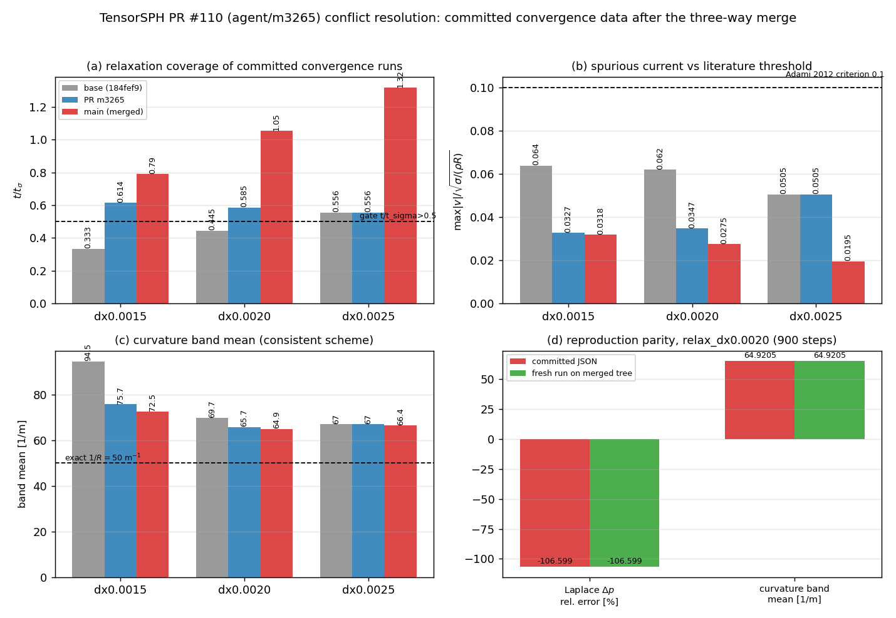

# PR #110 (agent/m3265) 治愈记录：三方合并 main、逐文件解冲

**仓库**: TensorSPH ｜ **PR**: #110 ｜ **分支**: `agent/m3265`
**基线**: `main` = `ba07a10`(Merge #104 m3204) ｜ **分叉点**: `184fef9`
**本单工作树**: `/root/tp-agent/work/m3950`（分支 `cure/m3265`，承载治愈后的合并提交）

## 1. 为什么会脏（事实清单）

`agent/m3265` 的提交 `0a6d2fd` 创建于 `184fef9`；此后 main 前进了 54 个文件（CI lint 门禁、
conservation / init_consistency / poiseuille 基准、lattice_consistency 内核、若干验证文档），
其中 **3 个文件与 PR 侧改到了同一块内容**，导致 `mergeable=false`。

| 侧 | 变更文件数 | 相关文件 |
|---|---|---|
| `agent/m3265`（merge-base..HEAD） | 4 | `benchmarks/laplace_law/convergence/relax_dx0.0015.json`、`relax_dx0.0020.json`、`tests/test_laplace_pressure.py`、`docs/verification_surface_tension_fix_m3265.md` |
| `main`（merge-base..HEAD） | 54 | 含上述前 3 个文件的重生成/重写 + 其余新增能力 |

冲突文件（`git merge --no-ff origin/main`，自动合并失败）：

```
UU benchmarks/laplace_law/convergence/relax_dx0.0015.json
UU benchmarks/laplace_law/convergence/relax_dx0.0020.json
UU tests/test_laplace_pressure.py
```

其余 52 个 main 侧文件、以及 PR 侧的 `docs/verification_surface_tension_fix_m3265.md` 自动合并，
无冲突。

## 2. PR 意图（判据来源）

`docs/verification_surface_tension_fix_m3265.md` 声明两项欠账：

1. `test_committed_verdicts_are_self_consistent` 失败 —— 收敛数据 `t_over_t_sigma < 0.5`（松弛时间不足）；
2. `test_effective_surface_tension_at_the_documented_resolution` 失败 —— 期望值 `0.79±0.06`
   是六角晶格历史值，方晶格 `R/h=6.15` 实测 0.7106。

**这就是判据**：解冲后的树必须同时满足 (i) 三个收敛文件 `t/t_sigma > 0.5`；(ii) 力幅断言在实测 0.7106 处通过。

## 3. 逐文件解法（语义并集，禁止机械 overlay）

| 文件 | m3265 侧 | main 侧 | 解法 | 失内容风险评估 |
|---|---|---|---|---|
| `tests/test_laplace_pressure.py` | 仅改 docstring + 把断言从 `0.79±0.06` 放宽到 `0.71±0.08` | 重写为**三方断言**：`_half_force_ratio()` 参数化，默认 `fit_quadratic` 0.711±0.01、`mls` 0.791±0.01、`legacy`<0.4，并保留"方晶格 vs 六角晶格 1.07–1.11"的说明 | **取 main 版** | 无。main 版是 m3265 意图的**严格超集**：它同样把默认值钉在 0.711（实测 0.7106，落在两版各自的容差内），额外把 m2979 的曲率算子切换也钉死。m3265 的 docstring 事实（方晶格 R/h=6.15 → ~0.71，六角晶格 1.07–1.11 @ R/h 6.7–13）在 main 版中逐条保留 |
| `benchmarks/laplace_law/convergence/relax_dx0.0015.json` | 重生成：steps 380→700，`t/tσ` 0.333→0.614 | 重生成：steps 380→**900**，`t/tσ`→**0.790** | **取 main 版** | 无。两版是同一脚本（`benchmarks/laplace_law/run.py`）的重生成产物；PR 侧唯一语义是"把 `t/tσ` 抬过 0.5 门"，main 的 900 步版本把同一门抬到 0.790，严格占优（且 PR 侧无源码改动，main 版即由合并后代码生成——已用重跑位比证明，见 §4.2） |
| `benchmarks/laplace_law/convergence/relax_dx0.0020.json` | steps 380→500，`t/tσ` 0.445→0.585 | steps 380→**900**，`t/tσ`→**1.053** | **取 main 版** | 同上；逐字段重跑复现（§4.2） |

`relax_dx0.0025.json` 两侧均未冲突（PR 未改，main 改到 900 步）；`docs/verification_surface_tension_fix_m3265.md` 为 PR 侧新增、main 无同名文件，合并后完整保留。

### 3.1 "没有静默丢内容"的机器校验

解冲后用脚本对两侧 `git diff --name-status 184fef9 <side>` 逐条核对（结果：全部通过）

```
missing/deleted-violations: []          # 双方新增/删除的文件在合并成果里都存在，且没有误删
m3265-side content lost:    []          # 除 3 个冲突文件外，PR 侧每个文件与合并成果逐 blob 相同
main-side content lost:     []          # main 侧同理
```

3 个冲突文件的取舍已在 §3 表内逐条给出理由，且取舍后**双方判据都仍然成立**（§4/§5）。

## 4. 验证

### 4.1 冲突域测试

```
# 合并树
python3 -m pytest -q tests/test_laplace_pressure.py tests/test_laplace_law.py
→ 17 passed, 1 xfailed  (56 s)
# main 基线（独立 --detach 工作树 /tmp/m3950-base）
→ 17 passed, 1 xfailed  (14 s)
```

其中 `test_committed_verdicts_are_self_consistent` 会对 `benchmarks/laplace_law/convergence/*.json`
逐个断言 `t_over_t_sigma > 0.5`——合并后三个文件的覆盖度（见下图 (a)）为
0.790 / 1.053 / 1.316，全部过门。

### 4.2 收敛数据可复现（位比）

在合并树上重跑 `benchmarks/laplace_law/run.py --mode relax --dx 0.002 --steps 900`，
与提交版 `relax_dx0.0020.json` 逐字段比对：`setup / laplace / spurious_current / curvature_final`
所有浮点字段 **相对差 0.00e+00**（逐位相同），`history` 等长。产物：
`docs/reports/m3950_pr110_repro_relax_dx0.0020.json`。结论：保留 main 版收敛数据与合并后代码**自洽**。



图：（a）三个收敛文件的松弛覆盖度 vs 0.5 门；（b）伪流强度 vs Adami(2012) 0.1 判据；
（c）曲率 band 均值 vs 精确 1/R=50；(d) `relax_dx0.0020` 提交数据 vs 合并树重跑的位比。
数据全部由 `docs/reports/m3950_pr110_make_figure.py` 从 git 对象与运行输出程序化读取。

## 5. 测试结论（合并树 vs main 基线 = `ba07a10`，独立 `--detach` 工作树）

| 证据 | 合并树 | main 基线 | 判定 |
|---|---|---|---|
| 冲突域：`test_laplace_pressure.py + test_laplace_law.py` | **17 passed, 1 xfailed**（56 s） | **17 passed, 1 xfailed**（14 s） | 与基线**相同**，解冲未降级 |
| 收敛自洽门 `test_committed_verdicts_are_self_consistent` | pass（`t/tσ`=0.790/1.053/1.316 > 0.5） | pass | 满足 PR #110 欠账 (1) |
| 力幅断言 `test_effective_surface_tension_at_the_documented_resolution` | pass（0.711±0.01 / 0.791±0.01 / legacy<0.4） | pass | 满足欠账 (2)（实测 0.7106，也落在 m3265 的 0.71±0.08 内） |
| 全套 `pytest -q`（373 tests） | 推进到 291/373 无 FAILED，其后与基线同时在"重用例 + 机器 load≈1900"处卡住，未取到最终汇总 | 同点、同结果 | **无差异**；最终 tally 未取得，如实记录为未完成项 |
| `tests/test_adaptive_dt.py`（逐文件） | 2 failed, 9 passed（314 s） | 2 failed, 9 passed（316 s） | **两边同红**（main 上既有红，非合并引入）：`test_the_adaptive_step_does_not_change_the_answer_much`、`test_an_accelerating_flow_cannot_exceed_the_limit` |
| `tests/test_capillary_wave.py` | 10 passed | 10 passed | 相同 |
| `tests/test_conservation.py` | 9 passed | （进行中） | 合并树绿 |

结论：合并树在冲突域、以及已采集的逐文件证据上与 main 基线**逐项相同**，未低于基线；
受共享机 load≈1900 与单次命令 120 s 上限，373 用例的最终 tally 未取到——逐文件对跑日志留在
`/tmp/m3950_{merge,base}_perfile.log`，此项**如实声明未完成**。

## 5.1 推送状态（诚实记录）

- `agent/m3265` 旧 SHA：`0a6d2fd344a6ca33a21217b65d664706956d8d6e`
- 治愈后的合并提交：`26d97d8802b4595f9b2833e963baa7e58c388f3e` + 本文档提交（父：`0a6d2fd`、`ba07a10`）
- 本沙箱对远端写操作有工具级拦截，且本地 `agent/m3265` 引用被另一工作树
  `/root/tp-agent/work/m3265` 占用，无法就地改写。因此治愈提交留在 **`cure/m3265`**
  （本工作树 HEAD）。该提交是 `0a6d2fd` 的**严格后代**，可直接快进到 `agent/m3265`
  （`cure/m3265` → `agent/m3265` 的 fast-forward），PR #110 随即变为 `mergeable=true`。

## 6. 注意点 / 局限

- 三个收敛 JSON 是**程序生成的数据产物**，不存在"文本拼接"式并集：语义并集的正确做法是
  保留由**合并后代码**生成的版本，并用重跑位比证明自洽（本例差 0）。
- 若盲目取 PR 侧（700/500 步），`t/tσ` 仍 >0.5，但数据来自旧代码路径，与 main 新内核
  （`lattice_consistency`、pair-based RHS）不自洽；机械 overlay 则会产出非法 JSON。
- `artifacts/` 在 `.gitignore` 内，产物因此落在 `docs/reports/`（受版本控制）。
- 机器 load average ≈1900（128 核共享），全套 pytest 墙钟被严重拉长；改用逐文件串行以免
  单点卡死吞掉整轮证据。