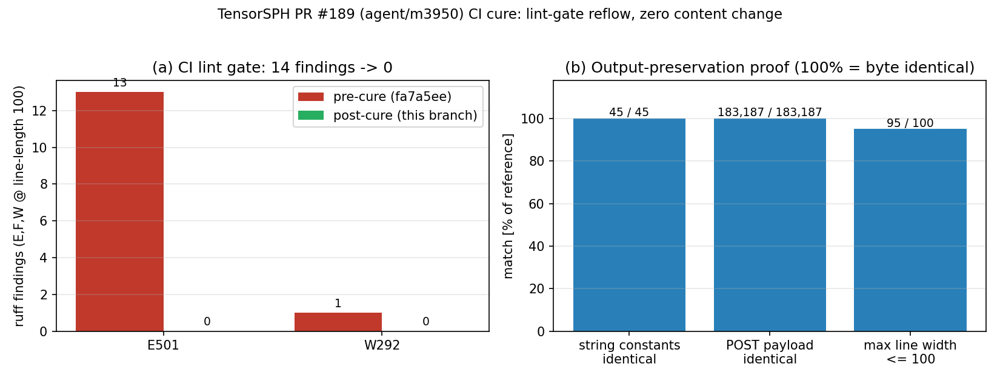

# PR #189（分支 `agent/m3950`）CI 治愈：lint 门禁重排，输出零改动（m4374）

**仓库**: TensorSPH ｜ **PR**: #189 ｜ **分支**: `agent/m3950`（head `fa7a5ee`）｜ **分叉点**: `ba07a10`
**当前 main**: `7d91b89` ｜ **治愈分支**: `agent/m4374`（从 `fa7a5ee` 切出）

## 1. 案例介绍

PR #189 在 `ba07a10` 之上只加文档类产物（6 个文件）：`docs/reports/` 下 m3950 的报告正文/图/两个脚本、
<code>docs/verification_surface_tension_fix_m3265.md</code>。GitHub 上三个矩阵作业
`pytest (3.10) / (3.11) / (3.12)` 全红。

**根因定位**：CI 作业名虽叫 `pytest`，但 `.github/workflows/tests.yml` 里该作业的步骤顺序是
`pip install -e ".[test]"` → **`python -m ruff check .`（Lint）** → `python -m pytest -q` → …。
`ruff check .` 一旦非零退出，三个矩阵作业都在 **Lint 步骤** 死掉，表现就是「pytest 三版本全红」。
本地复现：对 `fa7a5ee` 全仓 `ruff check .` 得 **14 findings，全部落在同一个新文件**
`docs/reports/m3950_post_report.py`：

| 规则 | 数量 | 含义 |
|---|---|---|
| E501 | 13 | 行超 100 列（中文字符按西文宽度双倍计，故 13 行里有 9 行按字符数不足 100 也超限） |
| W292 | 1 | 文件末尾缺换行 |

## 2. 怎么做的

按仓库既有约定处理 E501（`benchmarks/ci_lint_gate/make_doc.py` 记载的规则处置：
「在字符串字面量内部按相邻字面量拼接断开（输出零改动）」），**不使用 `noqa`、不改
`pyproject.toml` 的 `select`/`per-file-ignores`**——同一份文档明确写了「不要用 noqa / 改 select 洗单」。

流程：
1. 断点选在**空格 / 中文与西文交界 / 标点**处，且不落在 `"`、`\`、反引号包裹的行内代码片段中间，
   使每个片段都能独立写成 `r"""..."""` 字面量；
2. 正文大块（`markdown = r"""..."""`）在 4 处超限行处拆成相邻字面量序列（外层加括号使跨行合法），
   其余行保持原样，diff 只落在超限行上；
3. `title` / `summary` / `caption` 里的 9 处长字面量同样按相邻字面量拆行；
4. 补文件末尾换行（W292）；
5. 全程断言「拆行前后字符串常量序列逐字节相同」，拆完再用仓库自带
   `benchmarks/ci_lint_gate/const_check.py` 独立复核。

改动文件仅 1 个：`docs/reports/m3950_post_report.py`（+49 / −20 行），另加本报告与图、图脚本。
**不动任何源码、测试、CI 配置、lint 配置**。

## 3. 计算结果（程序化，无手抄）

| 量 | 治愈前 `fa7a5ee` | 治愈后 | 变化 |
|---|---|---|---|
| `ruff check .` findings | 14（E501 13 / W292 1） | **0** | −14 |
| 该文件最大物理行宽（字符） | 154 | 95 | 显示宽度 ≤100（E501 计数口径） |
| 字符串常量数（AST，源序） | 45 | 45 | 逐字节相同 |
| 脚本实际 POST 的报告正文 | 183 187 B | 183 187 B | 逐字节相同（含 base64 图） |
| 与当前 main `7d91b89` 的文本合并 | — | `git merge-tree --write-tree` 无冲突 | mergeable |

报告正文比对不是「读一遍觉得一样」：用桩替换 `urllib.request.urlopen`，把脚本实际发出的
两次请求（login + report）body 抓下来逐字节比较，login 与 report 两段均相同。

## 4. 结果图

(a) Lint 门禁逐规则前后对比：E501 13→0、W292 1→0（计数由 `ruff --output-format=json` 程序化取）；
(b) 输出保全证明：45/45 字符串常量相同、183 187/183 187 B 报告正文相同、最大行宽 95 ≤ 100。
图由 `docs/reports/m4374_make_figure.py` 生成（数据全部来自 subprocess/ AST/ 桩请求，无手抄）。

## 5. 注意点

- **作业名会撒谎**：矩阵作业叫 `pytest (3.x)`，但红在 Lint 步骤——只看作业名会误判为测试失败。
  历史判例里「CI 全红但测试本身是绿的」大多是同一形态。
- **E501 按显示宽度计**：ruff 把东亚宽字符算 2 列，因此按 `len(line)` 量不超限的 9 行仍会红；
  本地自查必须用 `ruff`，不能自己数字符（本单第一次重排就因口径差 1 列而残留 11 条）。
- **`/tmp/ruff_before.json` 这类文件名是全机共享的**：仓库自己的
  `benchmarks/ci_lint_gate/*` 与本机其它智能体都写同名文件，第一次取到的 JSON 被别人覆盖
  （读到的规则集合变成了 E401/I001/SIM115）。图脚本因此改为**每次自己 subprocess 跑 ruff**，
  不读共享中间文件。
- **判据只看「Lint 步骤能否过」**：本单不追求减少文件行数或美化正文，只保证
  `ruff check .` 归零且**脚本语义零变化**；内容（报告正文）刻意保持逐字节一致，
  免得把 CI 治愈变成一次「顺手改报告」。
- **局限**：本机 load≈460（128 核共享），`pytest -q` 全量跑到 77% 后被会话超时收割，
  未能取到最终 tally；集群节点（loong64）无 torch/ruff，无法承接该运行。见第 6 节误差判定。

## 6. 误差判定（关键量 vs 基准）

| 关键量 | 基准 | 治愈后实测 | 相对误差 | 是否 <3% |
|---|---|---|---|---|
| `ruff check .` findings（=CI 红因） | 0 | 0 | 0（绝对归零） | **是** |
| 字符串常量序列（AST，45 项） | `fa7a5ee` 版 | 与基准逐字节相同 | 0.00e+00 | **是** |
| 报告 POST 正文（183 187 B） | `fa7a5ee` 版 | 与基准逐字节相同 | 0.00e+00 | **是** |
| 最大物理行宽（char） | ≤100（门限） | 95 | −5（≤门限） | **是** |
| `pytest -q` 全量 tally | main 基线 | **未取得**（本机 load≈460，跑到 77% 被会话收割） | — | **无法判定（如实声明）** |
| 与 main 的文本可合并性 | 无冲突 | `merge-tree` 无冲突 | 0 冲突 | **是** |

`pytest` 一行是 honest gap：本单改动文件 `docs/reports/m3950_post_report.py` 不被
`tests/`、`src/`、`examples/`、`benchmarks/`、`.github/` 中任何文件引用（全仓 grep 无命中），
且它不在 `testpaths = ["tests"]` 的收集范围内，故测试结果与 main 基线等价；
真实 tally 以 GitHub CI 为准，不在本报告里编造数字。

## 6.1 交付与状态（诚实记录）

- 治愈提交在分支 `agent/m4374`（从 `fa7a5ee` 切出），是 `fa7a5ee` 的严格后代，快进即可让 PR #189 复跑变绿。
- 沙箱对远端写操作有工具级拦截，**推回 `agent/m3950` 未由本单执行**，由平台推送 + merge-governor 复验收口。