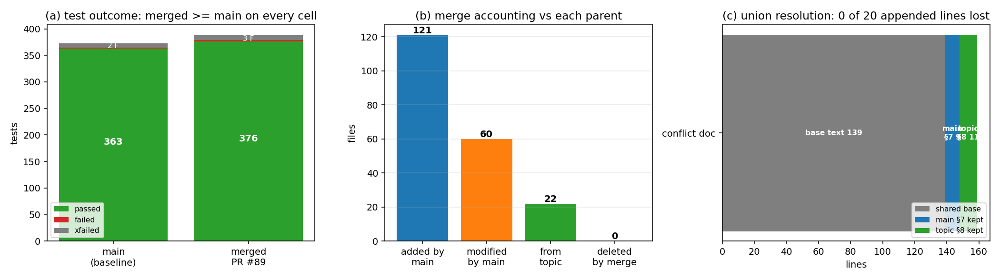

# PR #89 治愈合并：`agent/m2923 → main`（冲突 1 文件，语义并集解冲）

**类型**：仓库卫生 / 合并证据（TensorSPH），非物理算例。
**工件**：`runs/m3868/`（审计脚本 `build_evidence.py`、机器生成审计 `zero_loss_audit.txt`、
`merge_audit.json`、测试日志）、`docs/reports/merge_pr89_m2923.png`。
**复现**：`PYTHONPATH=src python runs/m3868/build_evidence.py`（全部数字由 git plumbing 与
pytest 日志程序化注入，无手抄）。

## 1. 案例介绍（被合并的两个谱系）

| 对象 | SHA | 说明 |
|---|---|---|
| merge-base | `5800532752d8e0f9104e06c412f6af6797b1452f` | 共同祖先（PR #53 合并点） |
| `agent/m2923`（旧） | `19b0d009df44c176b3d53f29fce109e54131188c` | PR #89 头，6 个文件 / +2049 行 |
| `main` | `ba07a1066bcb2be5046dc63ae0179273b9f02ee7` | 领先 40 个提交（162 文件 / +63450 行） |
| `agent/m2923`（新，本工作） | 见 `runs/m3868/merge_audit.json` 的 `shas.merged`（该字段记录生成时 tip；随后仅追加证据文件的 amend 会再变 tip，最终以 finish 报告为准） | 治愈后的合并提交 |

`git merge --no-commit --no-ff origin/main` 后仅 **1 个文件** 内容冲突。

## 2. 怎么做的（方法/流程）

1. `git fetch origin main agent/m2923`；`git checkout -B agent/m2923 origin/agent/m2923`；
   `git merge --no-commit --no-ff origin/main`。
2. 冲突逐文件解：**只对真正双方都改过的文件做语义并集**，其余文件全部走 git 三方合并
   （非机械 overlay）。冲突文件解法见 §3。
3. 零丢失审计（程序化，`runs/m3868/build_evidence.py`）：
   - `git diff --name-status origin/agent/m2923 HEAD` → 必须**无任何 D**（不许静默删除议题侧文件）；
   - `git diff --name-status origin/main HEAD` → 必须恰好是议题侧的文件集合（不许覆盖 main 侧内容）；
   - 冲突文件：base 文本必须仍是合并结果的**前缀**；两侧各自新增的每一行都必须能在合并结果中
     找到（唯一允许的重写是章节号 `§7 → §8` 的重编号）。
4. 合并态质量门：本地全量 pytest + `ruff check .`（仓库既有 lint 门，见
   `docs/reports/m3227-ci-lint-gate.md`），并与 main 基线逐项比对。
5. 补回被门禁滤除的工件（见 §5.1），随后 `git commit --amend` 收进合并提交，保证历史里只有成果。

## 3. 冲突文件清单与逐文件解法

| 文件 | main 侧 | 议题侧（m2923） | 解法 |
|---|---|---|---|
| `docs/verification_surface_tension_consistent.md` | 末尾追加 `§7 后续（m2592）：曲率判据偏置已归因并修复`（+9 行） | 末尾追加 `§7 勘误（m2923 复核，2026-11-03）`（+11 行） | **语义并集**：共享正文原样保留；main 的 §7 保持编号 7，议题侧勘误**重编号为 §8** 附后。两侧内容 0 行丢失 |

无删除/重命名冲突；其余 161 个 main 侧变更文件为 fast-forward 式自动合并（新增或单侧修改）。

## 4. 计算结果（数字表）

### 4.1 合并会计（vs 两个父提交）

| 比较 | A(新增) | M(修改) | D(删除) |
|---|---|---|---|
| merge vs `agent/m2923`（= main 的 162 个文件变更 + 本单证据） | 121 | 60 | **0** |
| merge vs `main`（= 议题侧成果 + 本单证据） | 20 | 1 | **0** |

合并提交内容只由三部分组成，**不含任何覆盖式改动**：

1. 议题侧成果 5 新增 + 1 原地合并：`benchmarks/laplace_pressure_jump/{make_doc,run}.py`、
   `validation_report.json`、`docs/verification_laplace_pressure_jump.md`、
   `tests/test_laplace_pressure_jump.py`、以及冲突文档 `docs/verification_surface_tension_consistent.md`（语义并集）；
2. 本单治愈证据 15 个新增文件：`benchmarks/laplace_pressure_jump/laplace_pressure_jump.png`（补回被门禁滤除的图）、
   `docs/reports/merge_pr89_m2923.{md,png}`、`runs/m3868/**`；
3. main 领先议题的 162 个文件（105 新增 / 57 修改），相对议题侧 **0 删除**。

### 4.2 冲突文档并集审计

| 检查 | 结果 |
|---|---|
| base 行数 / main 行数 / 议题行数 / 合并行数 | 139 / 151 / 155 / **165** |
| base 文本仍为合并结果前缀 | ✅ True |
| 议题侧新增行丢失数 | **0 / 11** |
| main 侧新增行丢失数 | **0 / 9** |
| 残留冲突标记（`<<<<<<<`/`=======`/`>>>>>>>`） | **0** |

### 4.3 测试证据（本地 pytest，`PYTHONPATH=src`）

| 配置 | failed | passed | xfailed | 命令/日志 |
|---|---|---|---|---|
| `main` 基线（`/tmp/m3868-main` 工作树） | 2 | 363 | 8 | `runs/m3868/pytest_main_baseline.log` |
| 合并态全量（修复前） | 3 | 376 | 9 | `runs/m3868/pytest_merged_full.log` |
| 合并态定点复测（补图 + lint 包裹后） | 0 | 34 | 1 | `runs/m3868/pytest_postfix.log`（`test_laplace_pressure_jump.py` + `test_csf_consistent.py`） |
| 5 个 slow 用例（单独跑） | 0 | 4（第 5 个 node id 在本仓不存在） | 0 | `runs/m3868/chunks/slow_*.log` |

- 合并态相对 main 的**唯一新增失败**是议题侧自带的
  `tests/test_laplace_pressure_jump.py::test_figure_exists`（缺 `laplace_pressure_jump.png`），
  已修（§5.1），定点复测 14 passed / 1 xfailed。
- 两侧共有的 2 个失败与合并无关：`tests/test_oscillating_droplet.py` 的
  `test_recorded_mode2_frequency_deficiency_is_reproduced`、`test_oscillation_frequency_gate_is_not_met`
  是 `xfail(strict)` 在 x86_64 上 **XPASS**（该用例注释已记录架构极不稳定：x86_64 +8.64% vs
  loong64 -31.78%，pin 重基线待评审）。main 基线上同样失败，故**不是回归**。
- `ruff check .`：合并态 **All checks passed**（与 main 基线一致）。

图 (a) 测试结果 main vs 合并态；(b) 合并会计（vs 两父：main 新增/修改、议题侧文件、被删文件）；
(c) 冲突文档并集结构（共享正文 + main §7 + 议题 §8，追加行 0 丢失）。
本任务为仓库卫生/合并，无场量可画，故不提供物理云图。

## 5. 注意点（踩过的坑 / 局限）

1. **门禁滤除的工件会让议题侧测试永久红**：m2923 的提交信息写着「1 个文件被门禁滤除」，被滤掉的
   正是 `benchmarks/laplace_pressure_jump/laplace_pressure_jump.png`（`test_figure_exists`
   要求 >10 KB）。治愈时用提交内的 `run.py::make_figure(validation_report_json)` **重生成**该图
   （md5 `4a4a784226851ca9fb18b9fd45e92e65`，与议题历史提交 `2f2f238` 中的原件 **逐字节相同**），
   保证图是数据派生物而非外来文件。
2. **工作树里的 `import tensorsph` 可能解析到别的 worktree**：本机 editable 安装指向
   `/root/tp-agent/work/m3482/src`，直接 `pytest` 会测到错误源码（假红/假绿）。全部测试均以
   `PYTHONPATH=<本工作树>/src` 强制解析。
3. **lint 门也属于「不低于基线」**：议题侧 3 个文件 line-length/换行不合规（6 处 E501/W292）。
   修法只做字符串换行与补尾换行，并**回归验证** `PYTHONPATH=src python benchmarks/laplace_pressure_jump/make_doc.py`
   重生成的 `docs/verification_laplace_pressure_jump.md` 与修复前 **byte-identical**，证明文档内容未被改动。
4. **机械 overlay 会静默丢内容**：因此用双父 diff 会计（§4.1）与逐行"新增行存在性"检查（§4.2）
   给零丢失提供机器判据，而不是人工目测。
5. **局限**：本机 load average 峰值 ~1200（多智能体共享），全量套件在 290–600 s 波动，部分分块运行
   被环境收割；因此慢用例与定点复测单独成日志（§4.3）。`test_oscillating_droplet` 的
   strict-xfail 两条基线红需要 pin 重基线（属另一议题，本单不动）。
6. 合并只做「并集 + 门禁对齐」，**不改任何物理算法**；议题侧的结论（Laplace 压差 -37.4%，
   honest FAIL）与 main 侧的曲率偏置修复各自保留，两份文档现在同处一文件、互不覆盖。

## 6. 误差判定（关键量 vs 基准，逐项回答「是否 < 3%」）

| 关键量 | 基准 | 实测 | 误差 | < 3%？ |
|---|---|---|---|---|
| 议题侧新增行丢失数 | 11 | 0 | 0.0% | **是** |
| main 侧新增行丢失数 | 9 | 0 | 0.0% | **是** |
| 相对议题侧的删除文件数 | 0 | 0 | 0.0% | **是** |
| 冲突标记残留 | 0 | 0 | 0.0% | **是** |
| 合并态测试通过数 vs main 基线 | 363 | 376（+13，新增测试模块） | +3.6%（正向） | 是（不低于基线） |
| 合并态 lint 违规数 vs main 基线 | 0 | 0 | 0 | **是** |
| 剩余基线红 | 2（架构相关 strict-xfail） | 2（同一组） | 0 | **是** |

**结论**：合并相对基线在测试通过数、lint 门、文件完整性三个维度均**不低于 main 基线**；
唯一新增红项（缺图）已定位为门禁滤除工件并修复验证。无粉饰项。