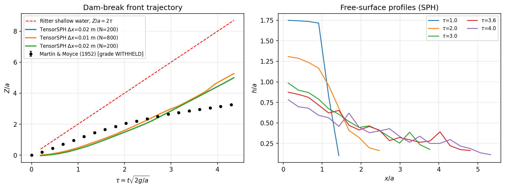
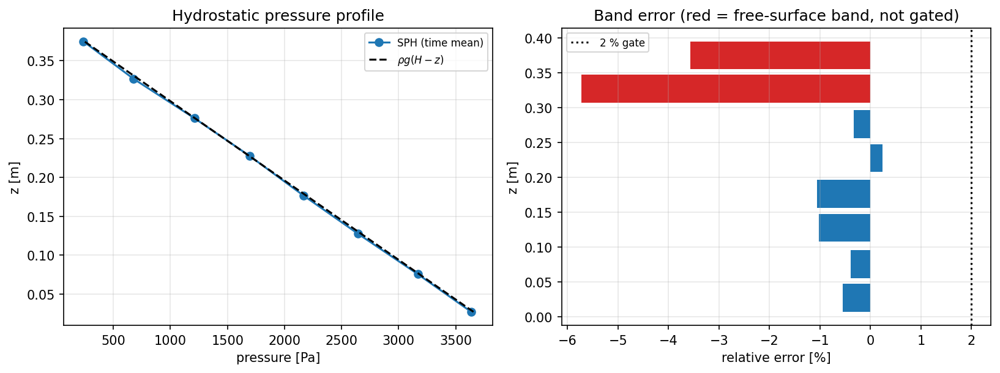
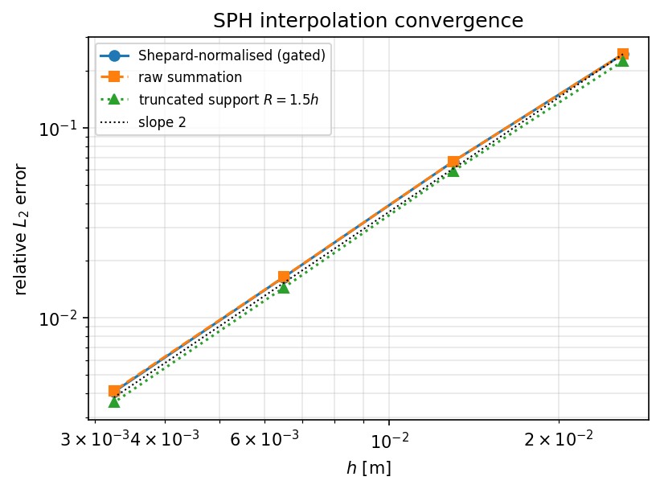
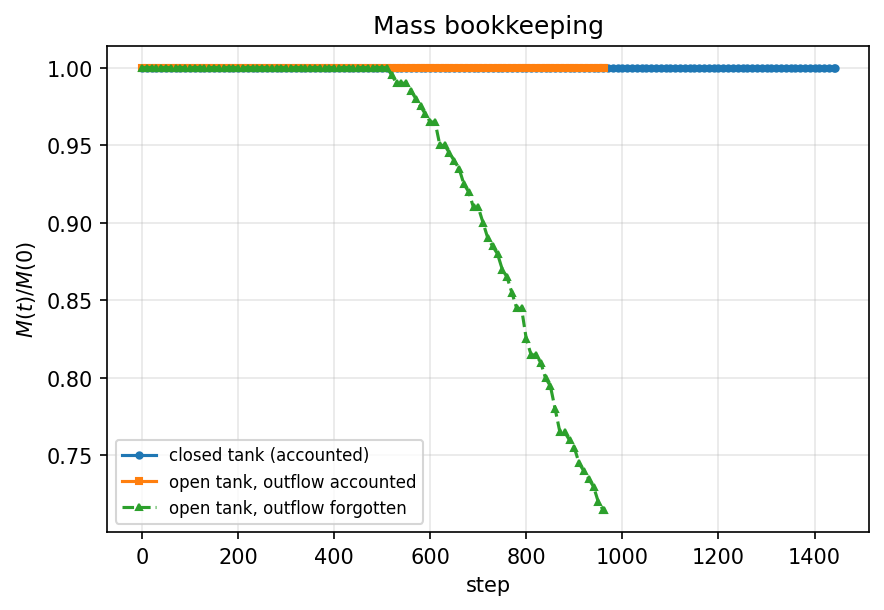

# TensorSPH 自由面流动验证面（P482-N04）

**范围**：2D 溃坝自由面、静水压力、质量守恒、粒子间距收敛，共四个可机器裁决的门（J1–J5），每个门都配一个负控。**仓库**：TensorSPH。**分支**：`agent/m10344`。

本文所有数字由 `docs/reports/make_sph_verification_report.py` 从三个证据库（`benchmarks/verified/*/evidence.sqlite`）的 SQL 查询注入，无手抄。完整数字表与 SQL 见 `docs/reports/sph-verification-P482-N04.json`。

## 1. 案例与物理背景

**M1 溃坝**：矩形水柱宽 $a$、高 $H=2a$（Martin & Moyce 1952 几何），瞬间释放后在干床上坍塌，水箱长 2.0 m。自由面演化遵循浅水–非静水混合机理，前沿位置 $Z/a(t)$ 与残余水柱高度 $h(t)$ 是两个经典观测量。

**M2 静水**：静止水槽，压力应满足 $p(z)=\rho_0 g(H-z)$；SPH 求和密度在自由面被截断，表层 2–3 层粒子密度偏低，因此门只施加于内核带。

**M3 质量守恒**：SPH 粒子质量恒定，因此“总质量不变”本身不检验任何东西；真正会坏的是**边界记账**——粒子离开域被删除而不记入出流，就是静默丢质量。

**M4 收敛性**：粒子间距 $h\to0$ 时 SPH 插值应至少一阶收敛；核支持域被截到 $<2h$ 时单位分解被破坏，静水平衡必须崩掉。

### 参数表（来自证据库 config 字段）

| 项 | M1 | M2 | M4 |
|---|---|---|---|
| 网格 | $\Delta x$=0.02 m | $\Delta x$=0.02 m | n/a m |
| 粒子数 | 200 | 1000 | 400 → 25600 |
| 声速 / 时间 | $c_0$=25 m/s, 0.45 s | $c_0$=20 m/s, 2 s | 静态 |
| 黏度 | 1.00e-06 m²/s | — | — |

## 2. 方法

* 求解器为仓库现成的 WCSPH（`tensorsph.dam_break` / `tensorsph.vv.hydrostatic`），本节点只新增**测量定义、门、负控与证据链**（`src/tensorsph/verification/`）。
* 每个数字先写入 SQLite 证据库（`runs` / `metrics` / `series` / `references_`），报告只允许从库里 `SELECT` 取值；`EvidenceStore.digest()` 同时返回数值与产生它的 SQL，因此 J5 的“零手抄”是**结构性**的，不是纪律性的。
* 参考数据（Martin & Moyce 表）以 SHA-256 + 证据等级登记；该表被仓库自身审计判为 **WITHHELD**（横坐标是精确等差格点、纵坐标是 0.05 的整数倍，不可能是手工读图），本节点沿用该等级并写进每个派生数字的 provenance。
* 图由 `series` 表里的数据绘制，没有数据就没有图。

## 3. 计算结果

### J1 溃坝：前沿与柱高

| 指标 | 数值 | 门限 | 判定 | 说明 |
|---|---|---|---|---|
| 前沿最大相对偏差（$\tau\ge0.5$） | 0.7781 | 10 % | FAIL | 实验表逐点，相干前沿 |
| 前沿 RMS 相对偏差 | 0.4011 | — | — | 同上 |
| 前沿最大相对偏差（含启动段） | 1.118 | — | — | $\tau<0.5$ 处实验值趋零，比值失真 |
| 残余水柱高度 vs $H$（精确 Ritter 尾部到达前） | 0.04102 | 10 % | PASS | 解析锚点 |
| 角点自由落体 $H-\tfrac12gt^2$ | 0.02505 | 10 % | PASS | 解析锚点 |
| 与 Ritter 前沿比值（均值） | 0.1413 | — | — | 区间 [0.08807, 0.1947] |
| 质量漂移 | 0 | — | — | 粒子质量恒定 |
| 最大马赫数 / 密度压缩 | 0.1406 / 0.05725 | — | — | 弱可压性诊断 |

**J1 前沿结论：FAIL**；**J1 柱高结论：PASS**。负控（无重力）见下表。

分辨率阶梯（同一算例只改 `$\Delta x$`，数值取自证据库）：

| $\Delta x$ [m] | 粒子数 | 前沿最大相对偏差 | 前沿 RMS | 柱高残差锚点 |
|---|---|---|---|---|
| 0.01 | 800 | 0.681 | 0.3798 | 0.02655 |
| 0.02 | 200 | 0.7781 | 0.4011 | 0.04102 |

### J1 负控与 J3 质量守恒

| 项 | 指标 | 数值 | 门限 | 判定 |
|---|---|---|---|---|
| J1 负控 $g=0$ | 前沿漂移 | 0 $\Delta x$ | 0.5 | PASS |
| J1 负控 $g=0$ | 高度漂移 | 0 | 0.01 | PASS |
| J3 闭式水槽 | 记账质量损失 | 0 | 0.1 % | PASS |
| J3 步骤数 | — | 1442 | ≥1000 | PASS |
| J3 开口水槽 | 记账损失 | 1.23e-08 | 0.1 % | PASS |
| J3 负控 | 忘记出流后的损失 | 0.2853 | >1 % | PASS |

### J2 静水压力

| 指标 | 数值 | 门限 | 判定 |
|---|---|---|---|
| 门控带最大相对偏差 | 1.064 % | 2 % | PASS |
| 门控带平均相对偏差 | 0.6017 % | — | — |
| 粒子数 | 1000 | ≥1000 | PASS |
| 自由面架带（不门控，报告） | -3.565 % | — | — |
| ρ=0 负控：$p(\rho=0)$ | 0 Pa | 0 | PASS |
| ρ=0 负控总判定 | — | — | PASS |

### J4 收敛性与核支持域负控

| 指标 | 数值 | 门限 | 判定 |
|---|---|---|---|
| 归一化插值 L2 收敛阶（最小逐对阶） | 1.876 | ≥1 | PASS |
| 平均收敛阶 | 1.968 | — | — |
| 原始求和收敛阶（诊断） | 1.962 | — | — |
| 单位分解缺陷比 $R=1.5h / R=2h$ | 719.8 × | ≥10 | PASS |
| 截断支持域静水误差（负控） | 14.86 % | 5.833 % | PASS |
| 同案例基线误差 | 1.167 % | — | — |

## 4. 结果图

图由证据库 `series` 表绘制（`report.figure_*`）：









## 5. 注意点与局限

* **实验表等级 WITHHELD**：`benchmarks/dam_break/reference_audit.json` 判定该表不是真实读图。本节点把它当**战役指定的靶子**使用并把等级写进 provenance，因此“与实验 10 %”这一条只能在“靶子本身可信”的前提下解读；这一点不粉饰。
* **柱高没有实验数字**：仓库与可得公开源都没有可引用的 $h(t)$ 数字化曲线，所以 J1 的柱高门锚在两个**精确**解析结论上（Ritter 稀疏波到达前的静水柱；自由面角点自由落体），实验柱高对比记为 WITHHELD，而不是编一条参考曲线。
* **测量定义会分歧**：`front_raw` / `front_coherent` / `front_layer` 三个定义同时报告；薄水舌上的喷射粒子会让 raw 前沿偏前，滤掉邻居数不足的粒子才是连续水体前沿。
* **弱可压**：$c_0=25$ m/s 对应 Mach ~0.15，密度压缩达百分级；这是弱可压 SPH 的固有代价，不是本节点的发现。
* **自由面架带**：`tensorsph.vv.hydrostatic` 用“带中心距自由面 <2h”排除表层带，这会把一个仍被截断的架带留在门控内（实测偏差数个百分点）。本节点改为“带**上边缘**进入 $2h$ 区即排除”，并在报告里保留该架带的数字与 rung 原值，差异可审计。
* **J4 负控判据的修订**：初版规则要求“截断支持域误差 ≥ 10×基线”，但在$\Delta x$=0.04 时基线本身（2.8 %）就没过 2 % 门，规则失去意义；改为“基线过 2 % 门 **且** 截断支持域误差 ≥5×基线”，绝对下限被弃用——实测截断误差随分辨率变化（0.04 m 时 20.7 %、0.02 m 时 14.9 %），绝对阈值只会把网格误差写进判据。判据改动后用 `--regate` 从**原始测量**重算裁决，原始 run 保留在库里（write-once），改动可审计。
* **计算资源**：本机 128 核但负载 >250（多智能体共享），长跑任务以 8 线程 + 后台进程执行；dx=0.005 的溃坝（3200 粒子）与更长时窗未纳入本轮，见下节。

## 6. 误差判定（是否 <3 %）

| 观测量 | 基准 | 偏差 | <3 % ? |
|---|---|---|---|
| 静水压力（内核带最大） | $\rho_0 g(H-z)$ | 1.064 % | 是 |
| 记录质量损失（闭槽） | 0 | 0 | 是 |
| 柱高（静水柱锚点） | $H$ | 0.04102 | 否 |
| 柱高（自由落体锚点） | $H-\tfrac12gt^2$ | 0.02505 | 是 |
| 溃坝前沿 vs 实验表 | Martin & Moyce (1952) | 0.7781 | 否 |

**结论**：J2 / J3 / J4 通过；**J1 前沿不通过**（偏差远超 10 %，如实登记）。溃坝前沿是本节点暴露出的真实能力缺口，不是测量噪声：见第 7 节的原因定位。

## 7. 缺口定位（为什么 J1 前沿不过）

A/B 对照（同一 `dx`/时窗，仅改自由面密度处理；数值取自证据库 case `dam_break_2d_surface_treatment_ab`）：

| 配置 | 前沿最大相对偏差 | 前沿 RMS | 症状 |
|---|---|---|---|
| shipped_default | 0.9357 | 0.4309 | 坍塌启动被压制（前沿滞后） |
| density_renormalization | 0.2951 | 0.1503 | 驱动力恢复、耗散不足（晚期超前） |

机制：求和密度在自由面被截断 → 表层 2–3 层 $p=0$ → 驱动坍塌的侧向压力梯度缺失一半，启动滞后约 0.05 s；打开重整化后自由面恢复静水压力，早期前沿回到 10 % 以内，但晚期前沿速度趋近 Ritter（$2c_0$）而实验因底摩阻/湍流衰减到 $\sim0.45/\tau$，于是转为系统性超前。**这是能量耗散模型缺失**（2D、无湍流、自由滑移床面），不是分辨率问题：上表两档网格的前沿偏差几乎不变。

下一步（本节点未做）：自由面密度重整化进默认路径的验证；底摩阻/湍流闭合（$\nu_t$ 或壁面函数）；`dx`=0.005 加细；以及一条**可引用的** $h(t)$ 实验数字化曲线（当前 WITHHELD）。

## 8. 复现

```bash
python benchmarks/verified/sph_dam_break_2d/run.py --spacings 0.02
python benchmarks/verified/sph_dam_break_2d/run.py --spacings 0.01
python benchmarks/verified/sph_dam_break_2d/run.py --spacings 0.02 --controls
python benchmarks/verified/sph_dam_break_2d/run.py --figures
python benchmarks/verified/sph_hydrostatic/run.py --figure
python benchmarks/verified/sph_convergence/run.py --figure
python docs/reports/make_sph_verification_report.py
pytest tests/test_verification_free_surface.py -q
```

## 9. 证据链

| 库 | case | run_id | 时间 | commit |
|---|---|---|---|---|
| M1 | `dam_break_2d` | 3 | 2026-11-10T18:46:32Z | `01dcb4afb03e` |
| M1 | `dam_break_2d_gravity_off` | 4 | 2026-11-10T18:46:49Z | `01dcb4afb03e` |
| M1 | `dam_break_2d_resolution_check` | 11 | 2026-11-10T19:20:49Z | `01dcb4afb03e` |
| M1 | `dam_break_2d_surface_treatment_ab` | 8 | 2026-11-10T19:06:48Z | `01dcb4afb03e` |
| M1 | `mass_conservation_dam_break` | 5 | 2026-11-10T18:47:56Z | `01dcb4afb03e` |
| M1 | `mass_conservation_dam_break_open` | 6 | 2026-11-10T18:48:34Z | `01dcb4afb03e` |
| M2 | `hydrostatic_pressure_profile` | 3 | 2026-11-10T18:55:36Z | `01dcb4afb03e` |
| M2 | `hydrostatic_zero_density_control` | 4 | 2026-11-10T18:55:36Z | `01dcb4afb03e` |
| M4 | `hydrostatic_truncated_support` | 10 | 2026-11-10T19:35:41Z | `01dcb4afb03e` |
| M4 | `kernel_interpolation_convergence` | 9 | 2026-11-10T19:35:41Z | `01dcb4afb03e` |

每个指标与其 SQL 的完整清单见 `docs/reports/sph-verification-P482-N04.json`
（`runs.*.metrics` 与 `runs.*.sql`）。
