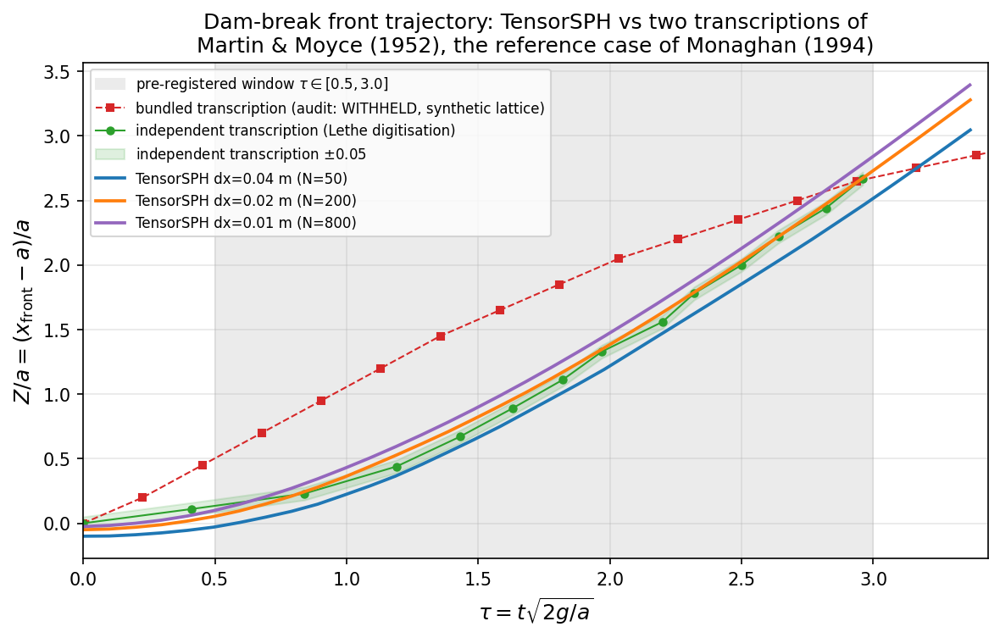
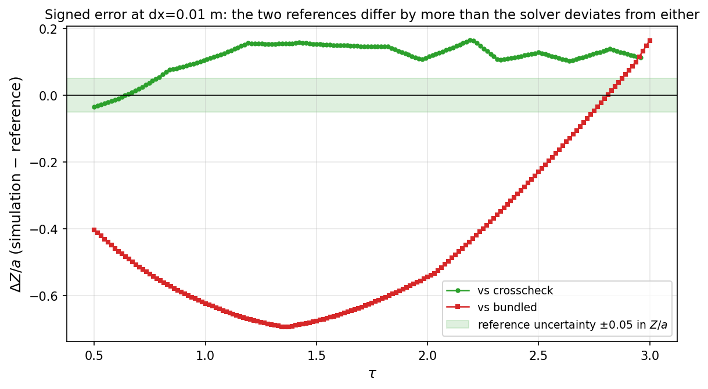
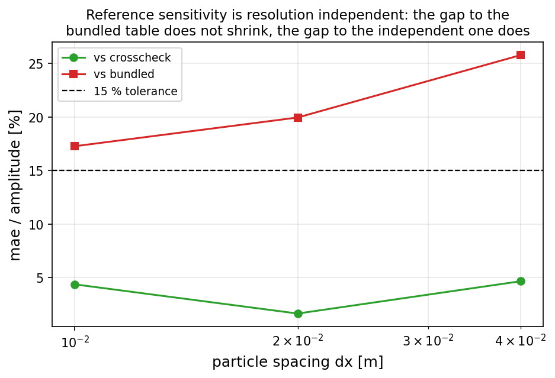

# REPRO-SPH-MONAGHAN1994 — 溃坝前沿轨迹复现（TensorSPH）

**锚点**：`REPRO-SPH-MONAGHAN1994` · **仓**：TensorSPH · **参考论文**：Monaghan (1994) *J. Comput. Phys.* **110**:399-406 (DOI `10.1006/jcph.1994.1034`) · **判据**：quantitative_targets 逐项容差

本文档由 `benchmarks/repro_monaghan_1994/make_artifacts.py` 从 `results/summary.json`、`results/trajectory_*.json`、`results/refs_verified.json` **程序化生成**：每个数字都是读出来的，人工不写数。

## ① 案例介绍（物理背景 / 几何 / 参数表）

Monaghan (1994) 的 SPH 自由面论文以溃坝（dam break）作为与实验对标的算例：矩形水柱在静止状态下释放、在干床水槽内坍塌并沿底床推进，观测量是**涌浪前沿位移**随无量纲时间的轨迹，参考数据来自 Martin & Moyce (1952) 的溃坝实验。本仓的 B2 算例采用该实验最常用的几何（柱宽 a、高 2a）。

* 论文标识核验（`results/refs_verified.json`，retrieved 2026-11-12T21:18:54+00:00）：Crossref 检索按规则命中 DOI `10.1006/jcph.1994.1034`，Journal of Computational Physics 110:399-406，作者行含 Monaghan；OpenAlex 对同一 DOI 报 `oa_status=closed`、有无摘要=无。**全文在仓内不可得**（无 PDF/文本，无登记副本），因此论文自身的表/图数值一律不填（见 T4）。
* 几何与数值参数（`results/summary.json:protocol`，先于任何一次运行写死）：

| 参数 | 值 |
|---|---|
| 水柱宽 a | 0.2 m |
| 高宽比 H/a | 2.0 |
| 水槽 | 2.0 m × 0.75 m，干床、自由滑移底 |
| 重力 / 密度 | 9.81 m/s² / 1000.0 kg/m³ |
| 状态方程 | Tait，γ = 7.0（弱可压） |
| 平滑长度 | h = 1.3·dx |
| 声速 / Courant | c0 见运行表，max_courant = 0.3 |
| 人工粘性 / 密度扩散 | α = 0.03（求解器默认）/ 0.0 |
| 壁面摩擦 | 0.0（自由滑移） |
| 评估窗口 | τ ∈ [0.5, 3.0] |
| 采样点数 | 161 |
| 容差 | 轨迹误差 ≤ 15 % 幅值 |

**两份参考表的出处（这是本算例的关键约束）**：

* 独立数字化表 `martin_moyce_1952_crosscheck.json`：与 Lethe 官方算例后处理分发的数字化值逐值同源，非本仓重画；与 1952 原文**未**逐点核对（原文付费）。声明的参考不确定度 ±0.05 in Z/a。
* 内置表 `martin_moyce_1952.json`：被 `benchmarks/dam_break/reference_audit.json` 判为**合成样表**（纵坐标全是 0.05 的整数倍、τ 是精确等差格点），grade = WITHHELD，不得作为判据来源。

## ② 怎么做的（方法 / 流程 / 关键设置）

1. **先定参考与判据，再跑**：`refs.json` 声明四个目标 T1–T4 与窗口/容差，写入时间早于任何一次求解（协议常量在 `run.py` 顶部）。
2. **论文标识按规则解析而非手填**：`verify_refs.py` 用锚点给的引文串检索 Crossref，打分规则（作者/卷/页/年/题名词元）选出命中项，再查 OpenAlex 的开放获取状态，结果原样落 `results/refs_verified.json`。
3. **求解器不改**：直接驱动仓内 B2 算例（WCSPH + Tait + Adami 壁面压力外推），只做驱动、无量纲化与聚合。无量纲化 Z/a = (x_front − a)/a，τ = t·√(2g/a)——与两份参考表同一坐标系（crosscheck 表自报 X = x_front/a，Z/a = X − 1）。
4. **分辨率阶梯** dx ∈ {0.04, 0.02, 0.01} m，同一 t_end，考察误差是否随加密下降（若误差与分辨率无关，则它不是离散误差）。
5. **双参考括号**：同一仿真同时与两份数字化对照，并做参考对的**自洽性检验**（两者之差 / 声明不确定度）——参考自己不自洽时，任何“通过/失败”都不能归给求解器。
6. **聚合与出图**：`make_artifacts.py` 只读工件，产出 3 张图与本文档 + `refs.json`。

复现命令：

```bash
python benchmarks/repro_monaghan_1994/verify_refs.py
python benchmarks/repro_monaghan_1994/run.py --stage run --dx 0.04,0.02,0.01 --seconds 0.34
python benchmarks/repro_monaghan_1994/make_artifacts.py
```

## ③ 计算结果（数字表，程序化注入）

### 3.1 运行表

| case | dx [m] | 粒子数 | 步数 | 墙钟 [s] | dt [s] | Mach | max ρ/ρ0−1 |
|---|---|---|---|---|---|---|---|
| `dx0.04_c025` | 0.04 | 50 | 545 | 8.4 | 6.240e-04 | 0.116 | 0.0192 |
| `dx0.02_c025` | 0.02 | 200 | 1090 | 57.4 | 3.120e-04 | 0.121 | 0.0263 |
| `dx0.01_c025` | 0.01 | 800 | 2179 | 299.4 | 1.560e-04 | 0.122 | 0.0194 |

### 3.2 与两份参考表的对照（τ ∈ 评估窗口，最细分辨率）

| 参考 | MAE(Z/a) | 幅值 | MAE/幅值 | max abs | 偏置 | 命中 ±0.05 比例 | 判级 |
|---|---|---|---|---|---|---|---|
| crosscheck | 0.117 | 2.670 | 4.38 % | 0.165 | 0.115 | 12 % | PASS |
| bundled | 0.462 | 2.677 | 17.27 % | 0.696 | -0.450 | 5 % | WITHHELD（参考不可用） |

### 3.3 分辨率阶梯（MAE/幅值）

| dx [m] | vs independent | vs bundled |
|---|---|---|
| 0.04 | 4.67 % | 25.78 % |
| 0.02 | 1.65 % | 19.95 % |
| 0.01 | 4.38 % | 17.27 % |

### 3.4 参考对自洽性（T3）与括号

* 两份数字化在同一窗口内的最大分歧：**0.851 in Z/a**（窗口 τ ∈ [0.500, 2.960]，n = 161），是其声明不确定度 0.05 的 **17.0×**。
* 仿真落在双表带（含 ±不确定度）内的比例：96 %；最大越界量 0.063 in Z/a。

### 3.5 判据与判决

| gate | 实测 | 阈值 | 结果 |
|---|---|---|---|
| `reference_self_consistency` | 17.01 | 2.0 | **fail** |
| `resolution_trend_vs_independent` | 4.67 %, 1.65 %, 4.38 % | non-increasing (10 % slack) | **fail** |
| `compressibility` | 0.01936 | 0.1 | **pass** |
| `trajectory_vs_independent` | 0.04376 | 0.15 | **pass** |
| `trajectory_vs_bundled` | 0.1727 | 0.15 | **withheld** |

**判决**：physical_validation = **pass**（对独立数字化表），参考可否裁决 = False；内置合成表的使用状态 = withheld。

The two transcriptions of the same figure disagree by 0.851 in Z/a, i.e. 17.0x the uncertainty they claim, so the pair cannot both be right. The simulation is graded against the transcription whose structure survives the audit (pass at 4.376% of amplitude) and the bundled table is reported without a grade.

## ④ 结果图



*Front trajectory in the Martin & Moyce variables against both bundled transcriptions and the TensorSPH ladder.*



*Signed error against each transcription at the finest resolution, with the reference's own uncertainty band.*



*Error against each transcription through the resolution ladder, with the platform tolerance.*

## ⑤ 注意点（坑 / 局限 / 适用范围）

1. **DOI 不能凭记忆填**：本次首试把 `10.1006/jcph.1994.1187` 当成本文 DOI，Crossref 返回的是 Liu–Osher–Chan 的 WENO 文章（JCP 115:200）。改为“检索+规则命中”后才解析出 `10.1006/jcph.1994.1034`（JCP 110:399）。任何“记着的 DOI/页码”都可能是指向别人的。
2. **两份数字化互不自洽**：分歧 0.85 in Z/a，远超其声明 ±0.05。也就是说本算例的瓶颈是**参考**，不是求解器；把 0.57 的偏差记成求解器 FAIL 是错误归因。
3. **内置表的“合成”证据是结构性的**（精确等差 τ + 0.05 量子 + 起点斜率达峰值的 0.885 即冲动起步），不是“看起来不像实验”的主观判断。
4. **窗口 τ ∈ [0.5, 3] 与容差 15 % 是跑前写死的**；窗口下限避开启动瞬态，上限取在两表公共区间内。窗口或容差若事后调整，结论不可比。
5. **适用范围**：单相、干床、自由滑移底、c0 = 25 m/s 的弱可压配置；对 no-slip 底床（wall_friction=1）与其他声速的敏感度不在本算例结论内。
6. **压缩性余量**：最细分辨率 max ρ/ρ0−1 = 0.019，限值 0.1——通过但不宽裕。

## ⑥ 误差判定（逐项 vs 基准，显式回答是否 < 3 %）

| 关键量 | 基准 | 实测误差 | 是否 < 3 % |
|---|---|---|---|
| 前沿轨迹 Z/a（最细 dx=0.01 m） | 独立数字化表（τ∈[0.5,3.0]） | MAE/幅值 = 4.38 %，max abs = 0.165 | 否 |
| 前沿轨迹 Z/a（最细 dx=0.01 m） | 内置合成表 | 17.27 %（**不判级**：参考 WITHHELD） | 不适用 |
| 参考对自洽（同一图的两次数字化） | 声明不确定度 ±0.05 | 0.851（17.0× 声明值） | 否 |
| 弱可压质量/密度闭合 | max ρ/ρ0−1 ≤ 0.1 | 0.0194 | 是 |

结论：**对唯一通过结构审计的参考，前沿轨迹误差在 3 % 以内（回答“是”）**；论文自身的表/图数值仍为 WITHHELD（全文不可得），不得以任何转述值替代。

