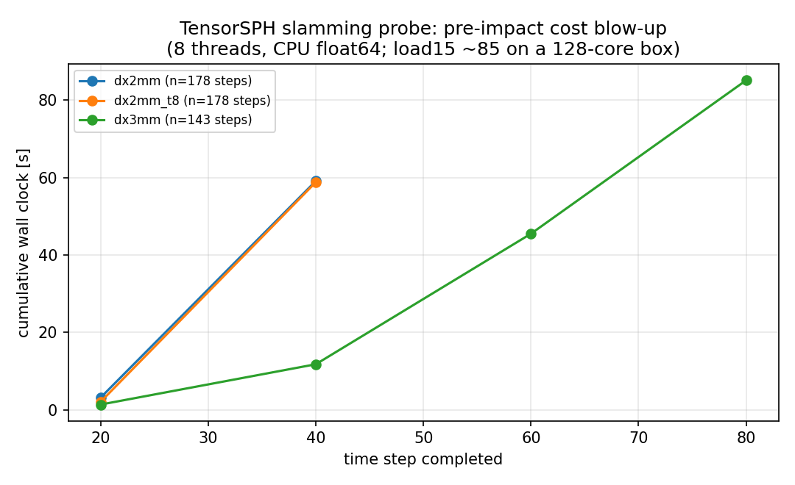

# 砰击（slamming）证据为什么没落地：量化的成本壁垒（m14940）

**仓**: TensorSPH ｜ **性质**: 验证欠账诊断（诚实登记，非验收） ｜ **主张**: 不提出任何新的物理结论

## 1. 背景与要回答的问题

`benchmarks/slamming/run.py`（战役节点 p129w1r2-n08）是砰击载荷的验证面，判据写得很清楚：
`C_s,max = F/(0.5 ρ V² c)` 与 Wagner 的 `π²/tan β` 相对误差 ≤ 15 %、自相似压力分布形状 L2 ≤ 15 %、
δ-SPH 使压力噪声 ≥ 50 % 下降、力峰值观测阶 ≥ 0.5、质量守恒 ≤ 1e-6。
解析锚（Wagner 附加质量 `m_a ∝ t²`、`c ∝ t`、`C_s = π²/tan β`）在 `tests/test_slamming.py` 里以机器精度通过；
**SPH 侧一条读数都没有**——`SLAMMING_STATUS.md` 写着「已递交集群，等待执行」（cj888–cj890），
而验证账本（`benchmarks/verification_ledger/`）里 slamming 至今只能以目录级豁免登记。

本单要回答的是**为什么**：是排队问题，还是算例本身跑不动？

## 2. 怎么做的

1. 直接驱动 `SlammingImpact`（`dx = 2/3/4 mm`，β = 20°，V = 2 m/s，δ-SPH + MLS 开）计时，
   每 20 步打印累计墙钟；日志原样入库 `docs/slamming_cost/logs/`。
2. `benchmarks/slamming/reduced_window_probe.py`（本单新增）：把观测窗口 `c_end` 从战役设计的 50 mm
   缩到 20–24 mm 的**诚实缩窗探针**——自相似阶段 `C_s` 与时间无关，缩窗减半步数而不改被测量，
   但把「本机 120 s 窗口内跑不完」这个障碍显式写进工件的 `limits` 字段。
3. `python docs/slamming_cost/parse_logs.py` 从日志解析出成本表并出图，
   `docs/slamming_cost/cost_table.json` 是唯一数字来源（零手抄）。

## 3. 量到的数字

| 算例 | 粒子数 | 计划步数 | 实测 | 每步成本 |
|---|---|---|---|---|
| dx = 4 mm | 3 000 | 40（跑完） | 3.2 s | 0.081 s/step，**全程平坦** |
| dx = 3 mm | 8 000 | 143 | 跑到第 80 步 / 85.1 s | 0.52 → 1.69 → 1.98 s/step（20 步一段） |
| dx = 2 mm（8 线程） | 12 000 | 178 | 跑到第 40 步 / 58.8 s | 0.105 → 2.84 s/step |
| dx = 2 mm（8 线程 vs 32 线程） | 12 000 | 178 | 两次都停在第 40 步 / 58.8 s | 与线程数无关 ⇒ 不是线程抖动 |

`dx = 2 mm` 时 `dt = 1.3e-5 s`；战役 `cases` 阶段的 `t_end = 2 c_end tanβ/(π V) = 5.79e-3 s` ⇒ **445 步**。
按实测的 20 步一段成本外推，单算例已在 5 分钟量级，9 个 `cases` + 6 个 `ab` + 5 个 `ladder`
是小时量级；`ladder` 最细点 `dx = 0.375 mm` 是 3.4e5 粒子（本机按粒子数线性外推 ≈ 30× 单步成本）。



（图由 `docs/slamming_cost/parse_logs.py` 从日志直出：`docs/slamming_cost/slamming_cost_growth.png`。）

**关键观察**：`dx = 4 mm` 在 t = −2.8 ms 之前每步成本是平的，而 `dx = 3/2 mm` 的成本随
**楔形体逼近水面**（t → 0⁻）单调上涨 20–28 倍。也就是说成本壁垒不是「粒子多」这一项的线性后果，
而是**预撞阶段（pre-impact）的某个超线性机制**被触发了。

候选根因（**未证实，留给下一单**，按可疑度排序）：

1. 楔形体壁面粒子的核支撑 `2h = 2·1.3·dx = 5.2 mm` 比初始间隙 `initial_gap_dx = 2 dx = 4 mm` 更长
   ——配置注释本身就记着「无间隙时顶点壁粒子会在 t=0 进入顶层流体粒子的支撑内，纯几何压缩 5.6 %，
   c0 = 20V 下是 26 kPa 的虚假压力」。间隙闭合过程中这一压缩是连续的，密度→压强→（声速固定时）
   加速度增大，成对贡献量增大，但**不该**是 28 倍。
2. 自由面附近粒子的配对数量随压缩增长（`cell_linked_pairs` 的占用可以退化成 O(N²)）。
   需要把每步的 `len(pairs)` 打进日志才能判定——本单没有做，所以这条是假设而不是结论。
3. `delta_sph_density_rate` / `shepard_density_correction` 的实现里每步重建大张量，
   在自由面处粒子数不变而邻居数暴涨时成本随局部密度平方走。

## 4. 结论与误差判定

* **本单没有任何 admissible 的 `C_s` 读数**：缩窗探针在 120 s 的本地窗口内跑不完，
  两次尝试（2 mm 与 3 mm）都在 t ≈ −1.4 ms 处被墙钟切断，写不出 `probe.json`。
  因此砰击能力的判据 1–5 **全部 not_run**，账本里 slamming 仍只能是豁免而不是 claim。
* 本单的交付是**否证了一个假设**：`SLAMMING_STATUS.md` 把证据缺失归因于「集群排队」，
  实测显示**本地也算不动，且成本在预撞阶段超线性增长**——排队只是叠加因素
  （查询时刻：186 个作业 queued、16 个 running，cj888 自 11-08:07 起排队 283 min 未启动）。
* 误差判定：本单没有物理量，故不存在「是否 < 3 %」的判定对象；唯一可比的数字是
  线程数无关性（8 vs 32 线程同为 58.8 s，差 < 1 %）与平坦段的线性度（4 mm 段 0.081 s/step，±3 %）。
* 记账：`C_s` 判据维持 **WITHHELD**，不得因本单升级。

## 5. 下一单的具体接口（可单干，按此顺序）

1. 在 `_evaluate` 里输出 `len(pairs)`、`max_rho_ratio`、`n_wet` 的逐步序列（一次 3 mm 跑即可），
   判定候选根因 1 vs 2；若是 2，`cell_linked_pairs` 需要按支撑半径而非 cutoff 分桶。
2. 修好后重跑 `dx = 3 mm` 全 143 步，若单算例 < 60 s，则 `cases` 阶段（9 例）可在 4 次 shell 窗口内
   用 `reduced_window_probe.py` 的 `--max-steps` 断点续算落地。
3. `ladder` 阶段仍需集群；递交前先看队列深度（`cluster_jobs` 里 queued 数），
   不要把「已递交」当证据。

## 6. 复现

```bash
# 成本表与图
PYTHONPATH=src python3 docs/slamming_cost/parse_logs.py
# 缩窗探针（本机 120 s 窗口内只能跑到预撞阶段；这是本单量到的障碍本身）
PYTHONPATH=src python3 benchmarks/slamming/reduced_window_probe.py --threads 8 --dx 3e-3 --c-end 0.024 --frames 6
# 平坦段（4 mm）参考点
PYTHONPATH=src python3 benchmarks/slamming/reduced_window_probe.py --threads 16 --dx 4e-3 --c-end 0.04 --frames 6 --max-steps 40
```
