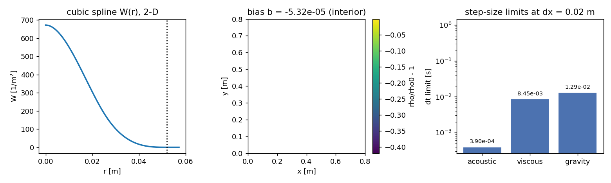

# Tutorial: six measured steps from a kernel to a running case

This is the shortest honest path through TensorSPH. In six steps you build a
particle lattice, get a density out of it, turn the density into pressure, find
the neighbours, choose a time step, and run the shipped case end to end. Every
step **asserts** what it claims, so the tutorial cannot quietly disagree with the
code: if a claim stops being true the script raises and the test suite goes red.

- **Runnable script:** [`examples/tutorial/first_steps.py`](../../examples/tutorial/first_steps.py)
- **Runtime:** the final step integrates 0.016 s of simulated time in
  40 steps; the whole script takes a few seconds of wall clock on one CPU
  core. No GPU, no data download, no dependencies beyond `tensorsph` and `torch`.
- **Everything is float64 on the CPU.** The tutorial is about discretisation
  error, so it does not also want to carry a float32 scatter around.

## Setup

```bash
python -m pip install -e ".[test]"
python examples/tutorial/first_steps.py                # runs all six steps
python examples/tutorial/first_steps.py --json out.json --figure kernel.png
```

The numbers quoted below are the console output of that command. The captured
run is committed as
[`captured_run/first_steps.stdout.txt`](captured_run/first_steps.stdout.txt)
and [`captured_run/first_steps.json`](captured_run/first_steps.json);
`tests/test_tutorial_first_steps.py` re-runs the script and fails if a number in
this document drifts from a fresh run. Do not edit the numbers here by hand --
re-run the script and paste its output.

## Step 1 -- is the kernel a normalised 2-D kernel?

The cubic-spline kernel is the only thing standing between "particles" and "a
fluid": it says how much a neighbour at distance `r` contributes. In two
dimensions its normalisation is `10/(7 pi h^2)`, and the only way to know that
without trusting a comment is to integrate it:

```python
h = 1.3 * 0.02
r = torch.linspace(0.0, 2.0 * h, 8001, dtype=torch.float64)
W = sph.cubic_spline_kernel(r, h)
integral = float(2.0 * math.pi * torch.trapz(W * r, r))   # 2-D polar quadrature
assert abs(integral - 1.0) < 1.0e-4
```

| quantity | measured value | what it settles |
|---|---|---|
| `kernel_integral` | `0.999999985119` | the normalisation is the 2-D one, and it is right |
| `kernel_peak` | `672.675160997` | `W(0)`; equals `10/(7 pi h^2)` for the `h` in this run |
| `kernel_at_2h` | `0` | the kernel has compact support: nothing beyond `r = 2h` |
| `h` | `0.026` | the smoothing length the rest of the tutorial uses |

That `2h` support is why every other cutoff in the code is `2.0 * h`: a pair
beyond it contributes exactly zero, which step 4 exploits.

## Step 2 -- density summation, and the mass that makes it come out right

Density is a sum, not a solve: `rho_i = sum_j m_j W_ij`. Put a square lattice of
spacing `dx` in a box, give every particle the "obvious" mass `m = rho0 dx^2`,
and the interior is *not* at `rho0`. It is at `rho0 dx^2 S`, where `S` is the
discrete kernel sum -- an approximation to `1/dx^2` that is off by a small,
perfectly uniform amount. That error is a property of the lattice, not noise:

| quantity | measured value | what it settles |
|---|---|---|
| `lattice_kernel_sum` | `2499.86692239` | `S` for this lattice, from `sph.lattice_kernel_sum(dx, h)` |
| `lattice_bias_square` | `-5.32310441266e-05` | the square-lattice bias `b`; small, and *negative* |
| `lattice_bias_hex` | `0.00588352236309` | the hex-lattice bias for the same `h/dx`; far larger, and positive |
| `lattice_bias_spread` | `2.99760216649e-15` | the bias carries no scatter in the interior |
| `calibrated_error` | `3.33066907388e-15` | mass `rho0/S` puts the interior at `rho0` to machine precision |
| `wrong_packing_error` | `0.00590202868943` | calibrating with the *hex* factor leaves the square bias behind |
| `interior_particles` | `1156` | particles whose whole `2h` support stays inside the lattice |

Three things are worth internalising here.

1. **Uniform is not the same as absent.** The bias is one number for every
   interior particle, so it does not average away. It is a background pressure.
2. **It depends on the packing, and on `h/dx`, not on the case.** The square and
   hex lattices disagree in sign at this resolution, so a calibration factor is
   only valid for the lattice it was measured on -- which is what
   `wrong_packing_error` demonstrates.
3. **Which particle is "interior"?** The kernel has support `2h`; a particle
   closer than that to the box edge, or to the free surface, genuinely has fewer
   neighbours and is *supposed* to come out lighter. Every measurement here is
   restricted to full-support particles.

## Step 3 -- the equation of state carries the sound speed you asked for

Tait: `p = B((rho/rho0)^gamma - 1)`, `B = rho0 c0^2 / gamma`, clamped at zero so a
free-surface particle cannot pull on its neighbours. `c0` is a *parameter*, so the
useful check is that the pressure law really differentiates to it:
`sqrt(dp/drho)` at `rho0` must be the configured `c0`, because that number is what
the Courant limit in step 5 is built on.

| quantity | measured value | what it settles |
|---|---|---|
| `bulk_modulus` | `57142.8571429` | `B` for `rho0 = 1000 kg/m^3`, `c0 = 20 m/s`, `gamma = 7` |
| `p_at_rho0` | `0` | zero background pressure at the reference density |
| `recovered_sound_speed` | `20.0003000028` | `sqrt(dp/drho)` at `rho0`, one-sided difference |
| `sound_speed_error` | `1.50001410217e-05` | relative error of the recovered sound speed |
| `compressed_sound_speed` | `20.6060200052` | central difference at `1.01 rho0`, where nothing is clamped |
| `compressed_sound_speed_expected` | `20.60602` | `c0 (rho/rho0)^3`, the analytic value |
| `bias_pressure_square` | `0` | the square bias is negative, so the clamp removes it |
| `bias_pressure_hex` | `2395.35767878` | the hex bias becomes a real startup pressure [Pa] |
| `tensile_pressure` | `0` | `rho < rho0` returns zero pressure, never tension |

The `bias_pressure_hex` number is why step 2 matters: a uniform `rho/rho0 = 1 + b`
is a uniform spurious pressure from the very first step, and it is set by the
initial mass, not by the flow.

## Step 4 -- neighbour search: the fast path against the reference

The linked-cell search is the only part of the solver that could silently change
the physics by being "almost right", so the check is equality of the pair lists,
not closeness:

```python
pos = torch.rand((2000, 2), generator=torch.Generator().manual_seed(20261105),
                 dtype=torch.float64)
assert torch.equal(sph.cell_linked_pairs(pos, 2.0 * h),
                   sph.brute_force_pairs(pos, 2.0 * h))
```

The Verlet skin is the same claim one level up: a list built at `cutoff + skin`
is still exact at `cutoff` while no particle has moved more than `skin/2`, because
pairs beyond the cutoff contribute exactly zero kernel weight.

| quantity | measured value | what it settles |
|---|---|---|
| `pair_count_brute_force` | `16533` | pairs within `2h` in a 2000-particle cloud |
| `pair_count_cell_linked` | `16533` | the same count from the O(N) path |
| `pairs_identical` | `1` | 1 means the two lists are bit-identical, not merely equal-sized |
| `skin_reuse_density_error` | `0` | density from a reused list vs a fresh one |
| `rho_first_step_max` | `3.02602271472` | sanity bound on the summation density of the cloud |

Zero reuse error means reusing the list is a pure cost optimisation here, which is
why the solver can reuse it for many steps without changing any published number.

## Step 5 -- which limit actually binds the step?

```python
stable = sph.stable_dt(cfg)            # min(acoustic, viscous, gravity, diffusion, capillary)
moving = sph.stable_dt(cfg, max_speed=10.0)   # signal speed is c0 + |v|
```

| quantity | measured value | what it settles |
|---|---|---|
| `h` | `0.026` | smoothing length at `dx = 0.02 m` |
| `acoustic_dt_limit` | `0.00039` | `max_courant h / c0` |
| `viscous_dt_limit` | `0.00845` | `0.125 h^2 / nu` |
| `gravity_dt_limit` | `0.0128704039826` | `0.25 sqrt(h/g)` |
| `stable_dt` | `0.00039` | the minimum of all limits -- the acoustic one binds by 22x |
| `moving_dt_limit` | `0.00026` | the same limit with `|v| = 10 m/s` added to the signal speed |
| `moving_to_stable_ratio` | `0.666666666667` | exactly `c0/(c0+|v|)` |
| `refused_message` | `dt=0.00078 gives acoustic Courant 0.600 > max_courant 0.3; use dt <= 3.900e-04 s` | what `validate_config` says about `dt = 2 x` the limit |

The last row is the important habit: a step that is too large is **refused with a
message naming the binding limit and the largest legal step**, not silently
clamped. A clamp would let you believe you ran the step you asked for. The
acoustic limit binding by an order of magnitude is also the honest explanation of
why WCSPH runs are expensive at engineering resolution.

## Step 6 -- run the shipped case and read what it recorded

Forty steps of the impact case at `dx = 0.05 m`: not a physics result, but enough
to prove the machinery end to end -- artifacts, manifest, acceptance criteria,
and a mass budget.

```python
cfg = sph.Config(dx=0.05, steps=40, output_every=10, device="cpu")
sph.run(cfg, "artifacts/tutorial_run", plot=False)   # raises on a violated criterion
manifest = json.loads(Path("artifacts/tutorial_run/run_manifest.json").read_text())
```

| quantity | measured value | what it settles |
|---|---|---|
| `steps` | `40` | integration steps taken |
| `time_end` | `0.016` | simulated time [s]; the drop has not hit the pool yet |
| `particle_count` | `152` | fluid particles |
| `wall_particle_count` | `159` | static wall particles (3 layers) |
| `mass_total` | `380.020263672` | total fluid mass [kg], reported in every diagnostic row |
| `mass_drift_relative` | `0` | change in total mass over the run -- exactly zero |
| `max_speed_end` | `0.156959950924` | fastest particle at the last step [m/s] |
| `free_fall_time` | `0.0903047281971` | when the drop reaches the pool, from the geometry |
| `peak_density_compression` | `0.00662957763672` | `max(rho/rho0 - 1)` over **all** steps, limit 5% |
| `peak_courant` | `0.124042830467` | `max dt(c0+|v|)/h` over all steps, limit 0.3 |
| `peak_mach` | `0.0078479975462` | `max|v|/c0` over all steps, limit 0.1 |
| `numerical_verification` | `pass` | the status the run recorded for itself |

Two habits to take away from this step:

- **Read the statuses, not just "it finished".** `software_execution = success`
  means the code ran; `numerical_verification = pass` means the recorded criteria
  passed; `physical_validation` is `not_evaluated` and stays that way until a
  reference experiment is compared against. These are three different claims.
- **The criteria are computed from the diagnostics you can open yourself.** The
  extremum is accumulated over every integration step, not over the rows that
  were written out, and the tutorial's own test re-reads `diagnostics.csv` and
  the manifest to confirm they agree.

At this point `max_speed_end` should be `g * time_end` to within a few per cent:
the drop is in free fall, nothing else has happened yet.

## The captured run

This is the console output of `python examples/tutorial/first_steps.py`, verbatim.
It is the only place the numbers in this document come from.

```text
MEASURED step1_kernel_normalisation.kernel_integral=0.999999985119
MEASURED step1_kernel_normalisation.kernel_peak=672.675160997
MEASURED step1_kernel_normalisation.kernel_at_2h=0
MEASURED step1_kernel_normalisation.h=0.026
MEASURED step2_density_calibration.lattice_kernel_sum=2499.86692239
MEASURED step2_density_calibration.lattice_bias_square=-5.32310441266e-05
MEASURED step2_density_calibration.lattice_bias_hex=0.00588352236309
MEASURED step2_density_calibration.lattice_bias_spread=2.99760216649e-15
MEASURED step2_density_calibration.calibrated_error=3.33066907388e-15
MEASURED step2_density_calibration.wrong_packing_error=0.00590202868943
MEASURED step2_density_calibration.interior_particles=1156
MEASURED step3_equation_of_state.bulk_modulus=57142.8571429
MEASURED step3_equation_of_state.p_at_rho0=0
MEASURED step3_equation_of_state.recovered_sound_speed=20.0003000028
MEASURED step3_equation_of_state.sound_speed_error=1.50001410217e-05
MEASURED step3_equation_of_state.compressed_sound_speed=20.6060200052
MEASURED step3_equation_of_state.compressed_sound_speed_expected=20.60602
MEASURED step3_equation_of_state.bias_pressure_square=0
MEASURED step3_equation_of_state.bias_pressure_hex=2395.35767878
MEASURED step3_equation_of_state.tensile_pressure=0
MEASURED step4_neighbour_search.pair_count_brute_force=16533
MEASURED step4_neighbour_search.pair_count_cell_linked=16533
MEASURED step4_neighbour_search.pairs_identical=1
MEASURED step4_neighbour_search.skin_reuse_density_error=0
MEASURED step4_neighbour_search.rho_first_step_max=3.02602271472
MEASURED step5_time_step_policy.h=0.026
MEASURED step5_time_step_policy.acoustic_dt_limit=0.00039
MEASURED step5_time_step_policy.viscous_dt_limit=0.00845
MEASURED step5_time_step_policy.gravity_dt_limit=0.0128704039826
MEASURED step5_time_step_policy.stable_dt=0.00039
MEASURED step5_time_step_policy.moving_dt_limit=0.00026
MEASURED step5_time_step_policy.moving_to_stable_ratio=0.666666666667
MEASURED step5_time_step_policy.refused_message=dt=0.00078 gives acoustic Courant 0.600 > max_courant 0.3; use dt <= 3.900e-04 s
MEASURED step6_run_case.steps=40
MEASURED step6_run_case.time_end=0.016
MEASURED step6_run_case.particle_count=152
MEASURED step6_run_case.wall_particle_count=159
MEASURED step6_run_case.mass_total=380.020263672
MEASURED step6_run_case.mass_drift_relative=0
MEASURED step6_run_case.max_speed_end=0.156959950924
MEASURED step6_run_case.free_fall_time=0.0903047281971
MEASURED step6_run_case.peak_density_compression=0.00662957763672
MEASURED step6_run_case.peak_courant=0.124042830467
MEASURED step6_run_case.peak_mach=0.0078479975462
MEASURED step6_run_case.numerical_verification=pass
```

Optionally the script also writes a figure (`--figure path.png`) with the kernel,
the interior bias field, and the three step limits at `dx = 0.02 m`:



## Pitfalls this tutorial walked into

These are real, and each one cost a debugging round while writing the script.

- **`lattice_kernel_sum` takes `(dx, h)`, not `(h, dx)`.** Swapping them returns
  a plausible-looking, completely wrong `S`, and the density then misses `rho0` by
  tens of per cent.
- **A central difference across the pressure clamp is not a derivative.** At
  `rho0` the lower sample lands on the clamped branch (`p = 0`, not `-p`), and the
  recovered sound speed comes out at `c0/sqrt(2)`. Use a one-sided difference at
  `rho0`, or move the stencil to a compressed density where both sides are
  compressive.
- **The lattice bias is not small enough to ignore.** `0.00588352236309`
  on a hex lattice is a fraction of a per cent of the density, and the pressure law
  is a `gamma`-th power, so it is not a fraction of a per cent of the pressure.
- **Interior means full support.** Averaging the density over *all* lattice
  particles mixes in free-surface under-counting and turns a uniform bias into
  fake scatter.
- **Skin displacement is a per-particle norm, not a per-component bound.** Moving
  every particle by `0.1 h` in *both* coordinates moves it by `0.141 h`, which
  exceeds `skin/2 = 0.125 h` and silently rebuilds the list (the tutorial asserts
  that the rebuild did *not* happen, which is how this was caught).

## How this document stays honest

- `tests/test_tutorial_first_steps.py::test_tutorial_document_quotes_a_run_of_this_script`
  re-runs every step and compares each `MEASURED` value in this file with the
  fresh run (relative tolerance 1e-9, so a platform difference in the last digits
  is tolerated but a hand-typed number is not).
- `...::test_script_runs_standalone_and_reports_measured_values` runs the script
  the way a reader does -- subprocess, `--json` -- and requires the printed lines
  and the JSON dump to exist and agree.
- `...::test_tutorial_artifacts_are_committed` compares the committed captured run
  with a fresh one.
- Everything else in the module pins the physics each step claims, independently
  of the prose.

## Where to go next

- [`docs/benchmarks/hydrostatic.md`](../benchmarks/hydrostatic.md) -- the wall model,
  measured against the analytic hydrostatic profile (B1).
- [`docs/benchmarks/dam-break-2d.md`](../benchmarks/dam-break-2d.md) -- convergence
  and compressibility of the other shipped case (B2).
- [`docs/benchmarks/free-surface-treatment.md`](../benchmarks/free-surface-treatment.md) --
  what clamping the free-surface pressure costs, measured.
- [`docs/benchmarks/gpu-scaling.md`](../benchmarks/gpu-scaling.md) -- where the
  device-resident neighbour search starts to pay.
- [`docs/algorithm-gap-analysis.md`](../algorithm-gap-analysis.md) -- what the
  solver does *not* do yet, in the project's own words.
