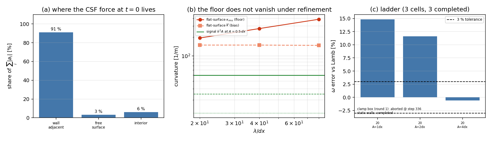

# The capillary standing wave on an open free surface: what would it take?

*TensorSPH, verification record, round 2. Generated by `benchmarks/capillary_wave/make_doc.py` from `benchmarks/capillary_wave/resolution_criterion.json` -- do not edit by hand.*

## 1. Case and question

Round 1 (`docs/verification_capillary_wave_open_surface.md`) measured that the linear capillary standing wave cannot be carried at HEAD: the harness aborts inside two periods and the Lamb (1932) dispersion claim is **WITHHELD**. That record left two candidate causes side by side and never separated them:

1. the discrete CSF surface-tension force on the **open free surface**;
2. the **boundary treatment** of the pool -- round 1 ran a bare `clamp` box with no wall particles at all, while every other pool benchmark in this repository (`hydrostatic`, `dam_break`, `sloshing`, `conservation`) runs with static `wall_lattice` particles.

This page separates them with four measurements on the same case and asks the follow-up question: what resolution or amplitude would make the dispersion claim gradable?

| parameter | value |
|---|---|
| wavelength `lambda` | 20.0 mm |
| depth `H` | 20.0 mm |
| particle spacing `dx` | 1.000 mm (20 points/wavelength) |
| initial amplitude `A` | 0.500 mm (0.5 dx) |
| surface tension `sigma` | 7.2 N/m |
| density `rho0` | 1000 kg/m^3 |
| sound speed `c0` | 10 m/s |
| horizon | 1 capillary periods (or the first boundary escape) |
| analytic `omega` (Lamb 1932 Art. 267, `g=0`) | 472.5 rad/s |

Predeclared before the runs (not tuned afterwards): a cell is **graded** only when `|omega - omega_Lamb|/omega_Lamb < 3 %`, the damped-oscillation fit residual is `< 0.2`, **and** the spurious current is inside the Adami limit `v_max/(A omega) < 0.1`. The stopping rule is a fixed 1-period horizon or the first boundary escape, identical for every cell (`profile = quick`).

## 2. What was done

`benchmarks/capillary_wave/resolution_criterion.py`, four readings:

1. **Force budget.** The initial-state CSF acceleration of round 1 (`open_surface_audit.initial_fields`, unchanged) is split into wall-adjacent, free-surface and interior particles, so the claim "the wall colour truncation carries the force" becomes a number.
2. **Wall boundary condition.** The *same* case is marched twice to the same horizon: the round-1 clamp box (no wall particles) and static wall particles (`droplet_impact.wall_lattice`, `boundary="wall"`).
3. **Curvature floor.** A **perfectly flat** interface (`A = 0`) has `kappa = 0`, so whatever the discrete estimator reports there is the floor that a wave of curvature signal `k^2 A` has to clear. Swept over `lambda/dx = 20, 40, 80`.
4. **March ladder.** `(lambda/dx, A/dx, density-renormalisation)` cells marched with the wall boundary condition and scored against the predeclared criteria above.

Environment: Python 3.11.6, torch 2.7.1, numpy 2.4.6, cpu, dtype float32, 2 threads, deterministic (no RNG), `Linux-6.6.52-1.7.lns23.loongarch64-loongarch64-with-glibc2.38`. Total wall clock of the study: 97 s.

## 3. Results

### 3.1 The force budget sits on the walls, not on the free surface

| zone | particles | share of `sum_i |a_i|` | `max |a|` [m/s^2] | median `|a|` [m/s^2] |
|---|---|---|---|---|
| wall adjacent | 140 | 91 % | 3070 | 210 |
| free surface | 11 | 3 % | 651 | 128 |
| interior | 70 | 6 % | 647 | 17 |

The four domain corners alone carry 21 % of the budget at `max |a| = 3070 m/s^2`. A fluid particle at a corner misses its kernel in *two* directions, so the kernel-sum colour function drops there and the CSF model reads the corner as a strongly curved free surface -- even though it is a wall. Physical restoring acceleration `omega^2 A = 111.6 m/s^2`, i.e. the worst particle is `28x` the wave signal.

### 3.2 With static wall particles the case survives the horizon

| boundary treatment | status | `v_max/(A omega)` | `omega` error vs Lamb | fit residual | fluid/wall particles |
|---|---|---|---|---|---|
| clamp box no wall | aborted @ step 336 | 29.37 | - | - | 221/0 |
| static wall particles | completed | 12.58 | -26.92 % | 0.314 | 221/189 |

**the round-1 abort is a boundary artefact: with the same CSF model and the same horizon, static wall particles carry the run to the end while the bare clamp box loses a particle**

### 3.3 The curvature floor does not vanish under refinement

A flat interface must report `kappa = 0`; it does not.

| `lambda/dx` | `dx` [mm] | interface particles | interior particles | `mean kappa` [1/m] | `rms kappa` [1/m] | `p95 |kappa|` [1/m] |
|---|---|---|---|---|---|---|
| 20 | 1.000 | 62 | 4 | +149.3 | 193.5 | 305.0 |
| 40 | 0.500 | 129 | 25 | +149.3 | 273.3 | 588.1 |
| 80 | 0.250 | 261 | 65 | +147.6 | 384.3 | 1129.7 |

The `mean` is a **bias**, not noise: it is the same order of magnitude at 20 and at 80 points per wavelength, i.e. refining the lattice does not remove it, while the wave signal `k^2 A` *shrinks* with `dx` at fixed `A/dx`. Table of the ratio the harness has to clear:

| `lambda/dx` | floor / `k^2 A` at A/dx=0.5 | floor / `k^2 A` at A/dx=1 | floor / `k^2 A` at A/dx=2 | floor / `k^2 A` at A/dx=4 |
|---|---|---|---|---|
| 20 | 1/3.9 | 1/2.0 | 1/1.0 | 1/0.5 |
| 40 | 1/11.1 | 1/5.5 | 1/2.8 | 1/1.4 |
| 80 | 1/31.2 | 1/15.6 | 1/7.8 | 1/3.9 |

Reading the table: at `A/dx = 0.5` (the harness case) the floor is 3.9x to 31.2x *larger* than the signal it is supposed to measure, at every resolution. The amplitude criterion that follows:

| `lambda/dx` | floor used [1/m] | source | `A/dx` for floor == signal | `A/dx` for 10x SNR |
|---|---|---|---|---|
| 20 | 193.5 | all_shell | 1.96 | 19.6 |
| 40 | 127.6 | interior | 2.59 | 25.9 |
| 80 | 158.2 | interior | 6.41 | 64.1 |

`A/dx multiplies the signal but not the floor, so refining the lattice at fixed A/dx does not improve the ratio` The headline number is `A/dx >= 64.1` for a 10x signal-to-floor ratio.

### 3.4 The march ladder

| cell | steepness `kA` | status | `v_max/(A omega)` | `omega` error | fit residual | graded |
|---|---|---|---|---|---|---|
| `ppw=20/A=1dx` | 0.31 | completed | 3.89 | +14.85 % | 0.201 | no |
| `ppw=20/A=2dx` | 0.63 | completed | 2.82 | +11.63 % | 0.142 | no |
| `ppw=20/A=4dx` | 1.26 | completed | 2.06 | -0.60 % | 0.076 | no |



*Figure provenance:* `docs/figures/capillary_wave_resolution_criterion.png`, sha256 `8a2a5cc16df45b153d744bf8ff7262c5cfb012379dcfebc2eb29d70c7056baaf`, drawn by `make_doc.render_resolution_figure` from `benchmarks/capillary_wave/resolution_criterion.json` alone. *(a)* the initial CSF acceleration budget by zone; *(b)* the flat-interface curvature floor against the analytic wave signal `k^2 A`; *(c)* the march ladder's `omega` error with the predeclared 3 % band and the wall-boundary status of the round-1 case.

## 4. Verdict

**WITHHELD.** No ladder cell satisfies both predeclared criteria (3 % dispersion AND Adami admissibility); the closest completed cell ppw=20/A=4dx reports -0.6 % with v_max/(A omega) = 2.1 (limit 0.1)

### Is the key quantity within 3 % of the reference?

**No.** The closest completed cell (`ppw=20/A=4dx`) reports `omega` error -0.60 %, i.e. 0.2x the 3 % tolerance, and its spurious current `v_max/(A omega) = 2.06` is 21x the Adami limit. The claim stays WITHHELD.

## 5. What the two rounds together establish

| question | answer | evidence |
|---|---|---|
| does the harness run at HEAD? | no, abort at step 336 | `open_surface_audit.json`, re-confirmed here |
| is the abort the free-surface CSF force alone? | no: the same case completes with wall particles | section 3.2 |
| is the CSF force physically scaled? | no: the wall/corner colour truncation carries 91 % of it | section 3.1 |
| can the dispersion claim be graded by refining? | no: the curvature floor is a bias, not noise | section 3.3 |
| is the claim graded? | WITHHELD | section 3.4 |

## 6. Notes, limits and the way forward

* The two defects are independent. The wall one is a **solver** defect with a known cure (include the static wall particles in the CSF colour sum, or exclude wall shells from the force); this round measures it and does not change `src/`.
* The free-surface one is an **estimator** defect: on a one-sided support the MLS curvature of a planar interface is biased by `O(100)` 1/m at these settings, which is 1-3x the signal of any wave the harness can afford. Fixing it needs a curvature operator that is exact for a planar free surface (e.g. a wall/void-aware MLS stencil) -- a separate change with its own verification page.
* The interior sample is small at 20 points per wavelength (4 particles), so the floor is also reported over the full shell; the criterion picks the interior value only where at least 20 particles survive the wall exclusion (`floor_source` column).
* The frequency fit is a damped-oscillation least squares on the column-mass elevation, 120 samples per period; a fit residual above 0.2 means the fit has no frequency to report and the cell can never be graded.
* Steepness is recorded for every cell. `ppw=20/A=4dx` is a *nonlinear* wave (`kA >= 1`): its frequency is reported for completeness but it cannot grade the linear dispersion relation of Lamb (1932), and the predeclared rule does not let it. The amplitude criterion of section 3.3 is not extrapolated beyond `A/dx = 4`.

## 7. Reproduction

```bash
PYTHONPATH=src python benchmarks/capillary_wave/resolution_criterion.py
PYTHONPATH=src python benchmarks/capillary_wave/make_doc.py --figures
PYTHONPATH=src python -m pytest tests/test_capillary_wave_resolution_criterion.py -q
```
