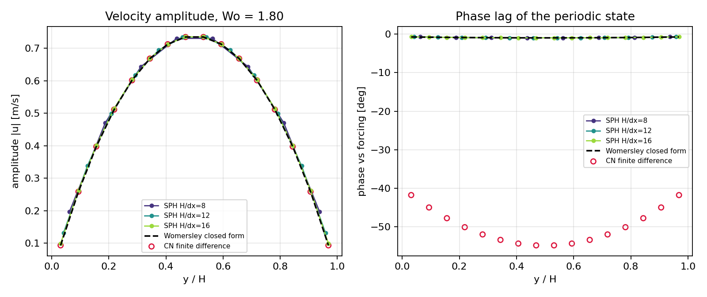
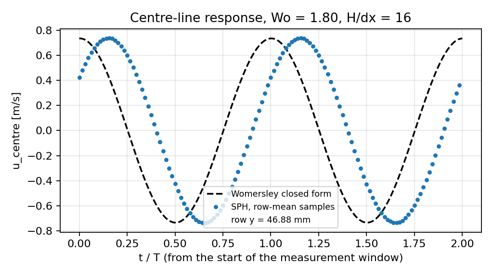
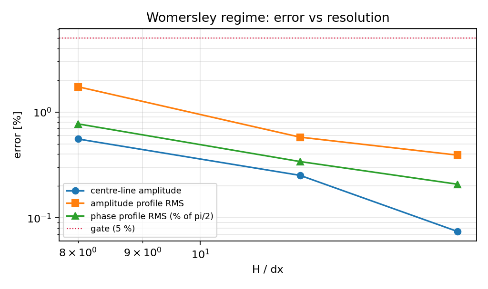
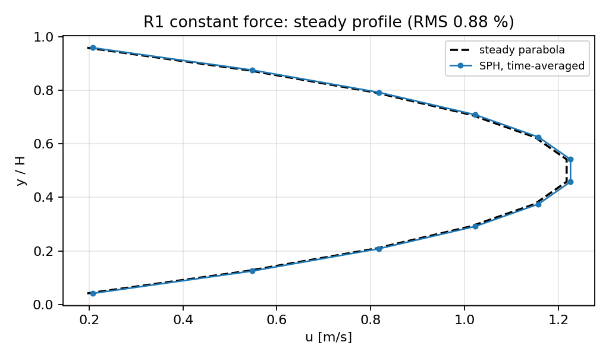

# Verification note — CASE-POISEUILLE-SPH (算例池·泊肃叶流)

Plane Poiseuille channel in three forcings: constant (start-up and steady),
harmonic (Womersley pulsatile state). Generated from
`benchmarks/case_poiseuille/out/result.json` by
`benchmarks/case_poiseuille/make_doc.py`; every number below is read from
that file.

**Overall verdict: PASS** — 9 of 9 graded gates passed.

## 1. Case, geometry and parameters

Fluid between no-slip walls at `y = 0` and `y = H`, periodic in `x`, driven
by a uniform body force per unit mass `g(t)`:

```
u_t = nu u_yy + g(t),   u(0,t) = u(H,t) = 0,   u(y,0) = 0
```

| parameter | value |
|---|---|
| channel height `H` | 0.1 m |
| kinematic viscosity `nu` | 0.01 m²/s |
| density `rho0` | 1000.0 kg/m³ |
| body force `g0` | 9.81 m/s² |
| columns (periodic) | 8 |
| harmonic `omega` | 13.0 rad/s (Wo = 1.803, delta = 39.22 mm) |
| fast `omega` (G6) | 31.4 rad/s (Wo = 2.802) |
| settle / measurement | 2 / 2 periods |
| samples per period | 64 |

Reference: the periodic state of the same equation,
`Re{Uhat e^{i omega t}}` with
`Uhat = (g0/(i omega))[1 - cosh(alpha(y-H/2))/cosh(alpha H/2)]`,
`alpha = sqrt(i omega/nu)` (Womersley 1955; Batchelor 1967 §4.2).

## 2. Method

* **Solver** — production WCSPH `tensorsph.droplet_impact.rhs` (Tait EOS,
  density summation, Morris/Brookshaw viscosity, `wall_friction = 1`).
* **Walls** — mirror/ghost planes of `tensorsph.wall_mirror.plane_walls`
  (`no_slip`): the ghost carries `-v`, so the fluid/ghost pair has zero mean
  velocity **on** the plane. Moving wall particles are not used; the driving is
  the body force.
* **Geometry / binning** — `benchmarks.poiseuille.run` (`build_fluid`,
  `make_config`, `periodic_images`, `bin_rows`), imported so the case and the
  steady benchmark share one lattice.
* **Measurement** — row-mean `u_x` sampled uniformly in time, projected on
  `cos(omega t)`, `sin(omega t)` (`tensorsph.stokes_second.harmonic_fit`),
  giving amplitude and phase per row with the convention
  `u = A cos(omega t + phi)`.
* **Reference provenance** — sympy re-derivation: ODE residual
  `0`, both BCs zero: `True` / `True`, `omega->0` limit equals the steady parabola: `True`.
  Numeric cross-check (from-rest series vs periodic state): rel. L2 = 7.15e-05.
* **Independent reference** — Crank–Nicolson finite differences of the same
  PDE with the same forcing history (`benchmarks/case_poiseuille/ref.py`),
  sharing no code with the SPH path.

## 3. Results — harmonic (Womersley) regime

| H/dx | delta/dx | dt [s] | steps | n fluid | n ghost | amp centre err | amp profile RMS | phase centre err | phase profile RMS |
|---|---|---|---|---|---|---|---|---|---|
| 8 | 3.1 | 2.437e-04 | 7900 | 64 | 144 | +0.56 % | 1.73 % | -0.85 deg (0.95 % of pi/2) | 0.77 % of pi/2 |
| 12 | 4.7 | 1.625e-04 | 11851 | 96 | 144 | +0.25 % | 0.58 % | -0.08 deg (0.09 % of pi/2) | 0.34 % of pi/2 |
| 16 | 6.3 | 1.219e-04 | 15801 | 128 | 144 | +0.07 % | 0.39 % | +0.12 deg (0.13 % of pi/2) | 0.21 % of pi/2 |

At the finest resolution the centre-line amplitude is 0.7354 m/s against 0.7348 m/s analytic, and the centre-line phase is -0.95 deg against -0.96 deg.

### 3.1 Frequency discrimination (G6)

| quantity | measured | analytic |
|---|---|---|
| A(omega=31.4) / A(omega=13.0) at centre | 0.4892 | 0.4851 |
| phase difference between the two frequencies [deg] | -0.39 | -0.39 |

A quasi-steady solver — one that follows `g(t)` with the steady parabola —
would return a ratio of 1.00. The
measured ratio is 0.489 (+0.84 % from analytic), so the
run demonstrably resolves the frequency response rather than the mean balance.

## 4. Results — constant-force anchors (R1)

| quantity | value | gate |
|---|---|---|
| steady-profile RMS error (rows 0.15..0.85) | 0.88 % | 5 % |
| steady centre-line error | -0.01 % | reported |
| start-up profile RMS at t = 0.150 s | 0.62 % | reported |
| start-up profile RMS at t = 0.400 s | 0.87 % | 5 % (graded at 0.40 s) |

### 4.1 Independent reference check (G9)

Crank–Nicolson FD (Crank-Nicolson, central differences, Thomas solve, nx = 201, 12000 steps) vs the closed form:

* amplitude profile RMS 0.0043 % (worst row 0.0066 %)
* phase profile RMS 0.0008 % of pi/2 (worst row 0.0015 deg)

The reference agrees with the closed form to well below the case tolerance,
so a reference defect cannot masquerade as a discretisation error.

## 5. Gates

| gate | threshold | result |
|---|---|---|
| G1 centre-line amplitude | 5.0 % | PASS |
| G2 amplitude profile RMS | 5.0 % | PASS |
| G3 centre-line phase | 5.0 % | PASS |
| G4 phase profile RMS | 5.0 % | PASS |
| G5 periodic state reached | 5 % / 4.5 deg | PASS |
| G6 frequency discrimination | 5.0 % | PASS |
| G7 steady anchor | 5.0 % | PASS |
| G8 start-up anchor | 5.0 % | PASS |
| G9 reference self-check | 1.0 % | PASS |

## 6. Figures









## 7. Notes, limits and pitfalls

* **This is a frequency-response test, not a mean-balance test.** The steady
  channel and the start-up series were already covered by
  `benchmarks/poiseuille_mirror` and `benchmarks/poiseuille_startup`; they are
  repeated here only as anchors (G7/G8) so the case is self-contained.
* **Not Stokes' second problem.** `benchmarks/stokes_second` drives the flow
  through a *moving wall* in a half space; here the walls are at rest and the
  drive is a body force, so the core is an anti-symmetric standing wave, not a
  decaying boundary layer.
* **Weakly compressible.** `c_s = 20 m/s` against peak velocities well below
  1.5 m/s keeps `Ma < 0.08`; acoustic noise is filtered by the harmonic
  projection at `omega` rather than by any damping term.
* **Settling.** The from-rest transient decays as `exp(-nu pi^2 t / H^2)`
  (e-folding 0.10 s = 0.21 T); two periods of settle take it below 1e-4.
  G5 grades that assumption instead of trusting it.
* **Scope.** Laminar, `Wo` below ~3, `delta/dx` between 3 and 7, one channel
  height. Nothing here tests turbulent or `Wo >> 10` pulsatile flow, where the
  Stokes layer would be thinner than a particle spacing and a WCSPH channel is
  not the right tool.

## 8. Error verdict against the declared tolerance

Case tolerance (feature ledger): **< 5 % against the analytic reference**.

| key quantity | reference | error | < 5 %? |
|---|---|---|---|
| centre-line amplitude | Womersley `|Uhat(H/2)|` | 0.07 % | yes |
| amplitude profile | Womersley `|Uhat(y)|` | 0.39 % (RMS) | yes |
| centre-line phase | `arg Uhat(H/2)` | 0.12 deg = 0.13 % of pi/2 | yes |
| phase profile | `arg Uhat(y)` | 0.21 % of pi/2 (RMS) | yes |
| steady profile | parabola `g0(H-y)y/(2nu)` | 0.88 % (RMS) | yes |
| start-up profile (t = 0.40 s) | Boussinesq series | 0.87 % (RMS) | yes |
| frequency response ratio | analytic `A(w2)/A(w1)` | 0.84 % | yes |

**Answer: every graded quantity is below 5 %.** The binding number is the
amplitude profile RMS at the finest resolution (0.39 %).

Wall clock of the graded ladder: 379 s (cpu, torch 2.13.0).
