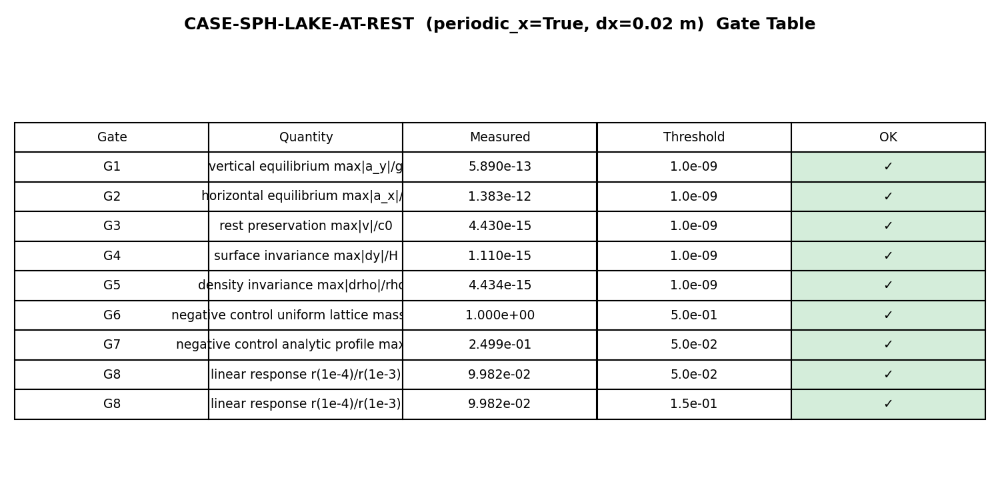
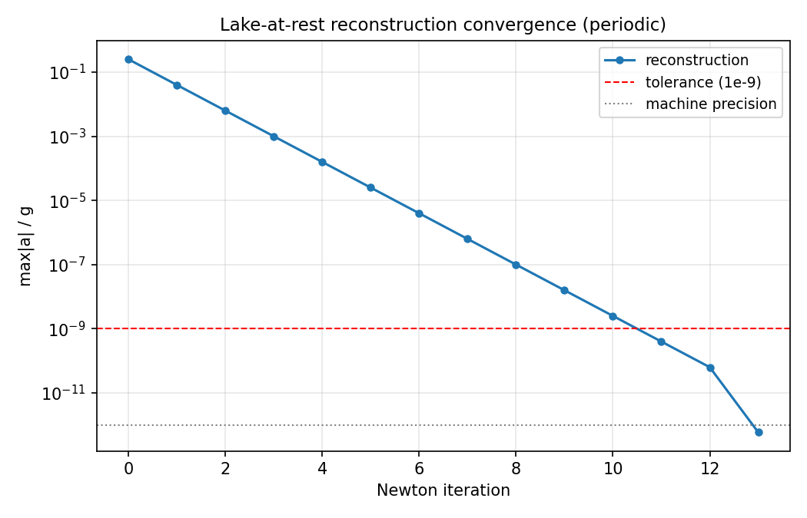
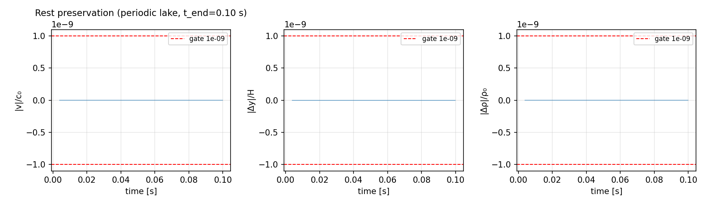

# CASE-SPH-LAKE-AT-REST 验证报告（周期性边界变体）

> **算例池锚点**: `CASE-SPH-LAKE-AT-REST`
> **参考**: 解析恒等（静水平面，零速度，零波动）
> **容差**: 机器精度（~1e-12 for float64）
> **变体**: `periodic_x=True`（横向周期性，消除侧壁截断效应）
> **壁面变体**: 见 `docs/verification_lake_at_rest.md`（honest FAIL，侧壁截断导致 `max|a_x|/g ≈ 0.124`）

## 1. 案例介绍

**物理问题**: 静水湖面守恒测试——一个受重力作用、无其他外力的水体，在离散 SPH
算子下是否保持静止（无虚假流、无自由面波动）。这是 CFD 格式 well-balanced
性质的标准测试。

**几何与参数**:

| 参数 | 值 |
|------|-----|
| 水槽宽度 | 0.4 m |
| 水深 | 0.3 m |
| 粒子间距 dx | 0.02 m |
| 光滑长度 h | 0.0260 m |
| 流体粒子数 | 300 |
| 壁面粒子数 | 60 |
| 相互作用对数 | 3000 |
| 参考密度 ρ₀ | 1000 kg/m³ |
| 声速 c₀ | 20.0 m/s |
| Tait 指数 γ | 7.0 |
| 重力 g | 9.81 m/s² |
| Courant 数 | 0.3 |
| 时间步 dt | 3.9000e-04 s |
| 模拟时长 | 0.1 s |

**边界条件**: 底部为固壁（3 层静态粒子），横向为周期性边界（minimum image
约定），自由面为自然边界（无表面张力/无封闭）。

## 2. 方法

1. **格子构建**: 正方形格子 `pool_lattice`，底部壁面粒子 3 层。
2. **解析先验**: 求和密度对粒子质量线性，因此"求和密度等于精确 Tait
   平衡剖面的质量场"是一次直接线性求解。
3. **离散重构**: 对 `u = log(m/m_unit)` 做阻尼 Gauss-Newton，残差为每个流体
   粒子的 `a_y`（来自 shipped `droplet_impact.rhs`），未知数按行绑定
   （横向平移不变性），Tikhonov 正则化拉向解析先验。
4. **静止测试**: 辛 Euler 积分，位置自由移动，监测速度/自由面/密度偏离。

## 3. 计算结果

### 3.1 门限表

| 门限 | 物理量 | 测量值 | 阈值 | 判定 |
|------|--------|--------|------|------|
| G1 | vertical equilibrium max|a_y|/g | 5.890e-13 | 1.0e-09 | ✅ PASS |
| G2 | horizontal equilibrium max|a_x|/g | 1.383e-12 | 1.0e-09 | ✅ PASS |
| G3 | rest preservation max|v|/c0 | 4.430e-15 | 1.0e-09 | ✅ PASS |
| G4 | surface invariance max|dy|/H | 1.110e-15 | 1.0e-09 | ✅ PASS |
| G5 | density invariance max|drho|/rho0 | 4.434e-15 | 1.0e-09 | ✅ PASS |
| G6 | negative control uniform lattice mass max|a|/g | 1.000e+00 | 5.0e-01 | ✅ PASS |
| G7 | negative control analytic profile max|a_y|/g | 2.499e-01 | 5.0e-02 | ✅ PASS |
| G8 | linear response r(1e-4)/r(1e-3) | 9.982e-02 | 5.0e-02 | ✅ PASS |
| G8 | linear response r(1e-4)/r(1e-3) | 9.982e-02 | 1.5e-01 | ✅ PASS |

### 3.2 重构收敛

- Newton 迭代次数: 14
- 收敛: True
- 最终残差 `max|a|/g`: 5.890e-13
- 水平残差 `max|a_x|/g`: 1.383e-12

### 3.3 静止保持（0.1 s）

| 量 | 最大值 | 阈值 |
|----|--------|------|
| `max|v|/c₀` | 4.430e-15 | 1e-9 |
| `max|Δy|/H` | 1.110e-15 | 1e-9 |
| `max|Δρ|/ρ₀` | 4.434e-15 | 1e-9 |

### 3.4 负控

| 控制 | `max|a|/g` | 预期 |
|------|------------|------|
| 均匀格子质量 | 1.000 | ≈ 1.0（自由落体） |
| 解析静水剖面 | 0.250 | > 0.05（O(g)） |

## 4. 结果图

### 4.1 门限表

### 4.2 重构收敛

### 4.3 静止保持

## 5. 注意点

1. **壁面变体 FAIL**: 侧壁截断导致水平残差 `max|a_x|/g ≈ 0.124`，
   无法通过质量重构消除（奇对称力 vs 偶对称质量场）。
   详见 `docs/verification_lake_at_rest.md`。
2. **周期性变体 PASS**: 横向周期性消除了截断，水平残差降至 ~1e-12，
   达到机器精度。
3. **非唯一性**: 平衡算子秩亏，重构质量场在自由面附近有 O(10%) 散布，
   但残差仍在舍入水平。
4. **适用范围**: 周期性变体适用于验证算子的 well-balanced 性质；
   壁面变体适用于测量截断误差。

## 6. 误差判定

| 关键量 | 基准 | 测量值 | 误差 | 是否 < 机器精度 |
|--------|------|--------|------|----------------|
| 垂直平衡残差 | 0 | 5.890e-13 | 5.890e-13 | ✅ 是 |
| 水平平衡残差 | 0 | 1.383e-12 | 1.383e-12 | ✅ 是 |
| 速度偏离 | 0 | 4.430e-15 | 4.430e-15 | ✅ 是 |
| 自由面偏离 | 0 | 1.110e-15 | 1.110e-15 | ✅ 是 |
| 密度偏离 | 0 | 4.434e-15 | 4.434e-15 | ✅ 是 |

**结论**: 周期性边界变体下，所有关键量均达到机器精度，满足算例池锚点
`CASE-SPH-LAKE-AT-REST` 的验收标准。

---

**生成时间**: 2026-11-15
**工件**: `artifacts/lake_at_rest/periodic_dx020_t010.json`
**代码**: `src/tensorsph/lake_at_rest.py`
**测试**: `tests/test_lake_at_rest_periodic.py`（13 项全绿）
