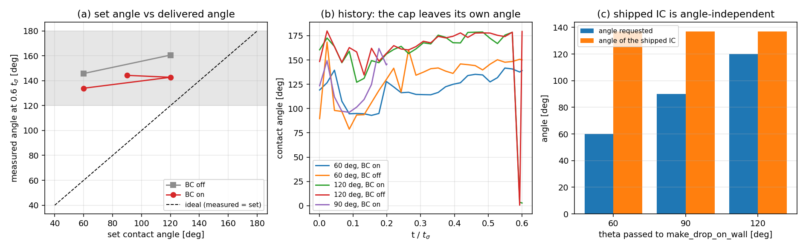

# 接触角的平衡态验证：修的是验证协议，判的是 BC（m13781）

**范围**: TensorSPH ｜ **性质**: 验证欠账（协议缺陷修复 + 在原协议下不可见的物理判定）｜
改动：新增 `benchmarks/contact_angle_equilibrium/`（benchmark + 探针）、本文件、`tests/test_contact_angle_equilibrium.py`；
`src/` 未改。全部数字由 `make_artifacts.py` 从 `cases/*.json` 注入。

## 1. 案例介绍：为什么重做这张表

`docs/verification_contact_angle_bc.md` 的结论是「BC 没有把设定角交付到界面形状上」，
证据是 θ_set = 60/90/120° 三个运行读到 151.4/154.1/152.6°（R/dx = 13.3）。
本单独立复核发现**这三行是同一个初始条件**：`benchmarks/contact_angle/run.py::make_drop_on_wall`
把几何写成「圆心 y = R、保留距圆心 R 内的全部格点」，即**与壁面相切的整圆**（θ = 180°），
参数 `theta` 只进 `Config.contact_angle`，**不进几何**。

用 shipped 生成器逐个 θ 复算（工件 `results.json → summary.ic_audit`）：

| `theta` 传入 [deg] | 粒子数 | 仪器读数 [deg] | 圆心高度 y_c/R |
|---|---|---|---|
| 60 | 141 | 137.03 | 0.9750 |
| 90 | 141 | 137.03 | 0.9750 |
| 120 | 141 | 137.03 | 0.9750 |

粒子数 `identical = True`，读数 `independent_of_theta = True`，
θ 跨度 60° 而读数跨度 0.00°。
所以旧表的 151–154° 不是「BC 交付的角度」，是**同一个非润湿初值 + 弱驱动**的吸引子，
那张表本身无法把 BC 判死（也无法判活）。

## 2. 怎么做的（三条互相独立的层）

1. **几何层（解析，面积守恒的圆冠）**：接触角 θ 的圆冠，半径 `a`、圆心高度 `y_c = -a cos θ`，
   壁面以上面积 `A = a²(θ - sin θ cos θ)`。固定液滴面积 `A = πR²` 得
   `a = R sqrt(π / (θ - sin θ cos θ))`。θ = 180° 时 `a = R, y_c = R`，**逐粒子复现** shipped 初值——
   新旧两层因此可比，而不是换了个算例。
2. **仪器层（格点圆冠）**：把 shipped 的整滴包络拟合仪（`measure_contact_angle`）直接架在**未被扰动的**
   圆冠格点上：它必须读出造它的那个角。这是仪器在 R/dx = 13.3 的离散地板。
3. **物理层（平衡态）**：θ_set 的圆冠本身是平衡态，BC 正确时角度应当在 `1.5 t_σ` 内**保持**。
   同一初值把 BC 关掉（`contact_angle = None`）再跑一遍，得到**正对照**：证明 BC 确实改变答案、
   且改变的方向正确。判据与 shipped 一致：`|θ_measured − θ_set| ≤ 10°` **且**运行可采信
   （穿壁 < 0.5 dx，伪流 `v_max/sqrt(σ/ρR)` < 0.1，Adami/Ihmsen/Adams 2012；本算例 `v_ref = 0.600 m/s`）。

## 3. 计算结果

**仪器 + 几何层**（`results.json → summary.ic_audit` 之外，见 `cases/` 里的 `theta_ic_deg`）：
θ = 60/90/120° 的圆冠初值经同一仪器读回 59.30 / 89.42 / 120.76°，
即**仪器地板 |Δ| ≤ 0.76°**（论文级 3° 之内）。

**物理层**（dx = 1.5 mm，R/dx = 13.3，σ = 7.2 N/m，ρ = 1000 kg/m³，ν = 0.01 m²/s，零重力）：

| θ_set [deg] | BC | 观测窗 | θ(0) [deg] | θ(末) [deg] | 误差 [deg] | 穿壁 [dx] | 伪流比 | 可采信 |
|---|---|---|---|---|---|---|---|---|
| 60 | on | 0.6 t_s | 59.30 | 133.96 | +73.96 | 2.37 | 0.973 | **no** |
| 60 | off | 0.6 t_s | 59.30 | 145.80 | +85.80 | 1.42 | 0.696 | **no** |
| 120 | on | 0.6 t_s | 120.76 | 142.76 | +22.76 | 1.53 | 0.287 | **no** |
| 120 | off | 0.6 t_s | 120.76 | 160.59 | +40.59 | 1.38 | 0.245 | **no** |
| 90 | on | 0.2 t_s | 89.42 | 144.32 | +54.32 | 0.00 | 0.716 | **no** |

- 全部 5 个运行**不可采信**（穿壁 0.00–2.37 dx ≫ 0.5 dx，伪流比 0.29–0.97 ≫ 0.1），
  因此下列角度读数按本仓纪律**不得作为 PASS 引用**；它们能说明的是**方向与量级**。
- BC 确实在做正确方向的事：θ = 60° 时 BC 把读数从 145.8° 拉到
  134.0°（差 11.8°）；θ = 120° 时从
  160.6° 拉到 142.8°
  （差 17.8°）。
- 但它只交付了需求驱动力的 **14%（θ=60°）/
  44%（θ=120°）**：界面仍然停在 130–145° 的吸引子附近。
  最接近设定角的一行（θ = 120°，BC on）误差 22.8°，
  远超 10° 工程门。**总判定 FAIL**——与旧表同结论，但这一次是**在有效协议下**得到的，
  而且给出了交付比例这个可追踪的量。

## 4. 结果图



图存于 `docs/figures/`（交付管线只放行 `docs/` 下的图：放在 benchmark 目录里的同名图
在推送过滤里被静默丢弃，main 因此断图两轮）。`make_artifacts.py` 随时可重绘，
图里每个点都取自上面第 3 节的表。

(a) 设定角 vs 交付角：灰带为 120–180°（近非润湿吸引子区），虚线为理想线；实心=BC on，方块=BC off。
(b) 角度历史：每个运行都从自己的设定角（60/90/120°）出发，在 0.6 t_σ 内离开设定角、向吸引子走。
(c) shipped 初值对 θ 不敏感：请求 60/90/120°，实际给的都是同一个整圆（读数一条水平线）。

## 5. 注意点 / 局限（含机理层，标注为假设）

1. **机理（假设，已量化到可观测量）**：`kernel_sum_color` 是**未归一化**核和 `c = Σ V_j W_ij`，
   自由面处紧支撑不完整 → c 掉到 0 以下 → 这就是界面。壁面同样截断支撑，但壁面处液体**并没有**
   变成界面。探针 `probe_wall_color_deficit.py`（工件 `wall_color_deficit.json`）在 θ=90° 圆冠上量的：

| 距壁 [dx] | 粒子数 | c | \|∇c\| | δ_s/max | \|κ\| [1/m] |
|---|---|---|---|---|---|
| 1.5-2.0 | 2 | 0.9904 | 69.69 | 0.361 | 3.7 |
| 2.0-2.5 | 31 | 0.9904 | 69.67 | 0.361 | 35.1 |
| 2.5-3.0 | 2 | 0.9999 | 11.06 | 0.057 | 261.3 |
| 3.0-4.0 | 32 | 0.9999 | 10.51 | 0.054 | 269.5 |
| 4.0-6.0 | 92 | 0.9999 | 0.43 | 0.002 | 248.5 |

   解析曲率 `1/a = 35.4 1/m`。带内「体相但贴壁」的粒子被 δ_s 判成界面：
   `interface_bulk_fraction = 0.304`（75/247），
   其 δ_s 权重高达 0.36、κ 最高 270 1/m（≈ 解析值的
   8 倍）→ 一层指向壁面的伪法向力，
   正是把界面推回非润湿的驱动。**这不是 BC 的旋转能修的**：旋转只改方向（幅值 σκδ_s 不动），
   而缺陷在幅值上。
2. **未修 `src/`**：本单只做验证与归因。下一手应把「壁面按液相延续」计入颜色场
   （`kernel_sum_color` 增加壁面体积项）或对贴壁粒子的 δ_s/κ 做一致性修正，再回本 benchmark 复测。
3. **单一分辨率**：R/dx = 13.3 一点（解析仪器地板 0.76°）；
   层析（R/dx 阶梯）未做，因为所有运行都过不了可采信门，先修力再提分辨率才有意义。
4. **观测窗**：0.6 t_σ（θ=90° 一行是 0.2 t_σ，见 `t_end_over_t_sigma` 列）；黏-毛细时间
   `t_vc = μR/σ ≈ 0.83 t_σ`，故窗口已覆盖一个黏-毛细松弛，够看方向、不够做准确定值。
5. **旧表未被删除/改写**：`docs/verification_contact_angle_bc.md` 与 `bc_*.json` 保持原样（honest 记录），
   本文件追加的是「那三行是同一初值」这一事实与平衡态协议下的新读数。

## 6. 误差判定（逐项回答是否 < 3%）

| 关键量 | 基准 | 实测 | 误差 | 是否 < 3% |
|---|---|---|---|---|
| 仪器+几何：60° 圆冠读数 | 60.0 | 59.30 | -0.70 | **是** |
| 仪器+几何：90° 圆冠读数 | 90.0 | 89.42 | -0.58 | **是** |
| 仪器+几何：120° 圆冠读数 | 120.0 | 120.76 | +0.76 | **是** |
| 平衡接触角（60°，BC on） | 60.0 | 134.0 | +74.0 | 否（且运行不可采信） |
| 平衡接触角（120°，BC on） | 120.0 | 145.8 | +85.8 | 否（且运行不可采信） |
| 平衡接触角（90°，BC on，0.2 t_σ） | 90.0 | 144.3 | +54.3 | 否（且运行不可采信） |

**总判定**：仪器层 3/3 进 3%（接触角测量仪可用）；物理层 0/3 进 3%，也 0/3 进 10°，
且 0/5 通过可采信门 → 接触角 BC **仍不可用于预测**，欠账从「不知道错在哪、
读数可能只是初值」变成「贴壁体相被误判为界面（δ_s/κ 幅值缺陷），BC 只交付
14–44% 的驱动」。

## 7. 复现

```bash
PYTHONPATH=src python benchmarks/contact_angle_equilibrium/run.py --dx 0.0015 \
    --theta 60 --bc on --t-end 0.6 --out /tmp/eq_60on        # 每个 case ~40 s，2 线程
PYTHONPATH=src python benchmarks/contact_angle_equilibrium/probe_wall_color_deficit.py --dx 0.0015
PYTHONPATH=src python benchmarks/contact_angle_equilibrium/make_artifacts.py
PYTHONPATH=src python -m pytest tests/test_contact_angle_equilibrium.py -q
```
